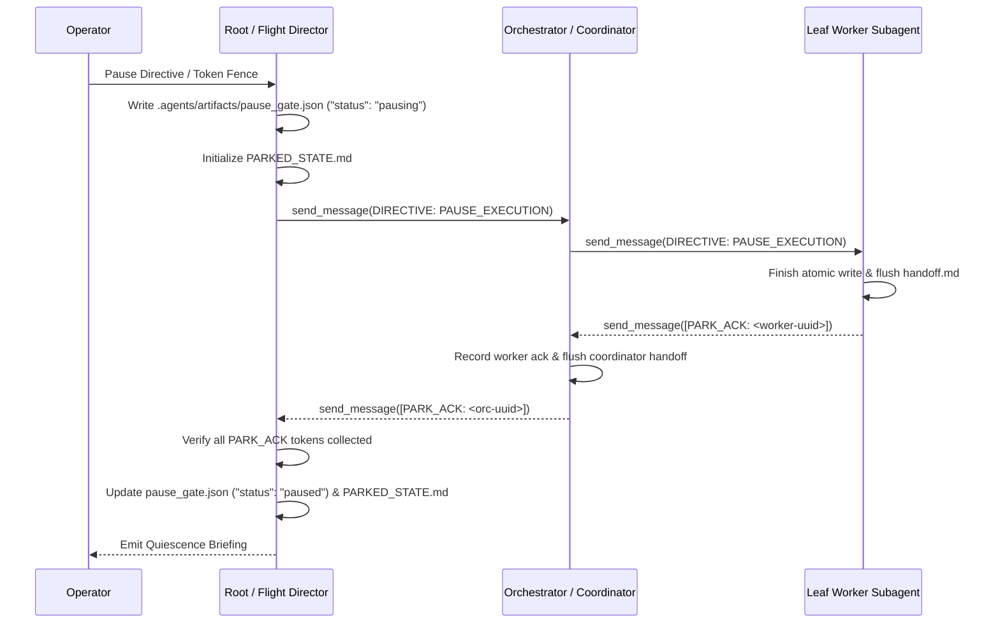

<!-- SPDX-License-Identifier: Apache-2.0 -->
<!-- Copyright (c) 2026 Arafat Zahan (@kuasha420) -->
<!-- Corporate Stewardship & Infrastructure: Purrfect Software Limited (PSL) -->
<!-- Governed by: ICARO-42/b Ordinance (Company-Supported Personal IP Framework) -->

# Graceful Swarm Parking & Safe Resumption Runbook (Zero-Kill Invariant)

This operational runbook governs non-destructive execution suspension across root flight directors, coordinators, and delegate subagents.

---

## 1. Zero-Kill Rationale & The Phantom Pause Failure Mode

### The Panic-Kill Anti-Pattern (Session `f2855e28`)
When approaching token limits or receiving an urgent pause directive from the operator, coordinators must **NEVER** invoke destructive termination primitives:
- `manage_subagents(Action='kill_all')`
- `manage_subagents(Action='kill')`
- `manage_task(Action='kill')`
- Shell `kill -9` / `pkill -9`

Calling panic-kill severs active evaluation loops mid-turn, deletes in-flight conversation context, and corrupts worktree progress ledgers.

### The Phantom Pause Anti-Pattern (Session `23c8e88c`)
Intermediate orchestrators frequently report back that the swarm is "paused" without ever dispatching pause directives to leaf workers. The unmanaged child workers continue running in the background, consuming API tokens and thrashing files.

**The Invariant**: An execution tree is NOT paused until every active leaf subagent has emitted an explicit `[PARK_ACK: <UUID>]` token.

---

## 2. Living Artifact Standard

Universal pause states are declared in Tier 1 Living Artifacts:
1. **Flag File (`.agents/artifacts/pause_gate.json`)**:
   Structured JSON flag evaluated in <1ms by lifecycle safety hooks:
   ```json
   {
     "status": "paused",
     "reason": "token_limit_fence",
     "mode": "teamwork",
     "timestamp": "2026-10-27T00:00:00Z",
     "initiator": "root_orchestrator"
   }
   ```
2. **State Ledger (`.agents/artifacts/PARKED_STATE.md` or `.agents/teamwork/PARKED_STATE.md`)**:
   Tracks the quiescence status and handoff pointers of every active subagent.

---

## 3. Bilateral Handshake Protocol (Top-Down Pause)

When initiating a graceful pause:



### Execution Steps:
1. **Declare Pausing Gate**:
   Create `.agents/artifacts/pause_gate.json` with `"status": "pausing"`.
2. **Broadcast Pause Directives**:
   Transmit `DIRECTIVE: PAUSE_EXECUTION` to all active child subagents via `send_message`:
   ```markdown
   [DIRECTIVE: PAUSE_EXECUTION]
   Reason: Operator request / Token preservation fence.
   Instructions:
   1. Complete current atomic file write (do not begin new tasks).
   2. Flush pending state to your local handoff ledger.
   3. Settle into idle holding pattern.
   4. Reply with [PARK_ACK: <YOUR_UUID>] once quiesced.
   ```
3. **Collect Acknowledgment Tokens**:
   Inspect active subagent list via `manage_subagents(Action='list')`. Await reactive receipt of `[PARK_ACK: <UUID>]` from every child. If an intermediate orchestrator reports quiescence without acknowledging children, directly message the unacknowledged children.
4. **Finalize Parked State**:
   Update `pause_gate.json` to `"status": "paused"` and finalize `PARKED_STATE.md`.

---

## 4. Bilateral Resumption Protocol

To resume a quiescent swarm:
1. **Pre-flight Integrity Check**:
   Verify worktrees with `git status -s` and inspect `.agents/artifacts/PARKED_STATE.md`.
2. **Top-Down Resume Broadcast**:
   Message active subagents via `send_message`:
   ```markdown
   [DIRECTIVE: RESUME_EXECUTION]
   Reason: Work resumed by operator.
   Instructions:
   1. Read your latest handoff.md.
   2. Verify surrounding context and continue next planned milestone.
   ```
3. **Deactivate Pause Gate**:
   Remove `.agents/artifacts/pause_gate.json` (or `.pause_gate`) once agents acknowledge resumption.
