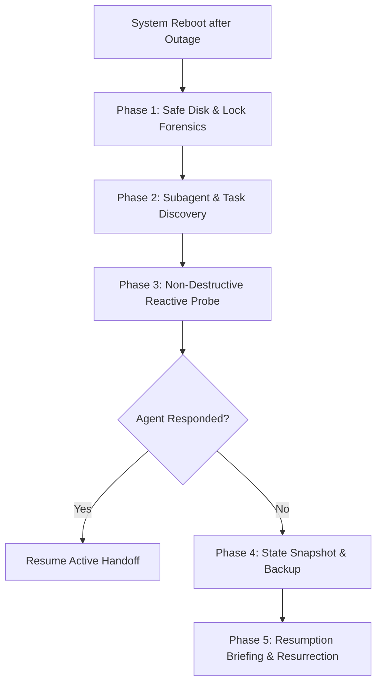

<!-- SPDX-License-Identifier: Apache-2.0 -->
<!-- Copyright (c) 2026 Arafat Zahan (@kuasha420) -->
<!-- Corporate Stewardship & Infrastructure: Purrfect Software Limited (PSL) -->
<!-- Governed by: ICARO-42/b Ordinance (Company-Supported Personal IP Framework) -->

# Powerloss Disaster Recovery Runbook (`/powerloss-resume`)

This operational runbook codifies the 5-phase non-destructive workspace recovery sequence derived from telemetry session `d93c71e7` following sudden electrical power loss or system crashes.

---

## 1. Core Invariants & Anti-Patterns

### Anti-Patterns to Ban:
- **Destructive Git Wipes**: NEVER run `git checkout .`, `git clean -fd`, or `git reset --hard` during disaster recovery.
- **Premature Process Termination**: NEVER kill surviving agent tasks without first performing a non-destructive reactivity probe.

### Safety Guarantee:
All uncommitted work, in-flight diffs, and intermediate state must be backed up before spawning replacement workers.

---

## 2. The 5-Phase Crash Recovery Sequence



### Phase 1: Safe Disk & Lock Forensics
1. Check for stale git locks:
   - Check if `.git/index.lock` exists.
   - If the git process holding the lock is dead, safely unlink `.git/index.lock`.
2. Inspect uncommitted files non-destructively:
   - Run `git status -s` to catalogue modified and untracked files.
   - Review recent git reflog entries: `git reflog -n 5`.

### Phase 2: Subagent & Background Task Discovery
1. Discover active tasks and subagents:
   - Run `manage_subagents(Action='list')` to check if the agent orchestrator retained subagent IDs in memory.
   - Run `manage_task(Action='list')` to check running background processes.
2. Inspect disk ledgers:
   - Scan `.agents/teamwork/**/progress.md`, `handoff.md`, or `DISPATCH.md`.
   - Inspect `.system_generated/logs/transcript.jsonl` to locate the last completed atomic step.

### Phase 3: Non-Destructive Reactive Probe
1. Ping surviving subagents via `send_message`:
   ```markdown
   [POWERLOSS_RECOVERY: Node recovered from outage]
   Please state your last completed atomic step and current working tree state.
   ```
2. Await reactive wakeup. Do NOT terminate agents that may still be responding or writing state.

### Phase 4: State Snapshot & Replacement Backup
If an agent is confirmed unreachable or unresponsive:
1. Create backup directory:
   `mkdir -p .agents/teamwork/backups/powerloss_$(date +%Y%m%d_%H%M%S)/`
2. Snapshot uncommitted diffs:
   `git diff > .agents/teamwork/backups/powerloss_<date>/git_diff_backup.patch`
   `git status -s > .agents/teamwork/backups/powerloss_<date>/git_status.txt`
3. Copy the unresponsive agent's directory into the backup folder.
4. Author `REPLACEMENT_BRIEF.md` detailing:
   - Interrupted phase & task ID
   - Working tree code state
   - Passing/failing test suites
   - Next concrete actions required

### Phase 5: Resumption Briefing & Clean Resurrection
1. Spawn a replacement worker only if necessary, providing `REPLACEMENT_BRIEF.md` as context.
2. Report the complete disaster recovery status to the operator before resuming full execution.
