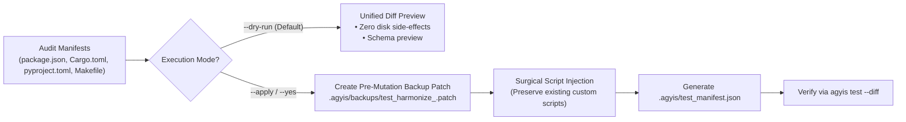

<!-- SPDX-License-Identifier: Apache-2.0 -->
<!-- Copyright (c) 2026 Arafat Zahan (@kuasha420) -->
<!-- Corporate Stewardship & Infrastructure: Purrfect Software Limited (PSL) -->
<!-- Governed by: ICARO-42/b Ordinance (Company-Supported Personal IP Framework) -->

# Dedicated Project Test Harmonization Protocol (`psl-test-harmonize`)

This skill codifies the operational protocol for inspecting, auditing, and harmonizing test runners and project manifests into the **Diff-Aware Affected Testing Architecture** (RFC-051). It eliminates synthetic tautological verification (e.g. 1,150 tests passing with 0% UI mounting) and equips workspaces with tiered test dispatch capabilities.

---

## 1. When to Use

Trigger this skill whenever:
- A workspace lacks diff-targeted test execution (`test:diff`, `test:affected`).
- An agent suffers consecutive test failure loops or token burn due to running full macro suites (>90s) on single-line edits.
- Frontend components are imported as raw JavaScript/TypeScript functions in Node without an authentic DOM mounting lifecycle (`happy-dom`, `jsdom`, or `@testing-library/react`).
- Visual Regression Testing (VRT) uses synthetic file existence checks (`fs.existsSync(file) == true`) rather than authentic pixel diffing (`toHaveScreenshot()`).
- Monorepos lack package-scoped test commands (`test:pkg`).
- Preparing a repository for multi-agent delegation pipelines (`/subagent-ladder`, `/teamwork-preview`) or milestone handoff gates.

---

## 2. Safe Dual-Mode Harmonization Lifecycle

To prevent unintended configuration drift, `psl-test-harmonize` mandates a safe dual-mode mutation protocol:



### Phase 1: Inspection & Diff Preview (Default)
Run a non-destructive audit of the workspace test configuration:

```bash
# Non-destructive dry-run preview (default behavior)
agyis harmonize test

# Explicit dry-run with structured JSON output
agyis harmonize test --dry-run --json
```

Guarantees:
1. **Zero Filesystem Mutation**: Target manifests remain byte-for-byte identical.
2. **Unified Diff Inspection**: Emits standard unified diff previews showing exactly which scripts or config blocks would be inserted.
3. **Gap Enumeration**: Explicitly catalogs missing tiers, fake mocks, and missing DOM environments.

### Phase 2: Safe Application & Pre-Mutation Patching
When ready to apply changes, execute with `--apply` or `--yes` (`-y`):

```bash
# Apply harmonization with automated backup patch creation
agyis harmonize test --apply

# Non-interactive application for agent subshells
agyis harmonize test --yes
```

**Automated Safety Guarantees**:
1. **Pre-Mutation Backup Patch**: Before any file is modified, a unified diff patch is written to `.agyis/backups/test_harmonize_<timestamp>.patch`.
2. **Custom Script Preservation Invariant**: Pre-existing custom scripts (e.g. specialized `test`, `test:e2e`, or custom `test:diff`) are NEVER overwritten. Only missing standardized scripts are appended.
3. **Format Integrity**: Preserves exact indentation, line endings, and file formatting of `package.json`, `Cargo.toml`, `pyproject.toml`, and `Makefile`.
4. **Manifest Synchronization**: Generates `.agyis/test_manifest.json` documenting supported test tiers.

---

## 3. Standardized Test Script Conventions

The protocol standardizes five canonical script tiers across all language stacks:

| Tier | Script Name | Target Scope | Execution Contract | Primary Consumer |
|---|---|---|---|---|
| **Tier 1A** | `test:diff` | Uncommitted working tree diffs (`git diff HEAD`) | Sub-second (<1.0s) related test run | Autonomous Agent turns & CI pre-commit hooks |
| **Human** | `test:watch` | Interactive file-watching loop | Long-running interactive process | Human engineers (Agents guarded via `--no-watch`) |
| **Tier 1B** | `test:affected` | Complete feature/bugfix blast radius | Runs unit, integration, DOM mounting, and affected VRTs | Subagent delegation handoffs & milestone completion |
| **Tier 2A** | `test:pkg` | Package boundary in monorepos | Scoped package suite (`--filter <pkg>`) | Monorepo feature engineers |
| **Tier 2B** | `test:full` | Complete repository / workspace | Unfiltered macro sweep (clean cache, all suites) | Final atomic git commit & PR publication gates |

---

## 4. Polyglot Manifest Ingestion & Injection

### 4.1 Node / TypeScript Workspaces (`package.json`)
- **Vitest**:
  ```json
  "scripts": {
    "test:diff": "vitest related --run",
    "test:watch": "vitest",
    "test:affected": "vitest related --run",
    "test:pkg": "vitest --project",
    "test:full": "vitest run"
  }
  ```
- **Jest**:
  ```json
  "scripts": {
    "test:diff": "jest --findRelatedTests --passWithNoTests",
    "test:watch": "jest --watch",
    "test:affected": "jest --findRelatedTests --passWithNoTests",
    "test:pkg": "pnpm --filter",
    "test:full": "jest --runInBand"
  }
  ```
- **Monorepo Root (`pnpm-workspace.yaml`, Turborepo)**:
  ```json
  "scripts": {
    "test:diff": "pnpm -r --filter ...[HEAD] test:diff",
    "test:affected": "turbo run test:affected --filter=...[HEAD]",
    "test:pkg": "pnpm --filter",
    "test:full": "pnpm -r test"
  }
  ```

### 4.2 Rust Workspaces (`Cargo.toml`)
Configures `.cargo/config.toml` aliases or `Makefile`:
```toml
[alias]
test-diff = "test"
test-watch = "watch -x test"
test-pkg = "test --package"
test-full = "test --workspace"
```

### 4.3 Python Workspaces (`pyproject.toml`, `pytest.ini`, `Makefile`)
Configures `[tool.pytest.ini_options]` in `pyproject.toml` and `Makefile`:
```toml
[tool.pytest.ini_options]
testpaths = ["tests"]
addopts = "-ra -q"
```
```makefile
.PHONY: test test:diff test:watch test:affected test:full

test:
	pytest

test:diff:
	pytest --picked -q

test:watch:
	ptw

test:affected:
	pytest -q

test:full:
	pytest -v
```

---

## 5. Anti-Synthetic Runner Upgrades

### 5.1 Eliminating 0% UI Mounting
When React, Vue, or Svelte dependencies are present:
1. **Vitest Configuration (`vitest.config.ts`)**:
   Upgrade `test.environment` from missing or `'node'` to `'happy-dom'` or `'jsdom'`:
   ```ts
   import { defineConfig } from 'vitest/config';

   export default defineConfig({
     test: {
       environment: 'happy-dom',
       globals: true,
     },
   });
   ```
2. **DOM Testing Invariant**: Prohibit invoking React component functions as raw JS functions. Components must be mounted via `@testing-library/react` (`render(<Component />)`).

### 5.2 Pixel-Based Visual Regression Testing (VRT)
- **Prohibited Synthetic Pattern**:
  ```ts
  // ❌ ILLEGAL SYNTHETIC TEST: Passes without verifying rendering
  expect(fs.existsSync('screenshot.png')).toBe(true);
  ```
- **Enforced Real-World Pattern**:
  ```ts
  // ✔ AUTHENTIC VRT: Performs real pixel buffer diff against baseline
  await expect(page).toHaveScreenshot('homepage.png', {
    maxDiffPixelRatio: 0.01,
  });
  ```

### 5.3 Computed Style & Contrast Auditing
Enforce `@axe-core/playwright` accessibility audits in real browser viewports:
```ts
import { injectAxe, checkA11y } from 'axe-playwright';

test('contrast and a11y compliance', async ({ page }) => {
  await page.goto('/dashboard');
  await injectAxe(page);
  await checkA11y(page, undefined, {
    detailedReport: true,
    detailedReportOptions: { html: true },
  });
});
```

---

## 6. The Harmonization Manifest (`.agyis/test_manifest.json`)

Applying harmonization generates `.agyis/test_manifest.json`, providing deterministic metadata for `agyis test` and `completion_fence_hook`:

```json
{
  "version": "1.0.0",
  "generated_at": "2026-10-21T16:00:00Z",
  "workspace_root": "/path/to/workspace",
  "stack": "typescript",
  "role": "frontend",
  "framework": "vitest",
  "package_manager": "pnpm",
  "is_monorepo": false,
  "backup_patch": ".agyis/backups/test_harmonize_20261021_160000.patch",
  "tiers": {
    "tier_1a_diff": {
      "name": "test:diff",
      "command": "pnpm test:diff",
      "supported": true,
      "clears_turn_code_dirty": true
    },
    "tier_1b_affected": {
      "name": "test:affected",
      "command": "pnpm test:affected",
      "supported": true,
      "required_for_handoff": true
    },
    "tier_2b_full": {
      "name": "test:full",
      "command": "pnpm test:full",
      "supported": true,
      "required_for_commit": true
    }
  },
  "human_loop": {
    "watch_command": "pnpm test:watch",
    "non_interactive_guard": "--no-watch CI=true"
  },
  "ui_mounting": {
    "detected_frontend": true,
    "environment": "happy-dom",
    "has_dom_testing_library": true
  }
}
```

---

## 7. Operational Verification

```bash
# 1. Preview harmonization
agyis harmonize test --dry-run

# 2. Apply harmonization and generate manifest
agyis harmonize test --apply

# 3. Verify backup patch creation
ls -la .agyis/backups/test_harmonize_*.patch

# 4. Execute Tier 1A diff test
agyis test --diff

# 5. Check completion fence status
agyis status
```
