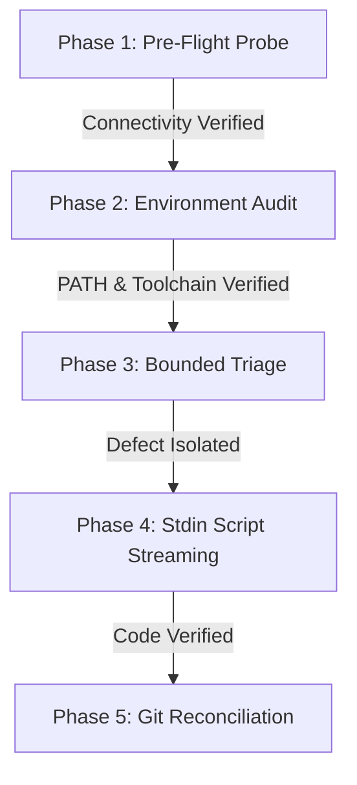

<!-- SPDX-License-Identifier: Apache-2.0 -->
<!-- Copyright (c) 2026 Arafat Zahan (@kuasha420) -->
<!-- Corporate Stewardship & Infrastructure: Purrfect Software Limited (PSL) -->
<!-- Governed by: ICARO-42/b Ordinance (Company-Supported Personal IP Framework) -->

# PSL Skill: Remote Operations, SSH Multiplexing & Cloud/Mesh Troubleshooting (ADR-027)

This skill provides deterministic standard operating procedures (SOP) for executing remote commands, streaming scripts, and troubleshooting remote cloud instances, staging servers, and physical mesh strands without connection latency, non-login `$PATH` failures, or context floods.

---

## 1. Core Architectural Guarantees (ADR-027)

1. **OpenSSH Connection Multiplexing**:
   - Reuses an authenticated master SSH connection (`ControlMaster=auto`, `ControlPersist=10m`).
   - Eliminates 500ms–2000ms handshake and TCP roundtrip overhead on subsequent calls.
   - Sockets reside safely in user-space at `~/.cache/psl/ssh/cm_%C` with `0700` permissions (staying strictly under the 108-byte UNIX domain socket path limit).
2. **Selective Login-Shell Promotion**:
   - Non-interactive SSH sessions do not source `~/.bashrc` or NVM by default, leading to false `Exit Code 127` errors when invoking toolchains.
   - Commands invoking `pm2`, `node`, `pnpm`, `cargo`, `nvm`, or `uv` are automatically wrapped in `bash -l -c '...'` when explicit PATH is not defined.
3. **Remote ADR-013 Pattern Probing Sanitization**:
   - Remote pattern search commands (`grep`, `diff`, `pgrep`) are automatically sanitized with `|| [ $? -eq 1 ]` inside the remote payload, preventing benign zero-match exits from failing the execution.
4. **Zero-Disk-Footprint Stdin Script Streaming**:
   - Local scripts are streamed directly into remote interpreters (`python3 -s -`, `node -`, `bash -l -s`) via stdin.
   - No temporary script files or lingering artifacts remain on remote servers.
5. **Bounded Triage Output (<2KB Markdown)**:
   - Diagnostic probes are compacted into structured tables bounded under 2KB, preventing context flooding and attention saturation.
6. **Physical Knot Mesh Interoperability**:
   - For targets within the physical Knot Mesh cluster (`desktop`, `laptop`, `steamdeck`, `rog-ally`), use `knot exec <target> "<cmd>"` as the preferred transport whenever the `knot` CLI is available, providing native LAN mDNS, WireGuard fallback, and zero-token cockpit forwarding.

---

## 2. Standard Operating Procedure (5-Phase Triage Ladder)

When diagnosing a malfunctioning service, deployment failure, or remote server defect, follow the 5-phase ladder sequentially:



### Phase 1: Pre-Flight Probe & Connection Verification
Verify remote reachability and establish the OpenSSH multiplexing master socket:
```bash
python3 -m harness.cli remote exec <target> "uname -a && uptime"
```
- Inspect socket status:
  ```bash
  python3 -m harness.cli remote socket status
  ```

### Phase 2: Environment & Toolchain Audit
Confirm toolchain presence without relying on host-inherited assumptions:
```bash
python3 -m harness.cli remote exec <target> "node -v || command -v pm2 || which uv"
```
- Notice: `psl remote exec` automatically injects `bash -l -c` for toolchain binaries.

### Phase 3: Bounded Diagnostic Triage (<2KB)
Gather system overview, listening ports, service statuses, and logs in a single bounded request:
```bash
# Full composite audit (<2KB Markdown)
python3 -m harness.cli remote triage <target>

# Focused profile queries
python3 -m harness.cli remote triage <target> --profile ports
python3 -m harness.cli remote triage <target> --profile services
python3 -m harness.cli remote triage <target> --profile resources
python3 -m harness.cli remote triage <target> --profile logs --service <service_name> --lines 50
```

### Phase 4: Stdin Script Streaming (Zero Remote Disk Footprint)
Execute diagnostic or repair scripts by streaming directly to the remote interpreter without leaving files on the remote disk:
```bash
# Execute local Python script remotely via stdin
python3 -m harness.cli remote script <target> ./scripts/check_health.py -- arg1 arg2

# Execute local shell script remotely
python3 -m harness.cli remote script <target> ./scripts/restart_service.sh

# Fallback staging mode (for scripts requiring local files/paths) with automatic trap cleanup
python3 -m harness.cli remote script <target> ./scripts/build_step.sh --stage
```

### Phase 5: Local Git Reconciliation & Clean Socket Closure
1. Reconcile any remote config changes back into local git repositories.
2. Clean up stale ControlMaster sockets:
```bash
python3 -m harness.cli remote socket cleanup
```

---

## 3. Command Reference

| Command | Purpose |
|---|---|
| `python3 -m harness.cli remote exec <target> "<cmd>"` | Execute command over multiplexed SSH with auto login-shell |
| `python3 -m harness.cli remote script <target> <file>` | Stream local script to remote target via stdin (zero disk footprint) |
| `python3 -m harness.cli remote script <target> <file> --stage` | Stage file in `/tmp/.psl_remote_*` with automatic `trap` cleanup |
| `python3 -m harness.cli remote triage <target>` | Generate compact (<2KB) multi-component triage Markdown report |
| `python3 -m harness.cli remote triage <target> --profile <p>` | Filter triage by profile (`ports`, `services`, `resources`, `logs`) |
| `python3 -m harness.cli remote socket status` | List active OpenSSH ControlMaster sockets |
| `python3 -m harness.cli remote socket cleanup` | Remove all cached ControlMaster sockets |

---

## 4. Invariants & Guardrails

- **Zero Unbounded Logs**: Never run naked `tail -f` or unconstrained `journalctl`. Always specify `--lines 50` or pipe through `head`/`tail`.
- **Zero Remote File Pollution**: Favor stdin streaming over manual `scp` + `chmod +x` + execution. When staging is necessary, always verify the `trap 'rm -rf ...' EXIT` handler.
- **Strict User-Space Sockets**: Never configure socket paths in root directories. Keep them inside `~/.cache/psl/ssh/` with `0700` permissions.
