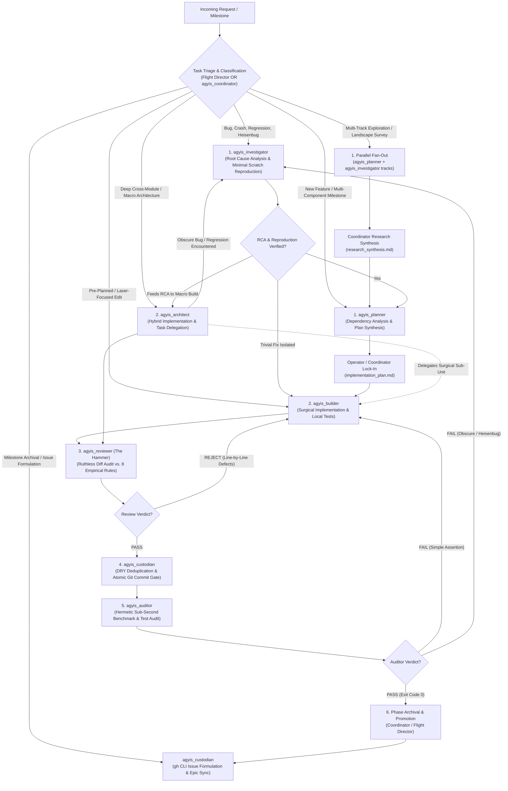

<!-- SPDX-License-Identifier: Apache-2.0 -->
<!-- Copyright (c) 2026 Arafat Zahan (@kuasha420) -->
<!-- Corporate Stewardship & Infrastructure: Purrfect Software Limited (PSL) -->
<!-- Governed by: ICARO-42/b Ordinance (Company-Supported Personal IP Framework) -->

# Subagent Ladder: Multi-Agent SWE Execution Protocol 🪜🤖

The **Subagent Ladder** formalizes an autonomous, multi-agent pair-programming protocol for complex software engineering tasks, large-scale refactorings, and delivery across multi-phase software engineering milestones in Agyis Harness.

> [!IMPORTANT]
> **Strictly User-Invoked Activation Contract**:
> Autonomous agents must **NEVER** activate or auto-trigger this skill autonomously. It is engaged **strictly upon explicit operator command** (e.g. `/subagent-ladder`, *"use subagent ladder"*, *"run the ladder flow"*). Single-turn or minor edits must use standard direct execution.

---

## 1. Architectural Rationale & Dual-Sovereignty Model

Complex engineering initiatives easily cause **conversational context collapse** when executed in a single monolithic context window. Accumulated tool outputs, compile logs, and search results bloat context, degrade instruction following, and incur exponential token costs.

The Subagent Ladder enforces the **Dual-Sovereignty Principle** (Cognition vs. Harness):
- **Cognition governs reasoning, intent, and architectural synthesis**: Role-pinning mental models, falsifiable root-cause hypotheses, surgical laser implementation, and dual-auditor certification.
- **The Harness governs boundaries, state verification, and physical execution guarantees**: Deterministic pre-tool-use write blocks for read-only agents, terminal command safety, output compaction (<2KB), and completion fence verification gates.

Key cognitive benefits include:
1. **Zero Context Carryover**: Subagents operate in lean, task-focused contexts (<50k tokens), preserving high reasoning capability and deterministic instruction following.
2. **Cognitive Role Isolation**: Separates the builder from the reviewer. An agent that writes code never reviews or audits its own diffs.
3. **Hermetic State Preservation**: High-level milestone state, plan artifacts, and empirical test logs are preserved in persistent markdown documents, resilient to conversational compaction or session resets.
4. **Anti-Anchoring Invariant**: Reviewers and auditors approach incoming diffs skeptically to break them with real repository tests rather than passively confirming prior attempts.

---

## 2. Autonomous Routing Architecture & 12-Workflow Decision Table

The Subagent Ladder provides dynamic, autonomous routing across specialized `agyis_*` agents based on the operational profile of the incoming task.

### 2.1 Autonomous Routing Flowchart



### 2.2 The 12-Workflow Decision Table

Calibrated across empirical telemetry, the 12 canonical workflows define the optimal agent sequence, invariants, and primary deliverables for any engineering objective:

| Workflow Profile & Signature | Starting Specialist | Pipeline Route | Critical Invariants & Tool Boundaries | Primary Deliverable Artifact | Empirical Precedent |
| :--- | :--- | :--- | :--- | :--- | :--- |
| **A. Bug Report / Test Regression / Silent Failure** | `agyis_investigator` | `Investigator` $\rightarrow$ `Planner` $\rightarrow$ `Builder` $\rightarrow$ `Reviewer` $\rightarrow$ `Custodian` $\rightarrow$ `Auditor` | **Strict Read-Only on Code**: Must author a deterministic reproduction script in scratch (`scratch/reproduce_*.py`) before writing any fix. | `rca_report.md` + `reproduce_bug.py` | Live debugging of `/compact` interceptor bug (Steps 3580–3634) |
| **B. New Feature / Multi-File Milestone** | `agyis_planner` | `Planner` $\rightarrow$ `Coordinator Lock-In` $\rightarrow$ `Builder` $\rightarrow$ `Reviewer` $\rightarrow$ `Custodian` $\rightarrow$ `Auditor` | **Zero Speculative Code**: Evaluates imports, architecture, and contracts without touching source code. Drafts interactive implementation plan. | `implementation_plan.md` | Epic #51 Phase 3.1 & Phase 3.3 planning |
| **C. Well-Defined Single-Phase Task** | `agyis_builder` | `Builder` $\rightarrow$ `Reviewer` $\rightarrow$ `Custodian` $\rightarrow$ `Auditor` | **Laser Executioner**: Single contiguous replacements (`replace_file_content`). Zero scope creep. Self-verifies locally. | In-flight diff + local test pass | Native slash command bypass patch (`f13e63f`) |
| **D. Cross-Module Architectural Overhaul** | `agyis_architect` | `Architect` (delegates sub-parts) $\rightarrow$ `Reviewer` $\rightarrow$ `Custodian` $\rightarrow$ `Auditor` | **Deep Hybrid Orchestration**: Combines implementation with delegation to `agyis_planner` and `agyis_builder` to prevent context bloating past 50k tokens. | Clean multi-module pull request / diff | Issue #87 Subagent Ladder domain decoupling (`a71c104`) |
| **E. Heisenbug during Auditor QA Gate** | `agyis_investigator` | `Auditor (FAIL)` $\rightarrow$ `Investigator (RCA)` $\rightarrow$ `Builder (Fix)` $\rightarrow$ `Reviewer` $\rightarrow$ `Custodian` $\rightarrow$ `Auditor` | **Anti-Bypass Invariant**: Under no circumstances may an Auditor failure bypass Hammer re-review or Custodian commit gate after being remediated. | `heisenbug_rca.md` | SQLite WAL concurrency contention debugging |
| **F. Obscure Regression during Macro Build** | `agyis_architect` | `Architect` $\rightarrow$ `Investigator (RCA)` $\rightarrow$ `Architect` $\rightarrow$ `Reviewer` $\rightarrow$ `Custodian` $\rightarrow$ `Auditor` | **Architect-to-Investigator Delegation**: When encountering unexpected side-effects or mysterious test breaks during macro refactoring, `agyis_architect` pauses and delegates RCA to `agyis_investigator` instead of guess-editing. | `scratch/reproduce_*.py` + `rca_report.md` | PreInvocation locked DB handling |
| **G. Multi-Track Parallel Research / Landscape Mapping** | `agyis_coordinator` | `Coordinator` $\rightarrow$ Fan-out parallel `agyis_planner` / `agyis_investigator` $\rightarrow$ `Coordinator Synthesis` | **Context Preservation (ADR-025)**: Independent research tracks run in parallel contexts without cross-contamination. Results chiseled into persistent markdown. | `research_synthesis.md` / `track_*.md` | Epic Research Kickoff (Steps 5–17: 4 parallel research tracks) |
| **H. Cleanroom Specification Audit & Gap Ledger** | `agyis_investigator` | `Investigator` (Cleanroom Auditor) $\rightarrow$ `Coordinator` $\rightarrow$ `Builder` / `Swarm` | **Zero Production Mutation**: Evaluates baseline revision line-by-line against formal ACs. Documents gaps in `COMPLETION_LEDGER.md`. | `COMPLETION_LEDGER.md` | Issue #83 Route C Baseline Audit (Step 2488) |
| **I. Cross-Branch Golden Merge & Reconciliation** | `agyis_architect` | `Architect` (Synthesizer) $\rightarrow$ `Reviewer` $\rightarrow$ `Custodian` $\rightarrow$ `Auditor` | **Hermetic Worktree Isolation**: Reconciles divergent branches in dedicated worktree (`agyis-golden-merge`). Runs cross-test matrix. | Golden commit on unified feature branch | Epic #51 Phase 3.1 Route A vs Route B Golden Merge (Steps 1505 & 1603) |
| **J. Out-of-Band Victory Certification Council** | `agyis_auditor` + `agyis_reviewer` | `Auditor` (Hermetic Benchmarks) + `Reviewer` (8 Rules) $\rightarrow$ Dual Sign-Off | **Dual-Auditor Gate**: Never trust in-band self-certification. Independent auditors evaluate clean committed revision on HEAD. | `victory_audit_report.md` | Route A, B, and C Victory Audits (Steps 993, 2106, 3634, 3781) |
| **K. Milestone Governance & GitHub Issue Curation** | `agyis_custodian` | `Flight Director` / `Coordinator` $\rightarrow$ `Custodian` (Issue Formulation & Epic Sync via `gh` CLI) | **Zero Repository Document Pollution (AC5)**: Strictly zero scratch or progress notes in git tree; deterministic CLI execution; formal parent Epic checklist and comment updates verified via `gh issue view`. | GitHub Issues + Parent Epic Tracking Comment | Phase 3.3 GitHub Issue Harmonizer (Step 2095: Created #83, #84, #85 and synced Epic #51) |
| **L. Adversarial Fuzzing & Stress Hardening Battery** | `agyis_builder` / `agyis_investigator` | `Investigator` (Fuzzing Vectors) $\rightarrow$ `Builder` (Adversarial Tests) $\rightarrow$ `Reviewer` $\rightarrow$ `Custodian` $\rightarrow$ `Auditor` | **Zero Error Swallowing & Sub-Second SLA**: Stress tests (concurrency lock timeout $\le 0.5$s, schema corruption, rapid token bursts, stdin binary stream noise) must execute cleanly in sub-second latency and fail-open. | `tests/test_*_adversarial.py` | Route C Carrier-Grade Hardening (Step 2990: 4 adversarial hardening vectors) |

### 2.3 The Investigation Triage Branch (`agyis_investigator`)

When a bug report, mysterious test regression, or Heisenbug is encountered, premature coding inevitably leads to guessing, code thrashing, and error swallowing. The Ladder activates the **Investigation Triage Branch**:

1. **Trigger Condition**: Any incoming bug report, unexpected test suite failure, crash dump, or Heisenbug immediately routes to `agyis_investigator`.
2. **Deterministic Scratch Reproduction Script Invariant**:
   - `agyis_investigator` MUST establish a minimal, standalone reproduction script in Tier 2 scratch space (`scratch/reproduce_issue.py` or `<appDataDir>/brain/<id>/scratch/reproduce_*.py`).
   - The script must reliably reproduce the defect with an exit code $\neq 0$ (confirming the red baseline).
3. **Strict Read-Only on Product Code**:
   - `agyis_investigator` is strictly forbidden from editing product source code or existing test files (`write: false` on production trees).
   - Findings, hypothesis validations, stack traces, and proposed fix specifications are synthesized into an `rca_report.md` in Tier 1 (`.agents/artifacts/`).
4. **Execution Handoff**:
   - The verified RCA and reproduction script are handed off to `agyis_builder` (or `agyis_architect` for macro defects).
   - The builder applies the surgical fix, verifies the reproduction script now exits 0 (green state), executes native automated test suites, and proceeds to `agyis_reviewer`.

---

## 3. The Phase Lifecycle Ladder (6-Stage Pipeline)

Every engineering milestone progresses through the sequential **6-Stage Pipeline**. All stages execute in the shared workspace (`Workspace: "share"`) to ensure changes, diffs, and artifacts persist without worktree file loss:

```
┌─────────────────────────────────────────────────────────────────────────┐
│ STAGE 1: PLANNING & OPERATOR LOCK-IN (`agyis_coordinator` / `agyis_planner`) │
│ - `agyis_planner` synthesizes architecture into `implementation_plan.md`.│
│ - Operator reviews, grills, refines, and formally locks in the plan.    │
└────────────────────────────────────┬────────────────────────────────────┘
                                     │ (Approved)
                                     ▼
┌─────────────────────────────────────────────────────────────────────────┐
│ STAGE 2: SURGICAL EXECUTION (`agyis_builder` / `agyis_architect`)       │◄────────────────────────┐
│ - `agyis_builder` applies surgical contiguous edits (`replace_file_content`). │                     │
│ - Local self-verification via native tests (<1.0s benchmark invariant).  │                         │
│ - Produces diff summary and local test pass.                            │                         │
└────────────────────────────────────┬────────────────────────────────────┘                         │
                                     │ (Execution Complete OR Remedy Complete)                      │
                                     ▼                                                              │
┌─────────────────────────────────────────────────────────────────────────┐                         │
│ STAGE 3: CODE & EMPIRICAL REVIEW (`agyis_reviewer` - The Hammer)         │                         │
│ - Ruthlessly audits all changes against the 8 Empirical Rules in        │                         │
│   AGENTS.md (zero error swallowing, no homework in tests, surgical      │                         │
│   contiguous edits, terminal safety, clean contracts).                  │                         │
│ - Verdict: PASS or REJECT with specific line-by-line defect ledger.     │                         │
└──────────────────┬───────────────────────────────────▲──────────────────┘                         │
                   │ (Passed Hammer Review)            │                                            │
                   ▼                                   │ (Hammer Code Rejection)                    │
┌──────────────────────────────────────────────────┐   │                                            │
│ STAGE 4: GIT COMMIT GATE & WORKSPACE CUSTODY     │   │                                            │
│ (`agyis_custodian`)                              │   │                                            │
│ - Audits git status & porcelain tree state.      │   │                                            │
│ - DRY & Code Deduplication Audit across codebase.│   │                                            │
│ - Enforces AC5 (Zero scratch/tmp debris staged). │   │                                            │
│ - Enforces ADR-014 Product vs. Project boundary. │   │                                            │
│ - Seals atomic conventional git commit on HEAD.  │   │                                            │
│ - Verdict: COMMITTED or REJECT with defect report│   │                                            │
└──────────────────┬───────────────────────────────┘   │                                            │
                   │ (Clean Commit Verified)           │ (Custodian Staging Rejection)              │
                   ▼                                   │                                            │
┌──────────────────────────────────────────────────┐   │                                            │
│ STAGE 5: QA & BENCHMARK AUDIT                    │   │                                            │
│ (`agyis_auditor` - Victory Auditor)              │   │                                            │
│ - Audits strictly the COMMITTED git revision on HEAD.│                                            │
│ - Executes automated test suites (`agyis test`). │   │                                            │
│ - Asserts exit code 0 & sub-second latency (<1.0s)│  │                                            │
│ - Verifies environment state and clean builds.   │   │                                            │
│ - Verdict: PASS or FAIL with raw diagnostics.    │   │                                            │
└──────────────────┬───────────────────────────────┘   │                                            │
                   │                                   │                                            │
         ┌─────────┴─────────┐                         │                                            │
         │ (Passed QA Audit) │ (QA/Audit Failed)       └────────────────────────────────────────────┤
         │                   └──────────────────────────────────────────────────────────────────────┘
         ▼                                                     (MANDATORY: Return to Builder/Investigator,
┌─────────────────────────────────────────────────────────────────────────┐   THEN through Hammer!)
│ STAGE 6: PHASE ARCHIVAL & PROMOTION (`cockpit_director` / `agyis_coordinator`) │
│ - Archives milestone plan into `.agents/artifacts/phase_X_delivery.md`. │
│ - Records milestone completion in `docs/taxonomy/project-ledger.md`.     │
│ - Subagents for completed phase are formally retired.                   │
│ - Presents Phase X+1 Implementation Plan to user.                       │
└─────────────────────────────────────────────────────────────────────────┘
```

---

## 4. Multi-Node Swarm PR Ingestion Protocol

When coordinating distributed campaigns across parallel feature worktrees, multi-agent branches, or remote contributor PRs (with physical multi-device hardware coordination cleanly isolated as an opt-in delegation to `mesh-ops` and `knot-swarm`):

### 4.1 Distributed PR & Branch Discovery
Subagents or external contributors push branches or open Pull Requests asynchronously. The Ladder coordinator discovers and ingests remote PRs using GitHub CLI (`gh`):
```bash
# Ingest open PRs across fleet
gh pr list --state open --json number,title,headRefName,author,updatedAt

# Inspect specific PR diff
gh pr diff <pr_number>
```

### 4.2 Swarm Ingestion Lifecycle
1. **Branch Fetch & Isolation**: Coordinator fetches feature / subagent worktrees into dedicated tracking branches (`git fetch origin pull/<id>/head:pr-<id>`).
2. **Phase Partitioning**: Coordinator maps ingested PR branches to Ladder milestones in `implementation_plan.md`.
3. **Ladder Verification Sweep**:
   - `agyis_builder`: Integrates or rebases branch changes cleanly against upstream HEAD.
   - `agyis_reviewer`: Audits multi-agent diffs against PSL invariants (The Hammer).
   - `agyis_custodian`: Re-verifies clean staging, enforces AC5, and executes DRY deduplication check across merged modules.
   - `agyis_auditor`: Executes local hermetic tests (`agyis test`) and verifies environment invariants (dispatches SSH probes across remote nodes when opted into `mesh-ops`).
4. **Automated Review Approval**: On Auditor PASS, Coordinator approves or merges the PR via `gh pr merge --squash` or `gh pr review --approve`.

---

## 5. Strict State Machine Invariants

### 5.1 Anti-Bypass Invariant (Zero Shortcuts)
> [!CAUTION]
> If `agyis_auditor` detects a failure and `agyis_builder` produces a remedy patch:
> $$\text{Auditor FAIL} \longrightarrow \text{Builder (Remedy)} \longrightarrow \mathbf{Reviewer\ (The\ Hammer\ Re\text{-}Review)} \longrightarrow \mathbf{Custodian\ (Commit\ Gate)} \longrightarrow \text{Auditor (QA)}$$
> **Under NO circumstances may an Executioner remedy bypass Hammer review or Custodian commit gate.** An implementer fixing an edge case under test failure pressure is prone to introducing error-swallowing constructs or artificial mocks. Auditor must audit strictly the clean, committed revision.

### 5.2 Zero Coordinator Remediation Invariant
> [!CRITICAL]
> The Coordinator (`agyis_coordinator`) is **strictly forbidden from modifying product code, patching files directly, or self-resolving review defects**.
> - The Coordinator orchestrates the ladder, manages persistent artifacts, and routes diagnostics.
> - Defect reports must be routed back to the designated `agyis_builder`.

### 5.3 Git Commit Gate & Custodian Mandate
> [!IMPORTANT]
> The Custodian (`agyis_custodian`) is the sole entity authorized to stage and commit milestone deliverables.
> - **DRY & Code Deduplication Audit**: Before approving any commit gate, Custodian actively executes targeted sweeps (`grep_search`, `find_by_name`) to verify newly introduced helpers, utilities, constants, and test fixtures do NOT duplicate existing logic elsewhere in the repository. If duplicates are found, reject with a DRY defect report instructing `agyis_builder` to reuse existing modules.
> - **Macro Architectural Review**: Evaluates repository-wide architectural integrity beyond Hammer's micro-diff: verifies cross-module boundary compliance (e.g. ADR-014 Product vs. Project bifurcation: `harness/` must never import `pipeline/` or `tests/`), detects orphan files, dead code, leftover temporary scripts, and uncommitted working-tree residue.
> - **Clean Revision Invariant**: The Auditor must certify a **committed git revision**, never a volatile, dirty working tree.
> - **Elimination of Tested-vs-Uncommitted Desync**: Committing before Auditor QA guarantees that everything passing tests is already recorded in version control.
> - **Atomic Staging**: Deliberately stage only files specified in the approved implementation plan. Blind `git add .` or `git add -A` is strictly prohibited.
> - **Zero Scratch Debris (AC5)**: Telemetry databases, temporary logs, and scratch artifacts must never be staged into version control. Untracked paths matching `scratch/*`, `tmp/*`, `*.tmp`, `*.log`, `*.db` abort the commit gate immediately.
> - **Zero Direct Code Mutation**: The Custodian cannot modify product or test code (`write: false`). If dirty state or missing files are found, the commit gate is rejected and routed back to `agyis_builder`.

### 5.4 Clean Committed Revision Invariant
> [!NOTE]
> `agyis_auditor` evaluates strictly the COMMITTED git revision on HEAD sealed by `agyis_custodian`. It never executes verification suites against a dirty working tree. If untracked modifications or uncommitted changes exist, the Auditor immediately rejects the stage back to Custodian.

### 5.5 Strict Reactive Wait Invariant (Rule 4 Non-Polling Contract)
> [!CRITICAL]
> **Strict Non-Polling Contract**:
> Calling `manage_task(Action='status')`, `manage_subagents(Action='list')`, or running `tail`, `cat`, `grep`, or `view_file` on background task logs in consecutive turns is **STRICTLY PROHIBITED**.
> - Empirical telemetry demonstrates that polling loops consume $>35\%$ of session tokens and degrade attention horizons.
> - Immediately upon executing `invoke_subagent`, asynchronous `run_command`, or `schedule`, the agent MUST emit a single concise progress notification and **STOP CALLING TOOLS**.
> - The Antigravity platform automatically wakes up the orchestrator when a subagent calls `send_message`, a background task terminates, or a scheduled timer fires.

---

## 6. Subagent Specialist Catalog & Permitted Tools

The Agyis Subagent Ladder defines 8 specialist roles plus the Cockpit Flight Director, mapped cleanly to internal archetypes with strict tool boundaries:

| Role | Specialist Agent | Internal Archetype | Mandate & Core Responsibilities | Permitted Toolset |
| :--- | :--- | :--- | :--- | :--- |
| **Cockpit Flight Director** | `cockpit_director` | `flight_director` | Primary interface to human operator; routes tasks across the 12 workflows; preserves cognitive state at 230k tokens into `.agents/artifacts/`. | Full platform toolset (`subagents: true`, `enable_write_tools: true`, `mcp: true`). |
| **Swarm Coordinator** | `agyis_coordinator` | `coordinator` | Assembly line director; manages artifacts, dispatches stages, routes review defects; strictly zero self-remediation on code. | Read/Task/Subagent tools (`subagents: true`, `execute: false`, `mcp: false`). |
| **Solutions Architect** | `agyis_planner` | `planner` | Researches architectures and synthesizes interactive `implementation_plan.md` artifacts; strictly zero speculative code writing. | Read/Artifact/Subagent tools (`subagents: true`, `execute: false`, `mcp: true`). |
| **Forensic Detective** | `agyis_investigator` | `investigator` | Root cause analyst; formulates falsifiable hypotheses; authors deterministic scratch reproduction scripts (`scratch/reproduce_issue.py`) and `rca_report.md`; strictly read-only on product code. | Read tools, command execution, task management, Tier 2 scratch write (`subagents: false`, `mcp: false`). |
| **The Executioner** | `agyis_builder` | `executioner` | Surgical implementer; single contiguous block replacements (`replace_file_content`); runs targeted local tests; zero scope creep. | Read, write, execute (`subagents: false`, `mcp: false`, `enable_write_tools: true`). |
| **The Hammer** | `agyis_reviewer` | `hammer` | Ruthless line-by-line auditor (`git diff -U3`) against the 8 Canonical Empirical Rules; zero fixing temptation; emits PASS/REJECT verdict with defect ledger. | Strictly read-only (`write: false`, `execute: false`, `subagents: false`, `mcp: false`). |
| **Workspace Custodian** | `agyis_custodian` | `custodian` | DRY deduplication auditor, macro boundary guardian (ADR-014), repository hygiene enforcer (AC5), and atomic git commit gate on HEAD. | Read, execute (`write: false`, `enable_write_tools: false`, `subagents: false`). |
| **Victory Auditor** | `agyis_auditor` | `auditor` | Evaluates strictly the COMMITTED git revision on HEAD; verifies full test suite exit code 0 and sub-second benchmark latency (<1.0s); zero error swallowing. | Read, execute (`write: false`, `enable_write_tools: false`, `subagents: false`). |
| **Lead Architect** | `agyis_architect` | `main` | Deep systems implementer & delegator (`/boost` DeepCoder + DeepInvestigator); macro refactoring, golden merges, and bounded sub-delegation to keep primary context <50k tokens. | Full platform toolset (`subagents: true`, `enable_write_tools: true`, `mcp: true`). |

### 6.1 Legacy Agent Alias Compatibility
To preserve backward compatibility across existing automation, scripts, and checkpoints, the harness dynamically maps legacy agent names to modern `agyis_*` specialists:
- `harness_builder` $\longrightarrow$ `agyis_builder`
- `harness_reviewer` $\longrightarrow$ `agyis_reviewer`
- `harness_custodian` $\longrightarrow$ `agyis_custodian`
- `harness_auditor` $\longrightarrow$ `agyis_auditor`
- `coordinator` $\longrightarrow$ `agyis_coordinator`
- `planner` $\longrightarrow$ `agyis_planner`

---

## 7. Inter-Agent Communication & Typed Stage Transition Payload

### 7.1 Cortex `send_message` Protocol (Strict Two-Argument Contract)
> [!IMPORTANT]
> **Strict Two-Argument Message Contract**:
> The Cortex `send_message` API schema strictly accepts only two properties: `Recipient` (string) and `Message` (string).
> - **DO NOT PASS EXTRANEOUS NAME FIELDS**: Parameter schemas outside `Recipient` and `Message` are rejected immediately with tool argument validation errors.
> - Subagents reporting completion, status, or handoffs back to the parent orchestrator must invoke `send_message` strictly as:
>   ```json
>   {
>     "Recipient": "<parent_conversation_id>",
>     "Message": "<status_or_handoff_markdown>"
>   }
>   ```

### 7.2 Typed Stage Transition Payload Schema (`psl_stage_transition_payload.json`)

When transitioning execution between ladder stages, the sending specialist passes this strictly typed JSON payload wrapped in a markdown code block within `Message`:

```json
{
  "$schema": "https://json-schema.org/draft/2020-12/schema",
  "title": "AgyisStageTransitionPayload",
  "type": "object",
  "required": [
    "protocol_version",
    "task_id",
    "phase",
    "stage",
    "status",
    "sender_role",
    "next_recommended_stage",
    "git_commit_hash",
    "diff_summary",
    "verification",
    "artifacts"
  ],
  "properties": {
    "protocol_version": { "type": "string", "enum": ["2026.1"] },
    "task_id": { "type": "string" },
    "phase": { "type": "string" },
    "stage": {
      "type": "string",
      "enum": ["INVESTIGATION", "PLANNING", "EXECUTION", "CODE_REVIEW", "GIT_CUSTODY", "QA_AUDIT", "PROMOTION"]
    },
    "status": {
      "type": "string",
      "enum": ["PASS", "REJECT", "FAIL", "BLOCKED", "COMPLETE"]
    },
    "sender_role": {
      "type": "string",
      "enum": [
        "agyis_coordinator", "agyis_planner", "agyis_investigator",
        "agyis_builder", "agyis_reviewer", "agyis_custodian",
        "agyis_auditor", "agyis_architect", "cockpit_director"
      ]
    },
    "next_recommended_stage": {
      "type": "string",
      "enum": ["INVESTIGATION", "PLANNING", "EXECUTION", "CODE_REVIEW", "GIT_CUSTODY", "QA_AUDIT", "PROMOTION", "HALT_OPERATOR_INTERVENTION"]
    },
    "git_commit_hash": { "type": "string" },
    "diff_summary": {
      "type": "object",
      "required": ["modified_files", "added_lines", "deleted_lines", "contiguous_chunks_count"],
      "properties": {
        "modified_files": { "type": "array", "items": { "type": "string" } },
        "added_lines": { "type": "integer", "minimum": 0 },
        "deleted_lines": { "type": "integer", "minimum": 0 },
        "contiguous_chunks_count": { "type": "integer", "minimum": 0 }
      }
    },
    "verification": {
      "type": "object",
      "required": ["command", "exit_code", "total_tests", "passed_tests", "failed_tests", "benchmark_latency_s"],
      "properties": {
        "command": { "type": "string" },
        "exit_code": { "type": "integer" },
        "total_tests": { "type": "integer", "minimum": 0 },
        "passed_tests": { "type": "integer", "minimum": 0 },
        "failed_tests": { "type": "integer", "minimum": 0 },
        "benchmark_latency_s": { "type": "number", "minimum": 0.0 }
      }
    },
    "artifacts": {
      "type": "object",
      "required": ["plan_path", "reproduction_script", "report_path"],
      "properties": {
        "plan_path": { "type": ["string", "null"] },
        "reproduction_script": { "type": ["string", "null"] },
        "report_path": { "type": ["string", "null"] }
      }
    },
    "defect_ledger": {
      "type": "array",
      "items": {
        "type": "object",
        "required": ["defect_id", "file_path", "line_range", "violated_rule", "description", "remediation"],
        "properties": {
          "defect_id": { "type": "string" },
          "file_path": { "type": "string" },
          "line_range": { "type": "string" },
          "violated_rule": { "type": "string" },
          "description": { "type": "string" },
          "remediation": { "type": "string" }
        }
      }
    }
  }
}
```

### 7.3 Stage Handoff Message Wrapper
Subagents wrap the JSON transition payload with human-readable markdown for immediate operator inspection:

```markdown
# Stage Transition Handoff: EXECUTION -> CODE_REVIEW
**Task ID**: `PHASE-4-LADDER-001` | **Status**: `COMPLETE`
**Sender**: `agyis_builder` | **Commit**: `HEAD` (Uncommitted Local Edits)

```json
{
  "protocol_version": "2026.1",
  "task_id": "PHASE-4-LADDER-001",
  "phase": "Phase 4",
  "stage": "EXECUTION",
  "status": "PASS",
  "sender_role": "agyis_builder",
  "next_recommended_stage": "CODE_REVIEW",
  "git_commit_hash": "uncommitted",
  "diff_summary": {
    "modified_files": ["harness/skills/subagent-ladder/SKILL.md"],
    "added_lines": 140,
    "deleted_lines": 20,
    "contiguous_chunks_count": 2
  },
  "verification": {
    "command": "python3 -m unittest tests/test_skills.py -v",
    "exit_code": 0,
    "total_tests": 18,
    "passed_tests": 18,
    "failed_tests": 0,
    "benchmark_latency_s": 0.12
  },
  "artifacts": {
    "plan_path": ".agents/artifacts/plan.md",
    "reproduction_script": null,
    "report_path": null
  }
}
```

### Summary of Actions
- Applied surgical modifications to target files.
- Verified test suite passes locally in 0.12s.
- Handoff ready for Hammer code review.
```

---

## 8. 3-Tier Storage Hierarchy & Artifact Bridge

### 8.1 3-Tier Storage Hierarchy
The Subagent Ladder strictly enforces storage isolation across 3 tiers:

1. **Tier 1: Living Artifacts (Durable, Cross-Compaction)**:
   - Locations: `.agents/artifacts/*.md` and `<appDataDir>/brain/<id>/*.md`.
   - Contents: Master plans, phase delivery reports, architectural specifications, RCA reports.
   - Durability: Preserved across compaction epochs and session resets; exempt from anti-drift write restrictions.
2. **Tier 2: Scratch Space (Ephemeral, Non-Committed)**:
   - Locations: `<appDataDir>/brain/<id>/scratch/*` and `scratch/*`.
   - Contents: Standalone reproduction scripts (`scratch/reproduce_issue.py`), fuzzers, temporary diagnostic dumps.
   - Invariant: Strictly forbidden from version control commits.
3. **Tier 3: Git Working Tree (Strictly Production Assets)**:
   - Locations: `harness/*`, `tests/*`, `docs/*`.
   - Contents: Production code, automated unit and contract test suites, clean ADRs and specifications.

### 8.2 AC5 Zero Repository Document Pollution
`agyis_custodian` runs `git status --porcelain` prior to staging. Any untracked path matching `scratch/*`, `tmp/*`, `*.tmp`, `*.log`, `*.db`, or non-whitelisted markdown progress markers aborts the commit gate immediately. Blind `git add .` or `git add -A` is strictly prohibited.

### 8.3 Workspace Artifact Bridge (`.agents/artifacts/`)
To prevent subagents from wasting context and tool calls hunting for plan artifacts:
1. **Bridge Symlink**: `.agents/artifacts` in the workspace root points to the active Coordinator brain directory:
   ```bash
   python3 runtime/skills/subagent-ladder/scripts/bridge_artifacts.py --setup "<brain_dir>"
   ```
2. **Git Hygiene**: `.agents/artifacts` is ignored in `.gitignore`.
3. **Prompt Standard**: Coordinator prompts strictly reference `.agents/artifacts/<plan_name>.md`.
4. **Tool Compatibility**: `view_file` resolves the symlink natively on Step 2 (the first tool call) with zero search pollution.

### 8.4 Prompt Addressing Standards & Forbidden Patterns
- ❌ **Bare filenames**: `Read phase_2_plan.md` (subagent wastes turns grepping the workspace).
- ❌ **`file://` URIs**: `view_file("file:///home/...")` (causes `invalid tool call error: path is not absolute`).
- ❌ **Raw machine paths**: `Read /home/username/.gemini/...` (leaks usernames, host paths, and session UUIDs into prompt history, violating OSS confidentiality).
- ✅ **Standardized Bridge Path**: `view_file(".agents/artifacts/phase_2_plan.md")` or absolute repo-relative paths.

---

## 9. Multi-Stage Execution & Worktree Invariants

### 9.1 Shared Workspace Invariant (`Workspace: "share"`)
> [!CRITICAL]
> **Cross-Stage Worktree Preservation Invariant**:
> Multi-stage sequential pipelines (Executioner -> Hammer -> Custodian -> Auditor) MUST always specify `Workspace: "share"` when dispatched via `invoke_subagent`.
> - Never use `Workspace: "branch"` across sequential ladder stages: isolated ephemeral worktrees cause later stages to fail with missing-file errors (`"no such file or directory"`).
> - Stages execute in the shared root workspace so diffs, newly created files, and persistent artifacts remain immediately accessible to subsequent stages.

### 9.2 Remote Fleet Probing Safeguards
When testing remote staging hosts or distributed multi-node environments (when opted into `mesh-ops` or `knot-swarm`):
1. **Mandatory Execution Ceilings**: All remote SSH checks must enforce hard timeouts and TCP keepalives:
   ```bash
   timeout 10 ssh -o ConnectTimeout=3 -o ServerAliveInterval=2 -o ServerAliveCountMax=2 <node> "<command>"
   ```
2. **Headless Execution Only**: Never invoke interactive graphical binaries headlessly over SSH; probe daemon sockets, CLI endpoints, or D-Bus services.

### 9.3 Session Immutability & Subagent Definition Protocol
- Cortex enforces session-lifetime immutability on subagent names in `define_subagent`. Re-registering an already-defined agent name triggers `"agent '<name>' already exists"`.
- Pipelines must either reuse predefined agent types (`@agyis_builder`, `@agyis_reviewer`, `@agyis_auditor`, `@agyis_custodian`, `@agyis_investigator`) or generate phase-unique identifiers (`ladder_exec_phase1`, `ladder_exec_phase2`) if dynamically defining agents.


