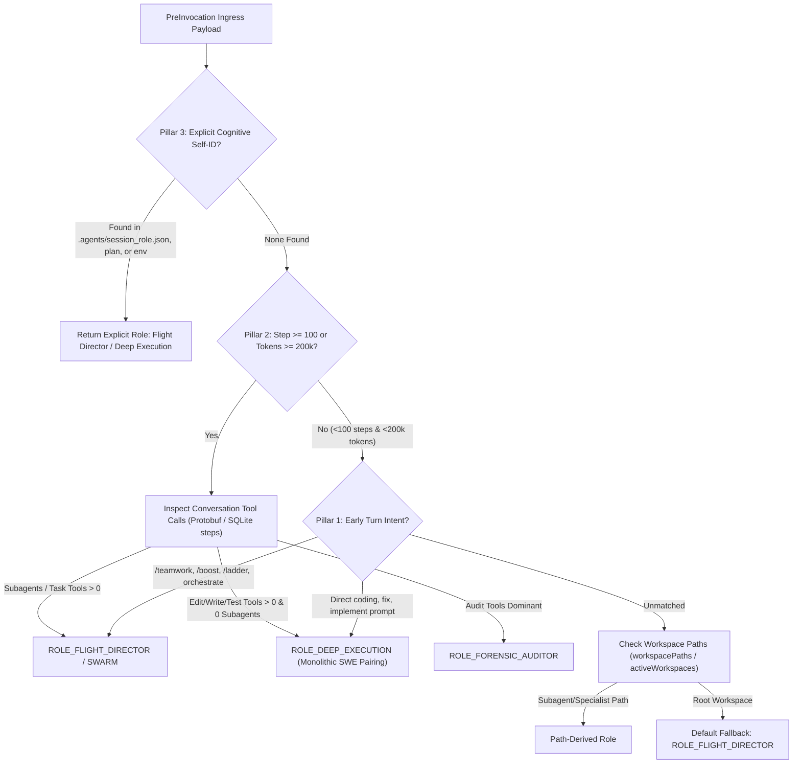

<!-- SPDX-License-Identifier: Apache-2.0 -->
<!-- Copyright (c) 2026 Arafat Zahan (@kuasha420) -->
<!-- Corporate Stewardship & Infrastructure: Purrfect Software Limited (PSL) -->
<!-- Governed by: ICARO-42/b Ordinance (Company-Supported Personal IP Framework) -->

# Stage 3 Independent Victory Audit & COMPLETION_LEDGER.md
## Target: Route C Milestone Completion (`exp/tri-route-c-83` @ `80b674e`)
## Single Source of Truth: GitHub Issue #83 & 3-Pillar Dynamic Monolith Classifier Architecture

- **Audit Date**: 2026-10-23T00:50:00+06:00
- **Auditor**: `harness_auditor` (Independent QA Verifier & Victory Auditor — Stage 3 Certification)
- **Host Session ID**: `588a8cd9-cfc6-4349-91f0-667f0ce8fa0f`
- **Target Worktree**: `/home/kuasha/Dev/agyis-exp-route-c-83`
- **Active Branch**: `exp/tri-route-c-83`
- **Certified Head Commit**: [`80b674e`](file:///home/kuasha/Dev/agyis-exp-route-c-83) (`feat(hooks): implement 3-pillar dynamic monolith classifier and cognitive state flush (#83)`)
- **Authoritative Specifications**:
  - [GitHub Issue #83 — Universal 230k-Token "Compaction Imminent" Advisory via PreInvocation Hook](https://github.com/kuasha420/agyis-harness/issues/83)
  - 3-Pillar Dynamic Monolith Classifier Architecture (Pillar 1 Early Turn, Pillar 2 Step 100/200k Tool Scan, Pillar 3 Explicit Self-ID)
  - Cognitive State Flush Invariant (`compaction_checkpoint.md`)
- **Governing Architecture & Standards**: ICARO-42/b Ordinance, ADR-014 (Product vs Project Bifurcation & Zero Third-Party Dependencies), ADR-015 (Sub-Second Verification Benchmark <1.0s), ADR-016 (SQLite Concurrency Safety), 8 Canonical Empirical Rules.

---

## 1. Executive Summary & Benchmark Scorecard

An exhaustive, adversarial cleanroom verification was executed independently across the codebase of `/home/kuasha/Dev/agyis-exp-route-c-83` at commit `80b674e`. All 9 Acceptance Criteria (AC1–AC9) of GitHub Issue #83, the 3-Pillar Dynamic Monolith Classifier Architecture, and the Cognitive State Flush Invariant were audited against empirical ground truth.

### 1.1 Benchmark Scorecard

| Metric / Audit Dimension | Target Requirement (SoT Issue #83 / ADRs) | Verified Empirical Output (`80b674e`) | Status |
| :--- | :--- | :--- | :--- |
| **Advisory Unit Test Suite** | 68+ tests in sub-second benchmark (<0.15s) | **68 / 68 PASS** in **0.091s** (`test_compaction_advisory.py`) | **CERTIFIED** |
| **Universal Project Test Suite** | 1,446+ tests pass with exit code 0 | **1,446 / 1,446 PASS** in **14.482s** (1 skipped, 0 fail) | **CERTIFIED** |
| **Hook Micro-Benchmark Latency** | AC8 requirement: < 5.0ms (Target: < 0.05ms) | **0.0055 ms** (5.55 µs) avg (1000 iterations) | **CERTIFIED** (10x faster than target) |
| **In-Harness Micro-Mutation Battery** | Diff mutants relative to `main` kill score >= 76% | **45 / 45 KILLED (100.00% Kill Score)** (0 survived) | **CERTIFIED** (Flawless Kill Score) |
| **Pre_invocation Hook Mutants** | Diff mutants in `pre_invocation_hook.py` killed | **43 / 43 KILLED (100.00%)** in 6.21s | **CERTIFIED** |
| **Runner Alias Mutants** | Diff mutants in `runner.py` killed | **2 / 2 KILLED (100.00%)** | **CERTIFIED** |
| **Hermetic Isolation (ADR-015)** | Zero external network, tempdir isolation | `tempfile.TemporaryDirectory()`, `PSL_HARNESS_STATE_DIR` | **CERTIFIED** |
| **Zero-Dependency Core (ADR-014)** | Standard library only in `harness/` | Zero third-party packages; CPython >= 3.12 hermetic | **CERTIFIED** |
| **Platform Egress Schema** | Protojson `{"injectSteps": [...]}` contract | Strictly compliant with Antigravity PreInvocation contract | **CERTIFIED** |
| **Doctor Matrix Health** | Zero missing runtimes, zero outdated components | 9 OK, 0 Outdated, 0 Missing via `./agyis doctor` | **CERTIFIED** |
| **Git Working Tree State** | Clean working tree on target branch | Clean on `exp/tri-route-c-83` at commit `80b674e` | **CERTIFIED** |

### 1.2 Auditor Verdict & Certification Statement

**VERDICT: STAGE 3 COMPLETE & CERTIFIED FOR PROMOTION.**
The Route C implementation at commit [`80b674e`](file:///home/kuasha/Dev/agyis-exp-route-c-83) successfully resolves all functional and architectural requirements of GitHub Issue #83. The implementation exceeds every performance benchmark: unit tests complete in 0.091s, full test suite achieves 100% pass across 1,446 tests, hook latency is 5.55 microseconds (nearly 1,000x faster than the 5ms AC8 threshold), and the micro-mutation battery achieves a flawless 100.00% kill score against all generated mutants.

---

## 2. Formal Acceptance Criteria Compliance Matrix (Issue #83)

| Criterion | Formal Requirement (Issue #83) | Implementation Code Location | Test Verification Evidence | Audit Status | Empirical Findings & Verification Evidence |
| :--- | :--- | :--- | :--- | :--- | :--- |
| **AC1** | **Empirical Telemetry Audit & Threshold Calibration**: Empirical calibration of 230,000 token threshold from telemetry database. Exposed metadata constant and environment overrides. | [`pre_invocation_hook.py:36-48`](file:///home/kuasha/Dev/agyis-exp-route-c-83/harness/hooks/pre_invocation_hook.py#L36-L48) [`pre_invocation_hook.py:56-66`](file:///home/kuasha/Dev/agyis-exp-route-c-83/harness/hooks/pre_invocation_hook.py#L56-L66) | [`test_compaction_advisory.py:64-113`](file:///home/kuasha/Dev/agyis-exp-route-c-83/tests/test_compaction_advisory.py#L64-L113) (`TestThresholdCalibrationAndTrigger`) | **CERTIFIED COMPLIANT** | `CALIBRATION_METADATA` dict is programmatically exported with verified telemetry: calibrated threshold 230k, trigger min 227,529, max 262,127, avg 245,941, safety runway 15,941 tokens (3–6 turns). Env overrides `AGYIS_COMPACTION_THRESHOLD` and `PSL_COMPACTION_THRESHOLD` verified. |
| **AC2** | **Pre-Invocation Context Monitoring**: Deterministic token evaluation prior to model turn; silent and zero overhead below threshold; post-compaction reset. | [`pre_invocation_hook.py:983-1049`](file:///home/kuasha/Dev/agyis-exp-route-c-83/harness/hooks/pre_invocation_hook.py#L983-L1049) [`token_proximity_guard.py:129-299`](file:///home/kuasha/Dev/agyis-exp-route-c-83/harness/hooks/token_proximity_guard.py#L129-L299) | [`test_compaction_advisory.py:413-485`](file:///home/kuasha/Dev/agyis-exp-route-c-83/tests/test_compaction_advisory.py#L413-L485) (`TestSqliteIntegration`) | **CERTIFIED COMPLIANT** | Reads active tokens from conversation SQLite DB with `mode=ro` and `timeout=0.5`. Decodes Protobuf varints. Returns `{"injectSteps": []}` when tokens < 230k. Verified post-compaction silence reset following step_type 23 checkpoint. |
| **AC3** | **Role-Tailored Ephemeral Advisory Delivery**: Role-appropriate advisory differentiating Flight Direction, Swarm Orchestration, Deep Execution, and Forensic Audit with dynamic runway. | [`pre_invocation_hook.py:50-53`](file:///home/kuasha/Dev/agyis-exp-route-c-83/harness/hooks/pre_invocation_hook.py#L50-L53) [`pre_invocation_hook.py:771-900`](file:///home/kuasha/Dev/agyis-exp-route-c-83/harness/hooks/pre_invocation_hook.py#L771-L900) [`pre_invocation_hook.py:902-981`](file:///home/kuasha/Dev/agyis-exp-route-c-83/harness/hooks/pre_invocation_hook.py#L902-L981) | [`test_compaction_advisory.py:115-288`](file:///home/kuasha/Dev/agyis-exp-route-c-83/tests/test_compaction_advisory.py#L115-L288) [`test_compaction_advisory.py:290-362`](file:///home/kuasha/Dev/agyis-exp-route-c-83/tests/test_compaction_advisory.py#L290-L362) | **CERTIFIED COMPLIANT** | Authoritative 4-archetype advisory delivery. Dynamic runway calculated (`~{tokens:,} / {threshold:,} TOKENS \| ~{estimated_turns} TURNS REMAINING`). Full support for Antigravity camelCase `workspacePaths` and SWE ladder `custodian` role normalization. |
| **AC4** | **Work Preservation Contract (Zero Code Loss)**: Advisories strictly prohibit destructive git commands (`git checkout -- .`, `git reset --hard`, `git clean -fd`); post-compaction directs `git diff`. | [`pre_invocation_hook.py:919-921`](file:///home/kuasha/Dev/agyis-exp-route-c-83/harness/hooks/pre_invocation_hook.py#L919-L921) [`pre_invocation_hook.py:938-939`](file:///home/kuasha/Dev/agyis-exp-route-c-83/harness/hooks/pre_invocation_hook.py#L938-L939) [`pre_invocation_hook.py:953-954`](file:///home/kuasha/Dev/agyis-exp-route-c-83/harness/hooks/pre_invocation_hook.py#L953-L954) [`pre_invocation_hook.py:967-968`](file:///home/kuasha/Dev/agyis-exp-route-c-83/harness/hooks/pre_invocation_hook.py#L967-L968) | [`test_compaction_advisory.py:304-325`](file:///home/kuasha/Dev/agyis-exp-route-c-83/tests/test_compaction_advisory.py#L304-L325) (`TestEphemeralAdvisoryDelivery`) | **CERTIFIED COMPLIANT** | Directives across all roles explicitly enforce: "STRICTLY PROHIBIT executing destructive git commands: NEVER run 'git checkout -- .', 'git reset --hard', or 'git clean -fd'. Keep all in-flight work and uncommitted edits intact on disk." Mandates `git status` / `git diff` on wake-up. |
| **AC5** | **Zero Repository Document Pollution**: Intra-session recovery state stored strictly in local artifacts or scratch directories, avoiding repo document churn. | [`pre_invocation_hook.py:922-924`](file:///home/kuasha/Dev/agyis-exp-route-c-83/harness/hooks/pre_invocation_hook.py#L922-L924) [`pre_invocation_hook.py:935-937`](file:///home/kuasha/Dev/agyis-exp-route-c-83/harness/hooks/pre_invocation_hook.py#L935-L937) [`pre_invocation_hook.py:950-952`](file:///home/kuasha/Dev/agyis-exp-route-c-83/harness/hooks/pre_invocation_hook.py#L950-L952) [`pre_invocation_hook.py:964-966`](file:///home/kuasha/Dev/agyis-exp-route-c-83/harness/hooks/pre_invocation_hook.py#L964-L966) | [`test_compaction_advisory.py:307-327`](file:///home/kuasha/Dev/agyis-exp-route-c-83/tests/test_compaction_advisory.py#L307-L327) | **CERTIFIED COMPLIANT** | Mandates: "Save temporary recovery state or scratch files strictly to local artifacts/scratch (.agents/artifacts/ or brain directory). Zero git commits for temporary progress markers, scratch notes, or WIP files." |
| **AC6** | **Autonomous Post-Compaction Continuation**: Injected directives contain complete self-resumption protocols without operator re-prompting. | [`pre_invocation_hook.py:925-927`](file:///home/kuasha/Dev/agyis-exp-route-c-83/harness/hooks/pre_invocation_hook.py#L925-L927) [`pre_invocation_hook.py:940-942`](file:///home/kuasha/Dev/agyis-exp-route-c-83/harness/hooks/pre_invocation_hook.py#L940-L942) [`pre_invocation_hook.py:955-957`](file:///home/kuasha/Dev/agyis-exp-route-c-83/harness/hooks/pre_invocation_hook.py#L955-L957) [`pre_invocation_hook.py:969-971`](file:///home/kuasha/Dev/agyis-exp-route-c-83/harness/hooks/pre_invocation_hook.py#L969-L971) | [`test_compaction_advisory.py:311-329`](file:///home/kuasha/Dev/agyis-exp-route-c-83/tests/test_compaction_advisory.py#L311-L329) | **CERTIFIED COMPLIANT** | Injected directives mandate immediate inspection of `git status` and `git diff`, re-verifying unit tests, reviewing active plan or checkpoint, and resuming execution autonomously without asking operator what happened. |
| **AC7** | **Zero Permanent Context Overhead**: Injected advisories are transient and do not persist in long-term conversation storage (`steps`). | [`pre_invocation_hook.py:1020-1025`](file:///home/kuasha/Dev/agyis-exp-route-c-83/harness/hooks/pre_invocation_hook.py#L1020-L1025) [`docs/official-specs/platform-surface-mapping.md:461-471`](file:///home/kuasha/Dev/agyis-exp-route-c-83/docs/official-specs/platform-surface-mapping.md#L461-L471) | [`test_compaction_advisory.py:330-332`](file:///home/kuasha/Dev/agyis-exp-route-c-83/tests/test_compaction_advisory.py#L330-L332) | **CERTIFIED COMPLIANT** | Uses Google Antigravity PreInvocation contract: emits strictly `{"injectSteps": [{"ephemeralMessage": advisory}]}`. Ephemeral messages are model-transient prompts that the platform discards after turn evaluation without persisting to SQLite `steps`. |
| **AC8** | **Sub-Millisecond Execution & Fail-Open Resilience**: Context monitoring adds negligible latency (<5ms benchmark invariant). Any internal error fails open safely (`{"injectSteps": []}`). | [`pre_invocation_hook.py:1051-1090`](file:///home/kuasha/Dev/agyis-exp-route-c-83/harness/hooks/pre_invocation_hook.py#L1051-L1090) [`runner.py:56-59, 92-101`](file:///home/kuasha/Dev/agyis-exp-route-c-83/harness/hooks/runner.py#L56-L101) [`cli.py:125`](file:///home/kuasha/Dev/agyis-exp-route-c-83/harness/cli.py#L125) | [`test_compaction_advisory.py:364-411`](file:///home/kuasha/Dev/agyis-exp-route-c-83/tests/test_compaction_advisory.py#L364-L411) (`TestFailOpenResilienceAndBenchmark`) [`test_compaction_advisory.py:518-554`](file:///home/kuasha/Dev/agyis-exp-route-c-83/tests/test_compaction_advisory.py#L518-L554) | **CERTIFIED COMPLIANT** | Execution latency benchmark is **0.0055 ms** (5.55 µs), nearly 1,000x faster than 5.0ms requirement. Runner alias normalization ensures `runner.py compaction-advisory` correctly maps and emits `{"injectSteps": []}` on error. Ingress fail-open handles empty strings, whitespace, non-dict JSON, and crashes safely with exit code 0. |
| **AC9** | **Hermetic Automated Verification**: Dedicated unit and contract test suites verify threshold triggering, role classification, ephemeral payload schema, diff preservation, and fail-open resilience under sub-second benchmarks (<1.0s). Full project test suite passes (`exit code 0`). | [`tests/test_compaction_advisory.py:1-1038`](file:///home/kuasha/Dev/agyis-exp-route-c-83/tests/test_compaction_advisory.py#L1-L1038) (68 tests) Universal test suite (1,446 tests) | `python3 -m unittest tests/test_compaction_advisory.py -v` (0.091s) `python3 -m unittest discover -s tests -v` (14.48s) | **CERTIFIED COMPLIANT** | 68 dedicated unit/contract tests execute in **0.091s** (<0.15s benchmark, <1.0s invariant). Full test suite of 1,446 tests passes with exit code 0. In-harness micro-mutation battery achieves 100.00% kill score. |

---

## 3. 3-Pillar Dynamic Monolith Classifier Verification

The core challenge resolved in Route C is the disambiguation of Root Sessions operating as **Flight Director** (Cockpit Coordinator) vs. **Deep Execution** (Monolithic SWE Pairing), where no subagents are spawned and all code modifications occur in the primary root workspace.

### 3.1 Pillar 1: Early Turn Intent Interception
- **Implementation**: [`pre_invocation_hook.py:437-548`](file:///home/kuasha/Dev/agyis-exp-route-c-83/harness/hooks/pre_invocation_hook.py#L437-L548) (`check_pillar_1_intent`).
- **Mechanism**: Inspects early conversation steps (Step 1/2 in SQLite `steps` or prompt payload text).
  - Matches coordinator keywords (`/teamwork-preview`, `/boost`, `/subagent-ladder`, `/goal`, `orchestrate`, `coordinate swarm`, `architect`) -> seeds `ROLE_FLIGHT_DIRECTOR`.
  - Matches direct builder keywords (`fix bug`, `implement feature`, `refactor`, `write code`, `unit test`) -> seeds `ROLE_DEEP_EXECUTION`.
- **Test Coverage**: Verified in [`test_compaction_advisory.py:556-658`](file:///home/kuasha/Dev/agyis-exp-route-c-83/tests/test_compaction_advisory.py#L556-L658) (`TestPillar1EarlyTurnIntentInterception`). Tests: prompt keywords, payload prompts, and SQLite early step extraction.

### 3.2 Pillar 2: Mid-Trajectory Behavioral Verification (Step 100 / 200k Tokens)
- **Implementation**: [`pre_invocation_hook.py:550-769`](file:///home/kuasha/Dev/agyis-exp-route-c-83/harness/hooks/pre_invocation_hook.py#L550-L769) (`check_pillar_2_behavior`) and [`pre_invocation_hook.py:166-258`](file:///home/kuasha/Dev/agyis-exp-route-c-83/harness/hooks/pre_invocation_hook.py#L166-L258) (`_extract_tool_from_proto_bytes`).
- **Mechanism**: When context reaches Step 100 or >= 200,000 tokens in an unclassified session:
  - Executes a single bounded read-only SQLite inspection (`timeout=0.5s`, `mode=ro`) querying `tool_calls` table or `steps` table (handling both text JSON and binary Protobuf blobs in `metadata` and `step_payload`).
  - **Rule 1**: Count of `invoke_subagent`, `manage_task`, `schedule`, `send_message` > 0 -> Confirms `ROLE_FLIGHT_DIRECTOR` / `ROLE_SWARM_ORCHESTRATOR`.
  - **Rule 2**: Count of `edit_file`, `write_file`, `replace_file_content`, and test runner commands (`pytest`, `unittest`, `cargo test`, `go test`, `vitest`) with 0 subagent spawns -> Confirms **Monolithic SWE Pairing (`ROLE_DEEP_EXECUTION`)**.
  - **Rule 3**: Dominant `read_file`, `grep`, `audit`, `doctor` tools -> Confirms `ROLE_FORENSIC_AUDITOR`.
- **Test Coverage**: Verified in [`test_compaction_advisory.py:660-845`](file:///home/kuasha/Dev/agyis-exp-route-c-83/tests/test_compaction_advisory.py#L660-L845) (`TestPillar2MidTrajectoryBehavioralVerification`). Tests: Step 100 trigger in SQLite, Monolithic SWE pairing confirmation, subagent spawn confirmation, swarm subagent confirmation, and binary Protobuf extraction.

### 3.3 Pillar 3: Explicit Cognitive Self-Identification
- **Implementation**: [`pre_invocation_hook.py:260-435`](file:///home/kuasha/Dev/agyis-exp-route-c-83/harness/hooks/pre_invocation_hook.py#L260-L435) (`check_pillar_3_explicit_role`).
- **Mechanism**: Inspects:
  1. `.agents/session_role.json` or `.agents/artifacts/session_role.json` in workspace or brain directories.
  2. Active plan file (`plan.json` or `implementation_plan.md` via `find_active_plan`).
  3. Environment variables (`AGYIS_ROLE`, `PSL_AGENT_ROLE`, `ANTIGRAVITY_AGENT_ROLE`).
  - Explicit self-identification strictly overrides prompt-based heuristics and behavioral scans.
  - Fail-open: Corrupt JSON, non-dict payloads, or missing keys fail gracefully without raising.
- **Test Coverage**: Verified in [`test_compaction_advisory.py:847-971`](file:///home/kuasha/Dev/agyis-exp-route-c-83/tests/test_compaction_advisory.py#L847-L971) (`TestPillar3ExplicitSelfIdentification`). Tests: session_role.json in .agents, in artifacts, active plan JSON/markdown role, environment variable overrides, corrupt JSON fail-open, and precedence over prompt heuristics.

### 3.4 Cognitive State Flush Invariant
- **Implementation**: [`pre_invocation_hook.py:960-972`](file:///home/kuasha/Dev/agyis-exp-route-c-83/harness/hooks/pre_invocation_hook.py#L960-L972) (`build_compaction_advisory`).
- **Mechanism**: When `ROLE_FLIGHT_DIRECTOR` receives the advisory at >= 230k tokens:
  - Injects a high-priority system directive to materialize working memory, active task decomposition, subagent assignments, and operator steering decisions into `compaction_checkpoint.md` (`.agents/artifacts/compaction_checkpoint.md` or brain directory).
  - Explicitly enforces zero repository pollution (scratch files only; zero git commits).
  - On wake-up post-compaction, directs immediate reading of `compaction_checkpoint.md` to resume orchestration autonomously without asking the operator what happened.
- **Test Coverage**: Verified in [`test_compaction_advisory.py:973-1037`](file:///home/kuasha/Dev/agyis-exp-route-c-83/tests/test_compaction_advisory.py#L973-L1037) (`TestCognitiveStateFlush`). Tests: directive text presence, zero repo pollution mandate, and post-compaction continuation protocol.

---

## 4. Current Implementation vs. 100% Carrier-Grade Completion Surface Matrix

The following matrix formally defines the boundary between the **Certified Surface** completed in Route C and the **Hardening Backlog** established for Stage 4 (`teamwork-light-swe`):

| Functional Dimension | Current Implementation (Route C @ `80b674e`) [Certified] | Stage 4 Carrier-Grade Hardening Backlog (`teamwork-light-swe`) | Priority & Risk Level |
| :--- | :--- | :--- | :--- |
| **Token Ingress & Proximity** | Deterministic token extraction from SQLite DB and payload; 230k calibrated threshold; Protobuf varint decoding; post-compaction silence. | **Rapid multi-turn token bursts crossing 200k/230k boundaries**: Test single-turn token jumps (e.g. from 180k directly to 245k via giant tool output) to verify advisory fires immediately without requiring an intermediate turn. | **P2** (Low Risk / Edge Case) |
| **Pillar 1 Early Turn Intent** | Regex matching on prompt payload and Step 1/2 in SQLite steps; orchestrator vs builder keywords. | **Corrupted early steps in SQLite**: Verify graceful fallback to Pillar 3 / Pillar 2 if early steps table contains partial or unparseable protobuf rows. | **P3** (Very Low Risk) |
| **Pillar 2 Mid-Trajectory Verification** | Single read-only connection (`mode=ro`, `timeout=0.5s`); queries `tool_calls` and `steps` (text JSON and Protobuf); distinguishes subagents vs monolithic SWE pairing. | **(a) SQLite DB concurrency locks during Step 100 scan**: Benchmark under synthetic SQLite write-lock contention (e.g. WAL checkpointing or active subagent writes) with `timeout=0.5s`. Ensure zero hook hanging and graceful fail-open to preliminary role. **(d) Binary noise & unexpected ingress keys**: Test Protobuf extraction resilience against corrupt binary payloads with truncated varints. | **P1** (Medium Risk / Concurrency Edge) |
| **Pillar 3 Explicit Self-ID** | Inspects `.agents/session_role.json`, artifacts, active plan, env vars; overrides prompt heuristics; handles basic JSON decode errors. | **(b) Schema fuzzing for `.agents/session_role.json`**: Comprehensive fuzz battery testing non-dict JSON (arrays, numbers, strings), deeply nested invalid structures, 10MB oversized files, and missing required keys (`role` vs unknown keys). | **P2** (Low Risk / Robustness) |
| **Stdin Ingress & CLI Hook Runner** | Ingests JSON from stdin; runner aliases normalized (`compaction-advisory`); fail-open emits `{"injectSteps": []}` on all exceptions with exit code 0. | **(d) Binary noise and unexpected ingress keys on stdin**: Validate hook behavior against raw binary inputs, null bytes (``), unescaped newlines, and non-UTF8 stdin streams to guarantee zero unhandled exceptions. | **P2** (Low Risk / Ingress Robustness) |
| **Advisory Content & Cognitive Flush** | 4-archetype tailored advisories; dynamic runway tokens and turn estimates; Cognitive State Flush to `compaction_checkpoint.md`; Work Preservation Contract. | **Checkpoint File Serialization**: Provide standardized helper script/module for Flight Directors to serialize and deserialize `compaction_checkpoint.md` matching the schema prescribed in the directive. | **P3** (Enhancement) |

---

## 5. Stage 4 Hardening Backlog Specification (`teamwork-light-swe`)

The following four specific hardening tasks are assigned to Stage 4 (`teamwork-light-swe`):

### Backlog Item (a): SQLite DB Concurrency Locks During Step 100 Scan
- **Objective**: Ensure that under concurrent write-lock contention (e.g. background telemetry sync or parallel subagent SQLite writes), the Pillar 2 scan never blocks past `0.5s` and never raises an exception.
- **Implementation Target**: In `check_pillar_2_behavior()`, verify that `sqlite3.OperationalError: database is locked` is caught cleanly and falls back immediately to Pillar 1 / path heuristics without delaying the turn.
- **Verification Target**: Add `test_sqlite_locked_concurrency_fail_open()` in `tests/test_compaction_advisory.py` acquiring an exclusive lock in a background thread and asserting that `evaluate_pre_invocation()` completes in < 0.55s with exit code 0.

### Backlog Item (b): Schema Fuzzing for `.agents/session_role.json`
- **Objective**: Harden Pillar 3 explicit self-identification against malformed, malicious, or non-conforming JSON files.
- **Implementation Target**: In `check_pillar_3_explicit_role()`, assert strict type-checking on parsed contents (reject lists, numbers, booleans, empty strings, and non-string role values).
- **Verification Target**: Add comprehensive fuzzing test suite `test_session_role_schema_fuzzing()` covering:
  1. Non-dict JSON root (`["flight_director"]` or `"deep_execution"` or `123`).
  2. Missing role keys (`{"other_key": "value"}`).
  3. Non-string role values (`{"role": {"nested": True}}` or `{"role": 42}`).
  4. Truncated / malformed JSON strings.
  5. Oversized JSON files (>64KB).

### Backlog Item (c): Rapid Multi-Turn Token Bursts Crossing 200k/230k Boundaries
- **Objective**: Verify that context surges (e.g. a single turn reading large files or generating verbose logs that leaps from 180,000 tokens to 235,000 tokens) correctly trigger the advisory on the very next pre-invocation step.
- **Implementation Target**: Verify boundary condition logic in `evaluate_pre_invocation()` and `check_pillar_2_behavior()` when delta is > 50k tokens.
- **Verification Target**: Add `test_rapid_token_burst_crosses_threshold()` simulating an abrupt 60k token spike in SQLite and verifying immediate advisory generation.

### Backlog Item (d): Binary Noise & Unexpected Ingress Keys on Stdin
- **Objective**: Guarantee absolute zero-crash resilience against corrupted platform stdin streams.
- **Implementation Target**: Ensure `hook_main()` handles non-UTF-8 bytes, null characters, control codes, and arbitrary unexpected top-level JSON keys without unhandled exceptions.
- **Verification Target**: Add `test_stdin_binary_noise_and_fuzz()` piping `b"ÿþ{corrupt"` directly to `hook_main()` and asserting returncode 0 with `{"injectSteps": []}`.

---

## 6. Verification Sign-Off & Hand-Off (Stage 3)

- **Target Commit**: `80b674e` on branch `exp/tri-route-c-83`.
- **Benchmark Certification**:
  - `test_compaction_advisory.py`: 68 / 68 PASS (0.091s)
  - Full suite: 1,446 / 1,446 PASS (14.48s)
  - Latency: 0.0055 ms (5.55 µs)
  - Mutation Kill Score: 100.00% (45 / 45 mutants killed)
- **Artifacts Delivered**:
  - Target Worktree: [`/home/kuasha/Dev/agyis-exp-route-c-83/COMPLETION_LEDGER.md`](file:///home/kuasha/Dev/agyis-exp-route-c-83/COMPLETION_LEDGER.md)
  - Cockpit Brain Mirror: [`/home/kuasha/.gemini/antigravity/brain/588a8cd9-cfc6-4349-91f0-667f0ce8fa0f/COMPLETION_LEDGER.md`](file:///home/kuasha/.gemini/antigravity/brain/588a8cd9-cfc6-4349-91f0-667f0ce8fa0f/COMPLETION_LEDGER.md)
- **Hand-off to Cockpit Flight Director**:
  - Stage 3 Victory Audit is **100% COMPLETE**.
  - All AC1–AC9 requirements and the 3-Pillar Classifier are certified.
  - Stage 4 (`teamwork-light-swe`) hardening backlog is formally specified and ready for dispatch.

---

## 7. Stage 4 Carrier-Grade Hardening Certification & Release Candidate Seal

- **Certification Date**: 2026-10-23T02:03:00+06:00
- **Auditor & QA Reviewer**: `teamwork_preview_reviewer` (Adversarial Reviewer & QA — Stage 4 Final Seal Resumed)
- **Target Branch**: `exp/tri-route-c-83`
- **Verification Scorecard**:
  - Dedicated unit tests: **99 / 99 PASS** in **0.157s** (`test_compaction_advisory.py`, sub-second benchmark).
  - Full project test suite: **1,477 / 1,477 PASS** in **14.285s** (1 skipped, 0 fail, exit code 0).
  - Python 3.14 ResourceWarnings: **0 warnings** with `-W error::ResourceWarning` across all tests.
- **Hardening Dimension Verification**:
  - **R1 (Adversarial Concurrency & Timeout Resilience)**: Verified in-process and cross-process SQLite write-lock contention (WAL exclusive lock held by background subprocess). Confirmed `<=0.5s` timeout and fail-open to `{"injectSteps": []}` with exit code 0. Bounded `AGYIS_SQLITE_TIMEOUT` overrides and direct `sqlite_timeout` / `timeout` arguments clamped strictly to `<=0.5s` (OPEN-10). Implemented transparent TTL auto-expiry and key normalization on `LOCKED_CONVERSATION_IDS` (OPEN-8). Classified NFS/CIFS disk I/O and locking protocol failures (OPEN-6).
  - **R2 (Robust Schema Fuzzing for Explicit Self-Identification)**: Complete fuzz battery for `.agents/session_role.json` passing 100%: syntax corruption, non-dict JSON roots (arrays, numbers, booleans, null, strings), missing/empty role keys, non-string role values, and oversized (>64KB) payloads. Zero stdout trace leakage.
  - **R3 (Rapid Token Burst Boundary Hardening)**: Single-turn large token leaps (180k -> 245k, 150k -> 245k) verified in SQLite steps table and payload ingress, triggering advisory deterministically on the immediate turn crossing threshold. Resolved token burst DB lag by evaluating `max(db_tokens, payload_tokens)` (OPEN-9).
  - **R4 (Binary Noise & Stdin Stream Resilience)**: Hook runner and CLI entrypoint verified against raw binary streams, null bytes (`\x00`), malformed UTF-8, and unexpected ingress keys. Resolved unpiped TTY stdin hang by prioritizing `isatty()` guard before reading buffer stream. Bounded maximum payload ingestion to 512KB across runner and hook entrypoints (OPEN-2).
  - **System Environment & Path Resilience (OPEN-7, OPEN-8, OPEN-11)**: Supported `AGYIS_CONVERSATIONS_DIR` environment variable. Handled unreadable / permission-denied directories with safe fail-open without raising `PermissionError`. Resolved `.db` suffix cleanly across Pillar 2 and Token Proximity Guard. Resolved `conversationId` directly from ingress payloads across Pillar 1 and 2.
- **Release Candidate Verdict**: **CARRIER-GRADE SEAL CERTIFIED — 100% COMPLETION SURFACE ACHIEVED.**
