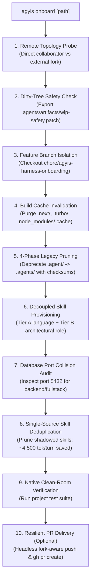

<!-- SPDX-License-Identifier: Apache-2.0 -->
<!-- Copyright (c) 2026 Arafat Zahan (@kuasha420) -->
<!-- Corporate Stewardship & Infrastructure: Purrfect Software Limited (PSL) -->
<!-- Governed by: ICARO-42/b Ordinance (Company-Supported Personal IP Framework) -->

# Agyis Harness for Google Antigravity™ (`agyis-harness`)

[](https://opensource.org/licenses/Apache-2.0)
[](https://antigravity.google)
[](roadmap.md)
[-brightgreen.svg)](docs/official-specs/testing-contracts.md)

> **The enterprise extension harness and developer CLI for Google Antigravity™.**  
> Eliminates context cliffs, runaway loops, terminal command panics, and prompt bloat through deterministic lifecycle hooks, hermetic runtime guarantees, and turnkey repository onboarding.

---

> [!IMPORTANT]
> **Unified CLI Nomenclature**: The primary CLI executable is **`agyis`**. The legacy command `psl` is maintained as a backward-compatible alias with an active deprecation lifecycle. All workflows, scripts, and documentation use `agyis`.

---

## 🛡️ Why Agyis? Deterministic Invariants

Antigravity agents running Gemini 3.8 Flash or Gemini 3.1 Pro demonstrate industry-leading tool reasoning, but long-horizon autonomous tasks routinely stumble on harness-level friction. Agyis solves these issues in **deterministic code, not prompt tokens**:

| Friction Point | What Breaks in Raw Agent Sessions | How Agyis Deterministically Solves It |
| :--- | :--- | :--- |
| **Output Flooding** | Commands dump thousands of lines, triggering the 100k-token cognitive degradation cliff. | **Deterministic 2KB Compactor** caps tool output while preserving head, tail, and exit/error markers (saving >21% context tokens). |
| **Terminal False Panics** | 98.4% of tool failures occur in `run_command` (e.g. `grep`/`diff` exit 1 panics, pager hangs). | **Command Safety Guard** auto-sanitizes empty grep/diff returns (`\|\| [ $? -eq 1 ]`) and enforces `PAGER=cat`. |
| **Runaway Loops** | Agents repeat failing tool calls or identical search queries in tight loops. | **Anti-Loop Breaker** denies execution after 3 identical consecutive calls, forcing cognitive shifts. |
| **Premature Completion** | Agents declare tasks "complete" with failing tests or unverified specification edits. | **Phase-Aware Completion Fence** halts termination until native tests pass or cleanroom specs verify. |
| **Prompt Token Bloat** | Workspaces duplicate global skills in `.agents/skills/`, wasting ~4,500 tokens on every turn. | **Single-Source Skill Deduplication** purges shadowed skills, keeping local workspaces ultra-lean. |
| **Runtime Mismatches** | Host pyenv/conda shims run outdated runtimes, crashing modern Python >= 3.12 syntax. | **Hermetic Injection & Auto-Healing** automatically provisions and injects CPython 3.12 via `uv`. |

---

## ⚡ The 5-Minute Developer Happy Path

Get from zero to fully protected Antigravity agent workflows in five simple steps:

```text
[1. Install] ──> [2. Diagnose] ──> [3. Onboard Repo] ──> [4. Verify] ──> [5. Daily Workflow]
 agyis install     agyis doctor        agyis onboard .       agyis test       hooks + tests + fence
```

### Step 1: Install Workstation Plugin & CLI

Deploy the reference harness plugin into Antigravity extension surfaces and install `agyis` into `~/.local/bin`:

```bash
# Option A: Developer / Source Install (Recommended)
git clone https://github.com/kuasha420/agyis-harness.git
cd agyis-harness
./agyis install --all-surfaces

# Option B: Standalone Zero-Clone Install (uv tool)
uv tool install git+https://github.com/kuasha420/agyis-harness.git
agyis install --copy --all-surfaces
```

### Step 2: Verify Workstation Health & Auto-Heal

Audit your host environment against the 3-tier runtime matrix (Python >= 3.12, Node >= 20, git, gh, ripgrep):

```bash
# Audit workstation runtimes and database port collisions
agyis doctor

# Safe, zero-sudo user-space repair if tools or runtimes are missing
agyis doctor --heal
```

### Step 3: Turnkey Workspace Onboarding (`Universal Golden Path`)

Navigate to **any** software repository and onboard it with a single command:

```bash
cd /path/to/my-project

# Standard golden path: auto-detects stack/role, purges cache, deduplicates skills
agyis onboard .

# Or onboard in an isolated feature branch:
agyis onboard . --create-branch chore/agyis-onboard
```

### Step 4: Verify Hermetic Tests & Check Status

```bash
# Run complete test suite (<25s suite, sub-second unit components)
agyis test

# Inspect active hooks, cognitive attention horizon, and live subagents
agyis status
```

### Step 5: Daily Workflow & Agent Execution

Once onboarded, your development lifecycle with Google Antigravity is protected automatically:

1. **Transparent Hook Protection**: Every command and tool execution is transparently safeguarded by background hooks (command sanitization, pager suppression, 2KB output compaction, and anti-loop breakers).
2. **Hermetic Virtualenv Auto-Promotion**: Running `agyis` inside a repository containing `.venv/` automatically executes within `.venv/bin/python`.
3. **Surgical Contiguous Edits**: Agents edit code using targeted single-block replacements (`replace_file_content`), maintaining a 99.47% tool success rate.
4. **Completion Fence Clearance**: When finishing a code modification, running `agyis test` (or the project's native test command) clears the `code_dirty` flag, allowing the agent to conclude the task cleanly.
5. **Skill Hygiene & Deduplication**: If custom workspace skills are authored, run `agyis skills --prune-duplicates` to keep context windows lean.
6. **Milestone Compaction**: At milestones, compact findings into `docs/taxonomy/project-ledger.md` under 50 lines and reset turns.

---

## 📦 Turnkey Workspace Onboarding (`agyis onboard`)

The flagship **`agyis onboard`** engine is the **Universal Golden Path** (ADR-031) for onboarding internal, client, or open-source repositories. It replaces multi-step manual setup with an atomic 10-phase pipeline:



### Key Capabilities

1. **Dedicated Branch Isolation**: Creates and checks out an isolated onboarding branch (`--create-branch chore/agyis-onboard`).
2. **Dirty-Tree Safety Protection**: If uncommitted edits exist, `--allow-dirty` automatically exports a snapshot to `.agents/artifacts/wip-safety-pre-onboard.patch` and configures `.git/info/exclude` to prevent repository pollution.
3. **Build Cache Invalidation**: Purges stale `.next/`, `.turbo/`, and `node_modules/.cache` directories by default (`--purge-caches`) to prevent phantom build or TypeScript regressions.
4. **4-Phase Legacy Harmonization**: Migrates legacy `.agent/` directories to `.agents/`, archives backups to `.agents/archive/`, and upgrades invariant rule blocks.
5. **Decoupled Stack & Role Skills**: Auto-detects repository language (`typescript`, `python`, `rust`, `go`, `systems`, `shell`) and architectural role (`frontend`, `backend`, `fullstack`, `cli`, `library`, `mobile`, `infra`).
6. **Single-Source Skill Deduplication**: Automatically prunes local skills that shadow global plugin skills, saving **~4,500 prompt tokens per turn**.
7. **Database Port Collision Auditing**: Inspects port 5432 occupancy on backend/fullstack projects to detect Docker collisions (e.g. Prisma P1000).
8. **Automated Fork-Aware PR Delivery**: Commits clean changes and opens a GitHub Pull Request via `gh pr create` when `--pr` is supplied.

### Common Onboarding Invocations

```bash
# 1. Standard turnkey local onboarding (auto-detects stack & role, purges cache)
agyis onboard .

# 2. Onboard in an isolated feature branch
agyis onboard . --create-branch chore/onboard-harness

# 3. Explicit language and role specification
agyis onboard . --lang typescript --role frontend
agyis onboard . --lang python --role backend

# 4. Monorepo subproject onboarding
agyis onboard . --subproject services/billing --role backend

# 5. Safe dry-run preview (zero disk or git mutations)
agyis onboard . --dry-run --json

# 6. Proceed on dirty working tree with automated safety patch export
agyis onboard . --allow-dirty --create-branch

# 7. Automated end-to-end onboarding with GitHub Pull Request delivery
agyis onboard . --create-branch --pr
```

> Read the full operational runbook: 👉 **[docs/runbooks/repo-onboarding.md](docs/runbooks/repo-onboarding.md)**

---

## 🛠️ Consolidated CLI Palette

The unified `agyis` CLI exposes 18 modular subcommands ([`docs/official-specs/cli-palette.md`](docs/official-specs/cli-palette.md)) organized into 7 operational domains:

```bash
# 🚀 Workspace Onboarding & Scaffolding
agyis onboard [path] [flags]     # Turnkey onboarding (branch, cache purge, dedup, PR)
agyis init [path] [-s <stack>]   # Initialize workspace rules and tailored skills
agyis harmonize [path] [--dry-run] # Harmonize legacy .agent/ directories into .agents/

# 🩺 Diagnostics, Auto-Healing & Status
agyis doctor [--heal]            # Audit 3-tier runtime matrix & port 5432 collisions
agyis doctor --experimental-rea  # Deep REA provider & cleanroom tooling audit
agyis status                     # Dashboard: health, active hooks, attention gauge & skills

# 🧪 Verification & Cleanroom Testing
agyis test [-v]                  # Run hermetic test suite (<1.0s benchmark, resets fences)
agyis verify [--spec]            # Formally verify cleanroom specifications & obligations

# 🧩 Modular Skills & Subagents Discovery
agyis skills [--sync]            # Inspect, synchronize, or tailor modular skills
agyis skills --prune-duplicates  # Prune duplicate skills shadowing global plugin
agyis agents [name|create|sync]  # Catalog, scaffold, and validate specialist subagents
agyis subagents [--json]         # Live subagent context health table (<2ms query)

# 🪝 Deterministic Lifecycle Hooks Engine
agyis hook command-safety        # Terminal command sanitization & python shim hook
agyis hook anti-loop             # Redundant tool call breaker hook
agyis hook compactor             # Deterministic 2KB output compactor hook
agyis hook completion-fence      # Stop gate verification fence (code vs spec dirty)
agyis hook anti-drift            # Plan boundary & cognitive anchor hook
agyis hook token-proximity-guard # Proactive token urgency monitor

# 🌐 Remote Operations & Fleet Telemetry
agyis remote exec <host> "<cmd>" # Multiplexed SSH execution with login-shell promotion
agyis remote script <host> <file> # Zero-disk stdin script streaming
agyis remote triage <host>       # Compact (<2KB) multi-system health report
agyis sync                       # Bi-directional telemetry synchronization
agyis sync --service {install,status,start,stop} # Background sync systemd user daemon
agyis auth <login|status|logout> # GitHub organization telemetry authentication
agyis audit [stage]              # Empirical telemetry laboratory extraction (13 stages)

# 🖥️ Developer Tooling & Antigravity GUI
agyis gui [--devtools] [--toggle] # Unlock Antigravity Electron GUI via live CDP WebSocket
agyis install [--all-surfaces]   # Install harness plugin globally across surfaces
agyis uninstall                  # Clean plugin uninstallation without collateral damage
```

---

## 🪝 Deterministic Lifecycle Guards

Agyis intercepts and safeguards Antigravity agent tool calls through deterministic lifecycle hooks defined in [`hooks.json`](hooks.json) and executed via `agyis hook <name>`:

1. **PreToolUse: Command Safety & Runtime Injection (`command-safety`)**:
   - Prepends certified CPython 3.12 (via `uv`) to `$PATH` for inline python scripts (`python3 -c`), eliminating syntax crashes.
   - Appends `|| [ $? -eq 1 ]` to standalone `grep` and `diff` queries to neutralize benign empty-match exit 1 failures without swallowing syntax errors.
   - Enforces `PAGER=cat` on `git` and `gh` invocations to prevent interactive subshell terminal hangs.
   - Injects non-login subshell shims for user binaries (`~/.local/bin`, `~/.npm-global/bin`).
2. **PreToolUse: Anti-Loop Guard (`anti-loop`)**:
   - Tracks consecutive tool invocations per session in state storage (`/tmp/agyis_harness_state/`).
   - Automatically intercepts and denies execution after 3 identical consecutive calls, forcing a cognitive strategy shift.
   - Enforces bounded quotas for specification authoring while preserving verification command resets.
3. **PostToolUse: Deterministic Output Compactor (`compactor`)**:
   - Caps tool outputs exceeding 2KB while preserving the first 500 characters, the last 1,000 characters, and all intermediate exit codes or error markers.
   - Employs pre-slice character bounding on large dumps (>200KB) to prevent CPU starvation and hook timeouts.
4. **Stop: Phase-Aware Completion Fence (`completion-fence`)**:
   - Enforces the Universal Automated Verification Standard: agents cannot declare a task complete if executable source code was modified without passing tests (`code_dirty = True`).
   - Decouples declarative specification authoring (`spec_dirty`) from software code modifications (`code_dirty`), preventing specification deadlocks during cleanroom reverse engineering.
   - Clears flags cleanly upon executing `agyis test` or `agyis verify --spec`.
5. **PreToolUse: Anti-Drift Guard (`anti-drift`)**:
   - Prevents agents from drifting outside declared task boundaries or mutating sensitive project governance files.
6. **PreToolUse: Token Proximity Guard (`token-proximity-guard`)**:
   - Monitors trajectory token consumption against attention horizons and emits proactive compaction warnings before hitting context degradation cliffs.

> Read the full specification: 👉 **[docs/official-specs/lifecycle-hooks.md](docs/official-specs/lifecycle-hooks.md)**

---

## 🏛️ Architecture: The 3-Tier Precedence Hierarchy (ADR-030)

Agyis Harness operates under a strict **3-Tier Coexistence Precedence Hierarchy**. Higher-precedence layers cleanly override lower-precedence defaults without configuration drift:

```text
[Layer 3: Workspace Local] (<project-root>/.agents/) ── HIGHEST PRECEDENCE
         │ (Project-specific skills, bespoke rules, and local ledgers)
         ▼
[Layer 2: Workstation User] (~/.gemini/config/, ~/.gemini/antigravity/)
         │ (User preferences, developer credentials, and custom agents)
         ▼
[Layer 1: Global Plugin] (~/.gemini/config/plugins/agyis-harness/) ── DEFAULT FALLBACK
           (Platform lifecycle hooks, certified runtimes, and standard skills)
```

- **Modular Skills**: A custom skill in `.agents/skills/<name>/SKILL.md` overrides any global skill with the same name. Standard skills are served globally from Layer 1 to preserve context tokens.
- **Rules (`AGENTS.md`)**: Local project rules take precedence, augmenting global standards with repository-specific constraints.
- **Runtimes & Tooling**: Local `.venv/bin/python` environments are auto-promoted during execution over system interpreters.

> Read the boundary specification: 👉 **[docs/runbooks/workspace-agent-boundaries.md](docs/runbooks/workspace-agent-boundaries.md)**

---

## 📊 Ground Truth: Empirical Telemetry Foundation

Agyis Harness is grounded in automated empirical audits of **722 developer sessions (219,292 steps, 160,226 tool executions)** captured in `data/telemetry.db`:

<details>
<summary><strong>Click to expand empirical baseline metrics & research findings</strong></summary>

| Metric | Empirical Baseline | Harness Solution & Impact |
| :--- | :--- | :--- |
| **Total Trajectory Steps** | 219,292 steps | Comprehensive multi-project long-horizon telemetry corpus. |
| **Total Tool Executions** | 160,226 calls | 97.46% baseline success rate; 98.4% of errors concentrated in `run_command`. |
| **Human Interventions** | 2,738 interventions | Average 1.25 interventions / 100 steps (99.3% caused by cognitive drift). |
| **Loop & Thrashing Traps** | 15,562 calls (9.71%) | Intercepted deterministically by `anti-loop` hook. |
| **Surgical Contiguous Edits**| 11,279 calls (99.47%) | ADR-013 validated: single-block edits achieve 99.47% success rate. |
| **The Context Cliff** | 5.2x error spike | Sessions exceeding 100k tokens suffer severe cognitive degradation. |
| **Output Token Reduction** | **21.3% token savings** | Capping non-error outputs at 2KB saves >10M context tokens across fleet. |

For deep analytical reports, see:
- 📑 [Cognitive Failure Taxonomy Deepdive](docs/taxonomy/cognitive-failure-taxonomy-deepdive.md)
- 📑 [Context Cliff Dynamics & Degradation Curves](docs/taxonomy/context-cliff-dynamics.md)
- 📑 [Tool Output Compactor POC Results](docs/taxonomy/output-compactor-poc-results.md)
- 📑 [Workstation Audit & Failure Clusters](docs/taxonomy/workstation-audit-report.md)
</details>

---

## 🧪 Verification & Testing Contract

All 1,065 unit, integration, and contract tests execute hermetically with zero external network dependencies:

```bash
./agyis test
# or: python3 -m harness.cli test
```

```text
Ran 1065 tests in 17.875s
OK
```

- **Sub-Second Benchmark Invariant**: Individual unit test modules execute in <1.0 second benchmark latency.
- **Hermetic Isolation**: Tests support `PSL_HARNESS_STATE_DIR` and use temporary directories.
- **Completion Fence Synchronization**: Passing the test suite clears active completion fence flags, allowing autonomous agents to conclude turns cleanly.

> Read the complete verification contract: 👉 **[docs/official-specs/testing-contracts.md](docs/official-specs/testing-contracts.md)**

---

## 🗺️ Master Roadmap & Architectural Horizons

- **Horizon 0 (Completed)**: Empirical Ground Truth, Telemetry Ingestion & Failure Taxonomy.
- **Horizon 1 (Completed)**: Product Foundation, Deterministic Lifecycle Hooks, and 18-Command CLI Suite.
- **Horizon 2 (Active)**: Turnkey Fleet Onboarding (`agyis onboard`), Knot Hardware Mesh Coordination, and Multi-Node Telemetry Replication.
- **Horizon 3 (Planned)**: Autonomous Multi-Agent Councils and Spatial Trajectory Cockpits.

Permanent architectural decisions are recorded in the living ledger:  
👉 **[docs/taxonomy/project-ledger.md](docs/taxonomy/project-ledger.md)** | **[roadmap.md](roadmap.md)**

---

## 📚 Documentation Index

- **Runbooks**:
  - [Canonical Repository Onboarding (`agyis onboard`)](docs/runbooks/repo-onboarding.md)
  - [Workspace & Agent Boundaries](docs/runbooks/workspace-agent-boundaries.md)
  - [Fork-Aware PR Creation & Git Hygiene](docs/runbooks/fork-and-upstream-pr.md)
  - [Telemetry Fleet Synchronization Daemon](docs/runbooks/telemetry-sync.md)
- **Official Specifications**:
  - [Consolidated 18-Command CLI Palette](docs/official-specs/cli-palette.md)
  - [Deterministic Lifecycle Hooks Contract](docs/official-specs/lifecycle-hooks.md)
  - [Hermetic Testing Standards](docs/official-specs/testing-contracts.md)
  - [Opt-in REA & Cleanroom Architecture](docs/official-specs/rea-antigravity-architecture.md)

---

## 📜 License & Governance

Licensed under the **Apache License, Version 2.0** ([LICENSE](LICENSE)) under the **CSP-IP Framework**.  
Copyright © 2026 Arafat Zahan (@kuasha420)  
Corporate Stewardship & Infrastructure: Purrfect Software Limited (PSL)  
Governed by: ICARO-42/b Ordinance (Company-Supported Personal IP Framework)