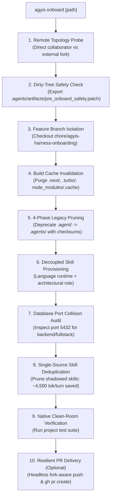

<!-- SPDX-License-Identifier: Apache-2.0 -->
<!-- Copyright (c) 2026 Arafat Zahan (@kuasha420) -->
<!-- Corporate Stewardship & Infrastructure: Purrfect Software Limited (PSL) -->
<!-- Governed by: ICARO-42/b Ordinance (Company-Supported Personal IP Framework) -->

# Agyis Harness for Google Antigravity™ (`agyis-harness`)

[](https://opensource.org/licenses/Apache-2.0)
[](https://antigravity.google)
[-8E75B2.svg)](docs/specs/antigravity_v2_34_compatibility_inventory.md)
[](https://github.com/kuasha420/agyis-harness/releases/tag/v1.0.0)
[](https://github.com/kuasha420/agyis-harness/actions/workflows/ci.yml)
[](docs/official-specs/testing-contracts.md)
[](docs/taxonomy/project-ledger.md)

> **The enterprise extension harness and developer CLI for Google Antigravity™ — ready for the Gemini 4 Model Family (`gemini-4-neon`, `gemini-4-hydrogen`, `512k`/`1M` scaled runway) and the Antigravity stack (`Desktop v2.34.0+` · `agy v1.5.15` · `IDE v2.8.0` · `REA v6.9.0`).**  
> Eliminates context cliffs, runaway loops, terminal command panics, and prompt bloat through deterministic lifecycle hooks (`PSL-INV-001`–`008` + on-demand `PSL-RE-001`), hermetic runtime guarantees, an in-situ Trajectory Debug HUD, and turnkey repository onboarding.

---

> [!IMPORTANT]
> **Unified CLI Nomenclature**: The primary CLI executable is **`agyis`**. The legacy command `psl` is maintained as a backward-compatible alias with an active deprecation lifecycle. All workflows, scripts, and documentation use `agyis`.

---

## 🛡️ Why Agyis? Deterministic Invariants

Antigravity agents powered by the **Gemini 4 model family (`gemini-4-neon`, `gemini-4-hydrogen`)** as well as Gemini 3.8 / 3.1 models deliver strong tool reasoning, but long-horizon autonomous sessions still hit harness-level friction. Agyis solves these issues in **deterministic code, not prompt tokens** (see [`docs/taxonomy/empirical-baselines.md`](docs/taxonomy/empirical-baselines.md) and [`antigravity_v2_34_compatibility_inventory.md`](docs/specs/antigravity_v2_34_compatibility_inventory.md)):

| Friction Point | What Breaks in Raw Agent Sessions | How Agyis Deterministically Solves It |
| :--- | :--- | :--- |
| **Output Flooding** | Long command dumps saturate context toward the degradation cliff (`45.9x` error / `32.0x` intervention surge in `200k+` trajectories). | **Smart `PostToolUse` Compactor (`overwriteResult`)** compacts succeeding `run_command` outputs `>2KB` and `read_file` outputs `>32KB` while keeping failing commands (`exitCode != 0` / `error`) **100% verbatim** (`39.69%` volume / `21.31%` context saved). |
| **Terminal False Panics** | `run_command` errors (`4.54%` failure rate across `101,940` calls; `19.24%` of Exit `1` failures from benign `grep`/`diff` probes) plus pager/shim hangs. | **Command Safety Guard** normalizes eager/lazy MCP args, enforces `PAGER=cat` & `SYSTEMD_PAGER=cat`, promotes fragile multi-line inline scripts, and guards `/swarm` pause states. |
| **Runaway Loops** | Agents repeat failing tool calls or identical searches (`21,410` loop candidates observed across `1,734` sessions). | **Anti-Loop Breaker** tracks canonical `v2.34` tools (`read_file`, `write_file`, `edit_file`, `swarm`, `run_workflow`), denies 3+ identical consecutive calls, and blocks background log-polling loops. |
| **Premature Completion** | Agents declare tasks "complete" with failing tests, unverified specs, or read-only roles mutating files via shell. | **Phase-Aware Completion Fence & Q5 Shell Guard** halts termination until native tests (`code_dirty`) or cleanroom specs (`spec_dirty`) verify, and blocks mutating shell commands for review/planning/auditor roles. |
| **Prompt Token Bloat** | Workspaces duplicate global skills in `.agents/skills/`, wasting ~4,500 tokens on every turn. | **Single-Source Skill & Rule Deduplication** purges shadowed skills and duplicate global rules across the 3-tier hierarchy, keeping workspaces ultra-lean. |
| **Runtime & Stack Drift** | Host pyenv/conda shims run outdated Python, and Antigravity `v2.34` removed default CDP DevTools ports. | **Hermetic `uv` CPython >= 3.12 Injection + Opt-In CDP Launcher (`agyis gui --install-launcher`)** keeps runtimes and the live ConnectRPC Trajectory HUD working seamlessly. |

---

## ⚡ The 5-Minute Developer Happy Path

Get from zero to fully protected Antigravity agent workflows in five steps:

```text
[1. Install] ──> [2. Diagnose] ──> [3. Onboard Repo] ──> [4. Verify] ──> [5. Daily Workflow]
 agyis install     agyis doctor        agyis onboard .       agyis test       hooks + tests + fence
```

### Step 1: Install Workstation Plugin & CLI

Deploy the reference harness plugin into Antigravity extension surfaces and install `agyis` into `~/.local/bin`:

```bash
# Option A: Frozen Release Wheel Install across All Surfaces (Recommended)
git clone https://github.com/kuasha420/agyis-harness.git
cd agyis-harness
./agyis install --global --wheel --all-surfaces

# Optional: Enable Opt-In CDP Launcher & Auto-Unlock Trajectory HUD Service
agyis gui --install-launcher
# Tip: Restart Antigravity completely from your desktop launcher after `--install-launcher`
# so the single-instance Electron process binds `--remote-debugging-port=0` and emits `DevToolsActivePort`.
agyis gui --service install

# Option B: Standalone Zero-Clone Install (uv tool)
uv tool install git+https://github.com/kuasha420/agyis-harness.git
agyis install --copy --all-surfaces
```

### Step 2: Verify Workstation Health & Auto-Heal

Audit your host environment against the 3-tier runtime matrix (Python >= 3.12, Node >= 20, `git`, `gh`, `ripgrep`), **8** hook runner checks, and port `5432` collisions:

```bash
# Audit workstation runtimes, hooks, symlinks, and database port collisions
agyis doctor

# Safe, zero-sudo user-space repair if tools or runtimes are missing
agyis doctor --heal
```

### Step 3: Turnkey Workspace Onboarding (`Universal Golden Path`)

Navigate to **any** software repository and onboard it with a single command:

```bash
cd /path/to/my-project

# Standard golden path: auto-detects stack/role, purges cache, deduplicates skills
agyis onboard .

# Or onboard in an isolated feature branch:
agyis onboard . --create-branch chore/agyis-onboard
```

### Step 4: Verify Hermetic Tests & Check Status

```bash
# Run complete test suite (~78s full suite; sub-second unit/contract components)
agyis test

# Inspect active hooks, cognitive attention horizon, and live subagents
agyis status
```

### Step 5: Daily Workflow & Agent Execution

Once onboarded, your development lifecycle with Google Antigravity is protected automatically:

1. **Transparent Hook Protection**: Every tool invocation is safeguarded by **7** `hooks.json` registration blocks (**8** runner targets verified by `doctor`), covering Antigravity `v2.34.0+` native tools (`write_file`, `edit_file`, `read_file`, `swarm`, `run_workflow`, `call_mcp_tool`, `mcp_.*`).
2. **Hermetic Virtualenv Auto-Promotion**: Running `agyis` inside a repository containing `.venv/` automatically executes within `.venv/bin/python`.
3. **Surgical Contiguous Edits**: Agents edit code using targeted single-block replacements (`edit_file`, matching the `99.25%` historical success rate of contiguous edits across `14,729` calls).
4. **Completion Fence Clearance**: Running `agyis test` clears `code_dirty`; running `agyis verify --spec` clears `spec_dirty` across `docs/specs/`.
5. **Skill Hygiene & Deduplication**: Run `agyis skills --prune-duplicates` and `agyis rules --dedup` to eliminate redundant prompt overhead (`PSL Invariant Codex v2`: **8** core invariants `PSL-INV-001`–`008` + on-demand `PSL-RE-001`).
6. **Dynamic Scaled Compaction**: Scales automatically across **Gemini 4 (`gemini-4-neon`, `gemini-4-hydrogen`, `512k`/`1M`)** and **`256k`** context windows (`70%` amber / `90%` red, `80`-step soft epoch horizon), emitting live `PreInvocation` `systemMessage` directives and CID-scoped checkpoints (`agyis checkpoint create`).

---

## 📦 Turnkey Workspace Onboarding (`agyis onboard`)

The flagship **`agyis onboard`** engine is the **Universal Golden Path** (`ADR-031B`) for onboarding internal, client, or open-source repositories. It replaces multi-step manual setup with an atomic 10-phase pipeline:



### Common Onboarding Invocations

```bash
agyis onboard .                                       # Auto-detect stack/role, purge cache, deduplicate skills
agyis onboard . --create-branch chore/onboard-harness # Onboard on an isolated feature branch
agyis onboard . --lang typescript --role frontend     # Explicit language + architectural role
agyis onboard . --subproject services/billing --role backend # Scoped monorepo subproject
agyis onboard . --dry-run --json                      # Safe preview without disk/git mutation
agyis onboard . --allow-dirty --create-branch         # Preserve dirty tree into pre_onboard_safety.patch
agyis onboard . --create-branch --pr                  # End-to-end onboarding with headless PR delivery
```

> Full human operator runbook: 👉 **[docs/runbooks/repo-onboarding.md](docs/runbooks/repo-onboarding.md)**

---

## 🛠️ Consolidated 28-Command CLI Palette

The unified `agyis` CLI registers **28** top-level subcommands (`router` and `ladder` separately; `changelog` also accepts `changelogs` — see [`docs/official-specs/cli-palette.md`](docs/official-specs/cli-palette.md)):

```bash
# 🚀 Workspace Onboarding & Hygiene
agyis onboard [path] [flags]     # Atomic 10-phase repository onboarding
agyis init [path] [-s <stack>]   # Initialize workspace rules, skills & cleanroom ledgers
agyis harmonize [path] [--dry-run] # Migrate legacy .agent/ configs into .agents/
agyis clean [--all] [--checkpoints] [--worktrees] # Purge stale checkpoints, worktrees & caches

# 🩺 Diagnostics, Auto-Healing & Status
agyis doctor [--heal]            # Audit 3-tier runtime matrix, 8 hook runner checks & port 5432
agyis doctor --experimental-rea  # Deep REA provider & cleanroom tooling audit
agyis status                     # Dashboard: health, active hooks, attention gauge & skills

# 🧪 Verification & Cleanroom Testing
agyis test [-v]                  # Run hermetic test suite (sub-second component benchmarks)
agyis verify [--spec]            # Verify 4 cleanroom RE specs & rea@6.9.0 typed obligation ledgers

# 🧩 30 Modular Skills, 8 Agent Personas & Rules
agyis skills [--sync]            # Inspect/sync 30 skills (>100 L ToC, <24,576 B cap)
agyis skills --prune-duplicates  # Prune duplicate workspace skills shadowing global plugin
agyis rules [--lint] [--dedup]   # Audit and deduplicate global/workspace agent rules
agyis agents [name|create|sync|validate] # Catalog, scaffold & validate the 8 canonical personas
agyis subagents [--json]         # Live subagent & /swarm context health & liveness (--liveness)

# 🛫 Cockpit Flight Direction & Routing
agyis cockpit status             # Cockpit dashboard: scaled 512k/1M tokens, subagents, plan & git
agyis cockpit route <A-L|alias>  # Structured dispatch briefing across 12 canonical workflows
agyis router / agyis ladder      # Dynamic subagent router subcommands (alias: ladder)
agyis checkpoint [status|generate|create|verify|prune] # CID-scoped pre-compaction succession

# 🔬 Dirtyroom RE & Extensible Commands
agyis re {status,init,patch-rea,pre-analyze,find,decompile,pcap,disasm,xrefs,addr,cache,daemon,seed,prime,clean} # 15-subcommand PE/ELF Cleanroom RE suite
agyis ext {list,run,init}        # Project-specific workspace extension commands (.agents/commands/)

# 🪝 Deterministic Lifecycle Hooks Engine
agyis hook command-safety        # Terminal sanitization, eager MCP normalization & swarm pause guard
agyis hook anti-loop             # Redundant tool call breaker & reactive wait hook
agyis hook compactor             # PostToolUse overwriteResult compactor (>2KB cmd / >32KB read_file)
agyis hook completion-fence      # Stop gate verification fence (code_dirty vs spec_dirty, continuationActive)
agyis hook anti-drift            # Plan boundary, native /plan lock & Q5 read-only role shell guard
agyis hook token-proximity-guard # Dynamic scaled token urgency monitor (256k / 512k / 1M windows)
agyis hook pre-invocation        # Role pinning, epoch horizon & systemMessage compaction advisory

# 🌐 Remote Operations & Fleet Telemetry
agyis remote exec <host> "<cmd>" # Multiplexed SSH execution with login-shell promotion
agyis remote script <host> <file> # Zero-disk stdin script streaming
agyis remote triage <host>       # Compact (<2KB) multi-system health report
agyis sync                       # Bi-directional telemetry synchronization
agyis sync --service {install,status,start,stop,uninstall} # Background sync systemd user daemon
agyis auth <login|status|logout> # GitHub organization telemetry authentication
agyis audit [stage]              # Empirical telemetry mining, AFF audit (`aff`) & Gate 2 (`certify`)

# 📦 Release Automation, GUI & Deployment
agyis release-notes              # Conventional commit parser & structured release notes
agyis changelog                  # Keep-a-Changelog generator (`changelogs` alias)
agyis gui [--install-launcher] [--service install] [--devtools] [--toggle] # Live CDP Trajectory HUD
agyis install [--wheel] [--all-surfaces] [--experimental-rea] # Install frozen wheel & sync surfaces
agyis uninstall                  # Clean plugin uninstallation without collateral damage
```

---

## 🪝 Deterministic Lifecycle Guards (`7` Blocks / `8` Runner Checks)

Agyis declares **7** registration blocks in [`hooks.json`](hooks.json) (symlink to [`harness/hooks/hooks.json`](harness/hooks/hooks.json)) backed by **8** runner targets verified by `agyis doctor` (default state path `/tmp/agyis_harness_state_{uid}`, overridable via `AGYIS_HARNESS_STATE_DIR` / `PSL_HARNESS_STATE_DIR`):

1. **`psl-command-safety-guard` (`PreToolUse`)**: Injects certified CPython >= 3.12 (`uv`), enforces `PAGER=cat` & `SYSTEMD_PAGER=cat`, normalizes `call_mcp_tool` & eager `mcp_*` arguments, guards `swarm{action:"kill"}` during pause states, and adds SSH timeouts + user PATH shims.
2. **`psl-anti-loop-guard` (`PreToolUse`)**: Covers `read_file`/`view_file`, `write_file`/`edit_file`, `swarm`, and `run_workflow`; breaks 3+ identical consecutive tool calls and blocks status/log polling loops.
3. **`psl-output-compactor` (`PostToolUse`)**: Emits `{"overwriteResult": compacted}` on succeeding `run_command` outputs `>2KB` and `read_file`/`view_file` outputs `>32KB`, while preserving failing commands (`exitCode != 0` or `error`) **100% verbatim** (`{}`).
4. **`psl-stop-verification-fence` (`PreToolUse`, `PostToolUse`, `Stop`)**: Tracks decoupled `code_dirty` vs `spec_dirty` via `verification-fence` and `post-verification-fence`; inspects `hookEventName` and `payload["error"]`, honors `StopHookArgs.continuationActive`, and clears on `agyis test` or `agyis verify --spec`.
5. **`psl-anti-drift-guard` (`PreToolUse`)**: Enforces plan boundaries (uppercase `Path`/`Content`/`Replacement`), Native Plan-Mode Lock (`ADR-031A`), read-only Auditor write-blocks, and the Q5 read-only shell mutation guard (`agyis_reviewer`, `agyis_planner`, `agyis_coordinator`, `agyis_auditor`, `agyis_investigator`).
6. **`psl-token-proximity-guard` (`PreToolUse`)**: Monitors active-epoch token accumulation with dynamic scaling across **`256k` / `512k` / `1M`** context windows in read-only SQLite URI mode (honoring `ANTIGRAVITY_APP_DATA_DIR`).
7. **`psl-compaction-advisory` (`PreInvocation`)**: Pins session roles, tracks the `80`-step soft epoch horizon, auto-saves CID-scoped `.agents/artifacts/checkpoints/<conv_id>.md`, and emits `v2.34.0` nested `systemMessage` advisories (`ADR-033`).

> Full schema & event contract: 👉 **[docs/official-specs/lifecycle-hooks.md](docs/official-specs/lifecycle-hooks.md)**

---

## 🏛️ Architecture: 3-Tier Precedence & Component Inventory

```text
[Layer 3: Workspace Local] (<project-root>/.agents/) ── HIGHEST PRECEDENCE
         │ (Project-only skills, bespoke rules, local specialists & commands)
         ▼
[Layer 2: Workstation User] (~/.gemini/config/, ~/.gemini/antigravity/)
         │ (User preferences, developer credentials & user agents)
         ▼
[Layer 1: Global Plugin] (~/.gemini/config/plugins/agyis-harness/) ── DEFAULT FALLBACK
           (7 hooks.json blocks, 30 modular skills, 8 canonical personas, certified runtimes)
```

- **Codex v2 Governance (`8` + `1`)**: **8** core universal invariants (`PSL-INV-001`–`008` in `GLOBAL_AGENTS.md` / `harness/rules/`) plus the on-demand `PSL-RE-001` cleanroom RE pack housed in `harness/skills/re-ops/SKILL.md`.
- **Modular Skills (`30`)**: Every `harness/skills/*/SKILL.md` over `100` lines carries a `## Table of Contents` and stays below `24,576` bytes; workspace skills mirroring plugin skills must be symlinks or pruned.
- **Agent Personas (`8`)**: Standard `agyis_*` personas (`<=20` canonical `v2.34+` tools) stay global; workspace `.agents/agents/` is reserved strictly for domain-unique specialists ([`docs/runbooks/repo-onboarding.md`](docs/runbooks/repo-onboarding.md#4-human-workspace--agent-boundary-controls)).
- **On-Demand REA Skill Healing**: `harness/runtime/healing.py` checks `rea-agents` packages and `~/.gemini/config/plugins/agyis-harness/skills/reverse-engineer-anything` rather than vendoring upstream skills in-tree.

---

## 📊 Ground Truth: Empirical Telemetry Foundation

Agyis Harness is grounded in reconciled empirical audits (`data/*.json` and read-only `data/telemetry.db` — live snapshot: **2,875 sessions, 598,911 steps, 424,817 tool calls, 5,604 interventions**):

<details>
<summary><strong>Click to expand reconciled empirical baseline metrics</strong></summary>

| Metric | Cohort Source | Reconciled Empirical Finding |
| :--- | :--- | :--- |
| **Tool Error Hotspots** | `classified_failures.json` (`N=1,734`) | `4,132` errors across `178,747` calls (`2.31%`); `run_command` accounts for `4.54%` failure rate (`4,629 / 101,940`) vs `0.75%` for `replace_file_content` (`110 / 14,729`). |
| **Benign Exit 1 Probes** | `classified_failures.json` (`N=1,734`) | Across `3,217` Exit `1` failures, `619` (`19.24%`) were empty `grep`/`diff` probes and `472` (`14.67%`) Python tracebacks. |
| **Loop & Thrashing Candidates** | `classified_failures.json` (`N=1,734`) | `21,410` repeated-call loop candidates (`view_file` `15,780`, `grep_search` `2,145`, `replace_file_content` `1,241`). |
| **Tool-Failure Disconnect** | `operator_interventions_summary.json` (`N=3,275`) | Only `26` interventions (`0.79%`) followed a failed tool call (`>99.2%` followed technically passing calls due to cognitive drift). |
| **Context Saturation Surge** | `context_dynamics_summary.json` (`N=1,731`) | `200k+` sessions average `57.79` errors (`45.9x`) and `39.00` interventions (`32.0x`) vs `<20k`, while per-call error rate stays flat (`1.87%–2.80%` in `N=2,875`). |
| **2KB Compaction Savings** | `volume_distributions.json` (`237,583` calls) | Saves **`39.69%`** output volume (`~22.44M` tokens, `0` error-truncation violations) and **`21.31%`** session context. |

Full reconciled tables and Issue #83 Route A/B/C scorecards:
- 📑 **[docs/taxonomy/empirical-baselines.md](docs/taxonomy/empirical-baselines.md)**
- 📑 **[Archived Taxonomy Index (`0069329`)](docs/archive/README.md#taxonomy)** · **[360 Telemetry Audit (2026-10, frozen at `0069329`)](docs/archive/README.md#reports)**

</details>

---

## 🧪 Verification & Testing Contract

All **2,486** unit, integration, and contract tests run hermetically with zero external network dependencies and zero live `~/.gemini/config/config.json` mutation:

```bash
./agyis test                         # Full hermetic suite (~78s; sub-second component modules)
python3 -m harness.cli verify --spec # Verify 4 cleanroom RE specifications in docs/specs/
python3 -m harness.cli audit aff     # Enforce Product/Project isolation, DAG acyclicity & PSL-INV-008 (100/100)
python3 -m harness.cli agents validate --json # Validate all 8 canonical v2.34+ agent schemas (<=20 tools)
python3 -m harness.cli rules --lint  # Verify agent rules & zero echo duplication
```

- **Hermetic Isolation**: Tests honor `AGYIS_HARNESS_STATE_DIR` / `PSL_HARNESS_STATE_DIR` (default `/tmp/agyis_harness_state_{uid}`) and use temporary directories (`docs/official-specs/testing-contracts.md`).
- **Cleanroom Specs (`4` specs)**: `docs/specs/` permits declarative cleanroom RE specifications only (including the 29-entry Antigravity `v2.34.0` compatibility inventory); `agyis verify --spec` enforces zero executable code inside `docs/specs/` and clears `spec_dirty`.

---

## 🗺️ Master Roadmap & Architectural Horizons

- **Horizon 0 & 1 (Completed — `v1.0.0` GA)**: Empirical taxonomy, **PSL Invariant Codex v2** (`PSL-INV-001`–`008` + `PSL-RE-001`), **7** lifecycle hook blocks (**8** runner checks), **28**-command CLI suite, **30** modular skills, **8** canonical `v2.34+` personas (`<=20` tool ceiling), modular ConnectRPC Trajectory HUD, ELF/PE cleanroom RE tooling, **29/29** Antigravity `v2.34.0` / Gemini 4 (`gemini-4-neon`, `gemini-4-hydrogen`, `512k`/`1M`) compatibility drifts resolved, and hardened CI/release wheel publishing.
- **Horizon 2 (Post-`v1.0.0`)**: Deferred `ADR-029` Spatial Terminal Multiplexing, Cross-Node Swarm & Publication, and RE & Audit Hardening.

👉 **[roadmap.md](roadmap.md)** | **[CHANGELOG.md](CHANGELOG.md)** | **[docs/taxonomy/project-ledger.md](docs/taxonomy/project-ledger.md)** | **[docs/adr/README.md](docs/adr/README.md)**

---

## 📚 Documentation Index

- **Guides**:
  - [Canonical User & Operator Guide](docs/user_guide.md)
  - [Developer & Architecture Guide](docs/developer_guide.md)
- **Human Operator Runbooks (`4`)**:
  - [Repository Onboarding, Agent Boundaries & Cross-Repo PRs](docs/runbooks/repo-onboarding.md)
  - [Telemetry Setup, Background Daemon & Fleet Sync](docs/runbooks/telemetry-and-fleet.md)
  - [Git, Worktree & Dirty-Tree Hygiene](docs/runbooks/git-and-worktree-hygiene.md)
  - [Dirtyroom & Cleanroom RE Operations](docs/runbooks/dirtyroom-operations.md)
- **Official Specifications (`7`)**:
  - [Consolidated 28-Command CLI Palette](docs/official-specs/cli-palette.md)
  - [Deterministic Lifecycle Hooks Contract](docs/official-specs/lifecycle-hooks.md)
  - [Cockpit Flight Director & Routing Spec](docs/official-specs/cockpit-director.md)
  - [Custom Codebase & Workspace-Aware Agents](docs/official-specs/custom-agents.md)
  - [Antigravity Platform Surface Mapping](docs/official-specs/platform-surface-mapping.md)
  - [Opt-in REA & Cleanroom Architecture](docs/official-specs/rea-antigravity-architecture.md)
  - [Hermetic Testing Contracts](docs/official-specs/testing-contracts.md)
- **Cleanroom RE Specifications (`4` specs, verified via `agyis verify --spec`)**:
  - [Antigravity Platform Compatibility & Drift Inventory (`v2.34.0` — 29/29 Resolved)](docs/specs/antigravity_v2_34_compatibility_inventory.md)
  - [Antigravity Compaction Reverse Engineering](docs/specs/antigravity_compaction_reverse_engineering.md)
  - [Antigravity GUI DevTools Unlocking](docs/specs/antigravity_gui_devtools_unlocking.md)
  - [Antigravity UI Token Surfacing Reverse Engineering](docs/specs/antigravity_ui_token_surfacing_reverse_engineering.md)
- **Architecture, Baselines & Archives**:
  - [Master ADR Registry (`ADR-001`–`ADR-035`)](docs/adr/README.md)
  - [Empirical Telemetry Baselines](docs/taxonomy/empirical-baselines.md) · [Active Project Ledger](docs/taxonomy/project-ledger.md)
  - [Frozen Archive Index (`0069329`, 48 docs)](docs/archive/README.md): [Historical RC10 Ledger](docs/archive/README.md#ledger) · [Archived Taxonomy](docs/archive/README.md#taxonomy) · [Archived Research](docs/archive/README.md#research) · [Rebrand Discussion](docs/archive/README.md#discussions)

---

## 📜 License & Governance

Licensed under the **Apache License, Version 2.0** ([LICENSE](LICENSE)) under the **CSP-IP Framework**.  
Copyright © 2026 Arafat Zahan (@kuasha420)  
Corporate Stewardship & Infrastructure: Purrfect Software Limited (PSL)  
Governed by: ICARO-42/b Ordinance (Company-Supported Personal IP Framework)
