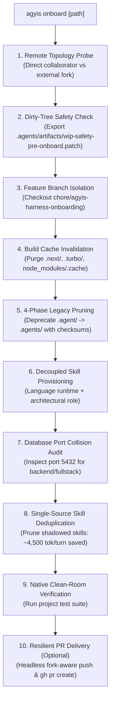

<!-- SPDX-License-Identifier: Apache-2.0 -->
<!-- Copyright (c) 2026 Arafat Zahan (@kuasha420) -->
<!-- Corporate Stewardship & Infrastructure: Purrfect Software Limited (PSL) -->
<!-- Governed by: ICARO-42/b Ordinance (Company-Supported Personal IP Framework) -->

# Agyis Harness for Google Antigravity™ (`agyis-harness`)

[](https://opensource.org/licenses/Apache-2.0)
[](https://antigravity.google)
[](roadmap.md)
[-brightgreen.svg)](docs/official-specs/testing-contracts.md)

> **The enterprise extension harness and developer CLI for Google Antigravity™.**  
> Eliminates context cliffs, runaway loops, terminal command panics, and prompt bloat through deterministic lifecycle hooks, hermetic runtime guarantees, and turnkey repository onboarding.

---

> [!IMPORTANT]
> **Unified CLI Nomenclature**: The primary CLI executable is **`agyis`**. The legacy command `psl` is maintained as a backward-compatible alias with an active deprecation lifecycle. All workflows, scripts, and documentation use `agyis`.

---

## 🛡️ Why Agyis? Deterministic Invariants

Antigravity agents running Gemini 3.8 Flash or Gemini 3.1 Pro demonstrate strong tool reasoning, but long-horizon autonomous tasks stumble on harness-level friction. Agyis solves these issues in **deterministic code, not prompt tokens** (see [`docs/taxonomy/empirical-baselines.md`](docs/taxonomy/empirical-baselines.md)):

| Friction Point | What Breaks in Raw Agent Sessions | How Agyis Deterministically Solves It |
| :--- | :--- | :--- |
| **Output Flooding** | Long command dumps saturate context toward the `100k–200k+` degradation cliff (`45.9x` error / `32.0x` intervention surge). | **Deterministic 2KB Compactor** caps non-error outputs while preserving head, tail, and error signatures (`39.69%` output volume / `21.31%` context saved). |
| **Terminal False Panics** | `run_command` errors (`4.54%` failure rate across `101,940` calls; `19.24%` of Exit `1` failures from benign `grep`/`diff` probes) plus pager/shim hangs. | **Command Safety Guard** auto-sanitizes empty `grep`/`diff` returns (`\|\| [ $? -eq 1 ]`) and enforces `PAGER=cat`. |
| **Runaway Loops** | Agents repeat failing tool calls or identical searches (`21,410` loop candidates observed across `1,734` sessions). | **Anti-Loop Breaker** denies execution after 3 identical consecutive calls and blocks status/log polling loops. |
| **Premature Completion** | Agents declare tasks "complete" with failing tests or unverified specification edits. | **Phase-Aware Completion Fence** halts termination until native tests (`code_dirty`) or cleanroom specs (`spec_dirty`) verify. |
| **Prompt Token Bloat** | Workspaces duplicate global skills in `.agents/skills/`, wasting ~4,500 tokens on every turn. | **Single-Source Skill Deduplication** purges shadowed skills across the 3-tier hierarchy, keeping local workspaces ultra-lean. |
| **Runtime Mismatches** | Host pyenv/conda shims run outdated runtimes, crashing modern Python >= 3.12 syntax. | **Hermetic Injection & Auto-Healing** automatically provisions and injects CPython >= 3.12 via `uv`. |

---

## ⚡ The 5-Minute Developer Happy Path

Get from zero to fully protected Antigravity agent workflows in five steps:

```text
[1. Install] ──> [2. Diagnose] ──> [3. Onboard Repo] ──> [4. Verify] ──> [5. Daily Workflow]
 agyis install     agyis doctor        agyis onboard .       agyis test       hooks + tests + fence
```

### Step 1: Install Workstation Plugin & CLI

Deploy the reference harness plugin into Antigravity extension surfaces and install `agyis` into `~/.local/bin`:

```bash
# Option A: Developer / Source Install (Recommended)
git clone https://github.com/kuasha420/agyis-harness.git
cd agyis-harness
./agyis install --all-surfaces

# Option B: Standalone Zero-Clone Install (uv tool)
uv tool install git+https://github.com/kuasha420/agyis-harness.git
agyis install --copy --all-surfaces
```

### Step 2: Verify Workstation Health & Auto-Heal

Audit your host environment against the 3-tier runtime matrix (Python >= 3.12, Node >= 20, `git`, `gh`, `ripgrep`), **8** hook runner checks, and port `5432` collisions:

```bash
# Audit workstation runtimes, hooks, symlinks, and database port collisions
agyis doctor

# Safe, zero-sudo user-space repair if tools or runtimes are missing
agyis doctor --heal
```

### Step 3: Turnkey Workspace Onboarding (`Universal Golden Path`)

Navigate to **any** software repository and onboard it with a single command:

```bash
cd /path/to/my-project

# Standard golden path: auto-detects stack/role, purges cache, deduplicates skills
agyis onboard .

# Or onboard in an isolated feature branch:
agyis onboard . --create-branch chore/agyis-onboard
```

### Step 4: Verify Hermetic Tests & Check Status

```bash
# Run complete test suite (~65s full suite; sub-second unit/contract components)
agyis test

# Inspect active hooks, cognitive attention horizon, and live subagents
agyis status
```

### Step 5: Daily Workflow & Agent Execution

Once onboarded, your development lifecycle with Google Antigravity is protected automatically:

1. **Transparent Hook Protection**: Every tool invocation is safeguarded by **7** `hooks.json` registration blocks (**8** runner targets verified by `doctor`).
2. **Hermetic Virtualenv Auto-Promotion**: Running `agyis` inside a repository containing `.venv/` automatically executes within `.venv/bin/python`.
3. **Surgical Contiguous Edits**: Agents edit code using targeted single-block replacements (`replace_file_content`, `99.25%` empirical success across `14,729` calls).
4. **Completion Fence Clearance**: Running `agyis test` clears `code_dirty`; running `agyis verify --spec` clears `spec_dirty` across `docs/specs/`.
5. **Skill Hygiene & Deduplication**: Run `agyis skills --prune-duplicates` and `agyis rules --dedup` to eliminate redundant prompt overhead.
6. **Milestone Compaction**: At milestones or `>=230k` red runway (`45`-step turn ceiling), capture checkpoints (`agyis checkpoint create`), compact [`docs/taxonomy/project-ledger.md`](docs/taxonomy/project-ledger.md), and reset sessions cleanly.

---

## 📦 Turnkey Workspace Onboarding (`agyis onboard`)

The flagship **`agyis onboard`** engine is the **Universal Golden Path** (`ADR-031B`) for onboarding internal, client, or open-source repositories. It replaces multi-step manual setup with an atomic 10-phase pipeline:



### Common Onboarding Invocations

```bash
agyis onboard .                                       # Auto-detect stack/role, purge cache, deduplicate skills
agyis onboard . --create-branch chore/onboard-harness # Onboard on an isolated feature branch
agyis onboard . --lang typescript --role frontend     # Explicit language + architectural role
agyis onboard . --subproject services/billing --role backend # Scoped monorepo subproject
agyis onboard . --dry-run --json                      # Safe preview without disk/git mutation
agyis onboard . --allow-dirty --create-branch         # Preserve dirty tree into wip safety patch
agyis onboard . --create-branch --pr                  # End-to-end onboarding with headless PR delivery
```

> Full human operator runbook: 👉 **[docs/runbooks/repo-onboarding.md](docs/runbooks/repo-onboarding.md)**

---

## 🛠️ Consolidated 28-Command CLI Palette

The unified `agyis` CLI registers **28** top-level subcommands (`router` and `ladder` separately; `changelog` also accepts `changelogs` — see [`docs/official-specs/cli-palette.md`](docs/official-specs/cli-palette.md)):

```bash
# 🚀 Workspace Onboarding & Hygiene
agyis onboard [path] [flags]     # Atomic 10-phase repository onboarding
agyis init [path] [-s <stack>]   # Initialize workspace rules, skills & cleanroom ledgers
agyis harmonize [path] [--dry-run] # Migrate legacy .agent/ configs into .agents/
agyis clean [--all] [--checkpoints] [--worktrees] # Purge stale checkpoints, worktrees & caches

# 🩺 Diagnostics, Auto-Healing & Status
agyis doctor [--heal]            # Audit 3-tier runtime matrix, 8 hook runner checks & port 5432
agyis doctor --experimental-rea  # Deep REA provider & cleanroom tooling audit
agyis status                     # Dashboard: health, active hooks, attention gauge & skills

# 🧪 Verification & Cleanroom Testing
agyis test [-v]                  # Run hermetic test suite (sub-second component benchmarks)
agyis verify [--spec]            # Verify 3 cleanroom RE specs (19 empirical evidence rows) & obligation ledgers

# 🧩 30 Modular Skills, 8 Agent Personas & Rules
agyis skills [--sync]            # Inspect/sync 30 skills (>100 L ToC, <24,576 B cap)
agyis skills --prune-duplicates  # Prune duplicate workspace skills shadowing global plugin
agyis rules [--lint] [--dedup]   # Audit and deduplicate global/workspace agent rules
agyis agents [name|create|sync]  # Catalog, scaffold, and validate the 8 canonical personas
agyis subagents [--json]         # Live subagent context health & heartbeat liveness (--liveness)

# 🛫 Cockpit Flight Direction & Routing
agyis cockpit status             # Cockpit dashboard: tokens, active subagents, plan & git
agyis cockpit route <A-L|alias>  # Structured dispatch briefing across 12 canonical workflows
agyis router / agyis ladder      # Dynamic subagent router subcommands (alias: ladder)
agyis checkpoint [status|generate|create|verify|prune] # Pre-compaction snapshot & succession

# 🔬 Dirtyroom RE & Extensible Commands
agyis re {status,init,patch-rea,pre-analyze,find,decompile,pcap,disasm,xrefs} # Cleanroom RE suite
agyis ext {list,run,init}        # Project-specific workspace extension commands (.agents/commands/)

# 🪝 Deterministic Lifecycle Hooks Engine
agyis hook command-safety        # Terminal command sanitization & python shim hook
agyis hook anti-loop             # Redundant tool call breaker & reactive wait hook
agyis hook compactor             # Deterministic 2KB output compactor hook
agyis hook completion-fence      # Stop gate verification fence (code_dirty vs spec_dirty)
agyis hook anti-drift            # Plan boundary, native /plan lock & auditor write-block hook
agyis hook token-proximity-guard # Proactive token urgency monitor (256k/180k/230k)
agyis hook pre-invocation        # Compaction advisory & 45-step turn ceiling PreInvocation hook

# 🌐 Remote Operations & Fleet Telemetry
agyis remote exec <host> "<cmd>" # Multiplexed SSH execution with login-shell promotion
agyis remote script <host> <file> # Zero-disk stdin script streaming
agyis remote triage <host>       # Compact (<2KB) multi-system health report
agyis sync                       # Bi-directional telemetry synchronization
agyis sync --service {install,status,start,stop,uninstall} # Background sync systemd user daemon
agyis auth <login|status|logout> # GitHub organization telemetry authentication
agyis audit [stage]              # Empirical telemetry mining, AFF audit (`aff`) & Gate 2 (`certify`)

# 📦 Release Automation, GUI & Deployment
agyis release-notes              # Conventional commit parser & structured release notes
agyis changelog                  # Keep-a-Changelog generator (`changelogs` alias)
agyis gui [--devtools] [--toggle] # Unlock Antigravity Electron GUI via live CDP WebSocket
agyis install [--all-surfaces]   # Install harness plugin globally across surfaces
agyis uninstall                  # Clean plugin uninstallation without collateral damage
```

---

## 🪝 Deterministic Lifecycle Guards (`7` Blocks / `8` Runner Checks)

Agyis declares **7** registration blocks in [`hooks.json`](hooks.json) backed by **8** runner targets verified by `agyis doctor` (default state path `/tmp/agyis_harness_state_{uid}`, overridable via `AGYIS_HARNESS_STATE_DIR` / `PSL_HARNESS_STATE_DIR`):

1. **`psl-command-safety-guard` (`PreToolUse`)**: Injects certified CPython >= 3.12 (`uv`), appends `|| [ $? -eq 1 ]` to standalone `grep`/`diff` probes, sets `PAGER=cat`, and injects SSH timeouts + user PATH shims.
2. **`psl-anti-loop-guard` (`PreToolUse`)**: Breaks 3+ identical consecutive tool calls and blocks `manage_task(status)` / log-tailing polling loops.
3. **`psl-output-compactor` (`PostToolUse`)**: Compacts outputs above 2KB (retaining 500B head + 1,000B tail + errors) with a 200KB pre-slice guard.
4. **`psl-stop-verification-fence` (`PreToolUse`, `PostToolUse`, `Stop`)**: Tracks decoupled `code_dirty` vs `spec_dirty` state via `verification-fence` and `post-verification-fence`; clears on `agyis test` or `agyis verify --spec`.
5. **`psl-anti-drift-guard` (`PreToolUse`)**: Enforces plan boundaries, Native Plan-Mode Lock (`ADR-031A`), and read-only Auditor write-blocks.
6. **`psl-token-proximity-guard` (`PreToolUse`)**: Monitors active session token accumulation (`180k` amber / `230k` red on `256k` window) in read-only SQLite URI mode.
7. **`psl-compaction-advisory` (`PreInvocation`)**: Enforces the `45`-step turn ceiling (`50`-step executioner horizon), auto-saves `.agents/artifacts/compaction_checkpoint_latest.md` and `cockpit_checkpoint.md`, and injects de-spammed advisories (`ADR-033`).

> Full schema & event contract: 👉 **[docs/official-specs/lifecycle-hooks.md](docs/official-specs/lifecycle-hooks.md)**

---

## 🏛️ Architecture: 3-Tier Precedence & Component Inventory

```text
[Layer 3: Workspace Local] (<project-root>/.agents/) ── HIGHEST PRECEDENCE
         │ (Project-only skills, bespoke rules, local specialists & commands)
         ▼
[Layer 2: Workstation User] (~/.gemini/config/, ~/.gemini/antigravity/)
         │ (User preferences, developer credentials & user agents)
         ▼
[Layer 1: Global Plugin] (~/.gemini/config/plugins/agyis-harness/) ── DEFAULT FALLBACK
           (7 hooks.json blocks, 30 modular skills, 8 canonical personas, certified runtimes)
```

- **Modular Skills (`30`)**: Every `harness/skills/*/SKILL.md` over `100` lines carries a `## Table of Contents` and stays below `24,576` bytes; workspace skills mirroring plugin skills must be symlinks or pruned.
- **Agent Personas (`8`)**: Standard `agyis_*` personas stay global; workspace `.agents/agents/` is reserved strictly for domain-unique specialists ([`docs/runbooks/repo-onboarding.md`](docs/runbooks/repo-onboarding.md#4-human-workspace--agent-boundary-controls)).
- **On-Demand REA Skill Healing**: `harness/runtime/healing.py` checks `rea-agents` packages and `~/.gemini/config/plugins/agyis-harness/skills/reverse-engineer-anything` rather than vendoring upstream skills in-tree.

---

## 📊 Ground Truth: Empirical Telemetry Foundation

Agyis Harness is grounded in reconciled empirical audits (`data/*.json` and read-only `data/telemetry.db` — live snapshot: **2,875 sessions, 598,911 steps, 424,817 tool calls, 5,604 interventions**):

<details>
<summary><strong>Click to expand reconciled empirical baseline metrics</strong></summary>

| Metric | Cohort Source | Reconciled Empirical Finding |
| :--- | :--- | :--- |
| **Tool Error Hotspots** | `classified_failures.json` (`N=1,734`) | `4,132` errors across `178,747` calls (`2.31%`); `run_command` accounts for `4.54%` failure rate (`4,629 / 101,940`) vs `0.75%` for `replace_file_content` (`110 / 14,729`). |
| **Benign Exit 1 Probes** | `classified_failures.json` (`N=1,734`) | Across `3,217` Exit `1` failures, `619` (`19.24%`) were empty `grep`/`diff` probes and `472` (`14.67%`) Python tracebacks. |
| **Loop & Thrashing Candidates** | `classified_failures.json` (`N=1,734`) | `21,410` repeated-call loop candidates (`view_file` `15,780`, `grep_search` `2,145`, `replace_file_content` `1,241`). |
| **Tool-Failure Disconnect** | `operator_interventions_summary.json` (`N=3,275`) | Only `26` interventions (`0.79%`) followed a failed tool call (`>99.2%` followed technically passing calls due to cognitive drift). |
| **Context Saturation Surge** | `context_dynamics_summary.json` (`N=1,731`) | `200k+` sessions average `57.79` errors (`45.9x`) and `39.00` interventions (`32.0x`) vs `<20k`, while per-call error rate stays flat (`1.87%–2.80%` in `N=2,875`). |
| **2KB Compaction Savings** | `volume_distributions.json` (`237,583` calls) | Saves **`39.69%`** output volume (`~22.44M` tokens, `0` error-truncation violations) and **`21.31%`** session context. |

Full reconciled tables and Issue #83 Route A/B/C scorecards:
- 📑 **[docs/taxonomy/empirical-baselines.md](docs/taxonomy/empirical-baselines.md)**
- 📑 **[docs/archive/taxonomy/](docs/archive/taxonomy/)** · **[360 Telemetry Audit (2026-10)](docs/archive/reports/360_telemetry_audit_2026_10.md)**

</details>

---

## 🧪 Verification & Testing Contract

All **1,993** unit, integration, and contract tests run hermetically with zero external network dependencies:

```bash
./agyis test                         # Full hermetic suite (~65s; sub-second component modules)
python3 -m harness.cli verify --spec # Verify 3 cleanroom RE specs (19 evidence rows: 10 SHA-256 ev_* + 9 EV-20261017 checks)
python3 -m harness.cli audit aff     # Enforce Product/Project isolation, DAG acyclicity & PSL-INV-011
python3 -m harness.cli rules --lint  # Verify agent rules & zero echo duplication
```

- **Hermetic Isolation**: Tests honor `AGYIS_HARNESS_STATE_DIR` / `PSL_HARNESS_STATE_DIR` (default `/tmp/agyis_harness_state_{uid}`) and use temporary directories (`docs/official-specs/testing-contracts.md`).
- **Cleanroom Specs (`3` specs, `19` verified empirical evidence rows)**: `docs/specs/` permits declarative cleanroom RE specifications only (`10` SHA-256 `ev_*` digests + `9` `EV-20261017` runtime checks); `agyis verify --spec` enforces zero executable code inside `docs/specs/` and clears `spec_dirty`.

---

## 🗺️ Master Roadmap & Architectural Horizons

- **Horizon 0 & 1 (Completed — Phases 0.5–35)**: Empirical taxonomy, **7** lifecycle hook blocks (**8** runner checks), **28**-command CLI suite, **30** modular skills, **8** personas, and `v1.0.0-rc10` enterprise hardening.
- **Horizon 2 (Active Post-RC10)**: Deferred `ADR-029` Spatial Terminal Multiplexing, Cross-Node Swarm & Publication, RE & Audit Hardening, and remaining `install_workspace()` fallback cleanup.

👉 **[roadmap.md](roadmap.md)** | **[CHANGELOG.md](CHANGELOG.md)** | **[docs/taxonomy/project-ledger.md](docs/taxonomy/project-ledger.md)** | **[docs/adr/README.md](docs/adr/README.md)**

---

## 📚 Documentation Index

- **Guides**:
  - [Canonical User & Operator Guide](docs/user_guide.md)
  - [Developer & Architecture Guide](docs/developer_guide.md)
- **Human Operator Runbooks (`3`)**:
  - [Repository Onboarding, Agent Boundaries & Cross-Repo PRs](docs/runbooks/repo-onboarding.md)
  - [Telemetry Setup, Background Daemon & Fleet Sync](docs/runbooks/telemetry-and-fleet.md)
  - [Git, Worktree & Dirty-Tree Hygiene](docs/runbooks/git-and-worktree-hygiene.md)
- **Official Specifications (`7`)**:
  - [Consolidated 28-Command CLI Palette](docs/official-specs/cli-palette.md)
  - [Deterministic Lifecycle Hooks Contract](docs/official-specs/lifecycle-hooks.md)
  - [Cockpit Flight Director & Routing Spec](docs/official-specs/cockpit-director.md)
  - [Custom Codebase & Workspace-Aware Agents](docs/official-specs/custom-agents.md)
  - [Antigravity Platform Surface Mapping](docs/official-specs/platform-surface-mapping.md)
  - [Opt-in REA & Cleanroom Architecture](docs/official-specs/rea-antigravity-architecture.md)
  - [Hermetic Testing Contracts](docs/official-specs/testing-contracts.md)
- **Cleanroom RE Specifications (`3` specs, `19` verified empirical evidence rows: `10` SHA-256 `ev_*` digests + `9` `EV-20261017` runtime checks; verified via `agyis verify --spec`)**:
  - [Antigravity Compaction Reverse Engineering](docs/specs/antigravity_compaction_reverse_engineering.md)
  - [Antigravity GUI DevTools Unlocking](docs/specs/antigravity_gui_devtools_unlocking.md)
  - [Antigravity UI Token Surfacing Reverse Engineering](docs/specs/antigravity_ui_token_surfacing_reverse_engineering.md)
- **Architecture, Baselines & Archives**:
  - [Master ADR Registry (`ADR-001`–`ADR-034`)](docs/adr/README.md)
  - [Empirical Telemetry Baselines](docs/taxonomy/empirical-baselines.md) · [Active Project Ledger](docs/taxonomy/project-ledger.md)
  - [Historical RC10 Ledger](docs/archive/ledger/project-ledger-rc10-historical.md) · [Archived Taxonomy](docs/archive/taxonomy/) · [Archived Research](docs/archive/research/) · [Rebrand Discussion](docs/archive/discussions/rebrand-agyis-epic.md)

---

## 📜 License & Governance

Licensed under the **Apache License, Version 2.0** ([LICENSE](LICENSE)) under the **CSP-IP Framework**.  
Copyright © 2026 Arafat Zahan (@kuasha420)  
Corporate Stewardship & Infrastructure: Purrfect Software Limited (PSL)  
Governed by: ICARO-42/b Ordinance (Company-Supported Personal IP Framework)
