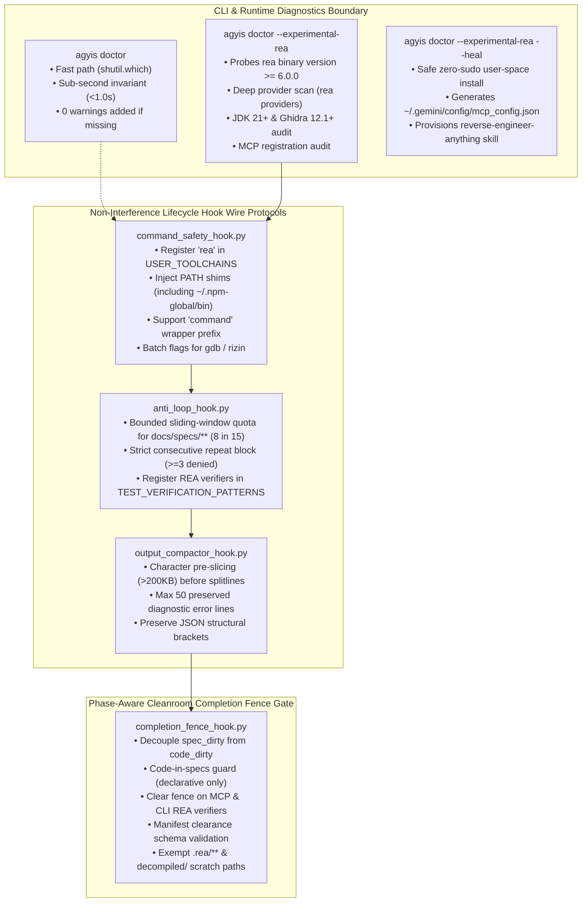

<!-- SPDX-License-Identifier: Apache-2.0 -->
<!-- Copyright (c) 2026 Arafat Zahan (@kuasha420) -->
<!-- Corporate Stewardship & Infrastructure: Purrfect Software Limited (PSL) -->
<!-- Governed by: ICARO-42/b Ordinance (Company-Supported Personal IP Framework) -->

# ADR-028: Opt-in REA Tooling and Cleanroom Reconstruction Harmonization

* **Status**: Accepted (Proposed for v1.0.0-rc4)
* **Date**: 2026-10-15
* **Authors**: PSL Lead Architect & Successor Orchestrator 17
* **Scope**: `harness/`, `docs/`, `skills/`
* **Document Reference**: `PSL-ADR-028`
* **Supersedes/Replaces**: Re-allocates reserved ADR-028 slot to REA harmonization.

---

## Context & Motivation

During the evolution of `psl-agy-harness` across Horizons 0 and 1, the harness established deterministic lifecycle hooks, sub-second hermetic test invariants (ADR-015), and completion fence stop hooks (ADR-022) to enforce rigorous agent behavior in Google Antigravity. Concurrently, complex reverse engineering and binary analysis workflows emerged, requiring the integration of **Reverse Engineer Anything (REA)** (upstream `morluto/rea`, package `rea-agents`, web `https://rea.tools/`).

In preliminary attempts to integrate REA and cleanroom specification verification into PR #47 (`feat/issue-remediation-41-46`), three severe architectural frictions arose:

1. **Doctor Latency Degradation (Issue #44)**:
   `harness/runtime/doctor.py` unconditionally invoked `rea --version` and `rea providers --json` on every single invocation of `agyis doctor`. Querying external disassembler installations (Ghidra, Hopper, IDA Pro, JADX) introduced **2.5 to 4.0 seconds of latency**, violating the ADR-015 sub-second benchmark invariant (<1.0s). Furthermore, when REA was absent or unconfigured, `doctor.py` incremented `summary["warning"]`, surfacing warning flags to standard web, systems, or backend developers who do not perform binary reverse engineering.

2. **Cleanroom Specification Deadlock (Issue #45)**:
   The stop verification fence (`completion_fence_hook.py`) classified edits to cleanroom specifications (`docs/specs/**`) and obligation ledgers (`.agents/ledger/**`) as production code dirtying (`code_dirty = True`). When an agent performed read-only black-box analysis of an unknown binary and authored a behavioral specification, attempting to exit triggered an insurmountable block:
   ```
   Verification Required: Unverified cleanroom contract edits detected in: docs/specs/api.md.
   Execute 'agyis test' (or 'python3 -m harness.cli test') before stopping.
   ```
   Because no unit tests existed for an initial black-box specification, the agent was forced into deadlock, having to trigger the safety valve twice to exit.

3. **Lifecycle Hook Interference**:
   - In non-login subshells where `~/.local/share/pnpm` was omitted from `PATH`, standalone `rea` terminal commands failed with Exit Code 127 (`command not found`) because `command_safety_hook.py` lacked `rea` in `USER_TOOLCHAINS`.
   - In `anti_loop_hook.py`, viewing cleanroom specifications during iterative reverse engineering tripped sliding-window repeat denials ($\ge 4$ in 15 calls) because `docs/specs/**` was omitted from heartbeat exemptions. Additionally, REA verification commands were absent from `TEST_VERIFICATION_PATTERNS`.
   - In `output_compactor_hook.py`, calling `.splitlines()` across tens of megabytes of raw disassembly dumps threatened Python CPU exhaustion and exceeded the 5.0-second hook timeout in `hooks.json`.

Per authoritative directive `2026-10-15T20:36:45Z`, REA integration and cleanroom gating were extracted from PR #47, Issues #44 and #45 were reopened on GitHub, and this dedicated architecture was formulated to harmonize REA natively into the harness without compromising core invariants.

---

## Decision Drivers

1. **Zero-Dependency Product Invariant (ADR-014)**:
   The distributable product (`harness/`) must remain hermetic and zero-dependency. Core harness operations must never mandate heavy JVM runtimes, external disassemblers, or third-party packages.
2. **Sub-Second Benchmark Invariant (ADR-015)**:
   Default `agyis doctor` diagnostics and test suite execution must complete strictly in **<1.0 second**. Long external probes must never degrade baseline runtime.
3. **The Non-Interference Invariant**:
   Harness lifecycle hooks must never obstruct, falsely throttle, or coerce false testing demands upon an agent executing legitimate reverse engineering, static inspection, or cleanroom specification authoring.
4. **Cleanroom Reconstruction Rigor without False Coercion**:
   Cleanroom contracts (`docs/specs/**`, `.agents/ledger/**`) must be protected and verifiable without coercing unrelated software unit test executions.
5. **Fail-Closed Evidence Evaluation**:
   Reconstruction claims must be validated mathematically against immutable Evidence IDs rather than probabilistic agent assertions.

---

## Considered Options

### Option 1: Monolithic Inclusion of REA as a Default Dependency
- Treat REA as a mandatory core language/toolchain in `matrix.json`.
- Run full REA checks in standard `agyis doctor`.
- **Verdict**: **REJECTED**. Violates the zero-dependency product invariant (ADR-014), bloats doctor latency by 3.5s, and injects unwanted warnings for standard software engineers.

### Option 2: Pure Out-of-Band External Server (Zero Harness Awareness)
- Leave REA entirely external as an unmanaged MCP server with zero harness changes.
- **Verdict**: **REJECTED**. Fails completely in practice. Subshell commands fail with exit 127 due to missing PATH shims; cleanroom specification drafting is blocked by `anti_loop_hook`; and completion fence stop hooks lock agents into termination deadlocks.

### Option 3: Opt-in `--experimental-rea` CLI Flag + Non-Interference Hooks + Cleanroom Decoupling
- Introduce explicit `--experimental-rea` CLI flags for deep doctor diagnostics, workspace init, and auto-healing.
- Maintain a zero-delay fast path in standard `agyis doctor` (<0.05s, 0 warnings added).
- Harmonize lifecycle hooks (`command_safety`, `anti_loop`, `completion_fence`, `output_compactor`) to eliminate false blocks during reverse engineering.
- Decouple specification authoring from code dirtying in the completion fence.
- Package `reverse-engineer-anything` as a first-class modular skill.
- **Verdict**: **ACCEPTED**. Perfectly balances complete developer autonomy, zero baseline overhead, and mathematical cleanroom rigor.

---

## Architectural Decisions



### 1. Opt-In CLI & Runtime Diagnostics Boundary (`--experimental-rea`)
- **Decision**: All heavy REA diagnostics, auto-installers, and provider audits are strictly gated behind the `--experimental-rea` CLI flag across `agyis doctor`, `agyis init`, `agyis onboard`, and `agyis install -g`.
- **Fast-Path Invariant**:
  When `--experimental-rea` is omitted, `harness/runtime/doctor.py` performs only a zero-delay binary probe (`shutil.which("rea")`). It skips `rea providers --json`, skips JDK/Ghidra filesystem scans, emits a concise informational status, and adds **zero warnings** to the diagnostic summary. Baseline `agyis doctor` runtime remains strictly **<1.0s**.
- **Deep Diagnostic Sweep**:
  When `--experimental-rea` is provided, `doctor.py` executes a comprehensive audit: CLI version (>=6.0.0), MCP server registration in `~/.gemini/config/mcp_config.json`, dynamic JDK 21+ discovery ladder (`$JAVA_HOME`), Ghidra distribution (`GHIDRA_INSTALL_DIR`), Hopper Headless Contract (`$DISPLAY`/`$WAYLAND_DISPLAY`/`xvfb-run`), IDA Pro supervisor isolation flags (`-A`, `-B`, `-o`), and JADX JAR.
- **Safe Zero-Sudo Auto-Healing (`--heal`)**:
  When combined with `--heal`, `agyis doctor --experimental-rea --heal` installs `rea-agents` via `pnpm add -g rea-agents` (or npm), configures `~/.gemini/config/mcp_config.json` with recommended environment variables (`REA_MCP_INPUT_SCHEMA_PROFILE: "full"`, `REA_MCP_OUTPUT_SCHEMA_PROFILE: "off"`), and provisions the `reverse-engineer-anything` skill.

### 2. Non-Interference Lifecycle Hook Wire Protocols
- **Decision**: Harmonize the lifecycle hooks to ensure transparent execution for REA tools:
  1. `command_safety_hook.py`:
     - Add `"rea"` to `USER_TOOLCHAINS` to inject PATH shims (`~/.local/share/pnpm`, `~/.npm-global/bin`, `~/.cargo/bin`, `~/.local/bin`, `~/.pyenv/shims`) in non-login bash subshells, permanently resolving Exit Code 127.
     - Add `Path.home() / ".npm-global/bin"` to candidate roots in `get_user_path_shims()`.
     - Extend `USER_TOOLCHAIN_REGEX` prefix wrapper to capture `command` (e.g. `command -v rea`, `command rea`).
     - Add `rea` installation suggestions in `COMMON_PACKAGE_SUGGESTIONS`.
     - Automatically rewrite interactive disassembler commands to batch modes (`gdb -batch`, `rizin -q -c`).
  2. `anti_loop_hook.py`:
     - Do **NOT** grant blanket immunity via `_is_peer_heartbeat`.
     - Implement a **bounded sliding-window quota** for cleanroom specifications (`docs/specs/**` and `.agents/ledger/**`), allowing an elevated threshold of up to 8 calls within a 15-call window (elevated from the default 4).
     - Strictly enforce **consecutive repeat limits**: $\ge 3$ consecutive identical `view_file` calls to the same specification path are immediately denied to break cognitive loops.
     - Add REA verification patterns (`rea verify`, `rea verify-reconstruction`, `rea test`, `agyis verify`) to `TEST_VERIFICATION_PATTERNS`, ensuring that cleanroom verification calls immediately reset anti-loop verification counters.
  3. `output_compactor_hook.py` (DEFECT-001 & DEF-04 Pre-Slice Character Bounding):
     - Guard against high-latency line-splitting and OOM on massive disassembly outputs (e.g. 50MB objdump) by enforcing character-offset slicing **before** line splitting.
     - For outputs exceeding 200KB (`len(middle) > 200_000`), slice `head_chunk = middle[:100_000]` and `tail_chunk = middle[-100_000:]`. Only execute `.splitlines()` on these bounded 100KB chunks.
     - Bound preserved diagnostic and error lines from candidate lines to a **maximum of 50 lines**.
     - Preserve JSON outer brackets to prevent corrupting structured JSON responses during compaction.

### 3. Phase-Aware Cleanroom Completion Fence Gate
- **Decision**: Redesign `completion_fence_hook.py` to decouple pure specification authoring from production code modifications:
  1. **Dual Dirty State Tracking & Code-in-Specs Guard (DEF-01)**:
     - Pure `spec_dirty` applies **strictly** to declarative document extensions:
       `DECLARATIVE_SPEC_EXTENSIONS = (".md", ".json", ".yaml", ".yml", ".proto", ".schema", ".fbs", ".toml", ".txt")`
     - Any modified file in `docs/specs/**` or `.agents/ledger/**` bearing a code extension (`.py`, `.ts`, `.rs`, `.go`, `.sh`, `.c`, `.cpp`, `.js`, etc.) **MUST trigger `code_dirty = True`** (dual dirty state), strictly enforcing project unit test verification before completion.
  2. **Specification Phase Clearance & MCP Verifier Clearance (DEF-03)**:
     - When *only* `spec_dirty` is True and `code_dirty` is False, the completion fence permits termination without coercing software unit test execution, provided cleanroom verification is executed or recorded.
     - In `PostToolUse`, intercept `call_mcp_tool` where `ToolName in ("verify_reconstruction", "evaluate_reconstruction_coverage")` or direct tool invocations matching `*verify_reconstruction*` / `*evaluate_reconstruction_coverage*`. Upon non-error completion, clear `spec_dirty = False`.
  3. **Formal Manifest Clearance Schema & Exact Rejection Message (DEF-06)**:
     - A recorded review in `.agents/ledger/manifest.json` clears `spec_dirty` only if it adheres strictly to the formal schema: `"status": "verified"`, valid 64-character SHA-256 `evidence_hash`, and a non-empty `obligations` array with all entries having `"status": "satisfied"`.
     - Exact `evaluate_stop` rejection message when `spec_dirty == True` and `code_dirty == False`:
       `"Cleanroom Verification Required: Unverified cleanroom contract edits detected in: <files>. Execute 'rea verify-reconstruction' or 'agyis verify --spec' before stopping."`
  4. **Universal Verifier Registration**:
     - Add REA verifier patterns (`rea verify-reconstruction`, `rea test`, `python3 -m harness.cli verify`, `agyis verify`) to `UNIVERSAL_TEST_RUNNER_PATTERNS` so that cleanroom verification clears both `spec_dirty` and `code_dirty`.
  5. **Scratch Path Isolation**:
     - Classify `.rea/**`, `**/decompiled/**`, and `**/artifacts/rea/**` as ephemeral analysis paths exempt from `is_code_file` dirty checks.

### 4. Canonical Packaging of `reverse-engineer-anything` Skill
- **Decision**: Package `reverse-engineer-anything` (skill version `"42"`, 207 MCP tools, 6 reference guides) as a first-class modular skill within `skills/reverse-engineer-anything/`.
- **Delivery**: Synchronized to `.agents/skills/` during `agyis init --experimental-rea` and to `~/.gemini/config/skills/` during `agyis install -g --experimental-rea`.

---

## Consequences

### Positive
- **Zero Overhead for Default Workflows**: Standard development workflows experience zero latency degradation, zero external dependency requirements, and zero spurious warnings in `agyis doctor`.
- **Elimination of Agent Deadlocks**: Reverse engineering agents can author cleanroom specifications in `docs/specs/**` and exit without hitting completion fence test-demanding deadlocks.
- **Subshell Reliability**: Transparent PATH injection guarantees `rea` commands succeed across all non-login subshells without exit code 127.
- **Scalable Disassembly Compaction**: Disassembly dumps no longer threaten Python CPU exhaustion or hook timeouts.
- **Strict Evidence Standards**: All reverse engineering deliverables are backed by cryptographic checksums, typed obligations, and residual unknowns tracking.

### Negative / Tradeoffs
- **Flag Discipline**: Developers working on reverse engineering tasks must remember to include `--experimental-rea` when running `doctor` or initializing workspaces.
- **Provider Maintenance**: Disassembler environments (JDK 21, Ghidra, Hopper, IDA) remain bring-your-own-provider and must be maintained by the host workstation.

### Mitigations
- `agyis doctor --experimental-rea --heal` automates user-space installation of `rea-agents` and configures `mcp_config.json` with correct environment variables in a single non-interactive command.
- Detailed actionable remediation messages are printed when disassemblers or JVMs are missing.

---

## Compliance & Verification Contract

1. **Sub-Second Doctor Benchmark Invariant**:
   - `tests/test_rea_doctor.py` asserts that `run_doctor()` without `--experimental-rea` executes in <0.05s and increments 0 warnings when REA is absent.
   - `python3 -m harness.cli doctor` runs in <1.0s on the host workstation.
2. **Hermetic Test Isolation**:
   - All tests in `tests/test_rea_doctor.py` and `tests/test_completion_fence_hook.py` mock subprocesses, filesystem paths, and MCP configs. Zero live network calls or heavy disassembler invocations.
3. **Completion Fence Contract Tests**:
   - Assert that authoring declarative specifications (`docs/specs/test.md`) does not trap agents in a unit test coercion loop when in specification mode.
   - Assert that authoring executable code (`docs/specs/helper.py`) sets `code_dirty = True`, strictly demanding software unit tests (DEF-01).
   - Assert that executing `rea verify-reconstruction` or calling `call_mcp_tool(ToolName="verify_reconstruction")` clears `spec_dirty` (DEF-03).
   - Assert that a valid `.agents/ledger/manifest.json` clears `spec_dirty`, while unverified stops fail with the exact cleanroom rejection message (DEF-06).
   - Assert that modifications to `.rea/` scratch dumps do not mark `code_dirty = True`.
4. **Lifecycle Hook Non-Interference**:
   - Assert that `command_safety_hook.py` injects `export PATH="...:$PATH"` (supporting `~/.npm-global/bin` and `command` wrappers) for `rea` commands (DEF-05).
   - Assert that `anti_loop_hook.py` applies the bounded 8-in-15 quota for `docs/specs/` while strictly blocking $\ge 3$ consecutive repeats (DEF-02).
   - Assert that `output_compactor_hook.py` character-pre-slices outputs >200KB before line splitting and bounds preserved error lines to max 50 (DEFECT-001 / DEF-04).

---

## References
- Authoritative Directive: `ORIGINAL_REQUEST.md § 2026-10-15T20:36:45Z`
- Official REA Specification: `docs/official-specs/rea-antigravity-architecture.md` (`PSL-SPEC-2026-REA-001`)
- Upstream REA Repository: `https://github.com/morluto/rea`
- REA Documentation: `https://rea.tools/get-started/`, `https://rea.tools/guides/`
- Governing Framework: ICARO-42/b Ordinance (Company-Supported Personal IP Framework)
