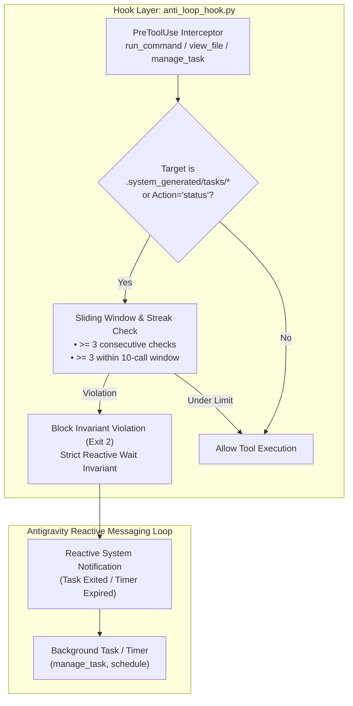

# ADR-032: Tool-Native Primacy and Task Log Anti-Polling Invariant

* **Status**: Accepted
* **Date**: 2026-10-10
* **Authors**: Antigravity & PSL Lead Architect
* **Scope**: `harness/hooks/anti_loop_hook.py`, `harness/skills/`, `.agents/skills/`, `harness/rules/AGENTS.md`
* **Related Issues & PRs**: Issue #32, PR #33

---

## Context & Motivation

Through empirical trace analysis of multi-turn autonomous execution across the `kuasha` `$HOME` workspace (including sessions `d3fbdfad-63f8-4578-a39a-6e3b2cd62690` and `171165ea-f64b-4916-ba80-b11115b3e31c`, totaling over 12,446 steps), two severe operational failure modes were observed:

1. **Circumvention of Task Polling Guards**:
   While `anti_loop_hook.py` already blocked repetitive `manage_task(Action='status')` calls, agents systematically evaded this guard by running shell commands (`cat`, `tail -n 20`, `head`, `grep`) targeting `.system_generated/tasks/task-*.log` or using `view_file` on task logs. In long-running background downloads or builds, this produced 45+ redundant tool invocations, consuming context window and thrashing the tool execution loop.

2. **Premature Cognitive Intervention**:
   When faced with network timeouts, CloudFront IP stalls, or Cloudflare HTTP 403 responses during media acquisition and format conversion, agents prematurely engaged in complex cognitive improvisation—attempting to decompile internal Python extractors, inject manual socket monkeypatches, write custom HTTP client scripts, or run multi-stage manual chunk downloads. In reality, modern native CLI tooling already provides hardened, battle-tested options (e.g., `yt-dlp --impersonate chrome -N 16` and `ffmpeg -vf vflip -c:a copy`) that solve these exact failure modes natively and in single-digit seconds without cognitive overhead.

---

## Architectural Decisions



### 1. The Strict Reactive Wait Invariant
- **Decision**: The Antigravity agentic runtime operates on an event-driven reactive messaging model. When a command or background task is running, the agent must **yield its turn** and wait for the system wakeup notification.
- **Enforcement**:
  - `harness/hooks/anti_loop_hook.py` inspects both `run_command` command-line strings and `view_file` target paths for references to `.system_generated/tasks/` or `.system_generated/logs/`, as well as `manage_task` calls with `Action='status'`.
  - Any attempt to inspect task logs $\ge 3$ consecutive times or $\ge 3$ times within a 10-call sliding window is deterministically denied with exit code 2 and the following guidance:
    ```
    PSL Anti-Loop Invariant: Repetitive task log inspection is forbidden.
    Background tasks send automatic notifications upon completion.
    Yield turn and wait for reactive notification instead of polling logs.
    ```

### 2. The Tool-Native Primacy Invariant
- **Decision**: Agents must exhaust idiomatic native tool flags and system commands before writing bespoke scripts, reverse-engineering libraries, or monkeypatching network layers.
- **Rule Definition**: Codified in `harness/rules/AGENTS.md` and `.agents/rules/AGENTS.md`:
  - When acquiring streams or handling restricted downloads: Always test native impersonation (`--impersonate chrome`) and multi-threading (`-N 16`) before attempting custom scrapers.
  - When manipulating video/audio: Always use native hardware-accelerated or losslessly remuxed `ffmpeg` (`-c:a copy`, native filters) rather than decoding and re-encoding with custom Python libraries.
  - When managing system services, storage, audio, or displays: Always invoke established OS user-space tools (`wpctl`, `kscreen-doctor`, `du -xhd 1`, `paccache`) rather than destructive system calls or ad-hoc process killing (`kill -9`).

### 3. Modular Workstation and Operations Skill Taxonomy
To anchor the Tool-Native Primacy Invariant in discoverable, repeatable protocols, 5 modular skills were codified and mirrored symmetrically across `harness/skills/` and `.agents/skills/`:

| Skill | Category | Native Tools & Protocols | Invariants & Guardrails |
| :--- | :--- | :--- | :--- |
| **`media-ops`** | Streaming & Video | `yt-dlp` (`--impersonate chrome`, `-N 16`, `--cookies-from-browser`), `ffmpeg` (`vflip`, `-c:a copy`), `ffprobe` | Exhaust native flags before cognitive scripting; preserve lossless audio streams. |
| **`storage-ops`** | Disk & Cache Hygiene | `du -xhd 1`, `uv cache clean`, `pnpm store prune`, `paccache -r -k 2`, `journalctl --vacuum-size=200M`, `docker system prune` | Bounded-depth exploration only; never run unbound `find` or `rm -rf` without dry-run confirmation; verify `ntfs3` mount options. |
| **`audio-ops`** | Audio Routing | PipeWire / WirePlumber (`wpctl status`, `wpctl inspect`, `wpctl set-default`), `bluetoothctl`, `loudnorm` filter | Strictly user-space routing via `wpctl`; never delete system configurations or kill core audio daemons. |
| **`display-ops`** | Wayland & Portals | `kscreen-doctor -o`, `systemctl --user restart xdg-desktop-portal`, Electron `--enable-features=UseOzonePlatform --ozone-platform=wayland`, Sunshine KMS capabilities | Never `killall -9` portal processes; probe modes before mutation; verify KMS DRM capture permissions. |
| **`sec-forensics`** | Security & Triage | `docker run --rm -v /:/host:ro`, `gcloud iam service-accounts keys delete`, `harness.cli remote script`, Typst headless PDF | Enforce strictly read-only filesystem mounts (`:ro`); immediate credential revocation; non-interactive remote script streaming. |

---

## Verification & Metrics

- **Unit Test Coverage**:
  - `tests/test_anti_loop.py`: Validates streak and window violations for `manage_task(Action='status')`, `view_file` on task logs, and shell commands (`cat`, `tail`, `grep`) targeting task log paths.
  - `tests/test_skills.py`: Validates contract schemas, discoverability, command listings, and frontmatter across all 5 modular skills.
  - `test_agents_rules_mirror_in_sync`: Enforces 100% bitwise parity between `harness/rules/AGENTS.md` and `.agents/rules/AGENTS.md`.
- **Benchmark Performance**: All 377 test cases execute in **1.57 seconds**, maintaining the PSL sub-2.0s execution invariant.
- **Telemetry Verification**: Verified central hub synchronization (`psl sync --push` and `psl sync --pull`) against `https://psl-harness.infra.purrfecthq.com`, confirming anti-echo filtering across multi-developer environments.
