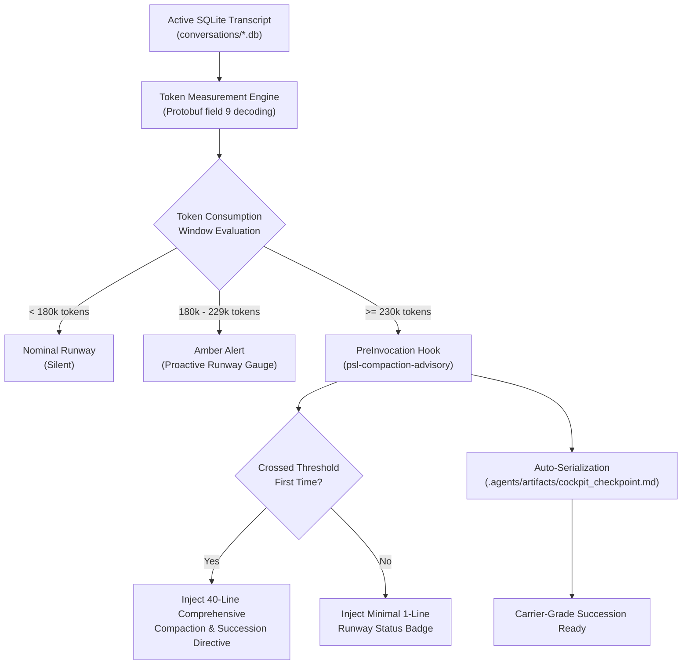

<!-- SPDX-License-Identifier: Apache-2.0 -->
<!-- Copyright (c) 2026 Arafat Zahan (@kuasha420) -->
<!-- Corporate Stewardship & Infrastructure: Purrfect Software Limited (PSL) -->
<!-- Governed by: ICARO-42/b Ordinance (Company-Supported Personal IP Framework) -->

# ADR-033: Dynamic Context Runway, Attention Horizon and Pre-Invocation Compaction Advisory

* **Status**: Accepted
* **Date**: 2026-10-25
* **Authors**: Antigravity & PSL Lead Architect
* **Scope**: `harness/hooks/token_proximity_guard.py`, `harness/hooks/pre_invocation_hook.py`, `harness/delivery/compaction_checkpoint.py`, `harness/commands/cockpit.py`, `harness/commands/status.py`
* **Related Issues & PRs**: Issues #68, #77, #94, #95; Milestone v1.0.0-rc7/rc9

---

## Context & Motivation

Long-horizon agent sessions on Google Antigravity (frequently spanning $>1,000$ steps or 250k+ tokens) suffer from context degradation and sudden compaction amnesia. When context approaches platform compaction limits, several critical failures occur:

1. **Abrupt Compaction Amnesia**: Without proactive runway visibility, agents are caught unprepared when Antigravity executes an automatic turn compaction, losing active execution plans, current task objectives, and dirty file states.
2. **Context Advisory Flooding**: Early warning mechanisms that repeatedly dump multi-paragraph advisory instructions on every tool use waste thousands of tokens per turn, accelerating the exact context cliff they attempt to prevent.
3. **Synthetic Mock Desynchronization**: Diagnostic CLIs that rely on hardcoded fixtures or synthetic mock numbers provide false reassurance instead of real transcript token counts.

---

## Architectural Decisions

### 1. Standardized Attention Runway Constants
Standardized active context thresholds across `harness/hooks/token_proximity_guard.py` and `harness/hooks/pre_invocation_hook.py`:
- **Model Attention Window**: `256,000` tokens.
- **Amber Warning Alert**: `180,000` tokens (approaching critical threshold).
- **Red Pulse / Compaction Trigger**: `230,000` tokens (compaction imminent, initiate succession).
- **Horizon Compulsory Interrupt**: `245,000` tokens (5 steps remaining; open sweeps blocked).

### 2. State-Gated De-Spammed PreInvocation Hook (`psl-compaction-advisory`)
- Configured in `hooks.json` under `PreInvocation` events.
- Intercepts turn dispatch *before* the model processes instructions.
- **De-Spamming Invariant**: The comprehensive 40-line compaction directive fires **exactly once** per session crossing. Subsequent turns receive a compact single-line gauge badge, preventing prompt token bloat.

### 3. Carrier-Grade Pre-Compaction Checkpointing (`agyis checkpoint`)
- Automatically captures current mission state into `.agents/artifacts/cockpit_checkpoint.md` and mirrors the active plan to `.agents/artifacts/active_plan.md`.
- Records: active milestone, task ID, git branch, dirty files, subagent liveness, and transition payloads.
- Eliminates context amnesia across session resets by enabling turnkey restoration.

### 4. Real Transcript SQLite Measurement
- Directly samples active SQLite database transcripts in read-only URI mode (`file:<path>?mode=ro`).
- Decodes binary protobuf fields to capture exact prompt tokens and cached content tokens.
- Replaces synthetic mock heuristics with ground truth measurements.

---

## Verification & Metrics

- **Hermetic Testing**:
  - `tests/test_token_proximity_guard.py`: Validates thresholds, protobuf extraction, and ANSI gauge rendering.
  - `tests/test_pre_invocation_hook.py`: Validates one-shot comprehensive directive injection and subsequent single-line badge compaction.
  - `tests/test_checkpoint.py`: Validates atomic state capture and restoration.
- **Benchmark Latency**: Token evaluation executes in $<2.5\text{ms}$ over read-only SQLite connections.
