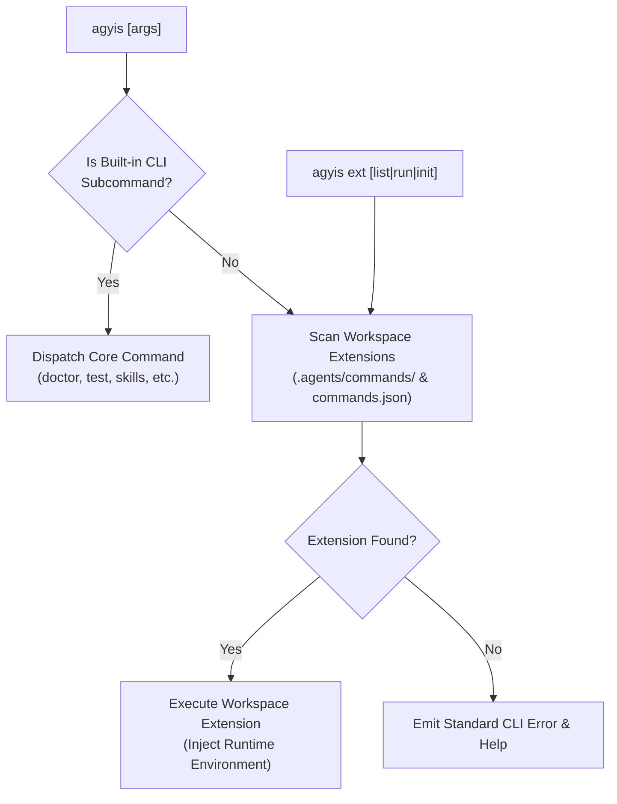

<!-- SPDX-License-Identifier: Apache-2.0 -->
<!-- Copyright (c) 2026 Arafat Zahan (@kuasha420) -->
<!-- Corporate Stewardship & Infrastructure: Purrfect Software Limited (PSL) -->
<!-- Governed by: ICARO-42/b Ordinance (Company-Supported Personal IP Framework) -->

# ADR-034: Extensible Workspace CLI Architecture and Project Command Federation

* **Status**: Accepted
* **Date**: 2026-10-26
* **Authors**: Antigravity & PSL Lead Architect
* **Scope**: `harness/runtime/extensions.py`, `harness/commands/ext.py`, `harness/cli.py`
* **Related Issues & PRs**: Issue #100, Milestone v1.0.0-rc9

---

## Context & Motivation

Different client and project repositories maintain specialized developer scripts, domain-specific utilities, and agent workflows (e.g., game loop harness in Project Immortal, database migration tools, bespoke triage pipelines). Previously:

1. **Product vs. Project Violations (ADR-014)**: Project-specific scripts were tempted into the global `harness/` codebase, diluting product boundaries and creating bloat.
2. **Unstructured Root Clutter**: Scripts placed in repository root (`scripts/`, `dirty`) lacked standardized schemas, execution tracing, and argument normalizers.
3. **Friction in Tool Calling**: Agents had to guess script paths or execute arbitrary bash one-liners rather than utilizing clean project CLI verbs.

---

## Architectural Decisions

### 1. Dynamic Workspace Command Discovery (`.agents/commands/`)
- `harness/runtime/extensions.py` automatically scans the active workspace's `.agents/commands/` directory for:
  - Executable scripts (`*.sh`, `*.py`, or binaries with executable bits).
  - Explicit manifest configuration in `.agents/commands.json`.
- Discovered extension commands are indexed with description, parameters, and executable paths.

### 2. Seamless Top-Level Dispatch (`agyis <custom-command>`)
- If an invoked subcommand does not match the 27 built-in core verbs, `harness/cli.py` checks for a discovered workspace extension.
- Dispatches transparently with arguments forwarded, setting standard environment variables (`WORKSPACE_ROOT`, `AGYIS_VERSION`, `PYTHONPATH`).

### 3. Extension Management CLI (`agyis ext`)
- Dedicated command group for managing extensions:
  - `agyis ext list`: Tables all discovered workspace extensions, source paths, and status.
  - `agyis ext run <name> [args]`: Explicitly runs an extension command.
  - `agyis ext init <name>`: Scaffolds a new extension template script in `.agents/commands/`.

### 4. Zero-Dependency & Isolation Guarantees
- Extensions run in isolated child processes with standardized signal traps and timeout handling.
- Core harness remains 100% clean and decoupled from bespoke project logic.

---

## Verification & Metrics

- **Hermetic Testing**:
  - `tests/test_extensions.py`: Validates extension discovery, manifest parsing, execution forwarding, and sub-second execution ($<0.05\text{s}$).
- **Production Validation**: Successfully migrated Project Immortal custom RE routines to `.agents/commands/`, eliminating legacy root scripts.
