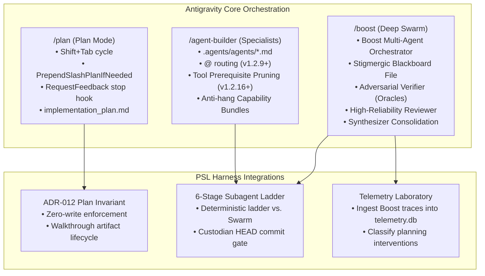
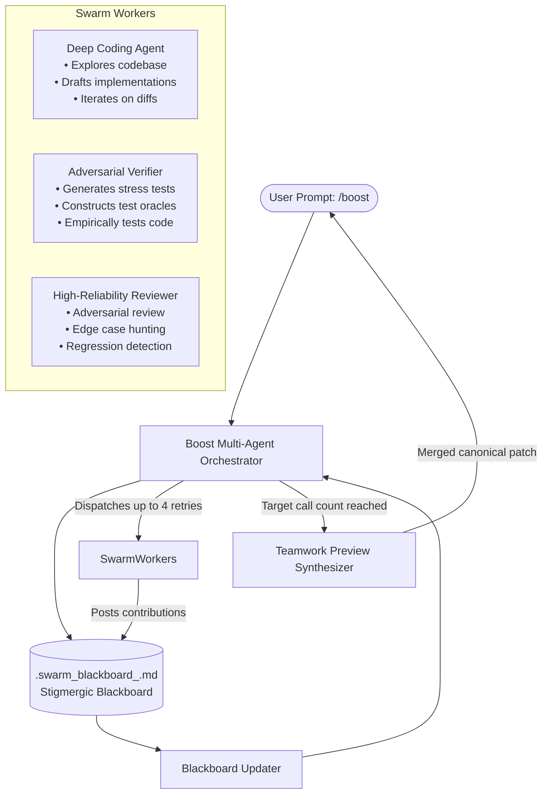

# Comprehensive Technical Specification: Antigravity `/boost`, `/plan`, and `/agent-builder`

## Executive Summary

As Google Antigravity transitioned through versions **v1.1.0** to **v1.2.16**, the platform underwent a fundamental architectural shift: moving from a conversational pair-programmer to a **structured multi-agent operating system**. At the core of this evolution are three interconnected capabilities:

1. **`/boost`**: An on-demand, multi-agent deep reasoning and adversarial verification orchestrator designed for high-concurrency bugs, deep architectural refactoring, and large-scale migrations.
2. **`/plan`**: A first-class modal planning loop (`default` $\to$ `accept-edits` $\to$ `plan`) and slash-command prefix that mandates read-only exploration and an interactive artifact gate (`implementation_plan.md`) prior to any workspace mutation.
3. **`/agent-builder` & Custom Agents**: The convergence of file-based specialist personas (`.agents/agents/*.md`), native inline routing (`@<subagent>`), tool prerequisite gating, and progressive skill execution (`/<skill-name>`).

This specification reverse-engineers the internal Go binary implementations, protobuf definitions, stop hooks, and stigmergic coordination protocols behind these primitives. It also establishes the comparative architecture and integration contracts for **`psl-agy-harness`**.



---

## 1. Feature Deep-Dive: Antigravity `/boost`

### A. Nature & User Experience
- **Invocation**: User types `/boost <prompt>` in the chat prompt or toggles Boost mode in the UI.
- **Surface**: Desktop IDE, Antigravity 2.0 auxiliary pane, and CLI (`agy`).
- **Target Workload**: Hard concurrency races, compiler/AST migrations, distributed system edge cases, and architectural refactoring where single-agent execution suffers from confirmation bias and premature self-certification.
- **License / Gate**: Enterprise / Paid platform feature. Governed by protobuf administrative controls:
  ```protobuf
  AdminControls.FeatureControls.MultiagentControls {
    bool boost_command_disabled = 1;
    bool teamwork_preview_command_disabled = 2;
  }
  ```

### B. Internal Topology & Agent Personas
Under the hood, `/boost` activates the `Boost multi-agent orchestrator` (internally located in `third_party/jetski/cortex/customizations/builtin/`). Instead of maintaining a single linear conversation context, the orchestrator provisions a multi-role team:



1. **The Orchestrator (`Boost multi-agent orchestrator`)**:
   - Inspects workspace context and breaks down the task into discrete, verifiable subtasks.
   - Maintains an authoritative progress file: `.swarm_blackboard_<task_name>.md` or `.pipeline_progress_<task_name>.md`.
   - Starts a heartbeat cron via `schedule(CronExpression="*/10 * * * *")` to monitor worker contributions and check for completion.
2. **Deep Coding Agent**:
   - Specializes in surgical, deep multi-file implementation.
   - Has read, execute, and isolated write permissions (often operating in Git worktrees).
3. **High-Reliability Review Agent**:
   - Explicit binary definition: *"Both objectively reviews AND adversarially challenges the work product."*
   - Specifically configured to resist model sycophancy: it attempts to actively find regressions, unhandled edge cases, and performance regressions.
4. **Code-Executing Adversarial Verifier**:
   - Explicit binary definition: *"Code-executing adversarial verifier. Writes generators, oracles, and stress test harnesses to empirically verify solution correctness and performance. Armed with domain skills by the orchestrator at dispatch time."*
   - Writes independent verification harnesses that run property tests, differential testing against reference implementations, and randomized inputs.
5. **Teamwork Preview Synthesizer (`teamwork_preview_synthesizer`)**:
   - Once workers complete their streams, the synthesizer merges the candidate patches, resolves conflicting changes, and returns a single unified, verified deliverable.

### C. Stigmergic Coordination & The Succession Protocol
To eliminate context window exhaustion (the "200+ step cliff"):
- **Stigmergic Coordination**: Workers do not talk directly to each other in one giant chat transcript. They communicate asynchronously via the Blackboard file (`.swarm_blackboard_<task_name>.md`).
- **Succession Protocol**: If the orchestrator reaches **16 spawns**, it dumps its state to the blackboard dashboard under `## Succession Status` and hands off execution to a clean successor orchestrator session:
  ```markdown
  ## Succession Status
  - Spawn count: [N] / 16
  - Pending subagents: [list of conversation IDs still running]
  ```
- **Self-Healing Workers**: If any worker crashes or stalls, the orchestrator triggers an anomaly detection event, notifies the blackboard updater (`worker_failed: <worker_id>`), and spawns a replacement (up to 4 retries).

---

## 2. Feature Deep-Dive: Antigravity `/plan`

### A. Nature & Mode Switching
Introduced in **v1.1.0** to replace legacy `/planning`, `/plan` operates both as an explicit slash command and as an interactive execution mode:
- **TUI/GUI Mode Switch**: Pressing `Shift+Tab` in the CLI cycles between:
  $$\text{default} \longrightarrow \text{accept-edits} \longrightarrow \text{plan}$$
- **Prompt Prepending**: In `agy`, the input model helper `PromptModel.PrependSlashPlanIfNeeded` automatically checks `types.AgentMode`. If the user is in Plan mode, `/plan` is prepended to the prompt buffer transparently.
- **Command Stacking (v1.1.4+)**: The parser supports chaining multiple leading slash commands, such as:
  ```bash
  /plan /grill-me Refactor the telemetry database schema
  ```
  This first initiates an interactive discovery interview (`/grill-me`) to clarify ambiguous requirements, and then synthesizes the results into a planning specification (`/plan`).

### B. The Planning Mode Template & Execution Loop
When `/plan` is active, the agent runtime injects the internal template:
```gotemplate
{{- /* This template file provides instructions for Planning Mode.
When the user has planning mode enabled, the model should research first,
create an implementation plan, and get explicit user approval before executing. */ -}}
You are in Planning Mode. Exercise judgement on whether a user's request warrants a plan before taking action.

**When to Plan**. Stop and create a plan if the user's request requires:
- Major architectural changes
- Extensive research to fulfill
- Significant decision making and ambiguity
- A significant deviation from existing code
```

### C. The Two-Artifact Contract
Plan mode enforces a strict two-artifact lifecycle:
1. **Implementation Plan (`{{ArtifactDirectoryPath}}/implementation_plan.md`)**:
   - Created with `write_to_file` with `ArtifactMetadata.RequestFeedback: true`.
   - Outlines: Executive Summary, User Review Required, Proposed Changes, Verification Plan.
   - **Stop Hook Trigger**: `request_artifact_feedback_stop_hook.go` intercepts `RequestFeedback: true` and halts the agent turn immediately, rendering an interactive "Proceed" / "Reject" banner in the IDE/CLI.
2. **Walkthrough (`{{ArtifactDirectoryPath}}/walkthrough.md`)**:
   - Created after the user approves the plan and code execution finishes.
   - Summarizes verified changes, benchmark results, and test run outcomes.

### D. Zero-Mutation Invariant
During the planning turn, the agent is strictly prohibited from mutating production files (`write_to_file`, `replace_file_content`). Any write attempts outside `<Artifact Directory>/implementation_plan.md` trigger an error or stop hook intervention.

---

## 3. Feature Deep-Dive: Antigravity `/agent-builder` & Custom Agents

### A. Skill-as-Slash-Command Discovery
In Antigravity, every modular skill installed in `.agents/skills/<name>/SKILL.md` or `~/.gemini/antigravity/builtin/skills/<name>/SKILL.md` is registered in the command palette as a slash command `/<name>`.

When a user types `/agent-builder <request>`, the runtime injects:
```xml
<SKILL>
The user has explicitly invoked the (agent-builder) skill.
You must strictly follow the instructions in this skill to process their request.
Here are its contents:
...
</SKILL>
```

### B. Custom Agent Specification (`.agents/agents/*.md`)
Antigravity discovers custom agents across three hierarchical directories:
1. **Workspace**: `<workspace_root>/.agents/agents/*.md` (shared in Git).
2. **Global**: `~/.gemini/config/agents/*.md` (user-wide).
3. **Plugins**: `~/.gemini/config/plugins/<plugin>/agents/*.md`.

Each agent is defined as Markdown with YAML frontmatter:
```yaml
---
name: security_auditor
archetype: auditor
role: Security & Sandbox Auditor
description: Verifies terminal sandbox rules and inspects permission boundaries.
model: inherit                           # Inherits model tier or pins gemini-3.8-pro
subagent: true                          # Accessible via invoke_subagent
mainAgent: true                         # Accessible in UI New Conversation dropdown
permissions:
  read: true
  write: false                          # Strictly read-only
  execute: true
  subagents: false
allowed_tools:
  - view_file
  - run_command
  - manage_task
---
# Instructions ...
```

### C. Platform Mechanics Added in Recent Releases
1. **Native `@<subagent>` Routing (v1.2.9+)**:
   - Users can route prompts directly to specific agents using inline `@` mentions in chat:
     ```text
     @harness_reviewer Please perform a delta review on the last commit.
     ```
2. **Tool Prerequisite Pruning in `/` Menu (v1.2.16+)**:
   - The CLI `/` suggestions menu dynamically queries the active agent's capability bundle.
   - If an agent declares `write: false`, write tools and file mutation commands are pruned from suggestions, preventing tool hallucination.
3. **The Platform Hanging Bug Hardening**:
   - An internal flaw in Antigravity's subagent loader: declaring an invalid or unmounted tool name in `allowed_tools:` causes the dispatcher to hang indefinitely without returning an error.
   - PSL's `agent-builder` skill enforces compile-time validation against the 20 verified platform tools (`ANTIGRAVITY_PLATFORM_TOOLS`).

---

## 4. Comparative Architecture: Antigravity Native vs. PSL Harness

| Dimension | Native `/boost` | PSL 6-Stage Subagent Ladder | Native `/plan` | PSL ADR-012 Invariant |
| :--- | :--- | :--- | :--- | :--- |
| **Orchestration Model** | Dynamic Stigmergic Swarm | Deterministic Linear Pipeline | Modal Single Agent | Interactive Artifact Protocol |
| **Coordination Medium** | `.swarm_blackboard.md` | Staged Worktrees & Memory Sync | Single Prompt Prepend | `implementation_plan.md` |
| **Worker Roles** | Coder, Adversarial Verifier, Reviewer | Planner, Builder, Reviewer, Custodian, Auditor | None (Single Persona) | Lead Architect & Specialists |
| **Commit Gate** | Synthesizer merges patches | Stage 4 Custodian atomic commit on HEAD | None | Retroactive Horizon Compaction |
| **Context Cliff Guard** | 16-Spawn Succession Protocol | Fresh context per ladder stage (<50k tokens) | Read-only planning turn | Aperture Compaction in Ledger |
| **Adversarial Verification** | Internal test generators/oracles | Sub-second benchmark & doctor audit | None | `python3 -m harness.cli test` |
| **Execution Cost** | High (Multi-agent fanout; paid plan) | Optimized (`Model: inherit`, targeted stages) | Low (Single turn) | Sub-second, zero-token overhead |

### When to Use Which Pattern:
- **Use `/plan` (or `/plan /grill-me`)**: Always at the start of any multi-file task. It establishes the operator feedback loop and locks down the scope before execution.
- **Use Native `/boost`**: For highly speculative, non-linear problems (e.g., mysterious data races, fuzzing complex parsers, or hard algorithmic optimizations) where generating synthetic adversarial test cases is essential.
- **Use PSL Subagent Ladder**: For deterministic, multi-phase production refactoring, feature delivery, and harness maintenance where strict Git commit boundaries (Stage 4 Custodian), immutable clean-room testing (Stage 5 Auditor), and sub-second verification are mandatory.

---

## 5. Harness Architectural Extensions

### A. PreToolUse Plan-Lock Enforcement (`anti_drift_hook.py`)
Enhance `harness/hooks/anti_drift_hook.py` to inspect the prompt trajectory:
- If the current turn is a `/plan` turn or if `implementation_plan.md` has `RequestFeedback: true` and has not yet received a user confirmation message (`Proceed`), any code-modifying tool call (`write_to_file`, `replace_file_content`, `edit_file`) is deterministically rejected with exit code 2.

### B. Telemetry Classification for `/boost` and `/plan` (`pipeline/`)
Update `pipeline/extract_transcripts.py` and `harness/telemetry/sync.py`:
- Detect user prompts starting with `/boost` and tag session attribute `orchestration_mode = 'BOOST'`.
- Detect prompts starting with `/plan` and classify interventions as `PLAN_INITIATION`.
- Track subagent fanout and verify if `/boost` blackboard files are present in the workspace.

### C. Agent Builder Capability Bundle Validation (`harness/subagents.py`)
Update `harness/subagents.py` and `harness/skills/agent-builder/SKILL.md`:
- Validate that all scaffolded agents explicitly support the Antigravity v1.2.16+ tool prerequisite pruning rules.
- Add an `adversarial_verifier` capability bundle inspired by `/boost`'s test generator pattern for testing lifecycle hooks.
