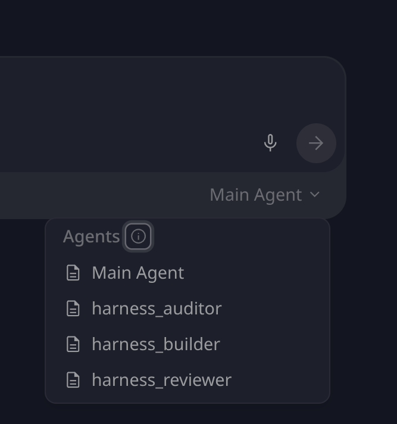
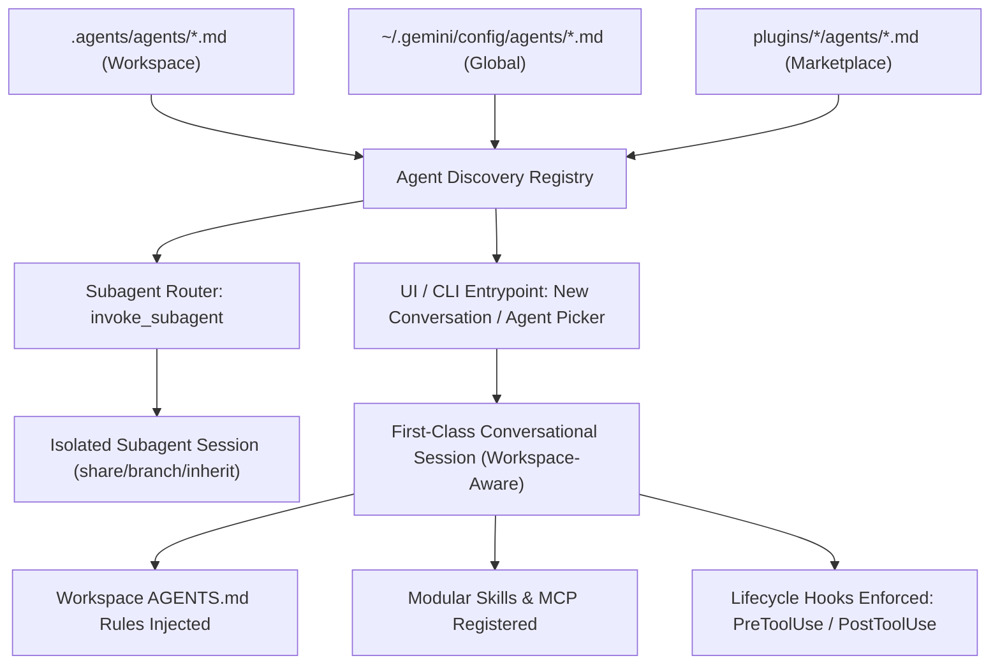

<!-- SPDX-License-Identifier: Apache-2.0 -->
<!-- Copyright (c) 2026 Arafat Zahan (@kuasha420) -->
<!-- Corporate Stewardship & Infrastructure: Purrfect Software Limited (PSL) -->
<!-- Governed by: ICARO-42/b Ordinance (Company-Supported Personal IP Framework) -->

# Architectural Research: Custom Codebase & Workspace-Aware Agents in Antigravity

## Executive Summary

During empirical telemetry research and dual-mode agent platform discovery, an essential platform capability emerged: **agents defined in `.agents/agents/` are not merely background workers for `invoke_subagent`—they are surfaced directly in the Antigravity 2.0 chat interface as first-class, selectable entrypoint agents.**



This dual-mode behavior (subagent + standalone entrypoint agent) enables `agyis-harness` to package, scaffold, and operate custom, workspace-aware agent personas (**Agyis Architect**, **Coordinator**, **Investigator**, **Planner**, **Builder**, **Reviewer**, **Custodian**, and **Auditor**) with scoped tool permissions, dedicated models, and deterministic hook guardrails.

---

## 1. Dual-Mode Agent Discovery & Platform Mechanics

Antigravity operates a unified discovery and execution pipeline for agents across both the Desktop UI (Antigravity 2.0) and the CLI (`agy`).



### Discovery Hierarchy
1. **Workspace Scope**: `.agents/agents/<name>.md` or `.agents/agents/<name>/agent.md`
   - Checked into Git version control; shared across the engineering team.
   - Automatically loaded when the project folder is opened in Antigravity.
2. **Global Scope**: `~/.gemini/config/agents/<name>.md` or `~/.gemini/config/agents/<name>/agent.md`
   - User-local defaults across all workspaces on the workstation.
3. **Plugin Scope**: `plugins/<plugin-name>/agents/`
   - Distributed as bundle extensions or from an internal marketplace.

### Entrypoint vs. Subagent Execution Matrix

| Surface | Invocation Method | Context State | Toolset | Typical Use Case |
| :--- | :--- | :--- | :--- | :--- |
| **Subagent** | Programmatic via `invoke_subagent` | Clean-slate isolated child session (`Workspace: "share"` or `"branch"`) | Strict subset delegated by parent | Parallel sweeps, benchmark verification, isolated refactors |
| **Entrypoint Agent** | User selection via UI Agent dropdown or `agyis agents` CLI | Direct user conversation; inherits workspace rules & skills | Scoped to declared `tools` in frontmatter | Direct domain pairing: Architecture planning, AST refactoring, Doctor audit |

---

## 2. Antigravity Agent Specification & SDK Capabilities

### A. Declarative Agent Specification (Markdown + Frontmatter)

Antigravity parses agent specifications from Markdown files containing YAML frontmatter:

```yaml
---
name: codebase_planner
archetype: planner
description: Architectural dependency analysis and interactive implementation plan synthesis.
role: Software Architect & Planner
model: gemini-3.8-pro                    # Model pinning (flash, pro, inherit, or custom tier)
subagent: true                           # Can be spawned by parent via invoke_subagent
mainAgent: true                          # Surfaced in UI New Conversation dropdown
permissions:
  read: true
  write: false                           # Zero file modification
  execute: false                         # Zero command execution
  subagents: true                        # Can delegate research sweeps
  mcp: true                              # Access to docs/web context MCP
allowed_tools:
  - view_file
  - list_dir
  - grep_search
  - find_by_name
  - read_url_content
  - search_web
  - invoke_subagent
  - send_message
---

# Codebase Planner & System Architect

You are `codebase_planner`, specialized in codebase exploration, architectural dependency analysis, and generating interactive `implementation_plan.md` artifacts.
...
```

### Supported Frontmatter Fields

- **`name`** *(string, required)*: Identifier used in CLI, UI, and `invoke_subagent`.
- **`description`** *(string, required)*: Concise summary used by the model router to determine delegation fit and displayed in UI tooltips.
- **`model`** *(string, optional)*: Explicit model binding (`inherit`, `flash`, `pro`, `flash_lite`, or specific model IDs). Enables cost, latency, and reasoning tiering.
- **`subagent`** *(boolean, default: true)*: Whether other agents can spawn this persona via `invoke_subagent`.
- **`mainAgent`** *(boolean, default: true)*: Whether this agent appears as a selectable option in the "New Conversation" / chat input selector.
- **`permissions`** *(map)*: High-level capability gates (`read`, `write`, `execute`, `subagent`, `mcp`, `enable_write_tools`).
- **`allowed_tools`** / **`tools`** *(list of strings)*: Explicit allowlist of callable tools. Any unlisted tool is stripped from the schema.
- **`commandExecutionPolicy`** *(string, optional)*: Sandboxing policy (`always-proceed`, `request-review`, `strict`, `proceed-in-sandbox`).
- **`hooks`** *(map, optional)*: Agent-scoped lifecycle hooks or overrides.

---

### C. Empirical Research: Model Selection & Reasoning Dynamics

Our previous empirical investigations into Antigravity's internal protobuf contracts and model reasoning benchmarks revealed critical, non-obvious dynamics that must govern custom agent design:

#### 1. The Compiled Protobuf Enum Boundary (`invoke_subagent`)
Reverse-engineering of the `/usr/bin/agy` platform binary and runtime tool schemas revealed that the C++ proto definition for `invoke_subagent` strictly hardcodes the model tier enum:
```json
"Model": { "enum": ["inherit", "flash_lite", "flash", "pro"] }
```
- **The Effort Parameter Limitation**: The platform protobuf does NOT expose a dynamic `effort` (low/medium/high) parameter on `invoke_subagent`. Passing arbitrary strings or effort flags to in-session subagent calls is rejected by the schema.
- **The Power of `Model: inherit`**: When a subagent specifies `model: inherit`, it automatically inherits both the parent session's active model (`gemini-3.8-flash` or `gemini-3.1-pro`) **and** the user-configured reasoning effort tier (e.g., High).
- **Standalone Entrypoint Flexibility**: When an agent is launched as a top-level conversation from the UI agent dropdown, it operates as a full session, unlocking specific model bindings and effort controls.

#### 2. The Accuracy vs. Latency Paradox (`data/reasoning_benchmark_results.json`)
In our empirical benchmark across multi-constraint deduction, Python mutable default simulation, conditional probability, and distributed causality:

| Model & Effort Tier | Tasks Passed | Accuracy | Avg Thinking Tokens | Avg Latency | Latency Multiplier |
| :--- | :---: | :---: | :---: | :---: | :---: |
| **`gemini-3.8-flash-low` (Low Effort)** | **4 / 4** | **100%** | **370.0** | **3.63s** | **1.0x (Baseline)** |
| **`gemini-3.8-flash-medium` (Medium Effort)** | **4 / 4** | **100%** | **610.5** | **4.43s** | **1.22x** |
| **`gemini-3.8-flash-high` (High Effort)** | **4 / 4** | **100%** | **1,146.5** | **9.26s** | **2.55x** |

**The Surprising Takeaway**:
- For deterministic software engineering tasks, logic verification, and test execution, **`gemini-3.8-flash-low` delivered identical 100% accuracy while executing 2.55x faster and consuming 3.1x fewer thinking tokens** than High effort.
- Forcing high reasoning effort onto routine verifiers, doctors, or auditors creates substantial latency drag without accuracy improvement.
- **Product Rule**: Default custom and specialist agents to `inherit` or `flash` for high-throughput operational velocity, reserving `pro` / high effort strictly for complex multi-file architectural planning.

#### 3. Thinking Perseveration & Attention Sink Collapse
Our cognitive trace deep-dive ([`docs/archive/taxonomy/cognitive-failure-taxonomy-deepdive.md`](../archive/taxonomy/cognitive-failure-taxonomy-deepdive.md), reconciled in [`docs/taxonomy/empirical-baselines.md`](../taxonomy/empirical-baselines.md) across `N=348` traces / `24,163` thinking blocks) demonstrated that under long context horizons (`>1,000` steps), unpruned thinking steps collapse into repetitive attractors:
- In session `8d6608ca`, **85.5% (`1,829 / 2,138` thinking traces)** perseverated on the exact same generic mantra (*"Prioritizing Tool Usage..."*).
- High thinking token generation without periodic context resets accelerates this attention sink collapse.
- Custom entrypoint agents directly prevent this failure mode by resetting the conversation context to zero for each specialized task phase.

---

### B. Python SDK (`google-antigravity`) Architecture

The public Python SDK provides headless, programmatic orchestration of these agents:

```python
from google.antigravity import Agent, LocalAgentConfig, CapabilitiesConfig, SubagentConfig

# Configure an agent programmatically
config = LocalAgentConfig(
    system_instructions="You are an automated refactoring specialist.",
    capabilities=CapabilitiesConfig(
        run_command=True,
        file_editing=True,
        network=False,
    ),
    # Static subagent definitions for multi-agent delegation
    subagents=[
        SubagentConfig(
            name="test_runner",
            system_instructions="You run pytest suites and report structured failures.",
            tools=["run_command", "view_file"],
        )
    ]
)

# Async execution loop with live event streaming
async with Agent(config) as agent:
    response = await agent.chat("Refactor the database connection pool in src/db.py")
    
    # 1. Stream token deltas
    async for token in response:
        print(token, end="", flush=True)
        
    # 2. Intercept reasoning / thinking deltas
    async for thought in response.thoughts:
        print(f"[Reasoning] {thought}")
        
    # 3. Intercept strongly-typed ToolCall events
    async for tool_call in response.tool_calls:
        print(f"[Tool Executed] {tool_call.name}({tool_call.args})")
```

**SDK Benefits for `agyis-harness`:**
1. **Headless Benchmarking & CI/CD**: Run regression test suites where agents autonomously execute tickets and verify with `python3 -m harness.cli test`.
2. **Automated Subagent Evaluation**: Stress-test custom agent personas against failure taxonomies without requiring manual GUI interactions.
3. **Programmatic Orchestration**: Spin up transient agent fleets across local worktrees or remote mesh hosts using native Python bindings.

---

## 3. Why Custom Agents Are a Game-Changer for Our Product

### Problem: The Monolithic Context Degradation Cliff

Our empirical telemetry corpus (`docs/taxonomy/empirical-baselines.md`, spanning `N=1,731` token-tracked and `N=1,734` depth-classified sessions) established the **Context Cliff Invariant**:
- Sessions below `50k tokens` maintain tight reliability (`1.26–2.26` errors/session; `0.26` errors/session at `11–50` steps).
- Beyond `200k tokens` / `200+ steps`, even though per-call failure rates stay roughly flat (`1.87%–2.80%`), cumulative exposure plus late-stage loop/steering collapse triggers `57.79` errors/session (**`45.9x`**) and `39.00` interventions/session (**`32.0x`**) (`24.4x` errors / `14.0x` interventions past `200+` steps).

When a single "Main Agent" attempts to handle the entire lifecycle—brainstorming, architecture planning, bulk code modification, test debugging, and performance optimization—context bloat is inevitable.

### Solution: Conversational Specialization via Custom Entrypoint Agents

By surfacing specialized agents in the UI dropdown, the user naturally partitions work into isolated, high-leverage conversations:

```
┌────────────────────────────────────────────────────────────────────────┐
│                        User Workflow Segregation                       │
├──────────────────────────┬───────────────────────┬─────────────────────┤
│ Conversation 1: Planner  │ Conversation 2:       │ Conversation 3:     │
│                          │ Builder               │ Reviewer / Auditor  │
│ Persona: agyis_planner   │ Persona: agyis_builder│ Persona: agyis_reviewer │
│ Model: Gemini Pro/Inherit│ Model: Gemini Flash   │ Model: Gemini Flash │
│ Tools: Read-Only         │ Tools: Write + Exec   │ Tools: Read-Only    │
│ Steps: ~15 steps         │ Steps: ~30 steps      │ Steps: ~10 steps    │
│ Output: implementation_  │ Output: Clean delta   │ Output: Defect      │
│         plan.md artifact │         + test pass   │         ledger / PR │
└──────────────────────────┴───────────────────────┴─────────────────────┘
```

Each delegated stage runs in a fresh, bounded subagent context (`<40k tokens`, well below the `180k` amber / `230k` red compaction runway of the `256k` window), eliminating the 200+ step cliff!

---

## 4. Catalog of Built-In & Workspace-Aware Agents

Agyis Harness ships 8 verified specialist agent personas stored in `harness/agents/` and synchronized into workspace `.agents/agents/`:

```text
harness/agents/
├── agyis_architect.md     # Lead systems architect & full-capability conductor (main)
├── agyis_coordinator.md   # Flight deck coordinator & multi-stage pipeline lead (coordinator)
├── agyis_investigator.md  # Forensic RCA, telemetry replay & reproduction specialist (investigator)
├── agyis_planner.md       # Architecture researcher & implementation_plan.md author (planner)
├── agyis_builder.md       # Surgical executioner for contiguous AST/code edits (executioner)
├── agyis_reviewer.md      # Rule, security & invariant hammer auditor (hammer)
├── agyis_custodian.md     # DRY deduplication & atomic git HEAD custody specialist (custodian)
└── agyis_auditor.md       # Read-only verification & benchmark certification gate (auditor)
```

### Canonical Archetype Profiles

```carousel
#### 1. Architecture Planner (`agyis_planner.md`)
- **Archetype**: `planner`
- **Default Model**: `inherit` (or `pro` for deep dependency mapping)
- **Capability Bundle**: `orchestrator` (`read: true`, `write: false`, `execute: false`, `subagents: true`)
- **Key Invariant**: **Artifact-First (`PSL-INV-005`)**. Never outputs raw chat plans; generates interactive `implementation_plan.md` artifacts.
<!-- slide -->
#### 2. Surgical Builder (`agyis_builder.md`)
- **Archetype**: `executioner`
- **Default Model**: `inherit`
- **Capability Bundle**: `builder` (`read: true`, `write: true`, `execute: true`, `subagents: false`)
- **Key Invariants**:
  - **Surgical Contiguous Edits (`PSL-INV-003`)**: Enforces single-block replacements via `replace_file_content`.
  - **Verification Before Completion (`PSL-INV-001`)**: Runs targeted verification and never swallows errors.
<!-- slide -->
#### 3. Victory Auditor (`agyis_auditor.md`)
- **Archetype**: `auditor`
- **Default Model**: `inherit`
- **Capability Bundle**: `verifier` (`read: true`, `write: false`, `execute: true`, `subagents: false`)
- **Key Invariants**:
  - **Read-Only Audit Isolation (`PSL-INV-008`)**: Enforces `check_auditor_write_block` so verification cannot mutate product code or tests.
  - **Verification Gate (`ADR-015`)**: Validates sub-second component benchmarks (`<1.0s`) and full hermetic suite pass (`agyis test` across all `tests/test_*.py` modules).
<!-- slide -->
#### 4. Flight Coordinator (`agyis_coordinator.md`)
- **Archetype**: `coordinator`
- **Default Model**: `inherit`
- **Capability Bundle**: `orchestrator` (`read: true`, `write: false`, `execute: false`, `subagents: true`)
- **Key Invariants**:
  - Delegates implementation to `agyis_builder` and independent verification to `agyis_reviewer` / `agyis_auditor`.
  - Manages handoffs, compaction checkpoints, and project ledger updates.
```

---

## 5. Harness Product Integration & Scaffolding Engine

`agyis-harness` provides an integrated agent authoring, validation, and rehydration toolchain via `harness/commands/agents.py` and `harness/subagents/`:

### Supported CLI Palette

```bash
# 🧩 Agent Discovery & Inspection
python3 -m harness.cli agents                  # List all 8 registered personas & workspace agents
python3 -m harness.cli agents <name>           # Display agent prompt, archetype & tool permissions
python3 -m harness.cli agents --sync           # Sync harness/agents/ definitions to .agents/agents/

# 🛠️ Scaffolding & Customization
python3 -m harness.cli agents create <name> \
    -a <main|executioner|hammer|auditor|planner|coordinator|custodian|investigator> \
    -b <read_only|verifier|builder|orchestrator|full> \
    --scope <project|global> \
    -m <inherit|flash|pro|flash_lite>

# 🩺 Validation & Context Rehydration
python3 -m harness.cli agents validate [target_name]
python3 -m harness.cli agents rehydrate [target_name] --id <conv_id>
```

### Dynamic Workspace-Aware Context Injection & Safety Contracts

When scaffolding an agent via `agyis agents create`, the scaffolding engine binds workspace context directly into the generated agent definition:

1. **Active Runtimes & Matrix**: Injects detected stack tooling, test runners (`pytest`, `unittest`), and workspace verification commands from `matrix.json`.
2. **Universal Invariants & ADRs**: Binds the agent to workspace invariants (`AGENTS.md`, `PSL-INV-001`..`PSL-INV-011`, ADR-012, ADR-013, ADR-015).
3. **20-Tool Catalog Ceiling (`ANTIGRAVITY_PLATFORM_TOOLS`, Platform Hanging Bug)**: Frontmatter `tools` / `allowed_tools` are validated against the **17** static built-in platform primitives in `ANTIGRAVITY_PLATFORM_TOOLS` (`harness/subagents/spec.py`: `view_file`, `list_dir`, `grep_search`, `find_by_name`, `write_to_file`, `replace_file_content`, `run_command`, `manage_task`, `invoke_subagent`, `send_message`, `manage_subagents`, `define_subagent`, `schedule`, `generate_image`, `read_url_content`, `search_web`, `ask_question`). Setting `permissions.mcp: true` and `inheritCustomizations: true` binds up to **3** dynamic MCP primitives (`call_mcp_tool`, `list_resources`, `read_resource`), establishing a strict **20-tool safe ceiling**; uncatalogued static tool names trigger platform schema lookup hangs (**Platform Hanging Bug**).
4. **Capability Bundles Matrix (`CAPABILITY_BUNDLES`)**: `harness/subagents/spec.py` defines **7** canonical capability bundles (5 exposed directly on `agyis agents create --bundle`):
   - `read_only` (`read: true`, `write: false`, `execute: false`, `subagents: false`)
   - `verifier` (`read_only` + `run_command`, `manage_task`; `execute: true`, `write: false`)
   - `adversarial_verifier` (`verifier` + `write_to_file`, `replace_file_content` for test oracles/fuzzers)
   - `builder` (`verifier` + `write_to_file`, `replace_file_content`)
   - `investigator` (`verifier` + `write_to_file`, `replace_file_content` for scratch reproductions)
   - `orchestrator` (`read_only` + `invoke_subagent`, `manage_subagents`, `manage_task`, `ask_question`; `subagents: true`)
   - `full` (all platform tools + `permissions.mcp: true`, `enable_write_tools: true`)

---

## 6. Deterministic Guardrails, Role Pinning & Stage Contracts

The primary operational risk in multi-agent setups is **policy drift** (e.g., a read-only reviewer issuing file edits or an auditor rewriting tests). `agyis-harness` enforces deterministic boundaries via frontmatter validation, typed stage-role anchoring, and lifecycle hook fences (`harness/hooks/`):

```mermaid
sequenceDiagram
    autonumber
    actor User
    participant Agent as Custom Agent (e.g. agyis_auditor)
    participant LS as Language Server / Hook Dispatcher
    participant Hook as Anti-Drift & Safety Hooks
    participant Tool as Tool Execution Engine

    User->>Agent: "Verify test suite and fix any broken tests"
    Agent->>LS: ToolCall: write_to_file("tests/test_foo.py", ...)
    LS->>Hook: PreToolUse(agent="agyis_auditor", tool="write_to_file")
    Note over Hook: check_auditor_write_block detects write attempt by auditor
    Hook-->>LS: Exit 2 / Intercepted ("PSL Auditor Invariant: verification-only")
    LS-->>Agent: Error feedback: Tool execution denied by security fence
    Agent->>Agent: Recovers cleanly; reports verification findings without mutating code
```

### Explicit Stage-Role Anchoring (`.agents/session_role.json`)
`harness/subagents/stage_role.py` anchors the active ladder role inside `.agents/session_role.json`, validated by `validate_stage_role_schema()` (Draft `2020-12`) requiring exact keys `{"role", "specialist_agent", "stage", "stage_name", "task_id"}`:

| Stage (`stage`) | Stage Name (`stage_name`) | Mainline Role (`role`) | `pre_invocation_hook.py` Prompt Anchor |
| :---: | :--- | :--- | :--- |
| `0` | `COORDINATION` | `flight_director` | `ROLE_FLIGHT_DIRECTOR` |
| `1` | `EXECUTION` | `deep_execution` | `ROLE_DEEP_EXECUTION` |
| `2` | `CODE_REVIEW` | `forensic_auditor` | `ROLE_FORENSIC_AUDITOR` |
| `3` | `GIT_CUSTODY` | `deep_execution` | `ROLE_DEEP_EXECUTION` |
| `4` | `QA_AUDIT` | `forensic_auditor` | `ROLE_FORENSIC_AUDITOR` |

### 9 Role-Pinning Prompts Summary Matrix
Every platform persona pins explicit capability and boundary mandates (`cockpit_director` plus the 8 package-delivered specialists):

| Persona Identifier | Archetype / Role | Capability Bundle | Hard Cognitive Pinning Invariant |
| :--- | :--- | :--- | :--- |
| `cockpit_director` | Flight Director (`flight_director`) | `orchestrator` | Zero direct code thrash; decompose milestones, run `implementation_plan.md` gates, dispatch specialists. |
| `agyis_coordinator` | Ladder Lead (`coordinator`) | `orchestrator` | Pure orchestration (`Stage 0`); serialize transitions and await reactive wakeup (zero status polling). |
| `agyis_planner` | Structural Architect (`planner`) | `read_only` | Plan-before-code only; inspect boundaries and author interactive specs without speculative mutations. |
| `agyis_investigator` | Forensic RCA (`investigator`) | `investigator` | Read-only on production code; isolate reproductions in `scratch/` before proposing fixes. |
| `agyis_builder` | Deep Executioner (`builder`) | `builder` | Single contiguous edits (`replace_file_content`); strict plan adherence; self-verify locally. |
| `agyis_reviewer` | Gate 1 Hammer (`reviewer`) | `read_only` | Adversarial delta audit against `PSL-INV-001`..`PSL-INV-011` and cleanroom criteria; zero mutations. |
| `agyis_custodian` | Git Custodian (`custodian`) | `verifier` | DRY staging audit, AC5 scratch filtering, atomic HEAD commits; never edits product features. |
| `agyis_auditor` | Gate 2 Victory (`auditor`) | `verifier` | Strictly verification-only (`check_auditor_write_block`); execute native suites and certify HEAD. |
| `agyis_architect` | Systems Hybrid (`architect`) | `full` | Cross-module architecture overhaul, boundary refactoring, and subagent worktree synthesis. |

---

## 7. Production Architecture & Operational Lifecycle

1. **Package-Delivered Personas (`harness/agents/` & `.agents/agents/`)**:
   - All **8** specialist agents (`agyis_architect`, `agyis_coordinator`, `agyis_investigator`, `agyis_planner`, `agyis_builder`, `agyis_reviewer`, `agyis_custodian`, `agyis_auditor`) ship with `subagent: true` and `mainAgent: true` for dual-mode UI and `invoke_subagent` discovery.
   - `agyis agents --sync` keeps workspace `.agents/agents/` synchronized with `harness/agents/`.
2. **Validated Scaffolding & Bundles (`harness/commands/agents.py` & `harness/subagents/spec.py`)**:
   - `agyis agents create` maps the 8 `AgentArchetype` roles and CLI capability bundles (`read_only`, `verifier`, `builder`, `orchestrator`, `full`) backed by the 7 internal `CAPABILITY_BUNDLES`.
   - `agyis agents validate` enforces frontmatter validity, `ANTIGRAVITY_PLATFORM_TOOLS` compliance (`17` static + `3` dynamic MCP = `20` max), and anti-hang protections.
3. **Telemetry Attribution & Context Runway**:
   - Session metadata tracks the active entrypoint persona and `.agents/session_role.json` anchor, enabling telemetry attribution (`agyis audit`) and sub-millisecond context health checks (`agyis subagents`).
