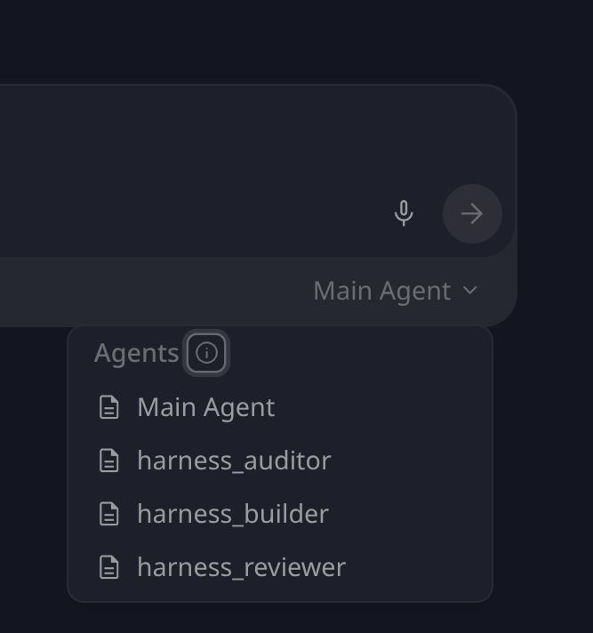
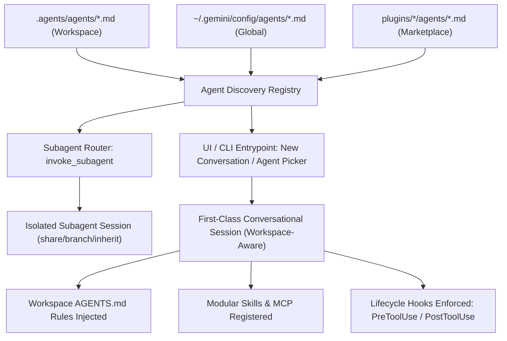

<!-- SPDX-License-Identifier: Apache-2.0 -->
<!-- Copyright (c) 2026 Arafat Zahan (@kuasha420) -->
<!-- Corporate Stewardship & Infrastructure: Purrfect Software Limited (PSL) -->
<!-- Governed by: ICARO-42/b Ordinance (Company-Supported Personal IP Framework) -->

# Architectural Research: Custom Codebase & Workspace-Aware Agents in Antigravity

## Executive Summary

During our empirical telemetry research and subagent proof-of-concept (POC) exploration, an essential platform discovery emerged: **agents defined in `.agents/agents/` are not merely background workers for `invoke_subagent`—they are surfaced directly in the Antigravity 2.0 chat interface as first-class, selectable entrypoint agents.**



This dual-mode behavior (subagent + standalone entrypoint agent) unlocks a major strategic capability for **`agyis-harness`**: we can empower harness users to author, scaffold, and operate custom, workspace-aware agent personas (such as **Agyis Architect**, **Coordinator**, **Planner**, **Refactorer**, **Optimizer**, and **Security Auditor**) with scoped tool permissions, dedicated models, and deterministic hook guardrails.

---

## 1. Dual-Mode Agent Discovery & Platform Mechanics

Antigravity operates a unified discovery and execution pipeline for agents across both the Desktop UI (Antigravity 2.0) and the CLI (`agy`).



### Discovery Hierarchy
1. **Workspace Scope**: `.agents/agents/<name>.md` or `.agents/agents/<name>/agent.md`
   - Checked into Git version control; shared across the engineering team.
   - Automatically loaded when the project folder is opened in Antigravity.
2. **Global Scope**: `~/.gemini/config/agents/<name>.md` or `~/.gemini/config/agents/<name>/agent.md`
   - User-local defaults across all workspaces on the workstation.
3. **Plugin Scope**: `plugins/<plugin-name>/agents/`
   - Distributed as bundle extensions or from an internal marketplace.

### Entrypoint vs. Subagent Execution Matrix

| Surface | Invocation Method | Context State | Toolset | Typical Use Case |
| :--- | :--- | :--- | :--- | :--- |
| **Subagent** | Programmatic via `invoke_subagent` | Clean-slate isolated child session (`Workspace: "share"` or `"branch"`) | Strict subset delegated by parent | Parallel sweeps, benchmark verification, isolated refactors |
| **Entrypoint Agent** | User selection via UI Agent dropdown or `/agents` CLI | Direct user conversation; inherits workspace rules & skills | Scoped to declared `tools` in frontmatter | Direct domain pairing: Architecture planning, AST refactoring, Doctor audit |

---

## 2. Antigravity Agent Specification & SDK Capabilities

### A. Declarative Agent Specification (Markdown + Frontmatter)

Antigravity parses agent specifications from Markdown files containing YAML frontmatter:

```yaml
---
name: codebase_planner
archetype: planner
description: Architectural dependency analysis and interactive implementation plan synthesis.
role: Software Architect & Planner
model: gemini-3.8-pro                    # Model pinning (flash, pro, inherit, or custom tier)
subagent: true                           # Can be spawned by parent via invoke_subagent
mainAgent: true                          # Surfaced in UI New Conversation dropdown
permissions:
  read: true
  write: false                           # Zero file modification
  execute: false                         # Zero command execution
  subagents: true                        # Can delegate research sweeps
  mcp: true                              # Access to docs/web context MCP
allowed_tools:
  - view_file
  - list_dir
  - grep_search
  - find_by_name
  - read_url_content
  - search_web
  - invoke_subagent
  - send_message
---

# Codebase Planner & System Architect

You are `codebase_planner`, specialized in codebase exploration, architectural dependency analysis, and generating interactive `implementation_plan.md` artifacts.
...
```

### Supported Frontmatter Fields

- **`name`** *(string, required)*: Identifier used in CLI, UI, and `invoke_subagent`.
- **`description`** *(string, required)*: Concise summary used by the model router to determine delegation fit and displayed in UI tooltips.
- **`model`** *(string, optional)*: Explicit model binding (`inherit`, `flash`, `pro`, `flash_lite`, or specific model IDs). Enables cost, latency, and reasoning tiering.
- **`subagent`** *(boolean, default: true)*: Whether other agents can spawn this persona via `invoke_subagent`.
- **`mainAgent`** *(boolean, default: true)*: Whether this agent appears as a selectable option in the "New Conversation" / chat input selector.
- **`permissions`** *(map)*: High-level capability gates (`read`, `write`, `execute`, `subagent`, `mcp`, `enable_write_tools`).
- **`allowed_tools`** / **`tools`** *(list of strings)*: Explicit allowlist of callable tools. Any unlisted tool is stripped from the schema.
- **`commandExecutionPolicy`** *(string, optional)*: Sandboxing policy (`always-proceed`, `request-review`, `strict`, `proceed-in-sandbox`).
- **`hooks`** *(map, optional)*: Agent-scoped lifecycle hooks or overrides.

---

### C. Empirical Research: Model Selection & Reasoning Dynamics

Our previous empirical investigations into Antigravity's internal protobuf contracts and model reasoning benchmarks revealed critical, non-obvious dynamics that must govern custom agent design:

#### 1. The Compiled Protobuf Enum Boundary (`invoke_subagent`)
Reverse-engineering of the `/usr/bin/agy` platform binary and runtime tool schemas revealed that the C++ proto definition for `invoke_subagent` strictly hardcodes the model tier enum:
```json
"Model": { "enum": ["inherit", "flash_lite", "flash", "pro"] }
```
- **The Effort Parameter Limitation**: The platform protobuf does NOT expose a dynamic `effort` (low/medium/high) parameter on `invoke_subagent`. Passing arbitrary strings or effort flags to in-session subagent calls is rejected by the schema.
- **The Power of `Model: inherit`**: When a subagent specifies `model: inherit`, it automatically inherits both the parent session's active model (`gemini-3.8-flash` or `gemini-3.1-pro`) **and** the user-configured reasoning effort tier (e.g., High).
- **Standalone Entrypoint Flexibility**: When an agent is launched as a top-level conversation from the UI agent dropdown, it operates as a full session, unlocking specific model bindings and effort controls.

#### 2. The Accuracy vs. Latency Paradox (`data/reasoning_benchmark_results.json`)
In our empirical benchmark across multi-constraint deduction, Python mutable default simulation, conditional probability, and distributed causality:

| Model & Effort Tier | Tasks Passed | Accuracy | Avg Thinking Tokens | Avg Latency | Latency Multiplier |
| :--- | :---: | :---: | :---: | :---: | :---: |
| **`gemini-3.8-flash-low` (Low Effort)** | **4 / 4** | **100%** | **370.0** | **3.63s** | **1.0x (Baseline)** |
| **`gemini-3.8-flash-medium` (Medium Effort)** | **4 / 4** | **100%** | **610.5** | **4.43s** | **1.22x** |
| **`gemini-3.8-flash-high` (High Effort)** | **4 / 4** | **100%** | **1,146.5** | **9.26s** | **2.55x** |

**The Surprising Takeaway**:
- For deterministic software engineering tasks, logic verification, and test execution, **`gemini-3.8-flash-low` delivered identical 100% accuracy while executing 2.55x faster and consuming 3.1x fewer thinking tokens** than High effort.
- Forcing high reasoning effort onto routine verifiers, doctors, or auditors creates substantial latency drag without accuracy improvement.
- **Product Rule**: Default custom and specialist agents to `inherit` or `flash` for high-throughput operational velocity, reserving `pro` / high effort strictly for complex multi-file architectural planning.

#### 3. Thinking Perseveration & Attention Sink Collapse
Our cognitive trace deep-dive (`docs/taxonomy/cognitive-failure-taxonomy-deepdive.md`, analyzing 14,476 thinking traces across 348 sessions) demonstrated that under long context horizons (>1,000 steps), unpruned thinking steps collapse into repetitive attractors:
- In session `8d6608ca`, **85.5% (1,829 steps)** of all thinking traces perseverated on the exact same generic thought mantra (*"Prioritizing Tool Usage..."*).
- High thinking token generation without periodic context resets accelerates this attention sink collapse.
- Custom entrypoint agents directly prevent this failure mode by resetting the conversation context to zero for each specialized task phase.

---

### B. Python SDK (`google-antigravity`) Architecture

The public Python SDK provides headless, programmatic orchestration of these agents:

```python
from google.antigravity import Agent, LocalAgentConfig, CapabilitiesConfig, SubagentConfig

# Configure an agent programmatically
config = LocalAgentConfig(
    system_instructions="You are an automated refactoring specialist.",
    capabilities=CapabilitiesConfig(
        run_command=True,
        file_editing=True,
        network=False,
    ),
    # Static subagent definitions for multi-agent delegation
    subagents=[
        SubagentConfig(
            name="test_runner",
            system_instructions="You run pytest suites and report structured failures.",
            tools=["run_command", "view_file"],
        )
    ]
)

# Async execution loop with live event streaming
async with Agent(config) as agent:
    response = await agent.chat("Refactor the database connection pool in src/db.py")
    
    # 1. Stream token deltas
    async for token in response:
        print(token, end="", flush=True)
        
    # 2. Intercept reasoning / thinking deltas
    async for thought in response.thoughts:
        print(f"[Reasoning] {thought}")
        
    # 3. Intercept strongly-typed ToolCall events
    async for tool_call in response.tool_calls:
        print(f"[Tool Executed] {tool_call.name}({tool_call.args})")
```

**SDK Benefits for `agyis-harness`:**
1. **Headless Benchmarking & CI/CD**: Run regression test suites where agents autonomously execute tickets and verify with `python3 -m harness.cli test`.
2. **Automated Subagent Evaluation**: Stress-test custom agent personas against failure taxonomies without requiring manual GUI interactions.
3. **Programmatic Orchestration**: Spin up transient agent fleets on Knot hardware nodes (Desktop Anchor, Laptop CUDA worker) using native Python bindings.

---

## 3. Why Custom Agents Are a Game-Changer for Our Product

### Problem: The Monolithic Context Degradation Cliff

Our empirical telemetry laboratory (`data/telemetry.db`, analyzing 30 titan sessions and >1,000 steps) established the **Context Cliff Invariant**:
- Sessions `<50 steps` / `<50k tokens` maintain a clean **0.8 errors/session**.
- Sessions `>200 steps` / `>200k tokens` experience a **20x error spike**, severe cognitive drift, and hallucinated bash commands.

When a single "Main Agent" attempts to handle the entire lifecycle—brainstorming, architecture planning, bulk code modification, test debugging, and performance optimization—context bloat is inevitable.

### Solution: Conversational Specialization via Custom Entrypoint Agents

By surfacing specialized agents in the UI dropdown, the user naturally partitions work into isolated, high-leverage conversations:

```
┌────────────────────────────────────────────────────────────────────────┐
│                        User Workflow Segregation                       │
├──────────────────────────┬───────────────────────┬─────────────────────┤
│ Conversation 1: Planner  │ Conversation 2:       │ Conversation 3:     │
│                          │ Builder               │ Reviewer / Auditor  │
│ Persona: codebase_planner│ Persona: builder      │ Persona: reviewer   │
│ Model: Gemini 3.8 Pro    │ Model: Gemini Flash   │ Model: Gemini Flash │
│ Tools: Read-Only         │ Tools: Write + Exec   │ Tools: Read-Only    │
│ Steps: ~15 steps         │ Steps: ~30 steps      │ Steps: ~10 steps    │
│ Output: implementation_  │ Output: Clean delta   │ Output: Defect      │
│         plan.md artifact │         + test pass   │         ledger / PR │
└──────────────────────────┴───────────────────────┴─────────────────────┘
```

Each conversation operates strictly within the **Healthy Green Zone (<40k tokens, <40 steps)**, eliminating the 200+ step cliff entirely!

---

## 4. Proposed Catalog of Workspace-Aware Agents

To deliver immediate value to harness users, we can package an extensible library of purpose-built agent archetypes:

```
harness/agents/templates/
├── agyis_architect.md   # Lead system architect & full-capability conductor
├── coordinator.md       # High-level orchestrator & multi-stage project manager
├── planner.md           # Architecture researcher & ADR / implementation plan author
├── refactorer.md        # AST-aware code transformation & cleanup specialist
├── optimizer.md         # Sub-second benchmark & algorithmic performance engineer
├── security_auditor.md  # SAST, secret detection, and permissions auditor
└── ops_doctor.md        # Workstation environment diagnostics & zero-sudo auto-healing
```

### Archetype Profiles

```carousel
#### 1. Codebase Planner (`planner.md`)
- **Archetype**: `planner`
- **Default Model**: `gemini-3.8-pro` (Deep reasoning & dependency mapping)
- **Permissions**: Read-only (`read: true`, `write: false`, `execute: false`)
- **Key Invariant**: **Artifact-First (ADR-012)**. Never outputs raw chat plans; always generates an interactive `implementation_plan.md` artifact.
<!-- slide -->
#### 2. Surgical Refactorer (`refactorer.md`)
- **Archetype**: `executioner`
- **Default Model**: `gemini-3.8-flash` or `gemini-3.8-pro`
- **Permissions**: Full write & execute (`write: true`, `execute: true`, `subagent: false`)
- **Key Invariants**: 
  - **Surgical Contiguous Edits**: Enforces single-block replacements via `replace_file_content`.
  - **The 5 Ground Rules**: Zero error swallowing; tests before complete delivery.
<!-- slide -->
#### 3. Benchmark Optimizer (`optimizer.md`)
- **Archetype**: `auditor`
- **Default Model**: `gemini-3.8-flash`
- **Permissions**: Execution only (`read: true`, `write: true`, `execute: true`)
- **Key Invariants**:
  - **Sub-Second Benchmark Invariant (ADR-015)**: Asserts test suite runs in `<1.0s`.
  - Continuous profiling with `time` and memory tracking.
<!-- slide -->
#### 4. Swarm Coordinator (`coordinator.md`)
- **Archetype**: `coordinator`
- **Default Model**: `gemini-3.8-pro`
- **Permissions**: Read + Subagents (`read: true`, `subagent: true`, `write: false`)
- **Key Invariants**:
  - Delegates execution to `harness_builder` and verification to `harness_auditor`.
  - Manages handoffs, milestones, and project ledger updates.
```

---

## 5. Harness Product Integration & Scaffolding Engine

To make this seamless for users, `agyis-harness` should provide a comprehensive agent authoring and lifecycle toolchain in `harness.cli`:

### Proposed CLI Palette

```bash
# 🧩 Agent Discovery & Inspection
python3 -m harness.cli agents                  # List all active workspace & built-in agents
python3 -m harness.cli agents <name>           # Display agent prompt, archetype & tool permissions
python3 -m harness.cli agents --sync           # Sync harness templates to .agents/agents/

# 🛠️ Scaffolding & Customization
python3 -m harness.cli agents create <name> \
    --archetype <planner|builder|reviewer|auditor|optimizer|custom> \
    --model <flash|pro|inherit> \
    --tools <read|write|exec|all>

# 🩺 Validation & Policy Audit
python3 -m harness.cli agents validate         # Assert frontmatter validity, tool compatibility & safety
```

### Dynamic Workspace-Aware Context Injection

When a user creates an agent using our harness CLI, the tool can automatically inject live workspace context directly into the agent's system prompt:

1. **Active Runtimes & Matrix**: Automatically injects detected Python version, test runners (`pytest`, `unittest`), and linters from `matrix.json`.
2. **Ground Rules & ADRs**: Binds the agent to workspace invariants (`AGENTS.md`, ADR-012, ADR-013, ADR-015).
3. **Execution Commands**: Injects exact verification commands (e.g. `python3 -m harness.cli test`).

---

## 6. Deterministic Guardrails via Lifecycle Hooks

The biggest risk with custom agents in raw LLM setups is **policy drift** (e.g., a "read-only" reviewer hallucinating an edit command or an "auditor" rewriting tests).

Because `agyis-harness` features a built-in lifecycle hook dispatcher (`harness/hooks/`), we enforce mathematical safety fences at the runtime level regardless of what the model attempts:

```mermaid
sequenceDiagram
    autonumber
    actor User
    participant Agent as Custom Agent (e.g. harness_auditor)
    participant LS as Language Server / Hook Dispatcher
    participant Hook as Anti-Drift & Safety Hooks
    participant Tool as Tool Execution Engine

    User->>Agent: "Verify test suite and fix any broken tests"
    Agent->>LS: ToolCall: write_to_file("tests/test_foo.py", ...)
    LS->>Hook: PreToolUse(agent="harness_auditor", tool="write_to_file")
    Note over Hook: check_auditor_write_block detects write attempt by auditor
    Hook-->>LS: Exit 2 / Intercepted ("PSL Auditor Invariant: verification-only")
    LS-->>Agent: Error feedback: Tool execution denied by security fence
    Agent->>Agent: Recovers cleanly; reports verification findings without mutating code
```

---

## 7. Strategic Recommendations & Next Steps

1. **Immediate POC (Phase 1)**:
   - Expand `harness/subagents.py` and `harness/agents/` to include `planner.md` and `optimizer.md`.
   - Update frontmatter schemas across all agents to declare `subagent: true` and `mainAgent: true`.
   - Run `python3 -m harness.cli agents --sync` to populate `.agents/agents/` and confirm immediate UI visibility in the New Conversation menu.

2. **Scaffolding CLI (Phase 2)**:
   - Implement `python3 -m harness.cli agents create` with interactive or flag-based scaffolding.
   - Add `python3 -m harness.cli agents validate` to ensure frontmatter conformances.

3. **Telemetry Integration (Phase 3)**:
   - Extend `data/telemetry.db` session tracking to record the entrypoint agent persona (`session.agent_persona = "harness_planner"`).
   - Correlate session error rates and step counts per agent persona to scientifically prove context health gains.
