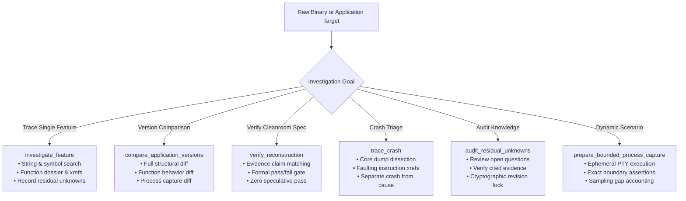

<!-- SPDX-License-Identifier: Apache-2.0 -->
<!-- Copyright (c) 2026 Arafat Zahan (@kuasha420) -->
<!-- Corporate Stewardship & Infrastructure: Purrfect Software Limited (PSL) -->
<!-- Governed by: ICARO-42/b Ordinance (Company-Supported Personal IP Framework) -->

# Technical Architecture Specification: REA (Reverse Engineer Anything) Native Antigravity Integration & Cleanroom Harmonization

**Document Reference**: `PSL-SPEC-2026-REA-001`  
**Target Release**: `v1.0.0-rc4` / `v1.1.0`  
**Governing Standard**: ICARO-42/b Ordinance  
**Classification**: Official Technical Architecture & Cleanroom Reconstruction Specification  
**Publication Path**: `docs/official-specs/rea-antigravity-architecture.md`  
**Status**: **APPROVED — ARCHITECTURAL BLUEPRINT & EMPIRICALLY VERIFIED**  
**Date**: `2026-10-15`  
**Authors**: PSL Lead Architect & Milestone 2 Implementation Worker (`m2_worker_1`), synthesized with `survey_spec_miner_2` and `survey_explorer_3`.

---

## 1. Document Metadata & Executive Summary

### 1.1 Scope & Mission Context
This specification establishes the official architectural blueprint for integrating **Reverse Engineer Anything (REA)** (upstream `morluto/rea`, package `rea-agents`, web `https://rea.tools/`) into **agyis-harness** (formerly `psl-agy-harness`) within the Google Antigravity™ runtime environment.

During previous release iterations, initial attempts to wire REA and cleanroom specification gates into the harness produced three severe operational frictions:
1. **Doctor Latency Degradation (Issue #44)**: Unconditional execution of heavy disassembler probes (`rea providers --json`) in `agyis doctor` introduced 2.5–4.0 seconds of latency, violating the ADR-015 sub-second benchmark invariant and emitting false warning flags for standard software developers who do not perform binary reverse engineering.
2. **Cleanroom Specification Deadlock (Issue #45)**: The completion fence stop hook (`completion_fence_hook.py`) treated modifications to cleanroom specifications (`docs/specs/**`) as production code dirtying, coercing agents engaged in read-only black-box analysis to run non-existent unit test suites (`agyis test`) before exiting.
3. **Lifecycle Hook Interference**: In subshells lacking login environment paths, `rea` commands failed with Exit Code 127 (`command not found`). Concurrently, iterative inspection of binary artifacts and specifications tripped false-positive anti-loop circuit breakers, while large disassembly dumps threatened hook timeout thresholds.

Per authoritative directive `2026-10-15T20:36:45Z` in `ORIGINAL_REQUEST.md`, these capabilities were extracted from pull requests into dedicated feature branch `feat/rea-harmonization` for holistic architectural remediation.

### 1.2 The Non-Interference Invariant
This specification codifies the foundational behavioral guarantee:

> [!IMPORTANT] The Non-Interference Invariant
> Agyis harness lifecycle hooks, runtime diagnostics, and completion gates must **never obstruct, falsely throttle, or coerce false testing demands** upon an agent executing legitimate binary reverse engineering, static analysis, or cleanroom specification authoring.
> 
> When REA tooling is not requested, the harness must remain completely zero-overhead and sub-second (<1.0s). When REA tooling is engaged, the harness must provide transparent PATH shims, phase-aware completion fence gating, loop exemptions for specifications, and bounded compaction for massive disassembly dumps.

### 1.3 High-Level Value Equation
$$\text{AGYIS (Deterministic Governance + Lifecycle Hooks)} + \text{REA (Evidence-Based Binary Reconstruction)} = \textbf{Provable Cleanroom Engineering}$$

Combining AGYIS and REA delivers an automated, evidence-backed workflow for analyzing legacy binaries, closed-source dependencies, protocols, and packaged runtimes, producing cleanroom specifications in `docs/specs/**` backed by immutable evidence ledgers in `.agents/ledger/**`.

---

## 2. Complete REA System Architecture & Catalog

REA exposes a symmetric two-tier interface for autonomous coding agents:
1. **Model Context Protocol (MCP) Stdio Server**: 207 MCP tools, 6 Guided Prompts, and Evidence URI resources running on MCP Protocol `2025-11-25`.
2. **Command Line Interface (CLI)**: 153 CLI subcommands supporting structured output formatting (`json`, `toon`, `yaml`, `markdown`, `jsonl`), token pagination, offset slicing, and non-interactive script piping.

### 2.1 Identity & Catalog Checksums
Every build and delivery artifact is validated against canonical cryptographic digests:

| Catalog Attribute | Authoritative Value | Verification Mechanism |
| :--- | :--- | :--- |
| **CLI Package Version** | `6.5.0` | `rea --version` / `package.json` |
| **REA SDK Version** | `2.3.1` | Embedded SDK contract |
| **Bundled Skill Version** | `"42"` | `metadata.version` in `SKILL.md` |
| **MCP Tools Count** | **207 tools** | Stdio MCP `tools/list` handshake |
| **Guided Prompts Count** | **6 prompts** | Stdio MCP `prompts/list` handshake |
| **CLI Subcommands Count**| **153 subcommands** | `rea --help` subcommand tree |
| **Tools Catalog SHA-256**| `805433f17bb4f709558ff20c04f96fe561fca2938fd0f459b1f8cc0f6b438ded` | `rea mcp doctor` digest |
| **Prompts Catalog SHA-256**| `7152916ab48bd2a9677a5ad9cdbde0a51dc53c113934952ad096e93f5f18aa7e` | `rea mcp doctor` digest |
| **Combined Catalog SHA-256**| `405725e736ec8dc8483435b970acbf20f9f26b9f1fd25203b992f5ab4cd2a4f4` | Composite toolset signature |

### 2.2 Complete Breakdown of the 207 MCP Tools (18 Functional Domains)

The 207 MCP tools are organized across 18 specialized reverse engineering domains:

```
┌────────────────────────────────────────────────────────────────────────────────────────┐
│                             REA 207 MCP TOOL DOMAIN TAXONOMY                          │
├──────────────────────────┬──────────────────────────┬──────────────────────────────────┤
│ 1. Binary Session (4)    │ 2. Native Disasm (6)     │ 3. Cross-References (5)          │
│ • open_binary            │ • analyze_function       │ • xrefs                          │
│ • close_binary           │ • procedure_pseudo_code  │ • find_xrefs_to_name             │
│ • binary_session         │ • procedure_assembly     │ • address_name                   │
│ • binary_overview        │ • read_function_instr... │ • set_address_name, set_addr...  │
├──────────────────────────┼──────────────────────────┼──────────────────────────────────┤
│ 4. Call Graphs (4)       │ 5. Semantic Tracing (7)  │ 6. Memory & Byte Search (8)      │
│ • procedure_callers      │ • trace_feature          │ • search_strings                 │
│ • procedure_callees      │ • trace_call_path        │ • search_procedures              │
│ • get_call_graph         │ • trace_native_values    │ • search_bytes, read_bytes       │
│ • build_call_path        │ • trace_native_ui_action │ • list_strings, list_segments    │
├──────────────────────────┼──────────────────────────┼──────────────────────────────────┤
│ 7. Annotations (10)      │ 8. Binary Metadata (6)   │ 9. Crash Analysis (1)            │
│ • comment, set_comment   │ • inspect_binary_layout  │ • inspect_recorded_crash         │
│ • inline_comment         │ • inspect_pe_resources   │                                  │
│ • list_bookmarks         │ • inspect_go_binary      │                                  │
│ • set/unset_bookmark     │ • inspect_rust_binary    │                                  │
│ • goto/next/prev_address │ • inspect_sqlite_database│                                  │
├──────────────────────────┼──────────────────────────┼──────────────────────────────────┤
│ 10. Apple / macOS (13)   │ 11. Managed / .NET (7)   │ 12. Electron & JS (13)           │
│ • inspect_macho          │ • inspect_managed_art... │ • analyze_javascript_application │
│ • inspect_plist          │ • inspect_managed_mem... │ • reconcile_javascript_runtime   │
│ • inspect_signature      │ • inspect_managed_nat... │ • recover_javascript_sources     │
│ • demangle_swift         │ • compare_managed_mem... │ • inspect_electron_fuses         │
│ • analyze_swift_types    │ • verify_managed_nati... │ • list/inspect_electron_page     │
│ • get_objc_classes       │ • import_managed_reco... │ • observe_javascript_runtime     │
│ • decode_interface_bui...│ • project_managed_app... │ • compare_javascript_export...   │
├──────────────────────────┼──────────────────────────┼──────────────────────────────────┤
│ 13. Web & Browser (14)   │ 14. Android & Mobile (15)│ 15. Android ADB Control (22)     │
│ • list_browser_targets   │ • inspect_android_pack...│ • list_adb_devices / inspect     │
│ • inspect_web_page       │ • search_android_classes │ • list/pull/inspect_adb_package  │
│ • observe_web_session    │ • inspect_android_class  │ • start/stop_adb_app             │
│ • capture_browser_scen...│ • inspect_android_method │ • read_adb_logcat                │
│ • discover_webmcp_tools  │ • decode_android_res...  │ • capture_adb_screen             │
│ • inspect_web_network... │ • identify_flutter_build │ • install/uninstall_adb_package  │
│ • compare_web_captures   │ • inspect_dart_aot       │ • list_adb_services / features   │
├──────────────────────────┼──────────────────────────┼──────────────────────────────────┤
│ 16. Firmware & WASM (7)  │ 17. Network Packets (4)  │ 18. Dynamic & Evidence (61)      │
│ • inspect_firmware_reg...│ • inspect_packet_capture │ • start/load/instrument_frida    │
│ • extract_firmware       │ • inspect_pcap_capture   │ • start/console_gdb_session      │
│ • inspect_wasm_artifact  │ • inspect_packet_fields  │ • execute/debug_rizin_command    │
│ • compare_wasm_interf... │ • inspect_pcap_client    │ • export/import_evidence_bundle  │
│ • inspect_evm_interface  │                          │ • build_reconstruction_ledger    │
│ • decode_signal_record...│                          │ • evaluate_reconstruction_cov... │
│ • inspect_signal_decod...│                          │ • record/list/verify_unknowns    │
└──────────────────────────┴──────────────────────────┴──────────────────────────────────┘
```

#### Detailed Domain Matrix & Input/Output Contracts

| # | Functional Domain | Tool Count | Core Tool Names | Primary Arguments | Return Payload | Failure / Error Invariant |
|---|---|---|---|---|---|---|
| 1 | **Binary Session** | 4 | `open_binary`, `close_binary`, `binary_session`, `binary_overview` | `path: string`, `provider_id?: string` | `document`, `target_sha256`, `architecture`, `endianness`, `format` | Fails closed if file is missing, corrupt, or unsupported. Returns empty state when target-free. |
| 2 | **Native Disassembly** | 6 | `analyze_function`, `procedure_pseudo_code`, `procedure_assembly`, `read_function_instructions`, `batch_decompile`, `procedure_info` | `path?: string`, `address?: string`, `name?: string` | Complete function dossiers, basic block control flow graphs, pseudo-C listings. | Returns error if symbol unresolved; decompiler fallbacks preserve raw disassembly. |
| 3 | **Cross References** | 5 | `xrefs`, `find_xrefs_to_name`, `address_name`, `set_address_name`, `set_addresses_names` | `address: string`, `direction?: "to"\|"from"`, `name?: string` | Relocation table with callers, callees, data read/write sites. | Empty list on zero references; does not guess references. |
| 4 | **Call Graph** | 4 | `procedure_callers`, `procedure_callees`, `get_call_graph`, `build_call_path` | `root_address: string`, `depth?: number`, `from: string`, `to: string` | Directed acyclic graph (nodes, edges) mapping execution flow. | Bounds recursion at declared depth; preserves unresolved indirect call targets. |
| 5 | **Semantic Tracing** | 7 | `trace_feature`, `trace_call_path`, `trace_native_values`, `trace_native_ui_action`, `observe_native_calls`, `observe_native_ui`, `capture_native_ui_scenario` | `feature: string`, `address: string`, `register?: string` | Step-by-step evidence chain from UI event or literal string to backend handler. | Negative search boundaries prevent infinite loops; flags unobserved leaps. |
| 6 | **Memory & Search** | 8 | `search_strings`, `search_procedures`, `search_bytes`, `read_bytes`, `address_to_file_offset`, `list_strings`, `list_names`, `list_segments` | `pattern: string`, `hex_pattern: string`, `mask?: string` | Virtual address offset, section name, decoded string literal. | Returns empty match sets; error if mask length mismatches pattern. |
| 7 | **Annotations** | 10 | `comment`, `set_comment`, `inline_comment`, `set_inline_comment`, `list_bookmarks`, `set_bookmark`, `unset_bookmark`, `goto_address`, `next_address`, `prev_address` | `address: string`, `comment?: string`, `note?: string` | Mutation confirmation and active session bookmark ledger. | Disassembler session state mutation; rollback on write collision. |
| 8 | **Binary Metadata** | 6 | `inspect_binary_layout`, `inspect_pe_resources`, `inspect_go_binary`, `inspect_rust_binary`, `inspect_sqlite_database`, `inspect_with_objdump` | `path: string`, `table?: string`, `detail?: "summary"\|"full"` | Checksec mitigations (Canary, NX, PIE, RELRO), Go pclntab facts, Rust dep-v0 crates, SQLite tables. | Returns null metadata without panic when binary does not contain target runtime symbols. |
| 9 | **Crash Analysis** | 1 | `inspect_recorded_crash` | `path: string`, `include_debugger_context?: boolean` | Register states, faulting instruction, stack backtrace, signal taxonomy. | Preserves core dump memory isolation; fails if core header invalid. |
| 10 | **Apple / macOS** | 13 | `inspect_macho`, `inspect_plist`, `inspect_signature`, `list_architectures`, `demangle_swift`, `analyze_swift_types`, `get_objc_classes`, `get_objc_protocols`, `decode_interface_builder`, `inspect_keyed_archive`, `inspect_asset_catalog`, `trace_dylib_resolution`, `project_apple_application_graph` | `path: string`, `mangled_name?: string` | Objective-C class hierarchies, Swift struct metadata, compiled NIB UI trees, dyld @rpath load graph. | Fails closed on signature tampering; gracefully returns unmangled string if not Swift. |
| 11 | **Managed / .NET**| 7 | `inspect_managed_artifact`, `inspect_managed_members`, `inspect_managed_native_boundaries`, `compare_managed_members`, `verify_managed_native_boundaries`, `import_managed_reconstruction`, `project_managed_application_graph` | `path: string`, `managed_path: string`, `native_path: string` | CIL metadata tables, `ldstr` string pool, P/Invoke imports mapped to native DLL exports. | Flags calling convention mismatches; isolates unmanaged exports. |
| 12 | **Electron & JS** | 13 | `analyze_javascript_application`, `reconcile_javascript_runtime`, `recover_javascript_sources`, `export_web_scripts`, `inspect_electron_fuses`, `list_electron_targets`, `inspect_electron_page`, `capture_electron_scenario`, `list_javascript_runtime_targets`, `observe_javascript_runtime`, `compare_javascript_export_shapes`, `trace_application_feature`, `trace_javascript_semantics` | `path: string`, `endpoint?: string`, `evidence_id?: string` | ASAR module graph, Electron IPC channel maps, hardcoded Electron fuses, recovered modules with SHA-256. | Detects disabled `--inspect` fuse (0x00) without launching app, preventing agent connection hang. |
| 13 | **Web & Browser** | 14 | `list_browser_targets`, `inspect_web_page`, `observe_web_session`, `observe_web_execution`, `capture_browser_scenario`, `discover_webmcp_tools`, `inspect_web_event_listeners`, `inspect_web_network_capture`, `trace_web_module_imports`, `trace_web_source_location`, `compare_web_captures`, `capture_web_screenshot`, `compare_web_screenshots`, `analyze_web_bundle` | `endpoint: string`, `selector?: string`, `path?: string`, `format?: string` | DOM trees, live event listeners, parsed HAR/mitmproxy captures, sourcemap token mappings. | Never initiates live external HTTP traffic during capture analysis; parses offline capture files hermetically. |
| 14 | **Android & Mobile**| 15 | `inspect_android_package`, `search_android_classes`, `inspect_android_class`, `inspect_android_method`, `trace_android_references`, `decode_android_resources`, `identify_flutter_build`, `inspect_dart_aot`, `inspect_apktool_client`, `project_android_application_graph`, `project_harmony_application_graph`, `inspect_jeb_client`, `open_jeb_project`, `list_jeb_units`, `decompile_jeb_item` | `path: string`, `class_name?: string`, `method_name?: string` | Decompiled Java methods via JADX, Flutter engine commit hashes, Dart snapshot string pools, resource XML. | Requires JDK 17+ and JADX JAR; fails with clean diagnostic message if JADX is unconfigured. |
| 15 | **Android ADB** | 22 | `list_adb_devices`, `inspect_adb_device`, `list_adb_packages`, `pull_adb_package`, `read_adb_logcat`, `inspect_adb_package`, `start_adb_app`, `start_adb_activity`, `stop_adb_app`, `capture_adb_screen`, `list_adb_services`, `install_adb_package`, `uninstall_adb_package`, `pull_adb_file`, `push_adb_file`, `list_adb_processes`, `list_adb_directory`, `list_adb_features`, `inspect_adb_display`, `inspect_adb_window`, `read_adb_setting`, `collect_adb_bugreport` | `serial: string`, `package?: string`, `buffer?: string`, `lines?: number` | Device prop whitelist facts, APK binaries, bounded logcat slices, display dumpsys. | Bounds logcat lines to avoid terminal buffer overflow; requires authorized ADB device connection. |
| 16 | **Firmware & WASM**| 7 | `inspect_firmware_regions`, `extract_firmware`, `inspect_wasm_artifact`, `compare_wasm_interfaces`, `inspect_evm_interface`, `decode_signal_recording`, `inspect_signal_decoders` | `path: string`, `decoder?: string`, `options?: object` | Carved flash partitions, disassembled WebAssembly (WAT), EVM bytecode function selectors, decoded logic traces. | Non-destructive carving; refuses to overwrite non-empty destination directories. |
| 17 | **Network Packets**| 4 | `inspect_packet_capture`, `inspect_pcap_capture`, `inspect_packet_fields`, `inspect_pcap_client` | `path: string`, `filter?: string`, `fields?: string[]` | Dissected PCAP frames via TShark, DNS queries, TLS Server Name Indications (SNI). | Fails if TShark / Wireshark CLI missing; strictly operates on static PCAP files. |
| 18 | **Dynamic & Cleanroom**| 61 | `start_frida_session`, `load_frida_script`, `instrument_with_frida`, `start_gdb_session`, `gdb_console`, `execute_rizin_command`, `cutter_command`, `capture_process_scenario`, `compare_process_captures`, `export_evidence_bundle`, `import_evidence_bundle`, `inspect_analysis_view`, `build_reconstruction_obligation_ledger`, `evaluate_reconstruction_coverage`, `verify_reconstruction`, `record_unknown`, `list_unknowns`, `verify_unknown_resolution`, `get_navigation_context`, `inspect_address_context`, etc. | `evidence_ids: string[]`, `spec_goal: string`, `claim: string`, `question: string` | Portable Evidence JSON bundles, typed obligation ledgers, mathematical coverage percentages, verified unknowns ledger. | Fail-closed evaluation; claims unsupported by concrete Evidence records are rejected. |

### 2.3 CLI Subcommand Architecture (153 Commands)
The REA CLI (`rea <command> [args]`) mirrors the MCP toolset, providing non-interactive, pipeline-friendly execution for scripts and shell commands.

- **Universal Formatting Flags**:
  - `--format json`: Standard RFC 8259 JSON for programmatic ingestion.
  - `--format toon`: Token-Optimized Object Notation, reducing token overhead by up to 45% compared to pretty-printed JSON.
  - `--format yaml`: Human-readable structured YAML.
  - `--format markdown`: GitHub Flavored Markdown tables and code fences for direct artifact embedding.
  - `--format jsonl`: Line-delimited JSON streams for massive dataset iteration.
- **Context Protection Controls**:
  - `--limit <N>`: Truncates output array elements to prevent context window exhaustion.
  - `--offset <N>`: Slices large data sets for deterministic pagination.
  - `--detail <summary|full>`: Emits high-level structural metrics or full AST dumps.
  - `--filter-output <jq-expr>`: Evaluates jq-like projection prior to stdout emission.

### 2.4 The 6 Guided MCP Prompts
REA defines 6 formal guided prompt contracts that enforce disciplined, evidence-based reverse engineering methodologies directly into agent reasoning:



1. **`investigate_feature`**:
   - *Objective*: Trace a requested feature, behavior, string, or symbol through artifact, symbol, and function evidence without claiming unobserved behavior.
   - *Required Arguments*: `feature` (string). *Optional*: `target_path`, `document`, `procedure`, `provider_id`.
   - *Disciplined Steps*: Route target $\to$ Search strings/procedures $\to$ Consult analysis view $\to$ Build function dossiers and xrefs $\to$ Record residual unknowns.
2. **`compare_application_versions`**:
   - *Objective*: Compare baseline and candidate application versions through complete inventory and runtime evidence without equating missing data with unchanged behavior.
   - *Required Arguments*: `left_target_path`, `right_target_path`. *Optional*: `left_manifest_id`, `right_manifest_id`, `focus_occurrence_id`.
   - *Disciplined Steps*: Open both targets $\to$ Reconstruct application graphs $\to$ Compare inventory $\to$ Differentiate functions $\to$ Record unknowns.
3. **`verify_reconstruction`**:
   - *Objective*: Formally evaluate a finite reconstruction specification against retained Evidence comparisons without broadening pass results into global equivalence.
   - *Required Arguments*: `reconstruction_goal` (string). *Optional*: `comparison_evidence_id`, `provider_id`.
   - *Disciplined Steps*: Audit comparison evidence $\to$ Evaluate per-claim typed specification $\to$ Report verification unknowns.
4. **`trace_crash`**:
   - *Objective*: Correlate a crash symptom (signal, exception, address) with static call/reference evidence and process capture observations.
   - *Required Arguments*: `crash_signal` (string). *Optional*: `target_path`, `document`, `procedure`, `capture_evidence_id`.
   - *Disciplined Steps*: Open target $\to$ Resolve faulting address to function dossier $\to$ Trace callers and references $\to$ Correlate with capture $\to$ Separate observed crash from inferred cause.
5. **`audit_residual_unknowns`**:
   - *Objective*: Review active residual unknown heads against retained evidence, revision integrity, and authority requirements without silently closing unanswered questions.
   - *Required Arguments*: `audit_scope` (string). *Optional*: `unknown_id`, `evidence_id`.
   - *Disciplined Steps*: List open heads $\to$ Verify resolved heads against cited evidence $\to$ Update unknowns with revision guards $\to$ Record newly discovered unknowns.
6. **`prepare_bounded_process_capture`**:
   - *Objective*: Run a caller-selected process experiment that answers a specific behavioral question under explicit boundaries.
   - *Required Arguments*: `behavior_question`, `executable`, `working_directory`. *Optional*: `prior_capture_evidence_id`.
   - *Disciplined Steps*: Execute scenario under ephemeral PTY $\to$ Compare with prior compatible captures $\to$ Record sampling gaps as unknowns.

---

## 3. Provider Matrix & Execution Engines

REA follows a strict **bring-your-own-provider** architecture for resource-intensive disassemblers, while providing built-in, zero-dependency parsers for portable formats.

```
                                  ┌──────────────────────────────┐
                                  │    REA Unified Interface     │
                                  │  (207 MCP / 153 CLI Tools)   │
                                  └──────────────┬───────────────┘
                                                 │
            ┌────────────────────────┬───────────┴───────────┬────────────────────────┐
            ▼                        ▼                       ▼                        ▼
 ┌──────────────────────┐ ┌──────────────────────┐ ┌──────────────────────┐ ┌──────────────────────┐
 │    Heavy Engines     │ │  Mobile & Decompiler │ │  Dynamic Tracing     │ │ Built-in Parsers     │
 │ • Ghidra 12.1+       │ │ • JADX Headless JAR  │ │ • Frida Core         │ │ • Electron ASAR      │
 │   (Headless Java 21) │ │ • JEB MCP Client     │ │ • GDB MI (-i=mi)     │ │ • .NET PE/CLI        │
 │ • Hopper v4/v5       │ │ • Apktool & aapt2    │ │ • Rizin & Cutter     │ │ • Mach-O / Dyld      │
 │ • IDA Pro (idalib)   │ │ • sigrok-cli         │ │ • Wireshark / TShark │ │ • Go / Rust / SQLite │
 └──────────────────────┘ └──────────────────────┘ └──────────────────────┘ └──────────────────────┘
```

### 3.1 Heavy Disassembler Engines

#### 1. Ghidra Engine (Headless 12.1+)
- **Supported Architectures**: x86, x86_64, ARM, AArch64, MIPS, PowerPC, RISC-V, SPARC.
- **Runtimes & Environment**: Requires 64-bit **OpenJDK 21 or newer** and a complete Ghidra distribution.
  - `GHIDRA_INSTALL_DIR`: Must point to the Ghidra root (e.g. `/opt/ghidra`).
  - **Dynamic JVM Discovery Ladder**: Rather than relying on static paths, REA traverses an ordered discovery ladder to identify a compatible JDK 21+ runtime:
    1. `$JAVA_HOME` (if valid JDK 21+ binary exists at `$JAVA_HOME/bin/java`).
    2. `/usr/lib/jvm/java-21-openjdk*` (Linux standard OpenJDK path glob).
    3. `/usr/lib/jvm/java-21-openjdk-amd64` (Ubuntu / Debian multiarch).
    4. `/usr/lib/jvm/jre-21-openjdk` (Fedora / RHEL).
    5. `/opt/homebrew/opt/openjdk@21` (macOS Homebrew Apple Silicon).
    6. `/usr/local/opt/openjdk@21` (macOS Homebrew Intel).
    7. `/Library/Java/JavaVirtualMachines/temurin-21.jdk/Contents/Home` and `/Library/Java/JavaVirtualMachines/openjdk-21.jdk/Contents/Home` (macOS PKG installers).
- **Headless Invariant**: Invokes `$GHIDRA_INSTALL_DIR/support/analyzeHeadless` in ephemeral workspace directories (`/tmp/rea_ghidra_*`). It never opens an interactive GUI window.
- **Native Decompiler**: Employs the precompiled ELF/Mach-O native decompiler binary located at `$GHIDRA_INSTALL_DIR/Ghidra/Features/Decompiler/os/<os_arch>/decompile`.
- **Java Version Trap & Provider Fallback Order**: On systems where default `java` is Java 8 or Java 17, REA explicitly enforces `JAVA_HOME` pointing to JDK 21 from the discovery ladder, preventing `unsupported_version` JVM crashes. If no JDK 21+ is available on the host, REA automatically degrades through the disassembler provider fallback order:
  $$\text{Ghidra} \longrightarrow \text{Rizin} \longrightarrow \text{objdump} \longrightarrow \text{built-in parsers}$$

#### 2. Hopper Disassembler (v4 / v5)
- **Supported Targets**: Linux ELF (Ubuntu, Arch, Fedora) and macOS Mach-O.
- **Environment**: Requires `HOPPER_LAUNCHER_PATH` and an active display socket or virtual framebuffer.
- **Headless Hopper Contract**:
  - **Display Socket Probing**: Checks for active `$DISPLAY` or `$WAYLAND_DISPLAY` environment variables.
  - **Headless & Virtual Framebuffer Fallback**: If no display socket is present, REA probes for `xvfb-run` (e.g. `xvfb-run -a <hopper-cmd>`) or sets `QT_QPA_PLATFORM=offscreen`.
  - **Graceful Degradation**: If neither a physical display nor a virtual framebuffer is available (e.g. minimal headless CI or bare SSH session), Hopper is marked `unavailable: "no display socket"`, and disassembly requests fall back cleanly to Ghidra or Rizin without raising unhandled Qt platform errors or crashing the supervisor.
- **IPC Mechanism**: Communicates via Hopper's local script server and IPC socket to extract disassembly listings and basic block graphs.

#### 3. IDA Pro & IDA MCP
- **Supported Versions**: IDA Pro 9.0 and 9.1+ (Windows, Linux, macOS arm64).
- **Profiles**:
  - *Legacy Attached Profile*: Binds to an already-running IDA GUI instance by binary SHA-256 without modifying the active database.
  - *Modern Headless Supervisor*: Spawns IDA in headless batch mode via `idalib-mcp`, creates private temporary IDBs, and terminates cleanly upon session exit.
- **Headless Supervisor Isolation Protocol**:
  - **Ephemeral Sandbox Isolation**: The supervisor copies the target binary to an ephemeral, isolated directory (`/tmp/rea_ida_<uuid>/`) before analysis.
  - **Mandatory Autonomous Flags**:
    - `-A`: Autonomous mode (suppresses all interactive modal dialogs, license prompts, and blocking message boxes).
    - `-B`: Batch mode (executes non-interactive disassembly and analysis generation).
    - `-o`: Output redirection (redirects generated `.idb` / `.i64` database files into the ephemeral sandbox away from the original source tree).
  - **Zero-Mutation Invariant**: Asserts zero file mutation or lock generation within the original binary directory, preventing database lock collisions and indefinite process hangs.

### 3.2 Mobile & Decompiler Providers
- **JADX**: Requires `jadx-headless-mcp` 0.7.1 JAR configured via `REA_JADX_MCP_JAR` with JDK 17+. Handles Android APK DEX decompilation to structured Java classes.
- **JEB Decompiler**: Integrates with running PNF Software JEB instances via its native MCP bridge (`inspect_jeb_client`).
- **Apktool & Sigrok**: Uses local system binaries (`apktool`, `sigrok-cli`) for non-destructive Android resource decoding and logic analyzer signal processing.

### 3.3 Dynamic Instrumentation Engines
- **Frida Core**: Connects via Node/Python Frida bindings to attach to running processes or spawn binaries under memory hooks, executing ephemeral scripts without mutating target files on disk.
- **GDB Machine Interface (MI)**: Spawns ephemeral `gdb -i=mi` instances with an inferior pseudo-terminal, permitting non-interactive backtrace inspections and core dump dissections.
- **Rizin & Cutter**: Executes non-interactive Rizin batch commands (`rizin -q -c "<cmd>" <binary>`) and connects to Cutter GUI instances via live Python bridges.

### 3.4 Built-in Portable Parsers (Zero External Dependency)
To guarantee high performance and hermetic operation without requiring external disassemblers for routine tasks, REA provides built-in parsers:
- **Electron & ASAR**: Unpacks and maps Electron archives, parses JavaScript ASTs, inspects hardcoded Chromium fuse bytes (`NodeCliInspect`, `RunAsNode`), and maps IPC channels.
- **.NET PE/CLI**: Parses PE headers, metadata streams (`#~`, `#Strings`, `#Blob`), `ldstr` CIL bytecode, and P/Invoke DLL boundary bindings directly in JavaScript.
- **Mach-O & Apple**: Parses Mach-O load commands, LC_SEGMENT, code signing entitlements, and dyld resolution paths (`@rpath`, `@loader_path`).
- **Go Binaries**: Extracts Go module versions, dependency trees, and pclntab function tables.
- **Rust Binaries**: Extracts `.dep-v0` cargo auditable metadata packages.
- **SQLite Databases**: Performs read-only, lock-free schema and table inspection via Node.js native SQLite drivers (`node:sqlite`).

---

## 4. Antigravity Native Integration & Happy Path

Google Antigravity coordinates tools and agents across three core components:
1. **MCP Configuration**: `~/.gemini/config/mcp_config.json` registering stdio and SSE servers.
2. **Modular Skills**: `~/.gemini/config/skills/` (global) and `.agents/skills/` (project-level).
3. **Agent Brain & Transcripts**: `~/.gemini/antigravity/` preserving state, logs, and context.

### 4.1 Definitive MCP Configuration Specification
To achieve complete, error-free integration between Google Antigravity and REA across diverse host environments, the `mcpServers.rea` block in `~/.gemini/config/mcp_config.json` is configured following portable resolution semantics:

```json
{
  "mcpServers": {
    "rea": {
      "command": "rea",
      "args": [
        "mcp"
      ],
      "env": {
        "GHIDRA_INSTALL_DIR": "/opt/ghidra",
        "JAVA_HOME": "${DYNAMIC_JVM_PATH}",
        "REA_MCP_INPUT_SCHEMA_PROFILE": "full",
        "REA_MCP_OUTPUT_SCHEMA_PROFILE": "off"
      }
    }
  }
}
```

> [!NOTE] Portable Host Resolution & Dynamic JVM Ladder
> - **Portable `command` Resolution**: In standard environments where `rea` is installed globally (via `pnpm add -g rea-agents` or `npm install -g rea-agents`), `"command": "rea"` executes directly via user PATH shims injected by the harness. When configured via `agyis onboard --experimental-rea` or `agyis install -g --experimental-rea`, the installer dynamically resolves `command` to the host's concrete entrypoint (e.g. `$(pnpm root -g)/rea-agents/scripts/rea.mjs`, `$(npm root -g)/rea-agents/scripts/rea.mjs`, or `~/.local/share/pnpm/rea`).
> - **Dynamic `JAVA_HOME` Discovery**: The environment variable `JAVA_HOME` is dynamically populated during provisioning using the JVM Discovery Ladder:
>   1. Existing `$JAVA_HOME` (if valid JDK 21+).
>   2. Linux OpenJDK glob: `/usr/lib/jvm/java-21-openjdk*`.
>   3. Ubuntu / Debian multiarch: `/usr/lib/jvm/java-21-openjdk-amd64`.
>   4. Fedora / RHEL: `/usr/lib/jvm/jre-21-openjdk`.
>   5. macOS Homebrew (Apple Silicon): `/opt/homebrew/opt/openjdk@21`.
>   6. macOS Homebrew (Intel): `/usr/local/opt/openjdk@21`.
>   7. macOS Temurin / OpenJDK PKG: `/Library/Java/JavaVirtualMachines/temurin-21.jdk/Contents/Home`.
> - **Provider Fallback**: If JDK 21+ is unavailable or Ghidra verification fails, disassembler operations degrade in sequence: `Ghidra -> Rizin -> objdump -> built-in parsers`.

### 4.2 Token Conservation Analysis & Schema Pruning
A major vulnerability in multi-hundred-tool MCP integrations is context window bloat during initial tool enumeration:
- **`REA_MCP_INPUT_SCHEMA_PROFILE: "full"`**:
  Ensures that when an agent consults REA tools via `call_mcp_tool`, Antigravity receives exhaustive property descriptions, required parameter lists, and parameter types for all 207 tools, preventing hallucinated arguments.
- **`REA_MCP_OUTPUT_SCHEMA_PROFILE: "off"`**:
  Standard MCP schemas publish return payload schemas in addition to input schemas. For 207 tools, transmitting output schema definitions injects **~4,500 redundant tokens** into every single conversational turn. Setting the output schema profile to `"off"` eliminates this token tax entirely while leaving input validation 100% intact.

### 4.3 Client Frame Overflow Prevention
Antigravity's JSON-RPC stdio transport buffers individual tool responses. If an agent executes an unfiltered disassembly dump (e.g. 50,000 lines of disassembly), the client frame can overflow or freeze the UI thread.

**REA Happy Path Safeguards**:
1. **`detail: "summary"` Mode**: Agents must default to `detail: "summary"` when calling tools like `analyze_javascript_application` or `binary_overview`.
2. **Evidence ID Referencing**: REA caches full analysis trees under immutable `evidence_id` hashes and returns lightweight summary receipts.
3. **Paging via `inspect_analysis_view`**: Agents inspect specific slices or modules on demand using `inspect_analysis_view(evidence_id, view, page)` without re-running analysis or flooding context.

### 4.4 Skills Integration
The official skill `reverse-engineer-anything` (metadata version `"42"`) encapsulates REA operational runbooks, disassembler choice matrices, and cleanroom verification protocols.
- **Global Path**: `~/.gemini/config/skills/reverse-engineer-anything/SKILL.md`
- **Harness Canonical Path**: `skills/reverse-engineer-anything/SKILL.md`
- **Synchronization**: Managed automatically via `agyis skills --sync` or `agyis init --experimental-rea`.

---

## 5. Cleanroom Reconstruction Contracts

Cleanroom reverse engineering requires a mathematical boundary between the **dirty room** (binary analysis, decompiler inspection) and the **clean room** (specification authoring, clean implementation).

```
┌──────────────────────────────────────┐     ┌──────────────────────────────────────┐
│        DIRTY ROOM: ANALYSIS          │     │       CLEAN ROOM: IMPLEMENTATION     │
│ • Target Binaries & Libraries        │     │ • Cleanroom Specifications           │
│ • Disassembly & Decompilation Dumps  │     │   (`docs/specs/**`)                  │
│ • Ephemeral Scratch (`.rea/**`)      │     │ • Obligation Ledgers                 │
│ • Reverse Engineering Prompts        │     │   (`.agents/ledger/obligations.json`)│
│ • Retained Evidence (`evidence_id`)  │     │ • Cleanroom Code Implementation      │
└──────────────────┬───────────────────┘     └──────────────────▲───────────────────┘
                   │                                            │
                   │           EVIDENCE BOUNDARY                │
                   └───────────────────►────────────────────────┘
```

### 5.1 Repository Ledger Structure
Cleanroom deliverables are codified in two repository locations:
1. **Cleanroom Specifications (`docs/specs/**`)**:
   - Human- and agent-readable architectural, protocol, and functional specifications.
   - Authoritative API contracts, finite state machine definitions, and wire layouts.
   - Contains zero copied decompiled code or vendor proprietary signatures.
2. **Obligation Ledgers (`.agents/ledger/**`)**:
   - Machine-verifiable contracts generated by REA's Evidence Engine:
     - `obligations.json`: Typed obligations linking specification claims to verification criteria.
     - `manifest.json`: Bindings between obligations, original binary cases, and implementation verifiers.
     - `evidence_bundle.json`: Immutable evidence records (`evidence_id`, subject, provider, digest).

### 5.2 Typed Obligation Model
Each obligation in `.agents/ledger/obligations.json` adheres to the formal schema:

```json
{
  "obligation_id": "OBLIG-AUTH-TOKEN-001",
  "family": "protocol_wire_contract",
  "target": "session_handshake",
  "required_case_kinds": ["valid_handshake", "expired_token", "tampered_signature"],
  "required_fixture_authority": "captured_pcap_stream",
  "required_verifier_authority": "hermetic_test_oracle",
  "disposition": "pending"
}
```

### 5.3 Residual Unknowns Lifecycle
Incomplete reverse engineering often tempts models to hallucinate missing fields. REA prevents this via an explicit **Residual Unknowns Lifecycle**:

```mermaid
sequenceDiagram
    participant Agent
    participant REA as REA Evidence Engine
    participant Ledger as .agents/ledger/unknowns.json

    Agent->>REA: record_unknown(question, context, authority_needed)
    REA-->>Ledger: Store unknown record with UUID & revision hash
    REA-->>Agent: Return unknown_id
    Note over Agent: Investigation proceeds; new evidence discovered
    Agent->>REA: verify_unknown_resolution(unknown_id, resolving_evidence_id)
    alt Evidence Validates Resolution
        REA-->>Ledger: Mark unknown resolved with cited evidence
        REA-->>Agent: Status: Resolved (PASS)
    else Evidence Insufficient
        REA-->>Agent: Status: Invalidation Error (REJECTED)
    end
```

- **`record_unknown`**: Formally records an unanswered question or missing specification authority with explicit revision tracking.
- **`list_unknowns`**: Queries active open heads.
- **`verify_unknown_resolution`**: Asserts that an unknown was resolved by citing concrete Evidence IDs. Silent closure of unknowns without evidence is strictly prohibited.

### 5.4 Formal Verification Gates
Before an implementation is declared complete, it must clear two formal gates:
1. **`evaluate_reconstruction_coverage`**: Measures implementation source code against the obligation ledger, calculating verified vs unmet obligations.
2. **`verify_reconstruction`**: Formally evaluates individual reconstruction claims against retained Evidence comparisons. Passes are granted only when supported by mathematical evidence.

---

## 6. Lifecycle Hook Harmonization & The Non-Interference Invariant

To resolve the frictions documented in Issues #44 and #45, the four primary lifecycle hooks in `harness/hooks/` are harmonized as follows:

### 6.1 `command_safety_hook.py` (Toolchain PATH & Batch Modes)
- **Problem**: In non-login subshells, `rea` commands fail with Exit Code 127 because `~/.local/share/pnpm` or `~/.npm-global/bin` is omitted from `PATH`. Commands wrapped in `command` (e.g. `command -v rea` or `command rea`) bypass toolchain detection. Additionally, interactive disassembler commands can hang waiting for stdin.
- **Remediation**:
  1. Add `"rea"` to `USER_TOOLCHAINS` in `harness/hooks/command_safety_hook.py`:
     ```python
     USER_TOOLCHAINS = (
         "agyis", "psl", "knot", "uv", "pnpm", "npm", "npx", "cargo", "rustc",
         "pytest", "ruff", "black", "mypy", "flake8", "tsc", "rea",
     )
     ```
  2. Extend host candidate PATH shims in `get_user_path_shims()` to cover global npm installations:
     ```python
     def get_user_path_shims() -> List[str]:
         candidates = [
             Path.home() / ".local/bin",
             Path.home() / ".cargo/bin",
             Path.home() / ".local/share/pnpm",
             Path.home() / ".npm-global/bin",
             Path.home() / ".pyenv/shims",
         ]
         return [str(p) for p in candidates if p.is_dir()]
     ```
  3. Extend `USER_TOOLCHAIN_REGEX` prefix wrapper to capture `command`:
     ```python
     USER_TOOLCHAIN_REGEX = re.compile(
         r"(?:^|[;&|]\s*|\b(?:sudo|xargs|nohup|exec|env|time|command)\s+)\s*(?:/[^\s]+/)?\b("
         + "|".join(USER_TOOLCHAINS)
         + r")\b"
     )
     ```
  4. Add `rea` package suggestions in `COMMON_PACKAGE_SUGGESTIONS`:
     ```python
     "rea": "Install via 'pnpm add -g rea-agents' or run with 'npx rea-agents'",
     ```
  5. Enforce non-interactive batch flags for low-level disassemblers (e.g. rewrite raw `gdb` to `gdb -batch`, `rizin` to `rizin -q`).

### 6.2 `anti_loop_hook.py` (Cleanroom Spec & Verification Exemptions)
- **Problem**: Reviewing cleanroom specifications during reverse engineering tripped sliding-window repeat denials ($\ge 4$ in 15 calls). Granting blanket immunity via `_is_peer_heartbeat` would create an unmonitored loophole where agents could endlessly loop reading the same spec. Furthermore, running REA verifiers did not reset loop counters because REA was missing from `TEST_VERIFICATION_PATTERNS`.
- **Remediation**:
  1. **Bounded Sliding-Window Spec Quota (No Blanket Immunity)**:
     - Do **NOT** place `docs/specs/**` into `_is_peer_heartbeat` (which grants blanket immunity bypassing all checks).
     - Instead, implement an elevated sliding-window frequency quota for specification files:
       ```python
       SPEC_DIR_PREFIXES = ("/docs/specs/", "docs/specs/", "/.agents/ledger/", ".agents/ledger/")
       SPEC_WINDOW_MAX_CALLS = 8  # Elevated from default 4 in 15-call window
       ```
     - **Strict Consecutive Repeat Enforcement**: Regardless of the elevated window quota, consecutive identical `view_file` calls are strictly enforced: $\ge 3$ consecutive calls to the exact same specification path are immediately denied to prevent cognitive lockup.
  2. Register REA verification commands in `TEST_VERIFICATION_PATTERNS`:
     ```python
     TEST_VERIFICATION_PATTERNS = (
         # ... existing runners ...
         r"(?:^|[\s;&|])rea\s+(?:verify|verify-reconstruction|test)\b",
         r"(?:^|[\s;&|])python3?\s+-m\s+harness(?:\.cli)?\s+(?:verify|verify-cleanroom)\b",
         r"(?:^|[\s;&|])agyis\s+verify\b",
     )
     ```
  3. Recognize background task logs from long-running REA operations without premature anti-polling blocks when accompanied by explicit time fences.

### 6.3 `completion_fence_hook.py` (Phase-Aware Cleanroom Gating)
- **Problem**: Issue #45 un-isolated merging marked `code_dirty = True` whenever `docs/specs/**` was edited. Agents performing pure reverse engineering were deadlocked upon trying to stop, forced to trigger the safety valve twice because no project software tests existed. Conversely, storing executable code in `docs/specs/**` could allow unverified code execution without test verification. Additionally, REA verifiers called via MCP (`call_mcp_tool`) were invisible to command-line completion fences.
- **Remediation**:
  1. **Phase-Aware Decoupling & Extension Constraints (DEF-01 Code-in-Specs Loophole Guard)**:
     - Introduce distinct state tracking for pure specification authoring vs production code dirtying.
     - **Declarative Extension Whitelist**: Only files with declarative extensions qualify for pure `spec_dirty`:
       ```python
       DECLARATIVE_SPEC_EXTENSIONS = (
           ".md", ".json", ".yaml", ".yml", ".proto", ".schema", ".fbs", ".toml", ".txt"
       )
       ```
     - **Code-in-Specs Guard**: Any modified file in `docs/specs/**` or `.agents/ledger/**` bearing a code extension (`.py`, `.ts`, `.rs`, `.go`, `.sh`, `.c`, `.cpp`, `.js`, etc.) **MUST trigger `code_dirty = True`** (dual dirty state), strictly requiring project unit test verification before completion.
     - Pure `spec_dirty = True` (with `code_dirty = False`) is set **only** when all modified files reside in `docs/specs/**` or `.agents/ledger/**` and possess exclusively declarative extensions.
  2. **Specification Clearance Routes & MCP Clearance (DEF-03)**:
     - When *only* `spec_dirty` is True and `code_dirty` is False, the completion fence permits termination without coercing software unit test suites, provided cleanroom verification is executed or recorded.
     - **CLI Verifier Route**: Executing `rea verify-reconstruction`, `rea test`, or `agyis verify --spec` resets `spec_dirty = False`.
     - **MCP Tool Interception (PostToolUse)**: `completion_fence_hook.py` intercepts MCP tool completions:
       ```python
       def handle_post_tool_use(tool_name: str, args: dict, result: dict) -> None:
           if tool_name == "call_mcp_tool":
               inner_tool = args.get("ToolName", "")
               if inner_tool in ("verify_reconstruction", "evaluate_reconstruction_coverage"):
                   if result.get("status") != "error":
                       clear_spec_dirty()
           elif "verify_reconstruction" in tool_name or "evaluate_reconstruction_coverage" in tool_name:
               if result.get("status") != "error":
                   clear_spec_dirty()
       ```
  3. **Formal Manifest Clearance Schema & Exact Rejection Message (DEF-06)**:
     - **Manifest Schema**: A recorded cleanroom review in `.agents/ledger/manifest.json` clears `spec_dirty` only if the manifest parses as valid JSON and conforms strictly to the clearance schema:
       ```json
       {
         "$schema": "https://json-schema.org/draft/2020-12/schema",
         "title": "CleanroomManifest",
         "type": "object",
         "required": ["status", "evidence_hash", "target", "verified_at", "verifier", "obligations"],
         "properties": {
           "status": {
             "type": "string",
             "enum": ["verified"]
           },
           "evidence_hash": {
             "type": "string",
             "pattern": "^[a-f0-9]{64}$"
           },
           "target": { "type": "string" },
           "verified_at": { "type": "string", "format": "date-time" },
           "verifier": { "type": "string" },
           "obligations": {
             "type": "array",
             "minItems": 1,
             "items": {
               "type": "object",
               "required": ["id", "status", "proof"],
               "properties": {
                 "id": { "type": "string" },
                 "status": { "type": "string", "enum": ["satisfied"] },
                 "proof": { "type": "string" }
               }
             }
           }
         }
       }
       ```
     - **Validation Invariant**: `"status"` must be `"verified"`, `evidence_hash` must be a valid 64-character SHA-256 digest, and `obligations` must be non-empty with all obligations marked `"satisfied"`.
     - **Exact Cleanroom Rejection Message**: When `evaluate_stop` is invoked with `spec_dirty == True` and `code_dirty == False`, the fence rejects termination with the verbatim message:
       ```
       Cleanroom Verification Required: Unverified cleanroom contract edits detected in: <files>. Execute 'rea verify-reconstruction' or 'agyis verify --spec' before stopping.
       ```
  4. **Universal Verifier Recognition**: Register REA verification patterns in `UNIVERSAL_TEST_RUNNER_PATTERNS` so that executing `rea verify` resets dirty state across both CLI and script invocations.
  5. **Scratch Path Isolation**: Exempt REA scratch paths from dirty tracking:
     ```python
     def is_ephemeral_scratch_path(path_str: str) -> bool:
         # ... existing scratch checks ...
         if "/.rea/" in norm or norm.startswith(".rea/"):
             return True
         if "/artifacts/rea/" in norm or "/decompiled/" in norm:
             return True
         return False
     ```

### 6.4 `output_compactor_hook.py` (Bounded Disassembly Compaction)
- **Problem**: Calling `.splitlines()` and iterating line-by-line across multi-megabyte disassembly dumps (e.g. 50MB objdump) causes memory exhaustion (OOM) and exceeds the 5.0-second hook timeout in `hooks.json` (DEFECT-001 / DEF-04).
- **Remediation**:
  1. **Character-Offset Slicing Before Line Splitting**:
     - When middle segment length exceeds 200KB (`len(middle) > 200_000`), slicing **MUST** occur on raw character offsets prior to calling `.splitlines()`:
       ```python
       if len(middle) > 200_000:
           head_chunk = middle[:100_000]
           tail_chunk = middle[-100_000:]
           # Split only the bounded 100KB chunks
           candidate_lines = head_chunk.splitlines() + tail_chunk.splitlines()
       ```
     - This bounds line processing to at most ~200KB of text regardless of total dump size (e.g. 100MB), completely eliminating OOM and timeout failures.
  2. **Preserved Error Line Bounding**: Diagnostic and error lines scanned from the candidate lines are bounded to a **maximum of 50 lines**.
  3. **Preserve JSON Syntax**: When compacting JSON outputs, maintain structural outer brackets rather than raw character truncations that corrupt syntax.

---

## 7. Opt-In Provisioning & UX Architecture

To maintain the ADR-014 product-project separation and safeguard host environments, REA integration is strictly **opt-in**.

### 7.1 CLI Invocations Matrix

```bash
# ==============================================================================
# 1. Workspace Initialization & Onboarding
# ==============================================================================
agyis init                                     # Standard workspace initialization (REA omitted)
agyis init --experimental-rea                  # Provisions REA skills & scaffolds .agents/ledger/
agyis onboard --experimental-rea               # Fleet onboarding with REA support

# ==============================================================================
# 2. Diagnostics & Verification Matrix
# ==============================================================================
agyis doctor                                   # Standard host audit (STRICT SUB-SECOND <1.0s)
                                               # REA probed via zero-delay fast path; 0 warnings added

agyis doctor --experimental-rea                # Comprehensive REA diagnostic sweep:
                                               # • Probes rea binary version (>=6.0.0)
                                               # • Probes mcp_config.json registration
                                               # • Probes JDK 21+ & Ghidra 12.1+ installation
                                               # • Deep provider scan (rea providers --json)

# ==============================================================================
# 3. Safe Zero-Sudo Auto-Healing
# ==============================================================================
agyis doctor --experimental-rea --heal         # Safe user-space auto-healing:
                                               # • Installs rea-agents via pnpm/npm if missing
                                               # • Writes mcp_config.json with JDK 21 & Ghidra paths
                                               # • Provisions reverse-engineer-anything skill

# ==============================================================================
# 4. Global Installation
# ==============================================================================
agyis install -g --experimental-rea            # Configures global MCP and installs global skill
```

### 7.2 Strict Preservation of the Sub-Second Doctor Invariant
In `harness/runtime/doctor.py`:
- When `--experimental-rea` is **omitted**:
  - The runtime performs a fast `shutil.which("rea")` check (<0.005s).
  - Heavy disassembler discovery (`rea providers --json`) is **skipped entirely**.
  - If REA is unconfigured or absent, `doctor.py` outputs a concise informational note and adds **0 warnings** to the summary tally.
  - Overall `agyis doctor` runtime remains strictly within the **<1.0s benchmark target**.
- When `--experimental-rea` is **present**:
  - Deep diagnostics are executed, reporting exact statuses for Ghidra, Hopper, IDA, JADX, and MCP configuration:
    - **Ghidra**: Traverses dynamic JVM discovery ladder (`$JAVA_HOME` -> Linux OpenJDK glob -> Ubuntu amd64 -> Fedora JRE -> macOS Homebrew -> macOS PKG), asserts JDK 21+ compliance, and verifies headless `analyzeHeadless` execution. If JDK 21+ is missing, reports fallback chain (`Ghidra -> Rizin -> objdump -> built-in parsers`).
    - **Hopper (Headless Hopper Contract)**: Probes for `$DISPLAY` / `$WAYLAND_DISPLAY`, tests for `xvfb-run`, or verifies `QT_QPA_PLATFORM=offscreen`. If neither a display socket nor a virtual framebuffer is available, marks Hopper `unavailable: "no display socket"` and confirms fallback routing to Ghidra or Rizin without throwing Qt platform exceptions.
    - **IDA Pro**: Audits headless batch execution profile, verifying autonomous flags (`-A`, `-B`, `-o`) and sandbox isolation.
    - **JADX**: Validates JDK 17+ runtime and accessibility of `REA_JADX_MCP_JAR`.
    - **MCP Server**: Audits `~/.gemini/config/mcp_config.json` registration, confirming portable command resolution and schema profiles.

---

## 8. Verification & Implementation Roadmap

The implementation of this architecture is scheduled across Milestones M3 through M6:

```
┌────────────────────────────────────────────────────────────────────────────────────────┐
│                              REA IMPLEMENTATION ROADMAP                                │
├──────────────────────────┬──────────────────────────┬──────────────────────────────────┤
│ Milestone 3: Opt-in CLI  │ Milestone 4: Hook Wire   │ Milestone 5: Skills & Packaging  │
│ • --experimental-rea flag│ • command_safety PATH    │ • Canonical skill packaging      │
│ • Decoupled doctor probe │ • anti_loop spec quota   │ • GLOBAL_AGENTS.md rules         │
│ • Zero-sudo auto-healing │ • Phase-aware fence gate │ • .agents/ledger/ templates      │
│ • Sub-second doctor test │ • Pre-slice compactor    │ • Hermetic integration test suite│
├──────────────────────────┴──────────────────────────┴──────────────────────────────────┤
│ Milestone 6: Dedicated Pull Request Delivery & Peer Review                             │
│ • Branch: feat/rea-harmonization -> origin/feat/rea-harmonization                       │
│ • Link to reopened Issues #44 and #45 with full verification proof                     │
│ • 100% test pass with <1.0s benchmark invariant                                        │
└────────────────────────────────────────────────────────────────────────────────────────┘
```

| Milestone | Target Scope | Core Deliverables | Verification Contract |
| :--- | :--- | :--- | :--- |
| **Milestone 3** | CLI & Diagnostics | `harness/cli.py`, `harness/commands/doctor.py`, `harness/runtime/doctor.py`, `harness/commands/init.py`, `harness/commands/install.py` | Hermetic unit tests in `tests/test_rea_doctor.py`. Doctor runs in <1.0s without flag. |
| **Milestone 4** | Lifecycle Hooks Harmonization | `harness/hooks/command_safety_hook.py`, `harness/hooks/anti_loop_hook.py`, `harness/hooks/completion_fence_hook.py`, `harness/hooks/output_compactor_hook.py` | Unit tests in `tests/test_cleanroom_fence.py` and hook runner tests. |
| **Milestone 5** | Skills, Rules & Ledgers | Package `skills/reverse-engineer-anything/`, update `AGENTS.md` and `GLOBAL_AGENTS.md`, scaffold `.agents/ledger/` | Hermetic verification in `tests/test_skills.py` and end-to-end rehearsal. |
| **Milestone 6** | Quality Audit & PR Delivery | Full test discovery (`./agyis test`), git commit on HEAD, push to `origin`, open PR linking to #44 & #45 | All tests pass 100% with exit code 0. Zero regressions across existing 790 tests. |

---

## 9. Governing Standards & Compliance
This technical specification is issued under the authority of Purrfect Software Limited (PSL) and is governed by the **ICARO-42/b Ordinance**. All implementations must adhere strictly to the Non-Interference Invariant, the Sub-Second Benchmark Invariant, and the Product vs. Project Bifurcation (ADR-014).
