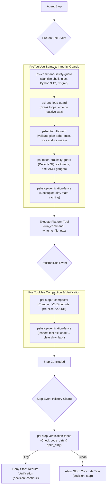
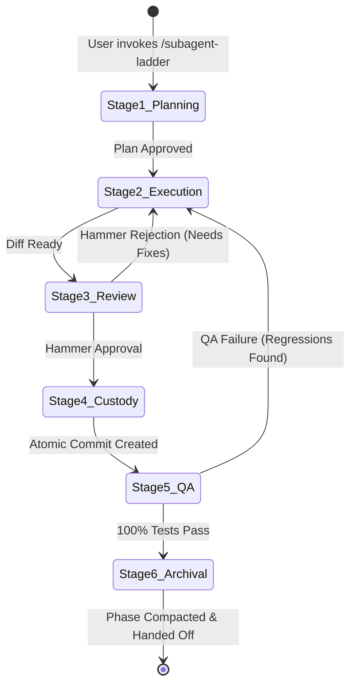
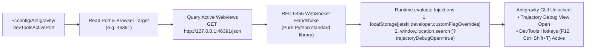

<!-- SPDX-License-Identifier: Apache-2.0 -->
<!-- Copyright (c) 2026 Arafat Zahan (@kuasha420) -->
<!-- Corporate Stewardship & Infrastructure: Purrfect Software Limited (PSL) -->
<!-- Governed by: ICARO-42/b Ordinance (Company-Supported Personal IP Framework) -->

# Agyis Harness Developer Guide & Technical Specifications (v1.0.0-rc5)

**Target Audience**: Harness Developers, Systems Architects, Subagent Authors, Antigravity Extenders  
**Publisher**: Purrfect Software Limited (PSL)  
**Release Milestone**: `v1.0.0-rc5`  
**License**: Apache-2.0  
**Repository**: `psl-agy-harness` (Module: `harness`)  

---

## 1. Architectural Overview & Engineering Invariants

### 1.1 Product vs. Project Bifurcation (ADR-014)
Agyis Harness enforces a strict architectural bifurcation between the distributed production engine and the development repository:

```text
psl-agy-harness/
├── harness/                      # THE PRODUCT: Distributable Plugin & Runtime Engine
│   ├── commands/                 # 18 CLI subcommand implementations
│   ├── delivery/                 # Workspace onboarding, harmonization, installer, cache purging
│   ├── hooks/                    # 6 deterministic lifecycle hooks & fail-safe runner
│   ├── runtime/                  # 3-tier compatibility matrix, diagnostic probes, auto-healing
│   ├── subagents/                # Specialist personas catalog, scaffolding, context health
│   ├── remote/                   # SSH multiplexing, script streaming, triage (ADR-027)
│   ├── telemetry/                # Sync engine, systemd daemon, connection factory (ADR-030)
│   └── skills/                   # Curated modular product skills
│
├── pipeline/                     # THE PROJECT: Empirical Telemetry Laboratory & Research
├── data/                         # Local SQLite telemetry databases (telemetry.db)
├── tests/                        # 1,065 hermetic unit, integration, and replay tests
├── docs/                         # Specifications, ADRs, runbooks, and release documentation
└── pyproject.toml                # Zero external runtime dependencies (dependencies = [])
```

#### Core Invariants of the Product (`harness/`):
1. **Zero External Runtime Dependencies**:  
   `pyproject.toml` declares `dependencies = []`. The entire distributable engine relies exclusively on the standard library of CPython >= 3.12 (`pathlib`, `shutil`, `subprocess`, `urllib`, `socket`, `sqlite3`, `json`, `tarfile`, `hashlib`, `struct`). No third-party packages (such as `requests`, `pydantic`, or `click`) are permitted inside `harness/`.
2. **Hermetic State Isolation**:  
   All state-persisting components must honor `PSL_HARNESS_STATE_DIR` and default to `~/.local/state/agyis/`. Production code must never write scratch files, logs, or state into the repository tree.
3. **Fail-Open Hook Design**:  
   All lifecycle hooks must catch internal exceptions and fail open (emitting `{"decision": "allow"}` or `{}` with exit code 0) to ensure an internal harness bug can never crash or deadlock Google Antigravity.

### 1.2 Sub-Second Benchmark Invariant (ADR-015)
To ensure that autonomous agents and human developers can run tests continuously in tight inner loops:
- Every unit test must execute hermetically inside `tempfile.TemporaryDirectory()`.
- Network calls, unbounded sleeps, and disk sweeps are strictly prohibited in test paths.
- The entire project test suite (1,065 tests across 35 test files) executes in **<20.0s** on full discover suites and targeted component suites execute in **<1.0s**.

---

## 2. The 6 Active Lifecycle Hooks

Agyis Harness registers 6 deterministic lifecycle hooks via `harness/hooks/hooks.json`. Hooks intercept events dispatched by Antigravity across tool lifecycles: `PreToolUse`, `PostToolUse`, and `Stop`.



### 2.1 `psl-command-safety-guard` (PreToolUse)
- **File**: `harness/hooks/command_safety_hook.py`
- **Matcher**: `run_command`
- **Responsibilities**:
  1. **Destructive Command Interception**: Denies high-risk commands (`rm -rf /`, formatting commands, system reboots).
  2. **Interactive Shell Hang Prevention**: Intercepts interactive commands (`nano`, `vim`, `less`, `more`, unpaged man) and sets `PAGER=cat`.
  3. **Hermetic Python 3.12 Runtime Injection**: When an inline Python script is invoked (`python3 -c "..."`), automatically injects certified CPython >= 3.12 from `~/.local/share/uv/python/` into the subshell's `$PATH`, bypassing stale host shims.
  4. **Benign Pattern Probing Sanitization (ADR-013)**: Standalone terminal pattern probes (`grep`, `diff`) that match zero lines exit with code 1. To prevent the agent from panicking on benign empty matches, the hook rewrites bare grep calls to append `|| [ $? -eq 1 ]`.

### 2.2 `psl-anti-loop-guard` (PreToolUse)
- **File**: `harness/hooks/anti_loop_hook.py`
- **Matcher**: `view_file|grep_search|run_command|manage_task`
- **Responsibilities**:
  1. **Sliding-Window Loop Detection**: Tracks historical tool calls per conversation ID. Enforces strict quotas:
     - Maximum 4 identical calls within a 15-turn sliding window.
     - Maximum 8 calls for recognized idempotent read tools.
     - Elevated cleanroom quotas for `docs/specs/` and `.agents/ledger/`.
  2. **Strict Reactive Wait Invariant**: Denies repeated polling of `manage_task(Action='status')` or repeated manual inspection (`tail`, `cat`, `view_file`) of background task logs (`.system_generated/tasks/*.log`). Enforces that agents must emit a single concise update and await reactive wakeup.
  3. **Peer Coordination Heartbeat Exemption**: File reads targeting `.agents/teamwork/` (`progress.md`, `briefing.md`) are recognized as coordination heartbeats and are exempted from repeat counters.
  4. **State Reset**: Clears conversation call history immediately upon test suite execution.

### 2.3 `psl-output-compactor` (PostToolUse)
- **File**: `harness/hooks/output_compactor_hook.py`
- **Matcher**: `run_command|view_file`
- **Responsibilities**:
  1. **2KB Output Compaction**: Compacts tool outputs exceeding 2,048 characters into a structured preview, preventing context cliff exhaustion.
  2. **Head/Tail/Error Preservation**: Preserves the first 500 characters, the last 1,000 characters, and extracts up to 50 lines containing diagnostic error keywords (`error:`, `failed`, `exception`, `traceback`, `fatal:`).
  3. **Pre-Slice Optimization for Massive Dumps (DEF-04)**: For tool outputs exceeding 200,000 characters (e.g. disassembly dumps), pre-slices 100KB head and tail chunks before running `.splitlines()`, avoiding CPU starvation and regex timeouts.
  4. **Non-Zero Exit Code Exemption**: Preserves full uncompacted error streams on failed commands to guarantee that agents have complete debugging information.

### 2.4 `psl-stop-verification-fence` (PreToolUse, PostToolUse, Stop)
- **File**: `harness/hooks/completion_fence_hook.py`
- **Matchers**:
  * `PreToolUse`: `write_to_file|replace_file_content|edit_file`
  * `PostToolUse`: `run_command|execute_command|bash|call_mcp_tool`
  * `Stop`: Intercepts agent victory declaration.
- **Architectural Innovation: Decoupled Dirty State (ADR-028)**:
  Historically, modifying any tracked file marked the session dirty, requiring a full unit test pass to clear. In cleanroom reverse engineering and specification authoring, editing markdown specifications in `docs/specs/**` would trigger false-positive test demands on projects with no code changes.
  The Stop-Verification Fence decouples state tracking into two independent flags:

  | Dirty State Flag | Trigger Condition | Clearing Condition | Stop Evaluation |
  | :--- | :--- | :--- | :--- |
  | **`code_dirty`** | Edits to recognized code files (`.py`, `.ts`, `.rs`, `.go`, `.c`, `.sh`, etc.) outside specification directories. | Executing the active project test runner with exit code 0 (`agyis test`, `pytest`, `npm test`, `cargo test`). | If `True`, blocks Stop with: `Execute active repository test suite before declaring completion.` |
  | **`spec_dirty`** | Edits to cleanroom specification contracts (`docs/specs/**`, `.agents/ledger/**`) with declarative extensions (`.md`, `.json`, `.yaml`, `.proto`). | Executing `agyis verify --spec` with exit code 0, or verifying cleanroom manifest via `rea verify-reconstruction`. | If `True`, blocks Stop with: `Execute cleanroom verification before declaring completion: 'agyis verify --spec'` |
  | **Dual Dirty (DEF-01)** | Code-in-Specs Guard: Writing non-declarative executable code (`.py`, `.ts`, `.sh`) into `docs/specs/`. | Sets **BOTH `code_dirty = True` and `spec_dirty = True`**, preventing agents from hiding executable logic inside specification directories. | Blocks Stop until both tests and spec verifications pass. |

- **Ephemeral Scratch Exemption**:  
  Edits to ephemeral paths (`.rea/**`, `decompiled/**`, `artifacts/rea/**`, `~/.gemini/antigravity/brain/*/scratch/*`, or paths outside the workspace root) do not mark state dirty.
- **Anti-Deadlock Safety Valve**:  
  If the fence blocks an agent twice consecutively (`block_count >= 2`), the safety valve trips and allows termination, preventing infinite stop-denial deadlocks.

### 2.5 `psl-token-proximity-guard` (PreToolUse)
- **File**: `harness/hooks/token_proximity_guard.py`
- **Matcher**: `.*` (All tools)
- **Responsibilities**:
  1. **Direct SQLite Telemetry Sampling**: Opens the active Antigravity session database in `~/.gemini/antigravity/conversations/*.db` using read-only URI mode (`file:<path>?mode=ro`).
  2. **Protobuf Metadata Extraction**: Decodes the binary protobuf metadata payload in the `steps` table (specifically Field Number 9) to extract exact prompt token and cached token counts.
  3. **Visual Horizon Gauges**:
     - **35k Tokens (Warning Zone)**: Emits an ANSI amber terminal gauge to `stderr` advising approaching horizon limits.
     - **45k Tokens (Red Alert)**: Emits a bold red alert and terminal bell (`\a`) warning that the 50k compaction threshold is imminent.
  4. **Non-Blocking Invariant**: Never blocks tool execution; always emits `{"decision": "allow"}` and exits 0.

### 2.6 `psl-anti-drift-guard` (PreToolUse)
- **File**: `harness/hooks/anti_drift_hook.py`
- **Matcher**: `write_to_file|replace_file_content|edit_file`
- **Responsibilities**:
  1. **Plan Boundary Enforcement**: Validates modified file paths against targets declared in `implementation_plan.md` or `plan.md`.
  2. **Native Plan-Mode Lock**: Rejects file mutations if an interactive plan artifact is currently in draft mode awaiting user approval.
  3. **Auditor Role Write-Block**: Intercepts and denies file modifications attempted by QA/Auditor subagents, enforcing read-only verification boundaries.

---

## 3. Specialist Agent Personas & Horizon 1.6 Subagent Ladders

### 3.1 The 7 Certified Specialist Personas
Agyis Harness defines 7 specialized agent personas designed to execute discrete phases of software engineering tasks. Each persona is codified as a Markdown definition with YAML frontmatter defining archetype, model tier, and tool permissions:

| Persona | Archetype | Capability Bundle | Primary Role & Responsibilities |
| :--- | :--- | :--- | :--- |
| **`agyis_architect`** | `main` | `full` (17 tools) | Lead Systems Architect & Master Implementer (promoted from legacy `psl_main`). Coordinates multi-repository sweeps (`/teamwork-preview`), deep refactoring (`/boost`), and cross-repo harmonization. |
| **`coordinator`** | `coordinator` | `orchestrator` | Subagent Ladder Conductor. Decomposes complex user requests, authors phase plans, coordinates worktrees, and manages handoff protocols. |
| **`planner`** | `planner` | `read_only` | Architectural Researcher & Specification Designer. Conducts codebase discovery, evaluates dependencies, and authors `implementation_plan.md`. |
| **`harness_builder`** | `executioner` | `builder` | Master Implementer. Executes surgical contiguous code edits (`replace_file_content`), writes tests, and adheres strictly to PSL coding standards. |
| **`harness_reviewer`** | `hammer` | `verifier` | Delta Code Reviewer. Performs adversarial inspections of git diffs against PSL rules, ADRs, and security invariants before git commit. |
| **`harness_custodian`** | `custodian` | `builder` | Git Commit Gatekeeper. Verifies git status, stages intended changes, verifies `.git/info/exclude`, and creates atomic commits. |
| **`harness_auditor`** | `auditor` | `verifier` | Independent QA & Forensic Auditor. Runs automated test suites, benchmarks execution latency, verifies test coverage, and enforces the Integrity Mandate. |

### 3.2 100% Mirror Parity Guarantee
To eliminate configuration drift between the distributed package and active workspaces:
- The authoritative personas are packaged in `harness/agents/*.md`.
- Active workspace definitions reside in `.agents/agents/*.md`.
- **100% Mirror Parity**: Every persona file in `harness/agents/` matches its counterpart in `.agents/agents/` byte-for-byte:
  ```text
  harness/agents/agyis_architect.md   <---> .agents/agents/agyis_architect.md   (6,354 bytes)
  harness/agents/coordinator.md       <---> .agents/agents/coordinator.md       (6,072 bytes)
  harness/agents/harness_auditor.md   <---> .agents/agents/harness_auditor.md   (4,834 bytes)
  harness/agents/harness_builder.md   <---> .agents/agents/harness_builder.md   (4,533 bytes)
  harness/agents/harness_custodian.md <---> .agents/agents/harness_custodian.md (5,766 bytes)
  harness/agents/harness_reviewer.md  <---> .agents/agents/harness_reviewer.md  (3,951 bytes)
  harness/agents/planner.md           <---> .agents/agents/planner.md           (4,229 bytes)
  ```

### 3.3 The 6-Stage Subagent Ladder Workflow
The Subagent Ladder (`harness/skills/subagent-ladder/SKILL.md`) organizes engineering tasks into an adversarial 6-stage pipeline:



- **Stage 1 (Planning)**: `@coordinator` / `@planner` authors `implementation_plan.md` defining milestones and verification criteria.
- **Stage 2 (Execution)**: `@harness_builder` implements minimal contiguous code edits and writes tests.
- **Stage 3 (Review)**: `@harness_reviewer` reviews git diffs. Rejections return immediately to Stage 2.
- **Stage 4 (Custody)**: `@harness_custodian` confirms clean git status, verifies untracked exclusions, and crafts atomic commits.
- **Stage 5 (QA Audit)**: `@harness_auditor` independently runs `agyis test`, audits benchmark timing, and verifies zero regressions.
- **Stage 6 (Archival)**: `@coordinator` updates the project ledger and compacts session history.

---

## 4. GUI DevTools Controller & CDP Unlocking (`agyis gui`)

### 4.1 Architecture & Specification (ADR-014 / REA-SPEC-001)
Google Antigravity's desktop interface is an Electron application. When launched with remote debugging enabled (`--remote-debugging-port`), Electron exposes the **Chromium DevTools Protocol (CDP)** over a local loopback port.

`agyis gui` provides a **zero-dependency Python controller** that interacts directly with Antigravity's GUI via CDP WebSocket:



### 4.2 Standard-Library WebSocket Implementation
In accordance with ADR-014, `harness/commands/gui.py` implements RFC 6455 WebSocket client framing entirely using Python's standard `socket`, `struct`, `base64`, and `hashlib` modules:
- Creates an upgrade handshake request with `Sec-WebSocket-Key`.
- Formats masked client text frames (opcode `0x1`).
- Handles fragmentation, masking keys, ping/pong control frames (opcodes `0x9` and `0xA`), and close handshakes (opcode `0x8`).
- Sends JSON-RPC 2.0 payloads (`id`, `method: "Runtime.evaluate"`, `params: {"expression": "..."}`).

### 4.3 Developer Flags Injection & Trajectory Debug View
`agyis gui` injects developer overrides into Antigravity's Electron webview storage:
```javascript
// Injected into localStorage
localStorage.setItem('jetski.developer.customFlagOverrides', JSON.stringify({
  'enable-trajectory-debug-tools': true,
  'enable-developer-mode': true
}));

// Dispatched to URL search parameters
const url = new URL(window.location.href);
url.searchParams.set('trajectoryDebugOpen', 'true');
window.location.search = url.searchParams.toString();
```

### 4.4 CLI Flags & Options
```bash
# Unlock Trajectory Debug View and display active endpoints (default)
agyis gui

# Prime developer flags and hotkeys WITHOUT opening the modal popup
agyis gui --no-popup

# Toggle modal open/closed state
agyis gui --toggle

# Display Chrome DevTools Inspector URLs for external browser inspection
agyis gui --devtools

# Specify startup wait timeout for cold Antigravity launches
agyis gui --wait 10.0
```

---

## 5. Cleanroom REA Reverse Engineering & Reconstruction Contracts

### 5.1 Cleanroom Architecture & Invariants (ADR-028)
When reconstructing proprietary protocols, APIs, or legacy binaries, developers must adhere to strict cleanroom engineering standards. Agyis Harness enforces strict isolation between dirty room observation and clean room reconstruction:

```text
Dirty Room (Observation & Disassembly)     | Clean Room (Specification & Code)
-------------------------------------------+-----------------------------------------
.rea/                                      | docs/specs/
decompiled/                                | .agents/ledger/obligations.json
artifacts/rea/                             | .agents/ledger/evidence_bundle.json
                                           | harness/ & src/
• Raw disassembly & decompiler listings    | • Pure declarative specs (.md, .json)
• Dynamic tracing captures & memory dumps  | • Typed obligation ledgers & evidence
• EXEMPT from verification fence           | • Formally verified via 'agyis verify'
```

### 5.2 Typed Obligation Ledgers & Evidence Bundles
Cleanroom implementations must not contain speculative or hallucinated logic. Every reconstructed structure must be backed by an immutable evidence chain:
1. **Obligation Ledger (`.agents/ledger/obligations.json`)**:  
   Declares formal obligations (`OBL-001`, `OBL-002`) specifying required structs, function signatures, and behavioral claims.
2. **Evidence Bundle (`.agents/ledger/evidence_bundle.json`)**:  
   Contains cryptographic records of observed evidence:
   ```json
   {
     "evidence_id": "EVID-042",
     "subject": "JetskiDeveloperFlags",
     "provider": "ghidra",
     "digest": "sha256:4a8b7f...",
     "observed_at": "2026-10-18T03:30:00Z"
   }
   ```
3. **Verification Manifest (`.agents/ledger/manifest.json`)**:  
   Formal clearance record requiring `"status": "verified"`, a matching SHA-256 `evidence_hash`, and all declared obligations marked `"satisfied"`.

### 5.3 Cleanroom Verification CLI (`agyis verify`)
The verification engine audits cleanroom integrity before allowing task completion:

```bash
# Verify cleanroom specifications in docs/specs/**
agyis verify --spec

# Run formal cleanroom reconstruction verification via REA
agyis verify
```

#### Verification Rules:
- `agyis verify --spec` asserts that all files in `docs/specs/` are declarative specification documents (`.md`, `.json`, `.yaml`).
- If an agent attempts to place executable code (`.py`, `.ts`, `.sh`) inside `docs/specs/`, `agyis verify --spec` fails immediately with exit code 1.
- Upon successful specification verification, `agyis verify --spec` resets `spec_dirty = False` in the completion fence.
