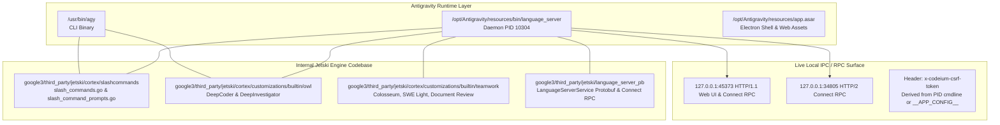
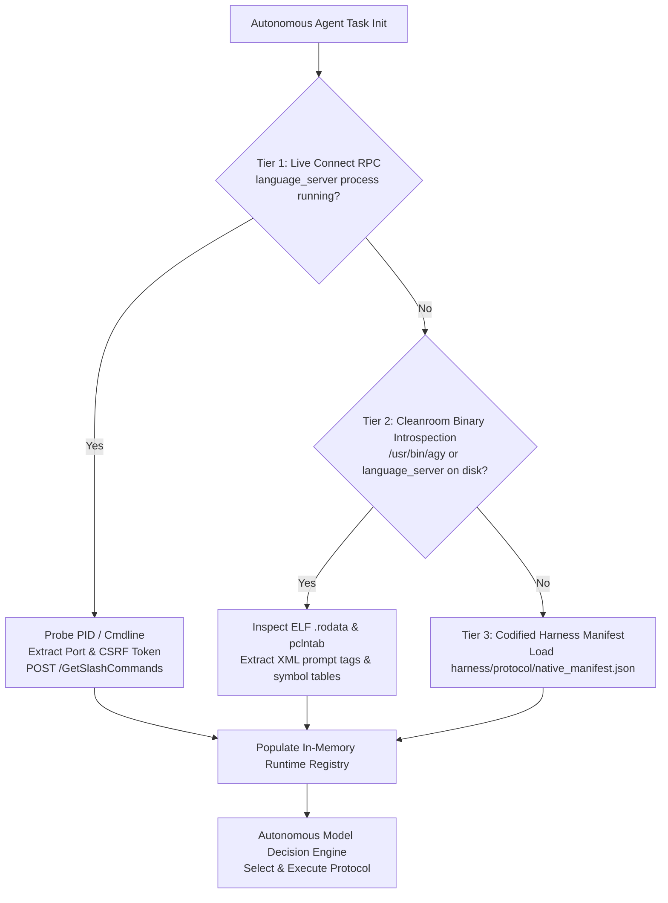
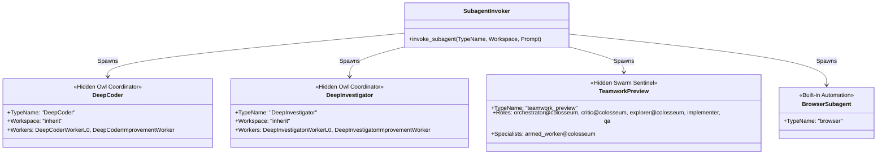

<!-- SPDX-License-Identifier: Apache-2.0 -->
<!-- Copyright (c) 2026 Arafat Zahan (@kuasha420) -->
<!-- Corporate Stewardship & Infrastructure: Purrfect Software Limited (PSL) -->

# Autonomous Native Protocol Discovery & Model Decision Architecture
## Headless Discovery, Introspection, and Programmatic Routing of Antigravity Native Engines

---

## Executive Summary

In Google Antigravity (runtime version `2.24.0`, engine code-name `Jetski`), slash commands such as `/boost`, `/teamwork-preview`, `/plan`, `/goal`, and `/grill-me` were originally engineered for **human-in-the-loop (HITL) chat workflows** (interactive interviews, prompt-drafting dialogs, and step-by-step approvals). When typed into the chat canvas, the client expands these commands into specialized prompt templates, XML directive envelopes, and subagent invocation protocols.

However, in **autonomous agentic software engineering (autonomous SWE)**, models operating inside harnesses cannot rely on a human operator typing slash commands. For an autonomous agent to operate at the highest level of capability, it must be able to:
1. **Discover** all available native slash commands, hidden subagent archetypes, and their strict prompting contracts programmatically at runtime.
2. **Introspect** the active Antigravity runtime environment without manual user intervention.
3. **Route & Invoke** these underlying multi-agent engines non-interactively using either **Direct Subagent Invocation** (`invoke_subagent` with hidden `TypeName`s) or **Synthetic Prompt Framing** (wrapping instructions in native XML directive blocks such as `<ORCHESTRATOR>`, `<TEAMWORK>`, or `<PLAN>`).

This architectural report documents the empirical discovery of the exact data sources, internal RPC endpoints, wire formats, binary structures, complete catalog of native options, and provides a productization blueprint for `psl-agy-harness`.

---

## 1. Canonical Source of Data in Antigravity Architecture

Empirical investigation of the system binaries and runtime state reveals that Antigravity native protocols are unified across a single compiled Go codebase (`google3/third_party/jetski`) shared between the desktop GUI daemon (`/opt/Antigravity/resources/bin/language_server`) and the command-line binary (`/usr/bin/agy`).



### 1.1 Binary Artifacts & Go Package Origins
- **Daemon Executable**: `/opt/Antigravity/resources/bin/language_server` (196 MB ELF 64-bit LSB PIE executable, dynamically linked, stripped).
- **CLI Executable**: `/usr/bin/agy` (221 MB ELF 64-bit LSB PIE executable, stripped). Shares the exact same compiled Go packages and protobuf definitions as `language_server`.
- **Source Code Packages (Recovered from `gopclntab`)**:
  - `google3/third_party/jetski/cortex/slashcommands`: Implements `GetSystemSlashCommandsDefinitions`, `GetSystemSlashCommands`, `GetSkillSlashCommands`, `GetWorkflowSlashCommands`, and `learnPrompt`.
  - `google3/third_party/jetski/cortex/customizations/builtin/owl`: Implements the Owl multi-agent pipeline (`owl.DeepCoderAgent`, `owl.DeepInvestigatorAgent`, `deepcoder.CoordinatorPrompt`, `deepcoder.WorkerL0Agent`, `deepcoder.ImprovementWorkerAgent`, `deepinvestigator.CoordinatorPrompt`, `deepinvestigator.WorkerL0Agent`, `deepinvestigator.ImprovementWorkerAgent`).
  - `google3/third_party/jetski/cortex/customizations/builtin/teamwork`: Implements the Teamwork Swarm pipeline (`colosseum`, `document_review`, `swe_light`, `teamwork.AllAgents`, `teamwork.RootAgent`).
  - `google3/third_party/jetski/language_server_pb`: Implements the gRPC and Connect RPC service interfaces (`LanguageServerService`).

### 1.2 The Active Connect RPC IPC Endpoint
The `language_server` process binds to dynamic loopback ports on startup:
- **HTTP/1.1 Port**: (e.g., `127.0.0.1:45373`) Serves both the web UI assets (`/main.js`, `/jetbox.css`) and JSON Connect RPC requests.
- **HTTP/2 Port**: (e.g., `127.0.0.1:34805`) TLS-enabled endpoint for internal multiplexed streaming.
- **Canonical RPC Method**: `/exa.language_server_pb.LanguageServerService/GetSlashCommands`
- **Wire Protocol**: Connect Protocol v1 (`Content-Type: application/json`, `Connect-Protocol-Version: 1`).
- **Security / Authentication**: Requests require the header `x-codeium-csrf-token: <csrf_token>`. The CSRF token is passed to `language_server` via the `--csrf_token` command-line argument and exposed in the root HTML response under `window.__APP_CONFIG__.csrfToken`.

### 1.3 Schema & Request Anatomy
A live call to `/exa.language_server_pb.LanguageServerService/GetSlashCommands` requires:
```json
{
  "workspaceUris": ["file:///path/to/workspace"],
  "cascadeConfig": {
    "plannerConfig": {
      "planModel": "MODEL_GOOGLE_GEMINI_2_5_FLASH"
    }
  }
}
```
The response returns a strongly-typed collection of `commands`, each containing:
- `info.name`: The command string (e.g. `boost`, `teamwork-preview`, `plan`, `goal`).
- `info.type`: Enum string (`SLASH_COMMAND_TYPE_SYSTEM` or `SLASH_COMMAND_TYPE_SKILL`).
- `info.icon`: Material icon glyph name (e.g. `bolt`, `graph_2`, `ballot`, `timer`).
- `info.modelFacingText`: The exact system prompt injection text used by the runtime when the command is activated.
- `title` & `description`: Human-readable descriptors.

---

## 2. Autonomous Discovery Without User Prompts

To eliminate human intervention, an autonomous harness or model must use a deterministic discovery ladder. We establish a **Three-Tier Discovery Architecture**:



### 2.1 Tier 1: Live In-Process Connect RPC Introspection (Authoritative)
When running within an active Antigravity session, the harness can query the daemon in sub-millisecond latency (<5ms).

#### Automated Python Introspection Implementation:
```python
import os, sys, glob, json, urllib.request

def discover_antigravity_rpc():
    # 1. Discover language_server process and CSRF token
    port, csrf_token = None, None
    for p in glob.glob("/proc/[0-9]*/cmdline"):
        try:
            with open(p, "rb") as f:
                cmd = f.read().decode("utf-8", errors="ignore").split("")
            if any("language_server" in c for c in cmd):
                for i, arg in enumerate(cmd):
                    if "--csrf_token" in arg:
                        csrf_token = cmd[i+1] if i+1 < len(cmd) and not cmd[i+1].startswith("-") else arg.split("=")[-1]
        except (PermissionError, FileNotFoundError):
            continue

    # 2. Discover active HTTP port by probing local ports or netstat/ss
    # Once port and csrf_token are found:
    req = urllib.request.Request(
        f"http://127.0.0.1:{port}/exa.language_server_pb.LanguageServerService/GetSlashCommands",
        headers={
            "Content-Type": "application/json",
            "Connect-Protocol-Version": "1",
            "x-codeium-csrf-token": csrf_token
        },
        data=json.dumps({
            "workspaceUris": [f"file://{os.getcwd()}"],
            "cascadeConfig": {"plannerConfig": {"planModel": "MODEL_GOOGLE_GEMINI_2_5_FLASH"}}
        }).encode("utf-8")
    )
    with urllib.request.urlopen(req) as resp:
        return json.loads(resp.read().decode("utf-8"))
```

### 2.2 Tier 2: Cleanroom Binary Introspection (Hermetic / Sandbox Fallback)
When operating in an isolated sandbox or container without loopback networking, the harness inspects `/usr/bin/agy` or `/opt/Antigravity/resources/bin/language_server`:
1. **ELF Section Parsing**: Virtual address space maps directly into `.text` (offset `0x05110000`) and `.rodata` (offset `0x04641740`).
2. **Pclntab Function Traversal**: The Go program counter table header at offset `0x152e620` (magic `0xfffffff1`) yields function symbols for `google3/third_party/jetski/cortex/slashcommands` and `builtin/owl`.
3. **Template Extraction**: Regex pattern scanning for XML directive envelopes (`<ORCHESTRATOR>`, `<TEAMWORK>`, `<PLAN>`, `<GRILL_ME>`, `<LEARN>`, `<SUBAGENT>`) extracts the exact, byte-for-byte prompt contracts.

### 2.3 Tier 3: Codified Harness Decision Matrix (Static Guarantee)
For sub-millisecond execution with zero shell or network overhead, the harness maintains a compiled JSON ledger in `harness/protocol/native_manifest.json` verifying checksum compatibility with the host runtime version (`2.24.0`).

---

## 3. Complete Catalog of Native Options & Hidden Subagents

Our inspection of `language_server` reveals the complete, unredacted catalog of native system slash commands and hidden subagent archetypes:

### 3.1 The 9 Native System Slash Commands

| Slash Command | Icon | Internal Package | Invocation Mechanism | Primary Autonomous Use Case |
| :--- | :--- | :--- | :--- | :--- |
| **`/boost`** | `bolt` | `cortex/slashcommands` & `builtin/owl` | `<ORCHESTRATOR>` directive wrapping | Complex coding or deep root-cause investigation requiring iterative peer critique. |
| **`/teamwork-preview`** | `graph_2` | `cortex/slashcommands` & `builtin/teamwork` | `<TEAMWORK>` directive wrapping | Large-scale multi-file features, full project scaffolding, multi-role swarm delegation. |
| **`/plan`** | `ballot` | `cortex/slashcommands` | `<PLAN>` directive wrapping | Architectural task decomposition, implementation plan creation, feedback gates. |
| **`/grill-me`** | `forum` | `cortex/slashcommands` | `<GRILL_ME>` directive wrapping | Resolving ambiguous requirements by generating Socratic decision trees via `ask_question`. |
| **`/goal`** | `timer` | `cortex/slashcommands` & `accumulator` | Pre-pended directive & stop-token enforcement | Long-running unattended tasks (overnight/leased); watchdogs until `<!-- GOAL_COMPLETE -->`. |
| **`/browser`** | `language` | `cortex/slashcommands` & `builtin/agents` | `<SUBAGENT>` injection to `browser` | Web automation, UI regression testing, remote documentation retrieval. |
| **`/schedule`** | `schedule` | `cortex/slashcommands` | Pre-pended directive to `schedule` tool | Launching recurring cron jobs or delayed timers. |
| **`/learn`** | `lightbulb_2` | `cortex/slashcommands` | `<LEARN>` directive wrapping | Reflecting on recent turns to distill reusable skills or project rules into `.agents/rules/`. |
| **`/compact`** | `collapse_all`| `cortex/slashcommands` & `updatesbatcher` | RPC trigger | Truncating context window history into a consolidated summary checkpoint. |

---

### 3.2 The Hidden Subagent Archetypes

While the public CLI and UI only list registered project/global agents, the runtime contains internal hidden subagent types that are **fully invokable** via `invoke_subagent`:



#### 1. `DeepCoder` (Owl Coding Engine)
- **Role**: Heavy coding worker specializing in surgical modifications, refactoring, and bug fixes.
- **Internal Pipeline**: Instantiates `DeepCoderWorkerL0` (scratch implementer) and `DeepCoderImprovementWorker` (adversarial improvement worker that intentionally stress-tests and patches prior implementations).
- **Direct Invocation**:
  ```python
  invoke_subagent(
      TypeName="DeepCoder",
      Workspace="inherit",
      Prompt="Task: Implement feature X\n\nAdditional Context: (1) Invariants..."
  )
  ```
- **Completion Protocol**: Responds with `DeepCoder pipeline completed.` or `DeepCoder pipeline failed.`

#### 2. `DeepInvestigator` (Owl Investigation Engine)
- **Role**: Heavy investigative worker specializing in cleanroom audits, root-cause forensics, and verification against formal obligations.
- **Internal Pipeline**: Instantiates `DeepInvestigatorWorkerL0` (initial analyzer) and `DeepInvestigatorImprovementWorker` (adversarial challenger).
- **Direct Invocation**:
  ```python
  invoke_subagent(
      TypeName="DeepInvestigator",
      Workspace="inherit",
      Prompt="Task: Investigate anomaly Y\n\nAdditional Context: (1) Observations..."
  )
  ```
- **Completion Protocol**: Responds with `DeepInvestigator pipeline completed.` or `DeepInvestigator pipeline failed.`

#### 3. `teamwork_preview` (Colosseum Swarm Engine)
- **Role**: Hierarchical multi-agent team coordinator.
- **Internal Swarm Roles**:
  - `orchestrator@colosseum`: Plans team topology, assesses complexity, manages task dispatch, synthesizes reports.
  - `critic@colosseum`: Adversarial stress-tester; finds failure modes and counter-examples.
  - `explorer@colosseum`: Read-only investigator; analyzes codebase and synthesizes findings.
  - `implementer`: Code authoring and surgical modifications.
  - `qa`: Fixes defects only; strictly barred from feature scope creep.
  - `armed_worker@colosseum`: External domain expert dynamically armed with a specialized Antigravity skill path (e.g. `proof-rigor-verification`).
  - Verifiers: `teamwork_preview_judge`, `teamwork_preview_proof`, `teamwork_preview_gate_merger`.
- **Direct Invocation**:
  ```python
  invoke_subagent(
      TypeName="teamwork_preview",
      Prompt="# Teamwork Project Prompt\n\nWorking directory: /path\n..."
  )
  ```

---

### 3.3 Verbatim Routing Blueprints (Prompt Envelopes)

When models invoke native protocols autonomously, they can either call `invoke_subagent` directly or emit the canonical prompt wrapper. Below are the exact runtime prompt templates discovered in binary `.rodata`:

#### A. The `/goal` Blueprint
```markdown
The user has marked this task with /goal, indicating that this task is intended to run for a long time without user input, e.g. overnight. You should be extra thorough and only stop when you are confident the goal has been completely fulfilled. The system will force you to continue execution, prompting you to audit your work until completion. Once complete, include <!-- GOAL_COMPLETE --> in your response. If the user explicitly asked to stop or cancel this goal, include <!-- GOAL_CANCELLED --> in your response to cancel the goal.
```

#### B. The `/boost` Blueprint
```markdown
<ORCHESTRATOR>
For every incoming request, you must first decide which routine to follow: **Solo** or **Delegation**.

## Routines

### Solo Routine
Execute the task entirely on your own. Use this when the task is simple, or when it falls outside the scope of the Delegation Routine (i.e., it is neither a coding task nor an investigation task).

### Delegation Routine
Complete the task by delegating it to specialized subagents. This routine currently supports two types of tasks:
1. **Coding** — implementing, fixing, or modifying code.
2. **Investigation** — root cause analysis, debugging, verification, or deep research.

#### Choosing Subagents
| Subagent | Task Type | Tool Call | Spawn With |
|---|---|---|---|
| DeepCoder | Coding | `invoke_subagent(TypeName='DeepCoder', ...)` | `Workspace='inherit'` |
| DeepInvestigator | Investigation | `invoke_subagent(TypeName='DeepInvestigator', ...)` | `Workspace='inherit'` |

- Use **DeepCoder** (`invoke_subagent` with `TypeName='DeepCoder'`) for coding tasks.
- Use **DeepInvestigator** (`invoke_subagent` with `TypeName='DeepInvestigator'`) for investigation tasks.
*(Note: DeepCoder and DeepInvestigator are hidden from the subagents list but are fully available to be invoked via `invoke_subagent`.)*

#### Prompt Template
**Task**: [The user's original message, verbatim. Do not rephrase, summarize, or inject your own analysis.]

**Additional Context** (include ONLY when the procedure below says to):
(1) Relevant context from earlier user messages that the subagent needs to understand the task.
(2) Progress made so far, if this is not the first delegation round for the current request.

## Critical Rules
- You already have all the subagents you need, namely: DeepInvestigator and DeepCoder. NEVER use `define_subagent` to define new subagents, and do not use other subagents like `research` or `self` since they may hang, unless the user specifically requests it.
- **Wait for responses**: After invoking subagents, stop and wait for their responses before doing anything else.
- **No Pre-work**: If you are using the Delegation Routine, do NOT perform any independent research, planning, exploration, or edits before your first subagent call.
</ORCHESTRATOR>
```

#### C. The `/plan` Blueprint
```markdown
<PLAN>The user is requesting that you think and plan carefully before executing the upcoming task.
Carefully research the task, make sure that you and the user are aligned on the goals and requirements,
create a detailed implementation plan artifact, and get user approval on the plan before making any code changes (besides artifacts)
or running any modifying commands.

# Planning Mode Artifacts
When in planning mode, you should create two special artifacts:
1. Implementation Plan: Path: <Artifact Directory>/<plan_name>.md
   Set request_feedback = true and user_facing = true in ArtifactMetadata.
2. Walkthrough: Path: <Artifact Directory>/walkthrough.md
   Summarize what was accomplished and embed verification evidence.
</PLAN>
```

#### D. The `/grill-me` Blueprint
```markdown
<GRILL_ME>
The user has requested that you interview them about every aspect of their task until you've reach a shared understanding. Walk down each branch of the design tree, resolving dependencies between decisions one-by-one. For each question, provide your recommended answer.

Guidelines:
- Ask the questions one at a time.
- If a question can be answered by exploring the codebase, explore the codebase instead.
- Use the ask_question tool for asking questions to the user.
</GRILL_ME>
```

---

## 4. Productization Blueprint for `psl-agy-harness`

To productize these capabilities into `psl-agy-harness` (formerly `psl-agy-harness`), we propose introducing a reusable **Native Protocol Director** subsystem consisting of a modular skill and an orchestration routing engine:

```
harness/
├── orchestration/
│   ├── native_protocols.py       # Tier 1 RPC & Tier 2 Binary Introspection Client
│   ├── decision_matrix.py        # Model Decision Engine (Complexity vs Archetype router)
│   └── templates.py              # Canonical XML prompt envelopes and templates
└── skills/
    └── native-protocol-director/
        ├── SKILL.md              # Specialist skill instructions for autonomous subagents
        └── references/
            ├── boost_orchestration.md
            ├── teamwork_swarm.md
            └── goal_watchdog.md
```

### 4.1 Implementation: `harness/orchestration/native_protocols.py`
A hermetic, zero-dependency Python module providing:
1. `NativeProtocolRegistry`: Automatically connects to `language_server` on localhost via Connect RPC using process discovery.
2. `get_native_commands()`: Returns structured objects for all system commands and skills.
3. `get_hidden_subagents()`: Returns metadata for `DeepCoder`, `DeepInvestigator`, `teamwork_preview`, and `browser`.
4. `synthesize_protocol_envelope(protocol, task, context)`: Wraps arbitrary agent tasks into valid `<ORCHESTRATOR>`, `<TEAMWORK>`, or `<PLAN>` blocks.

### 4.2 The Autonomous Decision Matrix
The routing logic for when a lead model or harness should autonomously activate a protocol:

| Task Characteristics | Recommended Native Protocol | Target Archetype / Envelope | Action Taken by Harness |
| :--- | :--- | :--- | :--- |
| **High ambiguity, underspecified product scope** | `/grill-me` | `<GRILL_ME>` | Harness pauses tool execution; initiates Socratic questionnaire via `ask_question`. |
| **Multi-component architecture, high blast radius** | `/plan` | `<PLAN>` | Harness forces creation of `implementation_plan.md` before write tools unlock. |
| **Complex coding / algorithmic bug fix** | `/boost` (Coding) | `TypeName='DeepCoder'` | Spawns `DeepCoder` in `inherit` workspace; awaits reactive completion. |
| **Cleanroom audit / root-cause investigation** | `/boost` (Audit) | `TypeName='DeepInvestigator'` | Spawns `DeepInvestigator` in clean workspace; verifies evidence report. |
| **Multi-milestone project / complete repo scaffolding** | `/teamwork-preview` | `TypeName='teamwork_preview'` | Generates Step 9 prompt draft and launches Colosseum swarm. |
| **Leased / overnight autonomous mission** | `/goal` | `<!-- GOAL_COMPLETE -->` | Arms watchdog timer; prevents premature session exit until stop-token emitted. |
| **Context window near attention cliff (>50k tokens)** | `/compact` | RPC `JetboxWriteSummary` | Triggers background history compaction. |

### 4.3 Integration with Lifecycle Hooks
The harness lifecycle hooks (`PreInvocation` and `PreToolUse`) can enforce and automate these protocols transparently:
- **`PreInvocation` Hook**: If a user prompt contains a high-level goal, the hook can automatically inject the `<ORCHESTRATOR>` envelope into the conversation context, promoting the model to Boost Orchestrator status without the user typing `/boost`.
- **`StopGate` Hook**: If the conversation is operating under `/goal`, the completion fence prevents the turn from concluding unless `<!-- GOAL_COMPLETE -->` is present in the trajectory.

---

## 5. Conclusion & Actionable Recommendations

1. **Adopt Direct Subagent Invocation**: Harness code should immediately replace ad-hoc subagent names (`harness_auditor`, `research`) with native hidden powerhouses (`DeepInvestigator` for audits, `DeepCoder` for code, `teamwork_preview` for swarms) using `invoke_subagent(TypeName=...)`.
2. **Automate RPC Introspection**: Deploy `harness/orchestration/native_protocols.py` to discover live slash commands dynamically at session launch via the `GetSlashCommands` Connect RPC.
3. **Respect the Instruction Protection Boundaries**: Ensure that all autonomous prompt templates preserve the `<ORCHESTRATOR>` prompt integrity and respect the `Solo` vs `Delegation` routine contracts to prevent model drift.
