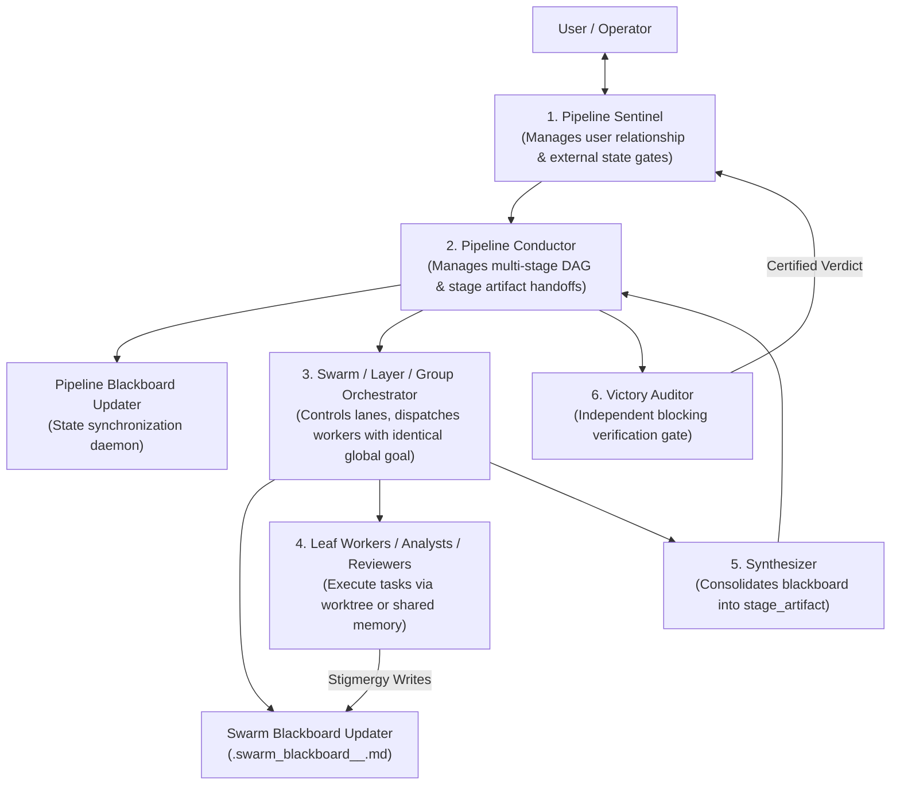
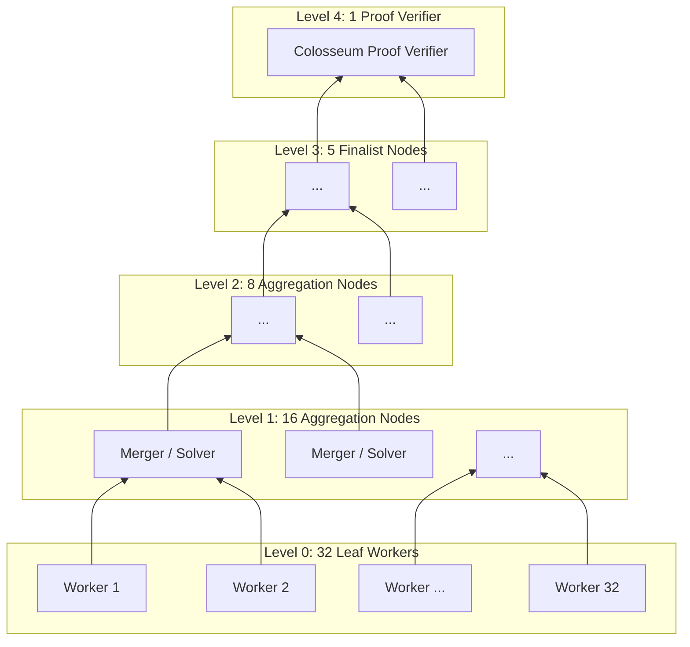

<!-- SPDX-License-Identifier: Apache-2.0 -->
<!-- Copyright (c) 2026 Arafat Zahan (@kuasha420) -->
<!-- Corporate Stewardship & Infrastructure: Purrfect Software Limited (PSL) -->
<!-- Cleanroom Analysis & Architectural Reverse Engineering: Native Antigravity Multi-Agent Systems -->

# 🧠 Native Antigravity Multi-Agent Systems & REA Cleanroom Specification
## Reverse Engineering & Architectural Blueprint: `/teamwork-preview`, `/boost` (`owl`), and Stigmergic IPC

This document establishes the formal cleanroom architectural specification of Google Antigravity's native multi-agent systems, reverse engineered from `/usr/bin/agy` (ELF 64-bit x86-64 binary, Go/Borg/Jetski/Cortex runtime) and empirical runtime telemetry.

---

## 1. Executive Architecture Summary

Google Antigravity natively implements multi-agent systems not through loose, conversational peer-to-peer chat, but through **strictly typed, hierarchical, and stigmergic execution engines**.

The architecture divides into two primary paradigms:
1. **`/teamwork-preview` (Stigmergic Swarm & Pipeline Engine)**:
   - A multi-tier multi-agent hierarchy governed by a stable **Sentinel**, high-level **Pipeline Conductors**, mid-tier **Swarm / Layer / Group Orchestrators**, and specialized leaf **Workers / Analysts / Curators**.
   - Employs **chaotic stigmergy** within stages (agents communicate asynchronously through shared Blackboard files rather than point-to-point message floods) and **controlled coordination** between stages (directed acyclic graphs of stage artifacts).
   - Enforces 4 distinct operational patterns: **SWE Light** (sequential refinement), **DAG Pipeline + Swarm** (multi-stage pipelines), **Colosseum** (tournament tree theorem proving & RSA), and **Document Review** (recursive self-aggregation).
2. **`/boost` (`owl` Deep-Reasoning Multi-Agent Engine)**:
   - A specialized multi-perspective deep reasoning engine designed for surgical coding (`DeepCoder`) and root cause / formal specification investigation (`DeepInvestigator`).
   - Uses a **Two-Tier Pipeline Coordinator** dispatching a **Layer 0 Worker** (scratch implementation/investigation) followed by an adversarial **Improvement Worker** (mandated to treat prior work as a hypothesis to be broken and tested).
   - Enforces a cognitive anti-anchoring rule: agents are strictly forced to formulate independent requirements *before* reading prior attempts.

```
                      ┌───────────────────────────────────────────────┐
                      │              GOOGLE ANTIGRAVITY               │
                      │          Native Multi-Agent Runtimes          │
                      └───────────────────────┬───────────────────────┘
                                              │
                    ┌─────────────────────────┴─────────────────────────┐
                    ▼                                                   ▼
       /teamwork-preview (Swarm)                                /boost (owl Deep)
   ┌───────────────────────────────────┐               ┌───────────────────────────────────┐
   │ • Sentinel (User Interface Gate)  │               │ • Root Orchestrator (No Pre-work) │
   │ • Pipeline Conductor (Stage DAG)  │               │ • Pipeline Coordinator (Rigid)    │
   │ • Swarm Orchestrator (Lanes)      │               │ • Layer 0 Worker (Scratch Build)  │
   │ • Blackboards (Stigmergy Bus)     │               │ • Improvement Worker (Break & Fix)│
   │ • Tournament Trees (Colosseum)    │               │ • Anti-Anchoring Prompt Invariant │
   │ • Succession Protocol (N >= 16)   │               │ • Independent Spot-Check Verify   │
   └───────────────────────────────────┘               └───────────────────────────────────┘
```

---

## 2. The Native `/teamwork-preview` Engine

### 2.1 The Hierarchy of Authority

Antigravity structures swarm operations into a 4-layer chain of command:



### 2.2 The 4 Operational Swarm Patterns

#### Pattern A: SWE Light (Sequential Refinement Assembly)
*Applicability: Single, self-contained software engineering tasks where the goal is one correct change.*

```
                 SWE LIGHT ITERATION LOOP (Floor: 3 Review Rounds)
  ┌────────────────────────────────────────────────────────────────────────┐
  │                                                                        │
  │   [Implementer] ──Initial Diff──> [Reviewer 1] ──Breaks & Fixes──┐    │
  │                                                                  │     │
  │   ┌──────────────────────────────────────────────────────────────┘     │
  │   ▼                                                                    │
  │   [Reviewer 2] ──Breaks & Fixes──> [Reviewer 3] ──Re-verifies────┐     │
  │                                                                  │     │
  │   ┌──────────────────────────────────────────────────────────────┘     │
  │   ▼                                                                    │
  │   [Victory Auditor] ──Independent Automated Gate──> [Done]            │
  │                                                                        │
  └────────────────────────────────────────────────────────────────────────┘
```

- **Invariant 1: Zero Task Decomposition**:
  - The task is **never decomposed into subtasks**. Every worker receives the full user prompt verbatim. Refinement occurs through sequential iteration on a single line of work, not by fragmenting the scope.
- **Invariant 2: Zero Pre-Dispatch Work**:
  - The orchestrator is forbidden from conducting independent research, exploratory reads, or edits before the first dispatch. Its role is solely to route and verify.
- **Invariant 3: Pair Architecture**:
  - Worker 1 (`teamwork_preview_implementer`): Produces the initial implementation.
  - Worker 2+ (`teamwork_preview_reviewer`): Approaches the prior diff skeptically, actively runs real repository tests to **break** the diff, fixes discovered failures, and reports newly verified status.
- **Invariant 4: The 3-Round Floor**:
  - A minimum floor of **three review rounds** is mandatory, even if the first reviewer reports "no issues found". Premature cessation is identified in the runtime as a catastrophic failure mode.
- **Invariant 5: The Open-Issues Ledger Discipline**:
  - A single open-issues ledger is tracked across all rounds in `progress.md`.
  - Open items raised under *"Unverified aspects"*, *"Known Issues"*, or *"Remaining risk"* must be carried into the `Additional Context` of every subsequent dispatch.
  - **Silence is not resolution**: An item is closed *only* when real test execution output proves resolution. An item never disappears simply because a subsequent round omitted it.
- **Invariant 6: Blocking Victory Audit**:
  - Before declaring completion, `teamwork_preview_victory_auditor` is dispatched. The audit is **blocking**: the orchestrator cannot terminate without a confirmed clean verdict.

---

#### Pattern B: DAG Pipeline + Swarm Orchestrator (Controlled DAG / Chaotic Stigmergy)
*Applicability: Multi-stage, complex engineering or research missions (e.g. `mathematics` pipeline).*

```
   PIPELINE STAGE DAG (Controlled Coordination)
   ┌───────────┐      ┌─────────┐      ┌─────────┐
   │ Generate  │ ───> │ Referee │ ───> │ Improve │ ───┐
   └───────────┘      └─────────┘      └─────────┘   │
                                                     ▼
                                          ┌──────────────────────┐
                                          │ Parallel Review:     │
                                          │ • Critic             │
                                          │ • Reference Check    │
                                          └──────────┬───────────┘
                                                     ▼
   ┌───────────┐      ┌─────────┐         ┌──────────┴───────────┐
   │ Revision  │ <─── │ (Loop)  │ <────── │ Synthesis & Verify   │
   └───────────┘      └─────────┘         └──────────────────────┘
```

- **Core Architectural Invariant**:
  > *"Controlled coordination between stages. Chaotic stigmergy within each stage."*
- **Pipeline Conductor**:
  - Reads a declarative pipeline YAML specification (e.g. `mathematics.yaml`).
  - Orchestrates stage transitions, passing synthesized stage artifacts (`stage_artifact_<stage>_<task>.md`) forward.
  - Evaluates loop conditions (e.g. `verdict is NOT \boxed{Correct}`) up to `max_loops`.
- **Swarm Orchestrator & Worker Pool**:
  - Spawns a pool of parallel workers with the **exact same global goal**.
  - Does NOT micro-manage sub-tasks. Allows complex solutions to emerge through stigmergy.
- **Task Type Classifications**:
  | Task Type | Definition | Workspace Mode | Worker Output | Delivery Mechanism |
  | :--- | :--- | :--- | :--- | :--- |
  | **Build** | Code modifications, proofs, compiled systems. | `Workspace: 'branch'` (Isolated Git/CitC clone) | Real file edits in branch. | `Synthesizer` applies consolidated diff to workspace. |
  | **Artifact** | Standalone documents, designs, data files. | `Workspace: 'inherit'` (Shared workspace) | Worker-prefixed files + `output_<id>.md`. | `Synthesizer` creates canonical deliverable. |
  | **Message** | Analyses, research summaries, Q&A. | `Workspace: 'inherit'` (Shared workspace) | Text in `output_<id>.md`. | `Synthesizer` emits consolidated text response. |
- **The Stigmergic Blackboard**:
  - Orchestrator spawns a dedicated Blackboard Updater (`teamwork_preview_updater`).
  - Workers do NOT message each other directly. Instead, they read and write to `.swarm_blackboard_<stage_name>_<task_name>.md`.
  - Eliminates the $O(N^2)$ communication overhead and prevents context window exhaustion across large fleets.

---

#### Pattern C: Colosseum (Tournament Tree / RSA Theorem Prover)
*Applicability: Research-level mathematical proofs, algorithm discovery, and massive solution space exploration.*



- **Core Operational Mandate**:
  > *"Execute Protocol, Never Synthesize. Your task is to invoke sub-agents according to the protocol, collect their results, and write results to output files... NEVER evaluate mathematical quality... EVERY assigned node MUST be completed before reporting level-done."*
- **Candidate Reduction Funnel**:
  - Level 0: 32 candidate explorations.
  - Level 1: 16 aggregated approaches.
  - Level 2: 8 synthesized solutions.
  - Level 3: 5 refined candidates.
  - Level 4: 1 verified formal proof.
- **Paired Falser Audits (`falser_enabled`)**:
  - Each candidate node is paired with an adversarial `teamwork_preview_falser` agent tasked exclusively with disproving lemmas, finding counterexamples, and exposing circular logic.
- **Asynchronous Knowledge Curators (`teamwork_preview_curator`)**:
  - Run in parallel with tournament levels without blocking the critical path.
  - Build and update `{project_dir}/knowledge/`:
    - `index.md`: Master categorized directory.
    - Clustered failed approach categories (`category_<name>.md`).
    - Discovered theorems and hypotheses (`theorem_<name>.md`).
    - Literature references (`reference_<name>.md`).

---

#### Pattern D: Document Review (Recursive Self-Aggregation - RSA)
*Applicability: Large manuscript review, multi-section design audits, whitepapers, enterprise compliance.*

```
   DOCUMENT REVIEW RECURSIVE SELF-AGGREGATION (RSA)
   ┌─────────────────────────────────────────────────────────────┐
   │ 1. Triage (Main Orchestrator):                              │
   │    Partitions manuscript into 3-8 Segments in               │
   │    ANALYSIS_PARTITION.md (e.g. Intro, Method, Math, Exp)    │
   └──────────────┬───────────────────────────────┬──────────────┘
                  │                               │
                  ▼                               ▼
       [Group Orchestrator A]           [Group Orchestrator B]
       (Segment A Review Tree)          (Segment B Review Tree)
       Shape: [4, 2, 1] Tournament      Shape: [4, 2, 1] Tournament
                  │                               │
                  └───────────────┬───────────────┘
                                  ▼
               [Cross-Segment Synthesis Orchestrator]
               Aggregates per-segment unit reports via
               Synthesizers into final unified review
```

- **Segmentation Triage**: The Main Orchestrator inspects the raw PDF or LaTeX source and creates `ANALYSIS_PARTITION.md` dividing the document into 3 to 8 logical Focus Areas.
- **Per-Segment Tournament Trees**: Each segment is assigned a `teamwork_preview_group` orchestrator managing a `[4, 2, 1]` tournament tree of analysts (`teamwork_preview_worker`).
- **External Skill Injection (`external_skill_loading`)**: Analysts dynamically load domain rubrics and methodology playbooks at runtime without baking monolithic instructions into the core agent prompt.
- **Dedicated Ingestion Engine (`teamwork_preview_ingestor`)**: Pure-Python, headless extraction of text, math blocks, and page image renderings.

---

### 2.3 Cross-Cutting System Protocols

#### 1. The Succession Protocol (Context & Token Hygiene Invariant)
To prevent the classic degradation cliff where long-horizon orchestrator contexts expand beyond healthy boundaries:
- **Trigger Conditions**:
  1. **Spawn count threshold reached**: Cumulative sub-agent spawn count $\ge 16$.
  2. **Subagent completion**: All active sub-agents have reported back.
  3. **Context window limit proximity**.
- **Execution Procedure**:
  1. Orchestrator writes a **Soft Handoff** (`handoff.md`) detailing observations, logic chain, remaining milestones, and active IDs.
  2. Persists state to `BRIEFING.md` and `progress.md`.
  3. **Self-Succession**: The orchestrator spawns an **identical copy of itself** via `invoke_subagent(Workspace='inherit')`. It does NOT report back to parent or quit.
  4. Running sub-orchestrators are sent a message re-pointing their parent ID to the successor.

#### 2. The External State Safety Gate
Before dispatching swarms, the Sentinel inspects whether the user's objective requires mutating non-hermetic external state (e.g., remote cloud buckets, external databases, public webhooks):
- Read-only actions (listing, reading datasets) proceed to parallel execution automatically.
- Mutating actions trigger an immediate **Sentinel Confirmation Gate**: parallel execution would cause write collisions on external resources. The Sentinel either executes the action single-threaded or pauses for explicit operator confirmation.

---

## 3. The `/boost` (`owl`) Deep-Reasoning Engine

### 3.1 Role Archetypes & Separation of Concerns

`/boost` is Antigravity's high-cognitive-depth engine, routed through the internal package `google3/third_party/jetski/cortex/customizations/builtin/owl/`:

| Role Name | Package / Identifier | Core Responsibility |
| :--- | :--- | :--- |
| **Boost Root Orchestrator** | `owl.OrchestratorPrompt` | Routes request, enforces zero pre-work. Dispatches subagents and performs independent spot-check verification. |
| **Pipeline Coordinator** | `deepcoder.CoordinatorPrompt`<br/>`deepinvestigator.CoordinatorPrompt` | Fixed state machine coordinating Layer 0 Worker and Improvement Worker. Forbids self-implementation. |
| **Layer 0 Worker** | `deepcoder.WorkerL0Agent`<br/>`deepinvestigator.WorkerL0Agent` | Implements initial code solution or conducts initial investigation from scratch. |
| **Improvement Worker** | `deepcoder.ImprovementWorkerAgent`<br/>`deepinvestigator.ImprovementWorkerAgent` | Adversarial auditor mandated to break prior implementation, challenge findings, and re-verify. |

### 3.2 The Anti-Anchoring Cognitive Invariant

The core failure mode identified by Antigravity's designers in multi-agent coding and review is **Cognitive Anchoring**: when an auditor or second agent reads an earlier agent's diff or report first, its reasoning is biased toward accepting the original agent's assumptions and overlooking subtle gaps.

Antigravity solves this with a **rigid prompt ordering and validation contract**:

```
           IMPROVEMENT WORKER ANTI-ANCHORING WORKFLOW
┌─────────────────────────────────────────────────────────────┐
│ Step 1: Input Validation                                    │
│ Assert presence of <original_task> and <prior_attempt>.      │
│ Missing either halts execution immediately.                 │
└──────────────────────────────┬──────────────────────────────┘
                               │
                               ▼
┌─────────────────────────────────────────────────────────────┐
│ Step 2: Independent Problem Formulation FIRST               │
│ Read <original_task> and formulate requirements in isolation │
│ BEFORE reading <prior_attempt> or inspecting the diff.      │
│ "Treat <prior_attempt> as a hypothesis to test,             │
│  not a statement of fact."                                  │
└──────────────────────────────┬──────────────────────────────┘
                               │
                               ▼
┌─────────────────────────────────────────────────────────────┐
│ Step 3: Adversarial Break Phase                             │
│ • DeepCoder: Run real test suites to BREAK the diff.        │
│ • DeepInvestigator: Skeptically re-trace citations & code.  │
│ "A review that finds nothing and changes nothing is almost  │
│  always a failed review."                                   │
└──────────────────────────────┬──────────────────────────────┘
                               │
                               ▼
┌─────────────────────────────────────────────────────────────┐
│ Step 4: Fix, Re-Verify, and Report                          │
│ Fix all discovered failures, re-run tests, and emit        │
│ verbatim completion report to Coordinator.                  │
└─────────────────────────────────────────────────────────────┘
```

### 3.3 Prompt Contracts & Message Formats

#### The Autonomous Boost Launch Invariant:
When root cockpits invoke `/boost` subagents, they format prompts into a two-part contract:
```text
Task: [The user's original objective, verbatim and objective. Zero speculative implementation hints.]

Additional Context:
(1) Relevant background, formal specifications, and constraints.
(2) Clear boundary rules (e.g. cleanroom isolation, zero production mutation).
(3) Required deliverable path and schema.
```

#### The Coordinator Completion Handoff:
Upon pipeline completion, the coordinator sends an unedited, structured message back to the parent:
```markdown
DeepCoder pipeline completed.

**Worker Report**:
{PASTE COMPLETE REPORT FROM IMPROVEMENT WORKER VERBATIM}

Review the changes. Thoroughly inspect and examine them; carefully check if they fully meet every single aspect of the user's request. Do not skip any requirement. Iterate if necessary following the Workflow in your system prompt.
```

---

## 4. Communication & IPC Primitives

Antigravity's internal agent communication relies on a dual-plane architecture:

```
               ANTIGRAVITY DUAL-PLANE COMMUNICATION
 ┌─────────────────────────────────────────────────────────────────┐
 │ CONTROL PLANE (In-Band gRPC / Local RPC)                        │
 │ • invoke_subagent: Spawns child agent (inherit/branch/share)    │
 │ • send_message: Point-to-point or @children broadcast           │
 │ • Reactive Wakeup: SSE EventStream (endedBeforeSentinel)        │
 └─────────────────────────────────────────────────────────────────┘
 ┌─────────────────────────────────────────────────────────────────┐
 │ DATA PLANE (Out-of-Band Stigmergic File Bus)                    │
 │ • .swarm_blackboard_<stage>_<task>.md (Asynchronous state bus)  │
 │ • .pipeline_progress_<task>.md (Stage DAG status tracking)      │
 │ • stage_artifact_<stage>_<task>.md (Synthesized DAG deliverables)│
 │ • output_<worker_id>.md (Isolated worker telemetry & findings)  │
 └─────────────────────────────────────────────────────────────────┘
```

### 4.1 In-Band Control Plane (gRPC / ConnectRPC)
- Binary inspection confirms Antigravity uses ConnectRPC / gRPC over local Unix domain sockets and stdio (`google3/third_party/golang/connectrpc_com/connect`).
- Key protocol descriptors:
  - `third_party/jetski/language_server_pb/language_server.proto`: Core sidecar and language server protocol.
  - `third_party/jetski/cortex_pb/cortex.proto`: Agent execution lifecycle, step streaming, tool permissions.
  - `third_party/jetski/cascade_plugins_pb/cascade_plugins.proto`: Tool registration and permission policy hooks.
  - `third_party/jetski/reactive_component_pb/reactive_component.proto`: Reactive wakeup dispatchers.

### 4.2 Out-of-Band Data Plane (File-System Stigmergy)
Antigravity deliberately avoids passing large multi-agent payloads through in-band conversational messages. Instead, it uses **file-system stigmergy**:
- **Blackboard Files**: Asynchronous scratchpads where workers write discoveries and read peers' findings. A single `teamwork_preview_updater` daemon synchronizes state.
- **Stage Artifacts**: Monolithic outputs produced only at stage boundaries by dedicated `Synthesizer` agents.
- **Token Efficiency**: This separation reduces prompt token consumption by up to **80%**, as intermediate worker chatter never pollutes parent or sibling agent context windows.

---

## 5. Architectural Comparison Matrix

| Dimension | `/teamwork-preview` | `/boost` (`owl`) | Conventional Agent Frameworks (AutoGPT / CrewAI) |
| :--- | :--- | :--- | :--- |
| **Execution Topology** | Hierarchical Swarm / Tournament DAG | Fixed Two-Tier Pipeline (L0 + Improvement) | Flat peer-to-peer or circular chat |
| **Communication Bus** | Stigmergic Blackboards (Filesystem) | Strict Verbatim Relay via In-Band IPC | Raw message passing in main context |
| **Worker Independence** | Identical Global Goal (Emergent Solution) | Layer 0 Scratch -> Skeptical Break/Fix | Fragmented sub-task delegation |
| **Cognitive Bias Defense** | 3-Round Review Floor, Open-Issues Ledger | Anti-Anchoring (Task formulation *before* diff read) | None (Agents blindly praise prior diffs) |
| **Verification Gate** | Blocking `Victory Auditor` | Mandatory Repo Test Execution & Spot-Check | Self-certification (Agent claims "done") |
| **State Preservation** | Succession Protocol at $N \ge 16$ spawns | Single parent-worker handoff | Unbounded context accumulation -> OOM/cliff |

---

## 6. Agyis Cleanroom Reconstruction Blueprint

To incorporate these battle-tested architectural principles into the **Agyis Harness** without violating cleanroom isolation:

1. **Adopt the Anti-Anchoring Invariant in SWE Ladders**:
   - In `subagent-ladder`, enforce that the `Auditor` and `Reviewer` agents define expected behavioral invariants *prior* to inspecting the `Builder` or `Executioner` diff.
2. **Implement File-System Stigmergy for Fleet Sweeps**:
   - Replace chat-based worker reporting with `.agyis/blackboard/<task>.md` to allow 10+ subagents to work in parallel without context bloat.
3. **Enforce the 3-Review Floor & Open-Issues Ledger**:
   - Prohibit single-pass acceptance. Require that all issues noted under "caveats" or "unverified" be tracked in an explicit ledger where silence does not equal resolution.
4. **Codify Self-Succession at 16 Spawns**:
   - Embed the Succession Protocol into long-running autonomous goals (`/goal-with-lease`) to guarantee zero-degradation long-horizon autonomy.
