<!-- SPDX-License-Identifier: Apache-2.0 -->
<!-- Copyright (c) 2026 Arafat Zahan (@kuasha420) -->
<!-- Corporate Stewardship & Infrastructure: Purrfect Software Limited (PSL) -->
<!-- Governed by: ICARO-42/b Ordinance (Company-Supported Personal IP Framework) -->

# 🔀 Fork Topology & Cross-Repository PR Delivery Runbook

This operational runbook provides deterministic guidelines for autonomous agents and engineers navigating heterogeneous Git remote topologies, collaborator write permission boundaries, non-interactive fork provisioning, and cross-repository pull request submissions.

---

## 1. Remote Topology Classification Matrix

Git workspaces across multi-organization fleets typically fall into one of four distinct topological configurations:

```mermaid
flowchart TD
    subgraph Config1["1. Direct Collaborator"]
        C1Local["Local Workspace"] -->|Push directly| C1Origin["origin (Canonical Upstream)\n[ADMIN / MAINTAIN / WRITE]"]
    end

    subgraph Config2["2. External Collaborator"]
        C2Local["Local Workspace"] -->|Push branch| C2Fork["fork (Personal Fork)\n[WRITE]"]
        C2Fork -.->|Open PR via --head user:branch| C2Upstream["origin (Upstream Canonical)\n[READ / TRIAGE / NONE]"]
    end

    subgraph Config3["3. Inverted Cloned Fork"]
        C3Local["Local Workspace"] -->|Push branch| C3Origin["origin (Personal Fork)\n[WRITE]"]
        C3Origin -.->|Open PR via --repo upstream| C3Upstream["upstream (Canonical Upstream)\n[READ / TRIAGE / WRITE]"]
    end

    subgraph Config4["4. Dual-Remote Mirror"]
        C4Local["Local Workspace"] -->|Push Canonical| C4Canon["origin (Primary Repo)"]
        C4Local -->|Push Mirror| C4Mirror["mirror (Staging / Org Mirror)"]
    end
```



| Topology Type | `origin` Remote | `upstream` / `fork` Remote | Push Target | PR Target | Head Specification |
| :--- | :--- | :--- | :--- | :--- | :--- |
| **Direct Collaborator** | Canonical Repo | *(None)* | `origin` | `origin` | `<feature_branch>` |
| **External Collaborator** | Canonical Repo (`READ`) | `fork` (`WRITE`) | `fork` | `origin` | `<username>:<feature_branch>` |
| **Inverted Cloned Fork** | Personal Fork (`WRITE`) | `upstream` (`CANONICAL`) | `origin` | `upstream` | `<username>:<feature_branch>` |
| **Dual-Remote Mirror** | Canonical Repo | `mirror` / `org` | `origin` & `mirror` | Target Org | `<feature_branch>` |

---

## 2. Automated Permission Detection

Before attempting any git push or PR creation, query GitHub API permissions via the `gh` CLI:

```bash
# Query authenticated user login
USER=$(gh api user --jq .login)

# Inspect viewer permissions on target repository
gh repo view <owner>/<repo> --json viewerPermission,defaultBranchRef
```

### Permission Evaluation Matrix:
- **Direct Push Access**: `ADMIN`, `MAINTAIN`, `WRITE`
  - Workspace has direct write authority.
  - Set push target to the canonical remote.
  - Submit PR directly against canonical repository using local branch name.
- **Restricted Access**: `READ`, `TRIAGE`, `NONE`
  - Direct push will fail with HTTP 403 / git rejection.
  - Personal fork is **required**.
  - Must push to personal fork and open cross-repository PR.

---

## 3. Headless Non-Interactive Forking

Autonomous subagents fail when commands block on interactive terminal prompts. By default, running `gh repo fork` prompts the operator:
`"Would you like to clone the fork? [y/N]"`.

### The Non-Interactive Invariant
Always pass `--clone=false` and `--remote=true` to fork non-interactively without prompting:

```bash
# Check if personal fork already exists
if ! gh repo view "${USER}/${REPO}" --json nameWithOwner &>/dev/null; then
  # Create personal fork headlessly
  gh repo fork "${CANONICAL_TARGET}" --clone=false --remote=true --remote-name=fork
else
  # Ensure local remote 'fork' exists
  if ! git remote get-url fork &>/dev/null; then
    git remote add fork "git@github.com:${USER}/${REPO}.git"
  fi
fi
```

**Why `--clone=false` is Mandatory**:
- Prevents subagent background hanging on stdin prompts.
- Avoids creating redundant clone directories on disk.
- Sets up the local `fork` remote cleanly.

---

## 4. Base Branch Tracking & Remote Synchronization

To avoid merge conflicts, ensure your feature branch is branched from the latest base branch of the canonical upstream:

```bash
# Fetch latest upstream commits
git fetch upstream

# Rebase or fast-forward onto canonical base branch
git checkout -B chore/my-feature upstream/main
```

---

## 5. Cross-Repository PR Submission

When submitting a pull request from a fork back to the canonical upstream repository, supply both `--repo` (canonical target) and `--head` (fork user and branch):

```bash
# Push feature branch to personal fork
git push -u fork chore/my-feature

# Create cross-repo pull request
gh pr create \
  --repo "${CANONICAL_TARGET}" \
  --base main \
  --head "${USER}:chore/my-feature" \
  --title "feat: descriptive pull request title" \
  --body "Automated pull request submitted from ${USER}/chore/my-feature"
```

> [!TIP]
> **Inverted Fork Submissions**: If your local `origin` is already the personal fork and `upstream` is canonical:
> ```bash
> git push -u origin chore/my-feature
> gh pr create --repo upstream/canonical-repo --base main --head "${USER}:chore/my-feature"
> ```

---

## 6. Dual PR Delivery Pattern

In enterprise environments with upstream open-source repositories and internal downstream mirrors (or staging forks):

1. **Phase 1: Canonical PR**:
   - Open primary pull request against upstream canonical repository.
   - Record PR URL: `CANONICAL_PR_URL`.
2. **Phase 2: Mirror / Staging Sync**:
   - Push feature branch to internal mirror remote:
     ```bash
     git push -u mirror chore/my-feature
     ```
   - Open downstream staging PR referencing the canonical PR URL:
     ```bash
     gh pr create --repo internal-org/mirrored-repo --base main --head internal-org:chore/my-feature \
       --title "sync: feature synced from ${CANONICAL_PR_URL}"
     ```

---

## 7. Offline & Non-GitHub Fallback

When operating in offline environments, local airgapped networks, or against non-GitHub hosts (GitLab, Gitea, self-hosted cgit):

1. `GitTopologyProbe` will log a diagnostic notice that GitHub API probe is unavailable.
2. The system defaults to standard `origin` push:
   ```bash
   git push -u origin <branch>
   ```
3. A formatted terminal message is emitted containing the direct manual URL or instructions to open the merge request:
   ```text
   [!] GitHub API unreachable or non-GitHub remote detected.
   [✓] Branch pushed successfully to: origin/<branch>
   👉 To open a pull/merge request manually, visit your git server web UI.
   ```
This guarantees that lack of GitHub credentials or API access never panics the agent or fails the onboarding pipeline.
