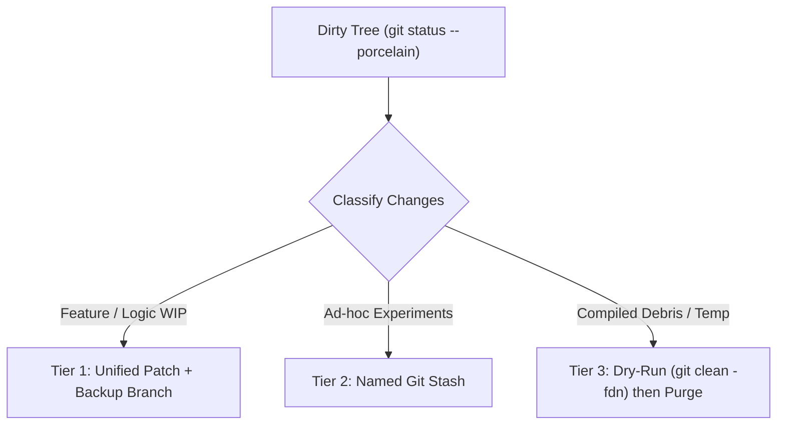

<!-- SPDX-License-Identifier: Apache-2.0 -->
<!-- Copyright (c) 2026 Arafat Zahan (@kuasha420) -->
<!-- Corporate Stewardship & Infrastructure: Purrfect Software Limited (PSL) -->
<!-- Governed by: ICARO-42/b Ordinance (Company-Supported Personal IP Framework) -->

# Git, Worktree & Dirty-Tree Hygiene Runbook

This human operator runbook defines zero-loss recovery procedures for dirty working trees, parallel worktree isolation, stale `.git/index.lock` cleanup, crash debris remediation, and build cache purging prior to verification.

> **Autonomous Agent Reference**: Automated multi-branch subagent worktree commands and 5-phase subagent crash resurrection protocols live in the [`git-worktree-ops`](../../harness/skills/git-worktree-ops/SKILL.md) and [`powerloss-resume`](../../harness/skills/powerloss-resume/SKILL.md) skills.

---

## 1. Zero-Loss Dirty Working Tree Triage

When entering a workspace with uncommitted changes (`git status --porcelain`), never run destructive wipes (`git reset --hard`, `git checkout .`, `git clean -f`) without preserving work first:



- **Tier 1 — High-Value WIP**: Export a patch and tag a backup branch before switching tasks:
  ```bash
  mkdir -p .agents/teamwork/backups
  git diff HEAD > ".agents/teamwork/backups/uncommitted-wip-$(date +%s).patch"
  git branch "backup/uncommitted-work-$(date +%Y%m%d%H%M%S)"
  ```
- **Tier 2 — Ephemeral Experiments**: Save a descriptive stash including untracked files:
  ```bash
  git stash push -u -m "backup: pre-switch WIP $(date +%Y-%m-%d_%H:%M:%S)"
  git stash list
  ```
- **Tier 3 — Untracked Build Scrap**: Always preview with `-n` before removing untracked files:
  ```bash
  git clean -fdn
  git clean -fd
  ```

---

## 2. Multi-Worktree Isolation & Orphan Pruning

Git rejects checking out a branch that is already active in another worktree (`fatal: '<branch>' is already checked out`). Always inspect active registrations first:

```bash
git worktree list --porcelain
```

### Primary Clones vs. Worktrees
- **Primary / Auxiliary Clone**: `.git` is a directory containing `HEAD`, `objects/`, `refs/`, and `config`.
- **Linked Worktree**: `.git` is a text file containing `gitdir: <path>`.

### Lifecycle Commands

```bash
# Branch into an isolated worktree without disturbing your main checkout
git worktree add -b feat/<task-name> ../worktrees/<task-name> main

# Remove the worktree cleanly once merged (avoid raw rm -rf on worktrees)
git worktree remove ../worktrees/<task-name>

# Prune orphaned .git/worktrees/* metadata if a directory was deleted externally
git worktree prune -v
```

---

## 3. Stale `.git/index.lock` & Crash Recovery

After a sudden reboot, killed process, or crashed editor, `.git/index.lock` (or `<worktree>/.git/index.lock`) can block subsequent git commands (`File exists`).

1. **Confirm No Active Git Process Is Running**:
   ```bash
   pgrep -fl "git" || [ $? -eq 1 ]
   ```
2. **Unlink Only If Idle**:
   ```bash
   LOCK_FILE="$(git rev-parse --git-dir)/index.lock"
   [ -f "$LOCK_FILE" ] && rm -f "$LOCK_FILE"
   ```
3. **Inspect Recent State & Harness Artifacts**:
   ```bash
   git status -s
   git reflog -n 5
   agyis checkpoint status       # Inspect latest pre-compaction state snapshot
   agyis subagents --liveness    # Check whether any active/stale subagent contexts remain
   ```
4. **Reclaim Expired Debris Safely**:
   ```bash
   agyis clean --dry-run --all   # Preview checkpoints, dead worktrees, merged branches & scratch cleanup
   agyis clean --all             # Execute safe cleanup (add --dist only if purging dist/ intentionally)
   ```

---

## 4. Pre-Verification Build Cache Remediation

Before running `agyis test`, `pnpm test`, or framework build gates after rebases, merges, or cross-branch worktree switches, purge stale bundler and compiler caches so tests never validate outdated build artifacts:

```bash
rm -rf .next/ .turbo/ node_modules/.cache/ apps/*/.next/ apps/*/.turbo/ packages/*/.turbo/
```

In Python/Node onboarding pipelines, `agyis onboard` runs `purge_build_caches('.')` automatically unless `--no-cache-purge` is passed.
