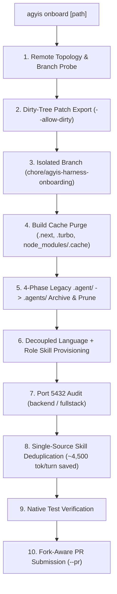

<!-- SPDX-License-Identifier: Apache-2.0 -->
<!-- Copyright (c) 2026 Arafat Zahan (@kuasha420) -->
<!-- Corporate Stewardship & Infrastructure: Purrfect Software Limited (PSL) -->
<!-- Governed by: ICARO-42/b Ordinance (Company-Supported Personal IP Framework) -->

# Repository Onboarding, Agent Boundaries & Cross-Repo PR Runbook

This human operator runbook establishes **`agyis onboard`** as the universal path for onboarding repositories to **Agyis Harness**, enforcing clean global-vs-workspace agent and skill boundaries, submitting PRs across forks, and resolving port `5432` Docker collisions.

> **Autonomous Agent Reference**: Automated `.agent/` migration mechanics, agent frontmatter validation (`ANTIGRAVITY_PLATFORM_TOOLS`), and low-level SQL/Docker diagnostics are handled by the [`psl-harmonize`](../../harness/skills/psl-harmonize/SKILL.md), [`agent-builder`](../../harness/skills/agent-builder/SKILL.md), and [`db-ops`](../../harness/skills/db-ops/SKILL.md) skills alongside [`custom-agents.md`](../official-specs/custom-agents.md).

---

## 1. Prerequisites & GitHub Scopes

| Requirement | Minimum Version | Verification Command | Notes |
| :--- | :--- | :--- | :--- |
| **Python** | CPython >= 3.12 | `python3 --version` | Standard library only; zero external runtime dependencies. |
| **Git** | 2.38+ | `git --version` | Safe worktree and exclude support. |
| **GitHub CLI (`gh`)** | 2.30+ | `gh auth status` | Required for remote permission checks and PR creation. |
| **Agyis Harness** | `1.0.0-rc10`+ | `agyis doctor` | Installed globally (`~/.local/bin/agyis`) or via `./agyis`. |

For cross-organization PRs or fork provisioning, ensure `repo` and `read:org` scopes are active:

```bash
gh auth refresh -h github.com -s repo,read:org
```

---

## 2. Golden Path Onboarding (`agyis onboard`)

`agyis onboard` runs an atomic 10-phase workflow: remote topology probe, dirty-tree safety patch export, branch isolation, build cache purge, 4-phase legacy `.agent/` archiving and pruning, decoupled language + architectural role skill provisioning, port `5432` check, single-source skill deduplication, verification, and optional headless PR delivery.



### Common Operator Invocations

```bash
# Preview every action safely without touching disk or git
agyis onboard . --dry-run --json

# Standard local onboarding in an isolated branch
agyis onboard . --create-branch chore/agyis-harness-onboarding

# Explicit language + architectural role (supports monorepo subprojects)
agyis onboard . --lang typescript --role frontend --create-branch --pr
agyis onboard . --subproject services/billing --role backend --create-branch --pr

# Preserve existing uncommitted edits into .agents/artifacts/wip-safety-pre-onboard.patch
agyis onboard . --allow-dirty --create-branch
```

For fresh greenfield repositories or legacy migration-only runs:

```bash
agyis init [path] -s python -r cli            # Greenfield scaffold
agyis harmonize [path] --prune-legacy --backup # Legacy .agent/ -> .agents/ only
```

*(Targeting the `agyis-harness` repository itself or an auxiliary clone automatically skips onboarding to prevent recursive self-modification.)*

---

## 3. Build Cache Invalidation & Single-Source Skill Hygiene

Stale framework caches (`.next/`, `.turbo/`, `node_modules/.cache/`) cause phantom build or TypeScript failures after branch switching or rebases. `agyis onboard` purges these caches by default (`--purge-caches`; opt out only with `--no-cache-purge`). To purge manually before running native tests:

```bash
rm -rf .next/ .turbo/ node_modules/.cache/ apps/*/.next/ apps/*/.turbo/ packages/*/.turbo/
```

### 3-Tier Skill Boundary (`~4,500` Tokens/Turn Saved)

Copying standard harness skills into a client repository's `.agents/skills/` wastes roughly **4,500 prompt tokens per turn** because Antigravity exposes both global plugin skills and workspace skills simultaneously.

| Tier | Location | Purpose |
| :--- | :--- | :--- |
| **Tier 1: Global Plugin** | `~/.gemini/config/plugins/agyis-harness/skills/` | Standard 30 harness capabilities (`db-ops`, `remote-ops`, `code-review`, stack/test skills). |
| **Tier 2: Project Specialist** | `<workspace>/.agents/skills/` | Bespoke repository-only workflows or domain codegen. |
| **Tier 3: User Standalone** | `~/.gemini/config/skills/` | Personal cross-workspace user skills. |

Prune shadowed duplicates and clean rule echoes across any repository:

```bash
agyis skills --prune-duplicates --dry-run
agyis skills --prune-duplicates
agyis rules --lint
agyis rules --dedup
```

---

## 4. Human Workspace & Agent Boundary Controls

Standard specialist personas (`agyis_architect`, `agyis_auditor`, `agyis_builder`, `agyis_coordinator`, `agyis_custodian`, `agyis_investigator`, `agyis_planner`, `agyis_reviewer`) live globally and must **never** be copied into client repositories.

| Precedence Layer | Location | Governance Rule |
| :--- | :--- | :--- |
| **Layer 3 (Highest): Workspace Local** | `<workspace>/.agents/agents/<name>.md` | Strictly reserved for project-unique domain specialists (e.g., `swarm_orchestrator.md` in `<mesh-repo>`, `kms_stream_specialist.md` in `<media-app-repo>`). |
| **Layer 2: User Global** | `~/.gemini/config/agents/<name>.md` | Workstation-wide operator overrides. |
| **Layer 1: Global Plugin** | `~/.gemini/config/plugins/agyis-harness/agents/` | Default 8 `agyis_*` baseline personas distributed by the harness. |

Verify which tier resolves each agent in your workspace:

```bash
agyis agents
```

---

## 5. Fork Topology & Cross-Repository PR Workflows

Repositories across organizations fall into four git remote topologies:

| Topology | `origin` | Secondary Remote | Push Target | PR Target & `--head` |
| :--- | :--- | :--- | :--- | :--- |
| **Direct Collaborator** | Canonical repo (`ADMIN`/`WRITE`) | *(None)* | `origin` | `origin` (`<branch>`) |
| **External Collaborator** | Canonical repo (`READ`) | `fork` (`WRITE`) | `fork` | `origin` (`<user>:<branch>`) |
| **Inverted Cloned Fork** | Personal fork (`WRITE`) | `upstream` (`CANONICAL`) | `origin` | `upstream` (`<user>:<branch>`) |
| **Dual-Remote Mirror** | Canonical repo | `mirror` / `<internal-org>` | `origin` & `mirror` | Canonical first, then mirror |

Check repository permissions and create forks non-interactively (always pass `--clone=false` so `gh repo fork` never hangs on a clone prompt):

```bash
USER=$(gh api user --jq .login)
gh repo view <owner>/<repo> --json viewerPermission,defaultBranchRef

# Create fork headlessly if viewerPermission is READ / TRIAGE / NONE
gh repo fork <owner>/<repo> --clone=false --remote=true --remote-name=fork

# Sync branch with upstream main and open a cross-repo PR
git fetch upstream
git checkout -B chore/my-feature upstream/main
git push -u fork chore/my-feature
gh pr create --repo <owner>/<repo> --base main --head "${USER}:chore/my-feature" \
  --title "chore: descriptive PR title"
```

When mirroring changes to an internal staging fork (`<internal-org>/<mirrored-repo>`), push to `mirror` after opening the canonical PR and cite the canonical PR URL. On offline or non-GitHub hosts (GitLab, Gitea, cgit), `agyis onboard` falls back to pushing `origin` and prints the manual merge-request instructions.

---

## 6. Database Port 5432 Collision Check (Prisma `P1000`)

On multi-project workstations, a foreign Docker container (e.g., `<backend-db-container>`) frequently holds host port `5432`, causing unrelated projects (e.g., `<client-web-repo>`) to fail local migrations or tests with Prisma `P1000`.

Check and rebind `.env` automatically using the zero-dependency helper shipped in `db-ops`:

```bash
# Audit port 5432 ownership across Docker and host sockets
python3 harness/skills/db-ops/scripts/detect_port_collision.py --check --json

# Rebind POSTGRES_PORT and DATABASE_URL in .env to a free port in 5432..5442
python3 harness/skills/db-ops/scripts/detect_port_collision.py --find-free --rebind --env .env
```

---

## 7. Post-Onboarding Operator Checklist

- [ ] Legacy `.agent/` directory is absent (`test ! -d .agent`) and any pre-migration backup in `.agents/archive/` is gitignored.
- [ ] Build caches (`.next/`, `.turbo/`, `node_modules/.cache/`) were purged prior to running verification tests.
- [ ] `agyis skills --prune-duplicates --dry-run` reports zero shadowed global skills in `.agents/skills/`.
- [ ] `<workspace>/.agents/agents/` contains zero copies of the 8 standard `agyis_*` personas (`agyis agents`).
- [ ] `AGENTS.md` preserves existing repo rules alongside `<!-- Added by AGYIS-HARNESS -->` delimiters (`agyis rules --lint`).
- [ ] Backend/fullstack services pass `detect_port_collision.py --check`.
- [ ] Project-native tests pass cleanly before opening or merging the onboarding PR.
