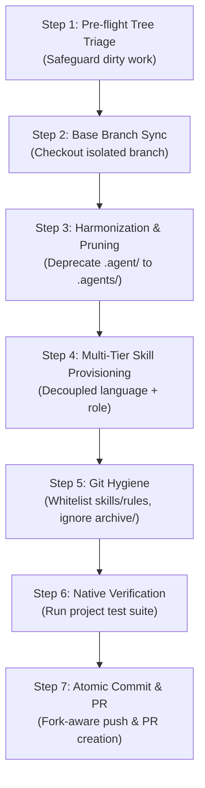

<!-- SPDX-License-Identifier: Apache-2.0 -->
<!-- Copyright (c) 2026 Arafat Zahan (@kuasha420) -->
<!-- Corporate Stewardship & Infrastructure: Purrfect Software Limited (PSL) -->
<!-- Governed by: ICARO-42/b Ordinance (Company-Supported Personal IP Framework) -->

# 📦 Canonical Repository Onboarding Runbook

This operational runbook provides the definitive, automated 7-step protocol for onboarding internal, client, or open-source repositories to the **Agyis Harness** runtime environment. It incorporates legacy configuration deprecation, deterministic directory pruning, decoupled multi-tier stack presets, git hygiene enforcement, and fork-aware pull request creation.

---

## 1. Prerequisites & Access Requirements

Before initiating repository onboarding, verify the host workstation or agent runner satisfies the following environment matrix:

| Requirement | Minimum Version | Verification Command | Description |
| :--- | :--- | :--- | :--- |
| **Python** | 3.12+ (CPython >= 3.12.0) | `python3 --version` | Hermetic standard library execution; zero external runtime dependencies. |
| **Git** | 2.38+ | `git --version` | Standard git toolchain with safe worktrees and sparse checkout support. |
| **GitHub CLI (`gh`)** | 2.30+ | `gh auth status` | Authenticated user credentials for remote permission probing and PR creation. |
| **Agyis Harness** | 1.0.0-rc1+ | `agyis doctor` | Global CLI or local `./agyis` harness executable available in path. |

> [!IMPORTANT]
> **GitHub Token Scopes**: If creating cross-organization pull requests, ensure your `gh` authentication token has appropriate repository write or fork scopes:
> ```bash
> gh auth refresh -h github.com -s repo,read:org
> ```

---

## 2. Canonical 7-Step Onboarding Sequence

The onboarding workflow follows a deterministic pipeline to ensure zero data loss, zero split-brain configuration, and clean-room verification.



### Step 1: Pre-flight Tree Triage & Safeguarding
Check the working tree for uncommitted changes or active work before executing mutations:
```bash
git status --porcelain
```
- **If uncommitted feature work exists**: Triage into a safety branch or patch file:
  ```bash
  git branch backup/pre-onboarding-$(date +%Y%m%d%H%M%S)
  git diff HEAD > /tmp/pre-onboarding-wip.patch
  ```
- **If ephemeral experimental changes exist**: Push to a named stash:
  ```bash
  git stash push -u -m "backup: pre-onboarding WIP"
  ```
- **If clean**: Proceed directly to Step 2.

### Step 2: Base Branch Synchronization & Feature Branching
Ensure local tracking branches match the canonical upstream default branch:
```bash
# Determine default branch (main or develop)
git fetch origin
BASE_BRANCH=$(git symbolic-ref refs/remotes/origin/HEAD | sed 's@^refs/remotes/origin/@@' || echo "main")

# Create isolated onboarding feature branch
git checkout -B chore/agyis-harness-onboarding origin/${BASE_BRANCH}
```

### Step 3: Harmonization with Legacy Deprecation
Migrate legacy `.agent/` configuration structures to `.agents/` and deterministically prune obsolete directories with zero residual debris:
```bash
# Optional dry run
agyis harmonize --prune-legacy --backup --dry-run

# Live execution
agyis harmonize --prune-legacy --backup
```
**Harmonization Guarantees (ADR-031)**:
1. **Verification**: Legacy files are verified against target files using SHA-256 checksums.
2. **Archival**: Legacy `.agent/` contents are packaged into `.agents/archive/agent-backup-<timestamp>.tar.gz`.
3. **Deterministic 2-Step Pruning**:
   - `git rm -rf .agent` removes tracked files from index.
   - Filesystem sweep removes any untracked debris via `shutil.rmtree()`.
   - Explicit invariant assertion guarantees `not Path(".agent").exists()`.
4. **Link Rewriting**: User rule file links (e.g. in `.agents/rules/AGENTS.md`) pointing to `.agent/` are rewritten to `.agents/`.

### Step 4: Multi-Tier Skill Provisioning
Provision modular skills matching the repository's genuine technology stack and architectural role:
```bash
# Automatic stack & role detection
agyis skills --sync

# Or explicit stack & architectural role specification
agyis skills --sync --stack typescript --role frontend
```
**Decoupled Preset Guidelines**:
- **Tier A (Language Runtimes)**: `typescript`, `python`, `rust`, `go`, `systems`, `shell`.
- **Tier B (Architectural Roles)**: `frontend`, `backend`, `fullstack`, `mobile`, `desktop_gui`, `cli`, `library`, `media`, `audio`, `infra`.
- *Domain Purity Invariant*: Frontend and UI repositories must NOT receive `psl-stack-backend` or `db-ops`. Backend database skills are reserved for `backend` and composite `fullstack` roles.

### Step 5: Git Hygiene Configuration
Configure repository `.gitignore` and `.git/info/exclude` to ensure modular skills and rules are tracked, while runtime artifacts, scratchpads, and backup tarballs are excluded:
```bash
agyis doctor --heal
```
Verify that `.gitignore` contains the canonical exclusions:
```gitignore
# Agyis Harness Ignored Directories
.agents/artifacts/
.agents/teamwork/
.agents/archive/
```
While `.agents/skills/` and `.agents/rules/` remain tracked and version-controlled.

### Step 6: Native Clean-Room Verification
Execute the repository's native test suite and lint checks to ensure zero regressions were introduced:
```bash
# Node / TypeScript
pnpm test || npm test || yarn test

# Python
python3 -m unittest discover -s tests -v || pytest

# Rust
cargo test

# Go
go test ./...
```
Assert that 100% of native tests pass before staging changes.

### Step 7: Atomic Commit, Push & PR Submission
Stage changes, commit with conventional commit format, and open a pull request:
```bash
git add .agents .gitignore
git commit -m "chore: onboard repository to agyis harness v1.0.0"

# Using automated fork-aware onboarding
agyis onboard --create-pr
```
Or execute manual remote push and PR creation:
```bash
# Push to push-target remote (origin or personal fork)
git push -u origin chore/agyis-harness-onboarding

# Open pull request against base branch
gh pr create \
  --title "chore: onboard repository to agyis harness" \
  --body "Onboard workspace to modern Agyis Harness (.agents/, modular skills, decoupled stack presets)." \
  --base "${BASE_BRANCH}"
```

---

## 3. Monorepo & Polyglot Onboarding

When onboarding repositories containing multiple subprojects, microservices, or polyglot packages:

### Bounded-Depth Monorepo Scanning
Agyis automatically scans child directories up to depth 2 (`apps/`, `services/`, `packages/`, `modules/`) to detect polyglot technologies without violating the sub-second execution benchmark.

### Targeted Subproject Onboarding
To onboard a specific service or microservice within a monorepo:
```bash
agyis onboard --subproject services/billing --role backend
```
This scopes skill synchronization and role assignment directly to the targeted subproject while preserving root workspace hygiene.

---

## 4. Post-Onboarding Verification Checklist

Execute this checklist before closing the onboarding task:

- [ ] **No Obsolete Directories**: Directory `.agent/` is completely absent from both git index and disk (`ls -d .agent 2>/dev/null` returns exit 1).
- [ ] **Modern Directory Structure**: `.agents/rules/` and `.agents/skills/` are populated and tracked in git.
- [ ] **Archive Hygiene**: `.agents/archive/` contains pre-migration tarballs and is ignored by git (`git status --porcelain` shows no `.tar.gz` files).
- [ ] **Domain Purity**: Installed skills match project architecture (e.g., no backend/db skills in frontend projects).
- [ ] **Rule Integrity**: Rule files contain the canonical `<!-- Added by AGYIS-HARNESS -->` tags and valid relative links.
- [ ] **Native Tests**: All native test suites pass with 100% success rate.
- [ ] **Pull Request Tracking**: Pull request URL is logged and accessible on GitHub.
