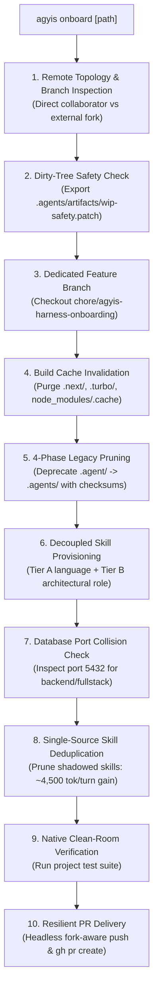

<!-- SPDX-License-Identifier: Apache-2.0 -->
<!-- Copyright (c) 2026 Arafat Zahan (@kuasha420) -->
<!-- Corporate Stewardship & Infrastructure: Purrfect Software Limited (PSL) -->
<!-- Governed by: ICARO-42/b Ordinance (Company-Supported Personal IP Framework) -->

# 📦 Canonical Repository Onboarding Runbook

This operational runbook establishes **`agyis onboard`** as the **Universal Golden Path** for onboarding internal, client, or open-source repositories to the **Agyis Harness** runtime environment. In a single turnkey command, `agyis onboard` atomically orchestrates git remote topology inspection, dirty-tree safety patch generation, build cache invalidation, 4-phase legacy pruning, decoupled multi-tier skill provisioning, database port collision auditing, single-source skill deduplication, git hygiene enforcement, and fork-aware pull request creation.

---

## 1. Prerequisites & Access Requirements

Before initiating repository onboarding, verify the host workstation or agent runner satisfies the following environment matrix:

| Requirement | Minimum Version | Verification Command | Description |
| :--- | :--- | :--- | :--- |
| **Python** | 3.12+ (CPython >= 3.12.0) | `python3 --version` | Hermetic standard library execution; zero external runtime dependencies. |
| **Git** | 2.38+ | `git --version` | Standard git toolchain with safe worktrees and sparse checkout support. |
| **GitHub CLI (`gh`)** | 2.30+ | `gh auth status` | Authenticated user credentials for remote permission probing and PR creation. |
| **Agyis Harness** | 1.0.0-rc1+ | `agyis doctor` | Global CLI or local `./agyis` harness executable available in path. |

> [!IMPORTANT]
> **GitHub Token Scopes**: If creating cross-organization pull requests, ensure your `gh` authentication token has appropriate repository write or fork scopes:
> ```bash
> gh auth refresh -h github.com -s repo,read:org
> ```

---

## 2. The Universal Golden Path: `agyis onboard`

The canonical, turnkey entrypoint for all repository onboarding across user workflows and autonomous subagents is **`agyis onboard`**. It coordinates all pre-flight inspections, safety migrations, skill deployments, and remote PR submissions without requiring multi-step manual intervention.



### 2.1 Canonical Turnkey Invocations

```bash
# Standard turnkey onboarding (auto-detects stack & role, creates branch, submits PR)
agyis onboard --create-branch --pr

# Explicit language and role specification
agyis onboard --lang typescript --role frontend --create-branch --pr

# Backend service onboarding with database port validation
agyis onboard --lang typescript --role backend --create-branch --pr

# Localized monorepo subproject onboarding
agyis onboard --subproject services/billing --role backend --create-branch --pr

# Safe dry-run preview (verifies topology and actions without disk or git mutation)
agyis onboard --dry-run --json
```

### 2.2 Atomic Operations Orchestrated Under the Hood
1. **Topology Probing**: Classifies remote topology into Direct Collaborator (`origin`), External Collaborator (`fork`), Inverted Cloned Fork (`upstream`), or Mirror, resolving canonical target and push targets automatically.
2. **Self-Referential & Auxiliary Clone Safeguards**: Automatically skips onboarding if targeted against the Agyis harness host repository itself or an auxiliary clone, preventing split-brain loop configurations.
3. **Dirty Working Tree Safeguarding**: If uncommitted edits exist:
   - Without `--allow-dirty`: Aborts cleanly with exit code 1 to protect operator WIP.
   - With `--allow-dirty`: Captures uncommitted diff to `.agents/artifacts/wip-safety-pre-onboard.patch` and configures git exclude so the patch is never committed.
4. **Branch Isolation**: Creates and checks out `chore/agyis-harness-onboarding` (or custom name via `--create-branch <name>`) tracked against the canonical upstream base branch.
5. **Build Cache Invalidation**: Purges `.next/`, `.turbo/`, and `node_modules/.cache` (default: `--purge-caches`), guaranteeing subsequent test runs evaluate fresh build artifacts.
6. **4-Phase Legacy Harmonization & Deterministic Pruning (ADR-031)**:
   - Verifies legacy `.agent/` files against target `.agents/` files using SHA-256 checksums.
   - Archives `.agent/` contents to `.agents/archive/agent-backup-<timestamp>.tar.gz`.
   - Executes deterministic 2-step pruning (`git rm -rf .agent` + `shutil.rmtree()`) asserting `not Path(".agent").exists()`.
   - Rewrites rule links from `.agent/` to `.agents/`.
7. **Decoupled Multi-Tier Skill Provisioning**: Deploys modular skills adhering to the Domain Purity Invariant (Language Runtimes: `typescript`, `python`, `rust`, `go`, `systems`, `shell`; Architectural Roles: `frontend`, `backend`, `fullstack`, `mobile`, `desktop_gui`, `cli`, `library`, `media`, `audio`, `infra`). Frontend repositories never receive backend/database skills.
8. **Automated Database Port Collision Audit**: When onboarding `backend` or `fullstack` roles, automatically audits port 5432 occupancy across Docker containers and host processes, alerting the operator to foreign container collisions.
9. **Single-Source Skill Deduplication**: Runs `enforce_single_source_skills` by default, removing workspace skills that shadow active global plugin skills to eliminate redundant tool schemas.
10. **Headless PR Submission**: When `--pr` is specified, commits changes cleanly and invokes `gh pr create` with `--clone=false --remote=true` to prevent interactive terminal hangs.

---

## 3. Build Cache Invalidation Mandate & Rebase Hygiene

In multi-branch PR rebases and repository onboarding across framework transitions (Next.js, Turborepo, Vite), compilation caches in `.next/`, `.turbo/`, and `node_modules/.cache` frequently retain stale compilation manifests, outdated route hashes, and invalid TypeScript declaration mappings.

### The Cache Invalidation Invariant
During repository onboarding and multi-branch rebase workflows (`agyis rebase`), build caches **must be purged prior to verification gates**.

- **Automatic Execution**: `agyis onboard` automatically purges these caches by default:
  ```bash
  # Enabled by default
  agyis onboard --purge-caches
  
  # Opt out only if conducting incremental local debugging
  agyis onboard --no-cache-purge
  ```
- **Manual Verification & Purge Command**:
  ```bash
  # Manually purge build caches across root and monorepo packages
  rm -rf .next/ .turbo/ node_modules/.cache/ apps/*/.next/ apps/*/.turbo/ packages/*/.turbo/
  ```
Executing this purge eliminates phantom build errors (such as stale Next.js static generation failures or Turborepo cache hits on outdated dependencies).

---

## 4. Single-Source Skill Deduplication (~4,500 Tokens/Turn Gain)

In early harness iterations, onboarding copied standard skills directly into every local repository's `.agents/skills/` directory. When Google Antigravity loads, it exposes both the global plugin skills and the local workspace skills to the agent model simultaneously.

### The 3-Tier Skill Boundary
To prevent prompt token bloat and split-brain instructions, Agyis establishes a strict 3-tier boundary:

| Tier | Directory Location | Scope & Governance | Example Skills |
| :--- | :--- | :--- | :--- |
| **Tier 1: Global Plugin** | `~/.gemini/config/plugins/psl-agy-harness/skills/` | Standard cross-workspace capabilities maintained by the harness platform. | `storage-ops`, `db-ops`, `audio-ops`, `display-ops`, `sec-forensics`, `git-worktree-ops`, `code-review` |
| **Tier 2: Project Specialist** | `.agents/skills/` (in target repo) | Bespoke skills tailored exclusively to the local repository's domain or proprietary toolchain. | `custom-billing-engine`, `proprietary-codegen`, `domain-migration` |
| **Tier 3: User Standalone** | `~/.gemini/config/skills/` | User-specific experimental or custom skills. | `knot-swarm`, `goal-with-lease` |

### Efficiency Gain & Pruning Protocol
Duplicating standard plugin skills into `.agents/skills/` consumes approximately **4,500 prompt tokens on every agent turn** without providing new capabilities.

- **Automated Deduplication**: `agyis onboard` automatically deduplicates skills on install via `enforce_single_source_skills()`.
- **Manual Fleet Pruning**: To audit and prune duplicate skills in any existing workspace:
  ```bash
  # Preview shadowed skills that can be safely removed
  agyis skills --prune-duplicates --dry-run

  # Live pruning of duplicate workspace skills
  agyis skills --prune-duplicates
  ```
This guarantees that only genuine project-specific specialist skills reside in `.agents/skills/`, saving thousands of tokens per cognitive cycle.

---

## 5. Automated Database Port Collision Remediation (Prisma P1000)

When onboarding repositories that feature localized database tests or Next.js static prerendering (e.g. `purrfectsoft/mm-website`), local builds frequently fail with:
```
PrismaClientInitializationError: Can't reach database server at localhost:5432 (Error Code: P1000)
```
On multi-project workstations, host port 5432 is often held by a foreign Docker container from an entirely different repository (e.g., `jasper_dev_postgres`). Agents frequently misdiagnose this as bad database credentials or corrupt schema rather than host port contention.

### Turnkey Remediation via `detect_port_collision.py`
Agyis includes a zero-dependency, standard library collision detection and remediation utility:
```bash
# 1. Audit port 5432 status and detect foreign container owner
python3 harness/skills/db-ops/scripts/detect_port_collision.py --check --json

# 2. Automatically find an available port (5432..5442) and rebind .env
python3 harness/skills/db-ops/scripts/detect_port_collision.py --find-free --rebind --env .env
```

### Remediation Mechanics
1. **3-Tier Probing**: Performs a non-blocking TCP connect/bind probe, probes `docker ps` for container attribution, and checks host processes via `ss`/`lsof`.
2. **Candidate Port Scanning**: Iterates candidate ports `5432` through `5442` to identify the first unbound port.
3. **Surgical Rebinding**: Updates `POSTGRES_PORT` and connection strings (`DATABASE_URL`, `POSTGRES_PRISMA_URL`) in `.env`, strictly preserving surrounding quotes, comments, database passwords, and URL query parameters (`?schema=public&sslmode=prefer`).

---

## 6. Under the Hood: Detailed Step-by-Step Breakdown (Manual Pipeline)

For manual execution, localized step debugging, or environments without global `agyis` CLI access, operators can follow the granular step-by-step pipeline:

### Step 1: Pre-flight Tree Triage & Safeguarding
```bash
git status --porcelain
# If dirty:
git diff HEAD > .agents/artifacts/wip-safety-pre-onboard.patch
```

### Step 2: Base Branch Synchronization & Feature Branching
```bash
git fetch origin
BASE_BRANCH=$(git symbolic-ref refs/remotes/origin/HEAD | sed 's@^refs/remotes/origin/@@' || echo "main")
git checkout -B chore/agyis-harness-onboarding origin/${BASE_BRANCH}
```

### Step 3: Cache Invalidation
```bash
rm -rf .next/ .turbo/ node_modules/.cache/
```

### Step 4: Harmonization with Legacy Deprecation
```bash
agyis harmonize --prune-legacy --backup
```

### Step 5: Multi-Tier Skill Provisioning & Deduplication
```bash
agyis skills --sync --stack typescript --role frontend
agyis skills --prune-duplicates
```

### Step 6: Git Hygiene Configuration
```bash
agyis doctor --heal
```

### Step 7: Native Clean-Room Verification
```bash
pnpm test || npm test || python3 -m unittest discover -s tests -v || cargo test || go test ./...
```

### Step 8: Atomic Commit, Push & PR Submission
```bash
git add .agents .gitignore AGENTS.md
git commit -m "chore: onboard workspace to modern Agyis Harness"
git push -u origin chore/agyis-harness-onboarding
gh pr create --title "chore: onboard repository to agyis harness" --body "Onboard workspace to modern Agyis Harness (.agents/, modular skills, decoupled stack presets)." --base "${BASE_BRANCH}"
```

---

## 7. Monorepo & Polyglot Onboarding

When onboarding repositories containing multiple subprojects, microservices, or polyglot packages:

### Bounded-Depth Monorepo Scanning
Agyis automatically scans child directories up to depth 2 (`apps/`, `services/`, `packages/`, `modules/`) to detect polyglot technologies without violating the sub-second execution benchmark.

### Targeted Subproject Onboarding
To onboard a specific service or microservice within a monorepo:
```bash
agyis onboard --subproject services/billing --role backend
```
This scopes skill synchronization and role assignment directly to the targeted subproject while preserving root workspace hygiene.

---

## 8. Post-Onboarding Verification Checklist

Execute this checklist before closing the onboarding task:

- [ ] **Universal Golden Path**: Repository was onboarded via `agyis onboard` (or manual fallback sequence verified).
- [ ] **No Obsolete Directories**: Directory `.agent/` is completely absent from both git index and disk (`ls -d .agent 2>/dev/null` returns exit 1).
- [ ] **Cache Invalidation**: Build caches (`.next/`, `.turbo/`, `node_modules/.cache`) were purged prior to verification.
- [ ] **Single-Source Skill Hygiene**: Duplicate skills shadowed by global plugins are pruned (`agyis skills --prune-duplicates` reports 0 duplicates).
- [ ] **Modern Directory Structure**: `.agents/rules/` and `.agents/skills/` are populated with version-controlled assets.
- [ ] **Archive Hygiene**: `.agents/archive/` contains pre-migration tarballs and is ignored by git (`git status --porcelain` shows no `.tar.gz` files).
- [ ] **Database Integrity**: Port 5432 has been audited via `detect_port_collision.py` for backend/fullstack stacks.
- [ ] **Domain Purity**: Installed skills strictly match project architecture (e.g., no backend/db skills in frontend projects).
- [ ] **Rule Integrity**: Rule files contain the canonical `<!-- Added by AGYIS-HARNESS -->` tags and valid relative links.
- [ ] **Native Tests**: All native test suites pass with 100% success rate.
- [ ] **Pull Request Tracking**: Pull request URL is logged and accessible on GitHub.
