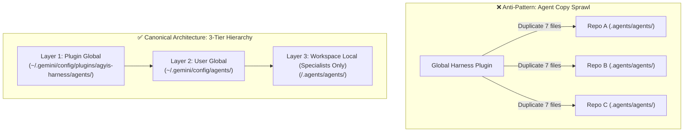

<!-- SPDX-License-Identifier: Apache-2.0 -->
<!-- Copyright (c) 2026 Arafat Zahan (@kuasha420) -->
<!-- Corporate Stewardship & Infrastructure: Purrfect Software Limited (PSL) -->
<!-- Governed by: ICARO-42/b Ordinance (Company-Supported Personal IP Framework) -->

# 🏛️ Workspace Agent Boundaries & Anti-Bloat Architecture Runbook

This operational runbook defines architectural boundaries governing global and local subagent persona configurations across repositories. It enforces the anti-bloat invariant, preventing repository sprawl and configuration drift in multi-workspace fleets.

---

## 1. The Fleet Repository Bloat Anti-Pattern

During early harness iterations, onboarding workflows frequently copied standard specialist agent markdown definitions (`agyis_architect.md`, `executioner.md`, `hammer.md`, `auditor.md`, `coordinator.md`, `planner.md`) directly into `<workspace>/.agents/agents/` across dozens of client and library repositories.

### Consequences of Repository Bloat:
1. **Maintenance Debt**: Updating a core prompt invariant required opening pull requests across 50+ repositories.
2. **Version Divergence**: Stale agent definitions in older repositories overrode updated global harness behaviors.
3. **Repository Pollution**: Pure libraries and backend services accumulated hundreds of lines of harness metadata unrelated to the business domain.



---

## 2. The 3-Tier Customization Hierarchy

Google Antigravity resolves agent personas across three distinct architectural tiers:

| Tier | Location | Scope | Lifecycle & Purpose |
| :--- | :--- | :--- | :--- |
| **Layer 1: Plugin Global** | `~/.gemini/config/plugins/agyis-harness/agents/` | Fleet-Wide | Shipped and versioned with the Agyis harness plugin. Provides canonical baseline personas (`agyis_architect`, `executioner`, `hammer`, `auditor`). |
| **Layer 2: User Global** | `~/.gemini/config/agents/` | Workstation-Wide | User-specific cross-project agent personas or global customizations. Inherits or extends Layer 1. |
| **Layer 3: Workspace Local** | `<workspace>/.agents/agents/` | Project-Specific | **Strictly reserved** for project-unique specialist subagents tailored to that repository's unique domain architecture. |

---

## 3. Canonical Scoping Invariants

To maintain fleet cleanliness, all developers and AI agents must adhere to the following invariants:

### Invariant 1: Standard Personas Remain Strictly Global
Standard subagent archetypes (`agyis_architect`, `executioner`, `hammer`, `auditor`, `coordinator`, `planner`) must NEVER be copied or committed into client repository trees. They are resolved automatically by the Antigravity runtime from Layer 1 or Layer 2.

### Invariant 2: Local Scope Reserved for Domain Specialists Only
The workspace directory `<workspace>/.agents/agents/` is permitted ONLY for domain-specific subagents that have zero applicability outside that specific codebase.
- *Valid Local Specialist*: `knot-mesh` defining `swarm_orchestrator.md` with hardware topology roles.
- *Valid Local Specialist*: `sunshine-physio` defining `kms_stream_specialist.md`.
- *Invalid Local Agent*: Any copy of standard `executioner.md` or `auditor.md`.

### Invariant 3: Prohibition of Standard Agent Copying During Onboarding
Neither `agyis onboard` nor `agyis harmonize` will provision or copy standard subagents into `.agents/agents/`. Repository onboarding provisions **modular skills** (`.agents/skills/`) and **project rules** (`.agents/rules/`), leaving agent personas cleanly in global scope.

---

## 4. Discovery Precedence & Conflict Resolution

When invoking an agent using `@<agent_name>`, Antigravity evaluates candidates in the following order of precedence:

1. **Workspace Local (`<workspace>/.agents/agents/<name>.md`)**:
   Highest precedence. If a project defines a local specialist, it overrides user and plugin definitions.
2. **User Global (`~/.gemini/config/agents/<name>.md`)**:
   Medium precedence. Overrides default plugin personas for the local developer workstation.
3. **Plugin Global (`~/.gemini/config/plugins/agyis-harness/agents/<name>.md`)**:
   Baseline fallback. Default behaviors distributed with the extension plugin.

### Verifying Agent Resolution
Use the Agyis CLI to inspect registered agents and verify their source locations:
```bash
# List all active agents and their discovery origins
agyis agents
```
This ensures clear visibility into which tier provides each active specialist.
