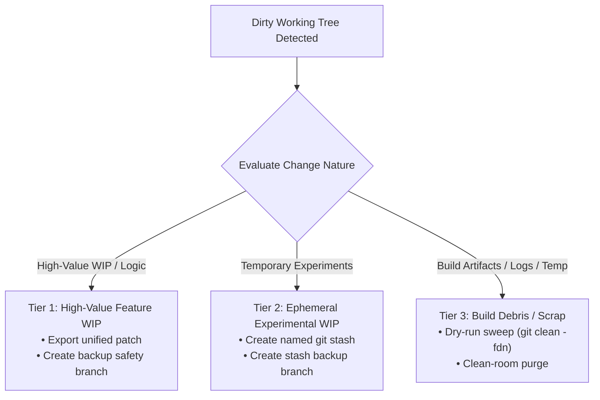

<!-- SPDX-License-Identifier: Apache-2.0 -->
<!-- Copyright (c) 2026 Arafat Zahan (@kuasha420) -->
<!-- Corporate Stewardship & Infrastructure: Purrfect Software Limited (PSL) -->
<!-- Governed by: ICARO-42/b Ordinance (Company-Supported Personal IP Framework) -->

# 🛡️ Worktree Hygiene & Dirty Tree Safeguarding Runbook

This operational runbook codifies zero-loss safety invariants for managing uncommitted changes, multi-worktree collision avoidance, orphan worktree lifecycle management, and index lockfile recovery during autonomous agent execution.

---

## 1. 3-Tier Dirty Working Tree Triage Decision Matrix

When an agent or developer enters a repository with a dirty working tree (`git status --porcelain` is non-empty), arbitrary destructive commands (`git reset --hard`, `git checkout -f`, `git clean -f`) are strictly prohibited. The working tree must be triaged according to the 3-tier matrix:



### Case A: High-Value Uncommitted Feature WIP
*Scenario: Meaningful code edits, bug fixes, or architecture work that has not yet been committed.*
1. **Export Unified Patch**:
   ```bash
   mkdir -p .agents/teamwork/backups
   git diff HEAD > .agents/teamwork/backups/uncommitted-wip-$(date +%s).patch
   ```
2. **Create Safety Branch**:
   ```bash
   git branch backup/uncommitted-work-$(date +%Y%m%d%H%M%S)
   ```
3. **Commit or Stash for Clean Tree**:
   ```bash
   git add -A
   git commit -m "wip: checkpoint uncommitted work prior to task switch"
   ```

### Case B: Ephemeral Experimental WIP
*Scenario: Quick diagnostic console logs, ad-hoc test assertions, or scratch scripts.*
1. **Create Named Stash**:
   ```bash
   git stash push -u -m "backup: pre-onboarding WIP $(date +%Y-%m-%d %H:%M:%S)"
   ```
2. **List and Verify Stash**:
   ```bash
   git stash list
   ```

### Case C: Build Artifacts & Untracked Scrap
*Scenario: Untracked compile outputs, node_modules build scraps, temporary files.*
1. **Dry-Run Inspection (MANDATORY)**:
   ```bash
   git clean -fdn
   ```
2. **Execute Clean-Room Purge**:
   ```bash
   git clean -fd
   ```

---

## 2. Multi-Worktree Collision Prevention

In multi-agent environments where multiple workers operate on the same repository, branch checkout conflicts occur frequently:
`fatal: '<branch>' is already checked out in '<path>'`.

### Safe Worktree Inspection
Always inspect existing worktree registrations before creating or checking out branches:
```bash
git worktree list --porcelain
```

### Discriminating Auxiliary Clones vs Worktrees
Agyis differentiates true git worktrees from separate repository clones:
- **Git Worktree**: The `.git` path is a regular text file containing `gitdir: <path>`.
- **Primary Clone / Full Clone**: The `.git` path is a full directory containing `HEAD`, `objects`, `refs`, and `config`.

### Collision Avoidance Protocol
1. Never checkout a branch that is already checked out in another active worktree.
2. If branching off a worktree, create a dedicated subagent branch name:
   ```bash
   git worktree add -b feat/task-worker-1 ../worktrees/worker-1 main
   ```
3. When finished, cleanly detach and remove the worktree:
   ```bash
   git worktree remove ../worktrees/worker-1
   ```

---

## 3. Safe Worktree Pruning

When directories backing worktrees are manually deleted, Git's administrative metadata under `.git/worktrees/` becomes stale. This can prevent branch checkouts or produce warning messages.

### Pruning Protocol
1. **Check Stale Worktrees**:
   ```bash
   git worktree list
   ```
2. **Prune Stale Registrations**:
   ```bash
   git worktree prune -v
   ```
This removes references to deleted directories while preserving active worktrees.

---

## 4. Stale `.git/index.lock` Recovery

If an agent or background process is killed or interrupted during a Git operation, a stale lockfile (`.git/index.lock` or `<worktree>/.git/index.lock`) may remain, blocking future Git commands:
`fatal: Unable to create '.../.git/index.lock': File exists.`

### Recovery Protocol
1. **Probe for Active Git Processes**:
   Never blindly remove the lockfile if a git process is genuinely running:
   ```bash
   pgrep -fl "git" || true
   ```
2. **Verify Process State**:
   - If a background git command (e.g. `git gc`, `git fetch`) is running, await its completion.
   - If no active git process exists or the process is defunct:
     ```bash
     LOCK_FILE=$(git rev-parse --git-dir)/index.lock
     if [ -f "$LOCK_FILE" ]; then
       echo "Removing stale lockfile: $LOCK_FILE"
       rm -f "$LOCK_FILE"
     fi
     ```
3. **Verify Git Operational Status**:
   ```bash
   git status
   ```
A clean status output confirms successful lockfile recovery without index corruption.
