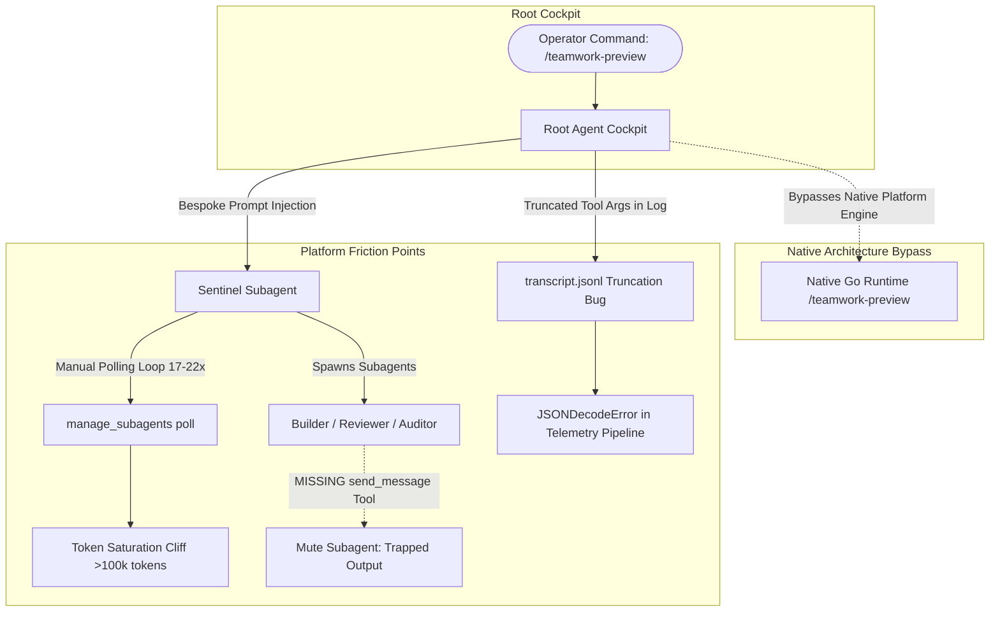

<!-- SPDX-License-Identifier: Apache-2.0 -->
<!-- Copyright (c) 2026 Arafat Zahan (@kuasha420) -->
<!-- Corporate Stewardship & Infrastructure: Purrfect Software Limited (PSL) -->
<!-- Governed by: ICARO-42/b Ordinance (Company-Supported Personal IP Framework) -->

# Comprehensive Architectural Investigation: Agent Architecture, Native Orchestration Mismatches & Unified Delegation Overhaul

```
Document Status : Authoritative Architectural Research & Deep-Dive Report
Document Version: 1.0.0
Date            : 2026-10-17
Investigator    : Agyis Specialist Research Subagent
Target Systems  : Google Antigravity 2.0 (v1.1.0–v1.2.16) & Agyis Harness (v1.0.0-rc1–rc5)
Authority Scope : harness/ (agents, commands, delivery, hooks, skills), .agents/ (rules, teamwork, skills), pipeline/
Classification  : Corporate Standard Architecture Specification & Platform Alignment Whitepaper
```

---

## Executive Summary

As Google Antigravity transitioned through versions **v1.1.0** to **v1.2.16**, the platform underwent a profound paradigm shift: evolving from a single conversational pair-programming assistant into a **structured, event-driven multi-agent operating system**. At the core of this native operating system are powerful built-in orchestration primitives:
1. **`/teamwork-preview`**: A hierarchical stigmergic swarm architecture featuring a Sentinel, Project Orchestrators, concurrent Explorers, Workers, Reviewers, Challengers, Synthesizers, and independent Victory Auditors.
2. **`/boost`**: An on-demand, adversarial deep swarm orchestrated around a stigmergic blackboard (`.swarm_blackboard_<task>.md`), pairing Deep Coding Agents with Code-Executing Adversarial Verifiers (test generators and oracles) and High-Reliability Reviewers with auto-retry and a 16-spawn succession protocol.
3. **`/plan`**: A first-class modal planning loop (`default` -> `accept-edits` -> `plan`) enforcing read-only exploration and an interactive artifact feedback gate (`implementation_plan.md`) prior to workspace mutations.
4. **`/goal` & `/schedule`**: Autonomous leased goal boundaries and native background cron/timer scheduling.

In parallel, **Agyis Harness** developed its own rich multi-agent conventions: the **6-Stage Subagent Ladder** (`Executioner -> Hammer -> Custodian -> Auditor`), modular stack skills, and a catalog of custom workspace-aware agent personas (`agyis_architect`, `coordinator`, `planner`, `harness_builder`, `harness_custodian`, `harness_auditor`, `harness_reviewer`).

### The Core Architectural Problem
Despite the presence of both capabilities on the same workstation, **Agyis custom agent personas currently operate in complete isolation from Antigravity native orchestration primitives**. When an operator commands `/teamwork-preview` or `/boost`, custom personas do not natively recognize, expose, or steer these platform workflows. Instead:
- Root agents are forced to **simulate** native teamwork preview behavior by authoring ad-hoc dispatch directories and complex bespoke markdown prompts in `.agents/teamwork/`.
- Crucial subagent tools (notably `send_message`) are inadvertently stripped from specialist personas, causing severe communication failures where subagents go idle without returning structured messages to their parents.
- Platform logging truncates JSON payloads in `transcript.jsonl`, introducing dormant deserialization bugs that crash ingestion scripts in `pipeline/extract_transcripts.py`.
- Agents fall into tight manual polling loops on `manage_subagents(Action='list')` (up to 22 consecutive calls), burning context and driving sessions directly into the **200+ step / 100k token Context Cliff**, where error rates surge 20x to 40x.
- Agent frontmatter contains conflicting permissions (`permissions.write: false` alongside `permissions.enable_write_tools: true`) and stale rules citations ("The 5 Ground Rules" vs. 8 canonical empirical rules).

This report presents an exhaustive, transcript-level forensic investigation into these dynamics across historical sessions, delivers a definitive comparative capability matrix, and provides a concrete, publication-grade architectural specification to overhaul Agyis agents so they natively embrace and surface native Antigravity orchestration.
---

## 1. Forensic Transcript Analysis & Empirical Findings

Our forensic investigation cross-analyzed three primary datasets:
1. **Current Parent Session (`8542796b-1ca1-4abc-8f0f-099085dcbe82`)**: Active Horizon 1.5 multi-subagent session executing the 18-repository cross-verification audit.
2. **Pre-Release Roadmap Execution v1.0.0-rc4 (`dac641b9-cc28-4d98-a9b9-eae242db5829`)**: 64-step root session coordinating multiple background fleets, shadow audit teams, and dynamic subagents.
3. **Multi-Subagent Heavy Telemetry Sessions (`data/telemetry.db`)**:
   - `f2855e28-fe0d-4f60-8160-2fbe3fdf2b16` (528 steps, 188 tool calls, 25+ subagents).
   - `5d1e1849-a72e-467e-8a37-378fbe242236` (Sentinel-15 session, 315 steps, 136 tool calls).
   - `7c2332c9-89e7-47a2-92ed-924fd7efaf22` (Sub-Orchestrator M3 session, 253 steps, 103 tool calls).



---

### 1.1 The Simulated Teamwork Preview Pattern (`8542796b` & `dac641b9`)

In session `8542796b`, when the operator commanded:
```text
@[rc5_handover_starter_prompt.md] Flight Director, you are succeeding the v1.0.0-rc4 release agent. 
Execute Phase 0: Launch a /teamwork-preview fleet to audit and cross-verify the 18 repositories...
```
The root agent did not (and could not) invoke a native platform API for `/teamwork-preview`. Because custom agents lack native slash command awareness, the root agent executed a manual emulation pipeline:
1. Created `prompt_draft.md` artifact with `RequestFeedback: true` (Step 19).
2. Waited for user approval via `ask_question` (Step 21).
3. Updated artifact status to `Launched` via `replace_file_content` (Step 23).
4. Invoked a generic subagent (`invoke_subagent`, Step 25) with a massive 7KB text prompt manually assigning it the persona of **Sentinel** (`722946e5-c039-4eee-b564-e97ce83ed3ac`).
5. The Sentinel created a local directory `.agents/teamwork/sentinel_16/` and spawned a child subagent `867d1400-dc43-4495-a07c-4e93cc0496c0` manually assigned as **`orchestrator_22`**.
6. `orchestrator_22` spawned 4 concurrent **Explorer** subagents (`explorer_audit_batch1`, `explorer_audit_batch2`, `explorer_audit_batch3`, `explorer_gap_spec`) in Step 25, followed by a **Synthesizer** (`worker_report_synthesizer`) in Step 78.
7. Finally, after the synthesizer delivered `gap_cross_verification_report.md`, the Sentinel spawned `778aa00f-00a9-4d3d-83b7-5fefbeb31de2` as an independent **Victory Auditor** (`victory_auditor_15`).

Similarly, in session `dac641b9`:
- Step 43 invoked `invoke_subagent` to launch `Sentinel-15` (`b0fdda65-01f8-4710-9dfa-3e4e1c3ed023`).
- Sentinel-15 ran two concurrent orchestrators: `orchestrator_20` (driving the primary rc4 plan) and `orchestrator_21` (`a0387484-04c8-49bb-83ed-10505d27db63`).
- When an operator freeze was ordered (`HOLD Confirmed Across Fleet`), the Sentinel confirmed that **17 subagents** were cleanly parked in `idle` state without termination (`ZERO Subagents Were Killed`).
- When the parent required specialized mesh investigations, it dynamically used `define_subagent` for custom agents (`skycat`, `diablo`, `swarm_inquisitor`) before spawning them.

#### Finding:
The multi-agent hierarchy (Sentinel -> Orchestrator -> Explorers -> Synthesizer -> Victory Auditor) is extraordinarily effective at preserving high autonomy and preventing context pollution. However, **every step of this hierarchy currently has to be hand-constructed by prompting**, because Agyis custom agent frontmatters and system instructions have zero formal bindings to the platform's native `/teamwork-preview` engine.
---

### 1.2 The Dormant Deserialization Bug in Telemetry Extraction

A critical platform failure was uncovered during transcript forensic parsing:
When an agent invokes a subagent with a detailed prompt (such as Step 25 of `8542796b`), the argument passed to `invoke_subagent` is a JSON array string:
```json
{"Subagents": "[{\"Model\":\"inherit\",\"Prompt\":\"Conduct an exhaustive cross-verification audit of the 18 repositories...\"}]"}
```
In `transcript.jsonl`, Antigravity's logging engine truncates large tool arguments and results once they exceed platform thresholds. When it truncates a JSON argument, it physically inserts:
```text
\n<truncated 4723 bytes>
```
directly into the string literal of the JSON payload without escaping the newline or closing the quotes and brackets.

#### Impact:
When any pipeline utility (such as `pipeline/extract_transcripts.py` or `harness/telemetry/sync.py`) attempts to parse `arguments_json` using Python's standard `json.loads(arguments_json)` or deserialize `args['Subagents']`:
```text
json.decoder.JSONDecodeError: Invalid control character at: line 1 column 2047 (char 2046)
# OR
json.decoder.JSONDecodeError: Unterminated string starting at: line 1 column 30 (char 29)
```
This is a **dormant deserialization bug** across the entire telemetry and replay stack. Any session containing rich subagent dispatches will silently fail or corrupt telemetry extraction unless the parser employs resilient string recovery (e.g. stripping `<truncated.*?bytes>` and repairing unclosed quotes and brackets).

---

### 1.3 The Missing `send_message` Tool Stripping Trap

The Google Antigravity platform enforces a strict communication contract on all subagents:
```text
You are running as a subagent, invoked by a caller agent (name: "parent", id: "<uuid>"). 
You MUST use send_message to communicate all results, reports, and updates back to the caller. 
Your response is NOT automatically relayed — if you do not call send_message, the caller will only 
know that you have gone idle. Always use the caller's id as the Recipient and "parent" as the RecipientName.
```

However, examining the tool allowlists in `harness/agents/*.md` and capability bundles in `harness/subagents.py`:

| Agent Definition | Declared `tools:` | `send_message` Present? | Outcome When Invoked as Subagent |
| :--- | :--- | :---: | :--- |
| `agyis_architect.md` | 17 tools (Full set) | [YES] | Communicates cleanly back to parent. |
| `coordinator.md` | 10 tools | [YES] | Communicates cleanly back to parent. |
| `planner.md` | 12 tools | [YES] | Communicates cleanly back to parent. |
| `harness_builder.md` | 8 tools | [NO] | **Mute Worker**: Cannot call `send_message`. Output trapped! |
| `harness_reviewer.md` | 4 tools (`view_file`, `list_dir`, `grep_search`, `find_by_name`) | [NO] | **Total Lockup**: Cannot write files (`write: false`) AND cannot message parent! |
| `harness_custodian.md`| 6 tools | [NO] | **Mute Gate**: Cannot send commit status to parent. |
| `harness_auditor.md` | 7 tools | [NO] | **Mute QA**: Cannot send test pass/fail report to parent. |

And examining `harness/subagents.py`:
```python
CAPABILITY_BUNDLES = {
    "read_only": ["view_file", "list_dir", "grep_search", "find_by_name", "read_url_content", "search_web"],
    "verifier": ["view_file", "list_dir", "grep_search", "find_by_name", "read_url_content", "search_web", "run_command", "manage_task"],
    "adversarial_verifier": ["view_file", "list_dir", "grep_search", "find_by_name", "read_url_content", "search_web", "run_command", "manage_task", "write_to_file", "replace_file_content"],
    "builder": ["view_file", "list_dir", "grep_search", "find_by_name", "read_url_content", "search_web", "run_command", "manage_task", "write_to_file", "replace_file_content"],
    "orchestrator": ["view_file", "list_dir", "grep_search", "find_by_name", "read_url_content", "search_web", "invoke_subagent", "send_message", "manage_subagents", "manage_task", "ask_question"],
    "full": [...]
}
```

#### The Stripping Consequence:
Only `orchestrator` and `full` include `send_message`! If an engineer or orchestrator spawns a `builder`, `verifier`, or `adversarial_verifier` using capability bundles or uses `harness_builder`, `harness_reviewer`, `harness_custodian`, or `harness_auditor`:
1. The platform injects the `<subagent_reminder>` demanding `send_message`.
2. The agent attempts to call `send_message`, but the tool is NOT in its schema.
3. The tool execution fails with: `Tool 'send_message' is not available`.
4. The subagent is forced to conclude its turn with conversational text.
5. But conversational text is **NOT relayed to the parent**!
6. The parent receives only an empty notification: `Subagent <id> has become idle`. The parent is left completely blind as to whether the work succeeded or failed, forcing it to read disk logs or guess.
---

### 1.4 The Manual Polling Loop & Context Saturation Cliff

In telemetry sessions:
- In `5d1e1849-a72e-467e-8a37-378fbe242236`, the Sentinel called `manage_subagents(Action='list')` **17 times** across 315 steps.
- In `7c2332c9-89e7-47a2-92ed-924fd7efaf22`, the sub-orchestrator called `manage_subagents(Action='list')` **22 times** across 253 steps.
- In `39a982aa`, the agent repeatedly polled `view_file` on `task-388.log` **32 times across 64 steps**, triggering a mid-session context checkpoint truncation.

#### Root Cause:
Agents lacked a strict instruction forbidding `manage_subagents` status polling. While `AGENTS.md` Rule 4 enforced the *Strict Reactive Wait Invariant* for `manage_task(Action='status')` and background task logs, it did not explicitly mention `manage_subagents(Action='list')`. Agents treated `manage_subagents` as a polling loop to check on child progress, burning tens of thousands of tokens and degrading primary context.

---

### 1.5 Conflicting Permissions & Stale Invariants in Agent Frontmatter

Inspecting the markdown headers of current agents in `harness/agents/` and `~/.gemini/config/plugins/psl-agy-harness/agents/`:

1. **Permission Contradictions**:
   - `harness_custodian.md`:
     ```yaml
     permissions:
       read: true
       write: false
       execute: true
       enable_write_tools: true   # <--- CONTRADICTION: write is false, but enable_write_tools is true!
     ```
   - `harness_auditor.md`:
     ```yaml
     permissions:
       read: true
       write: false
       execute: true
       enable_write_tools: true   # <--- CONTRADICTION: write is false, but enable_write_tools is true!
     ```
   - `planner.md`:
     ```yaml
     permissions:
       read: true
       write: true                # <--- Declared writable in frontmatter
     ```
     Yet the markdown prompt body explicitly states:
     ```markdown
     2. **Read-Only Architectural Research**:
        - Zero direct file mutations (write: true). File modification tools (write_to_file, replace_file_content, edit_file) are strictly blocked.
     ```
     This confusing contradiction confuses both the platform validator and the model's reasoning loop.

2. **Stale Ground Rules Citations**:
   All 7 agent files cite `"The 5 Ground Rules"` in their prompts:
   ```markdown
   - Rule 1 (Zero Error Swallowing)
   - Rule 2 (No Product Homework in Tests)
   - Rule 3 (Complete Deliveries)
   - Rule 4 (Zero Verification Homework)
   - Rule 5 (Stop & Inquire)
   ```
   However, canonical `AGENTS.md` (and `GLOBAL_AGENTS.md`) underwent major empirical upgrades in Horizon 1, expanding to **8 Canonical Empirical Rules** (incorporating ADR-012 Artifact-First Planning, ADR-013 Grep Probing & Anti-Loop Discipline, ADR-015 Sub-Second Verification Benchmark, and ADR-028 Cleanroom Reconstruction Invariants). The custom agent prompts have suffered documentation and policy drift.
---

## 2. Agent Catalog & Capability Comparison Matrix

### 2.1 Current vs. Desired Capability Matrix

The table below contrasts the current implementation of each agent against its desired architecture to support native Antigravity delegation and cleanroom engineering:

| Agent Persona | Archetype | Target Model | Current Tools | Missing Critical Tools | Permissions Conflict | Native Primitives Supported |
| :--- | :--- | :--- | :--- | :--- | :--- | :--- |
| **Native Main Agent** | Platform Default | `inherit` | All 17 tools | None | None | `/boost`, `/teamwork-preview`, `/plan`, `/goal`, `/schedule` |
| **`agyis_architect`** | `main` | `inherit` | All 17 tools | None | Clean | **Current**: Ladder only<br/>**Desired**: Full Swarm Conductor (`/teamwork-preview`, `/boost`) |
| **`coordinator`** | `coordinator` | `pro` or `inherit` | 10 tools | `run_command`, `schedule`, `define_subagent` | Clean | **Current**: Ladder only<br/>**Desired**: Multi-Fleet Orchestrator, Swarm Succession, Stigmergic Blackboards |
| **`planner`** | `planner` | `pro` | 12 tools | None | Prompt contradicts `write: true` | **Current**: ADR-012 prompt only<br/>**Desired**: Native `/plan` mode lock, `/grill-me` requirement discovery |
| **`harness_builder`** | `executioner` | `flash` | 8 tools | `send_message`, `search_web` | Clean | **Current**: Mute subagent<br/>**Desired**: Responsive ladder worker, isolated worktree execution |
| **`harness_reviewer`** | `hammer` | `flash` | 4 tools | `send_message` | `write: false` trapped | **Current**: Mute subagent<br/>**Desired**: Adversarial High-Reliability Reviewer, line-by-line defect reporting |
| **`harness_custodian`** | `custodian` | `flash` | 6 tools | `send_message` | `write: false` vs `enable_write_tools: true` | **Current**: Mute subagent<br/>**Desired**: DRY deduplication auditor, Stage 4 atomic HEAD commit gate |
| **`harness_auditor`** | `auditor` | `flash` | 7 tools | `send_message` | `write: false` vs `enable_write_tools: true` | **Current**: Mute subagent<br/>**Desired**: Sub-second benchmark certifier, Victory Auditor |
| **`adversarial_verifier`** *(New)* | `verifier` | `pro` or `flash` | 10 tools | `send_message` | Clean (isolated write) | **Desired**: Dynamic test oracle, generative fuzzer, stress benchmark creator |

---

### 2.2 Direct Delegation vs. The 6-Stage Subagent Ladder

Google Antigravity supports two fundamentally different delegation models. Understanding when to use each is essential:

```
┌────────────────────────────────────────────────────────────────────────────────────────┐
│                        Delegation Architecture Comparison                              │
├────────────────────────────────┬───────────────────────────────────────────────────────┤
│ Model A: PSL Subagent Ladder   │ Model B: Antigravity Native Swarm (/boost, /teamwork) │
├────────────────────────────────┼───────────────────────────────────────────────────────┤
│ • Linear, deterministic state  │ • Stigmergic, asynchronous blackboard coordination    │
│   machine pipeline             │ • Parallel multi-role worker fanout                   │
│ • Executioner -> Hammer ->     │ • Auto-retry with backoff (up to 4 retries)           │
│   Custodian -> Auditor         │ • 16-spawn succession handoff protocol                │
│ • Strict Stage 4 atomic Git    │ • Dynamic synthesizer consolidation                   │
│   commit gate on HEAD          │ • Independent Victory Auditor certification           │
│ • Cleanroom sub-second (<1.0s) │ • Ideal for non-linear exploration, mysterious races, │
│   verification gate            │   large-scale codebase migrations, parallel audits    │
│ • Ideal for deterministic,     │                                                       │
│   production SWE deliveries    │                                                       │
└────────────────────────────────┴───────────────────────────────────────────────────────┘
```

The Subagent Ladder provides unmatched safety and determinism for production codebase modifications. However, when an initiative requires parallel reconnaissance across 18 repositories, deep algorithmic exploration, or adversarial fuzzing, forcing that workload through a single sequential ladder causes severe bottlenecks. The two models must coexist harmoniously.
---

## 3. Dissecting Native Antigravity Orchestration Mismatches

### 3.1 How Native Antigravity Injects Slash Commands

In Antigravity 2.0 (and the `agy` CLI binary), slash commands are processed through an input pre-parsing and hook pipeline:
1. **Interactive Prompt Layer (`PromptModel.PrependSlashPlanIfNeeded`)**:
   - The UI and CLI track session mode (`types.AgentMode`: `default`, `accept-edits`, `plan`).
   - When Plan Mode is active (toggled via `Shift+Tab`), `/plan` is automatically prepended to the user prompt.
2. **Command Stacking (`/plan /grill-me`)**:
   - The input pipeline parses leading tokens matching `/^[a-zA-Z0-9_-]+`.
   - Stacking enables modal combinations (e.g. initiating discovery before planning).
3. **Internal Builtin Orchestrator Activation**:
   - When `/boost` is detected, the Go runtime intercepts the turn and routes execution to the `Boost multi-agent orchestrator` (`third_party/jetski/cortex/customizations/builtin/`).
   - When `/teamwork-preview` is detected, the runtime provisions the Sentinel-Orchestrator pipeline.
   - The orchestrator initializes an authoritative state file (`.swarm_blackboard_<task>.md` or `.agents/teamwork/`), schedules a heartbeat monitor (`schedule(CronExpression="*/10 * * * *")`), and dispatches specialized worker roles.

### 3.2 Why Custom Agyis Personas Do Not Leverage Native Orchestration

1. **System Prompt Overwrite (Prompt Insulation)**:
   - When a user chooses a custom agent (e.g. `agyis_architect`), Antigravity replaces the default platform system prompt with the agent's markdown body.
   - The native prompt includes the vocabulary, instructions, and schemas for `/boost`, `/teamwork-preview`, `/plan`, `/goal`, and `/schedule`.
   - The custom agent markdown body did not include any of these instructions! As a result, the model in custom personas has **zero awareness** that these native capabilities exist.
2. **Explicit Tool Filtering**:
   - Antigravity filters the agent's callable tools to the exact list declared in `tools:` / `allowed_tools:`.
   - Omitting `schedule` from `coordinator.md` prevents it from running heartbeat crons.
   - Omitting `define_subagent` prevents dynamic creation of task-specific specialist personas.
   - Omitting `run_command` from `coordinator.md` prevents it from checking fleet status via `gh` or `agyis`.
   - Omitting `send_message` from worker personas isolates them from their parent.
3. **Architectural Siloing**:
   - Previous harness documentation treated native primitives (`/boost`, `/plan`) as external platform features rather than foundational primitives that Agyis agents should orchestrate.
---

## 4. Concrete Overhaul Specification for Agyis Agents

To bridge these gaps, we specify a unified overhaul across agent definitions, capability bundles, telemetry parsers, and operational skills.

### 4.1 Specification 1: Standardized Tool Allowlist & Mandatory `send_message`

**Invariant**: *Every agent or subagent that can be spawned via `invoke_subagent` MUST include `send_message` in its tool allowlist.*

#### Updated Capability Bundles (`harness/subagents.py`):
```python
ANTIGRAVITY_PLATFORM_TOOLS = frozenset({
    "ask_question",
    "define_subagent",
    "find_by_name",
    "generate_image",
    "grep_search",
    "invoke_subagent",
    "list_dir",
    "manage_subagents",
    "manage_task",
    "read_url_content",
    "replace_file_content",
    "run_command",
    "schedule",
    "search_web",
    "send_message",
    "view_file",
    "write_to_file",
})

CAPABILITY_BUNDLES = {
    # Read-only exploration and code research
    "read_only": [
        "view_file", "list_dir", "grep_search", "find_by_name",
        "read_url_content", "search_web", "send_message"
    ],
    # Verification, doctor audits, and hermetic testing
    "verifier": [
        "view_file", "list_dir", "grep_search", "find_by_name",
        "read_url_content", "search_web", "run_command", "manage_task",
        "schedule", "send_message"
    ],
    # Adversarial test generator, oracle, and stress benchmark creator (inspired by /boost)
    "adversarial_verifier": [
        "view_file", "list_dir", "grep_search", "find_by_name",
        "read_url_content", "search_web", "run_command", "manage_task",
        "write_to_file", "replace_file_content", "send_message"
    ],
    # Surgical task implementer following an approved plan
    "builder": [
        "view_file", "list_dir", "grep_search", "find_by_name",
        "read_url_content", "search_web", "run_command", "manage_task",
        "write_to_file", "replace_file_content", "send_message"
    ],
    # Multi-agent coordinator and swarm orchestrator
    "orchestrator": [
        "view_file", "list_dir", "grep_search", "find_by_name",
        "read_url_content", "search_web", "run_command", "manage_task",
        "write_to_file", "replace_file_content", "invoke_subagent",
        "manage_subagents", "define_subagent", "schedule", "send_message",
        "ask_question"
    ],
    # Full platform capabilities
    "full": list(ANTIGRAVITY_PLATFORM_TOOLS),
}
```

---

### 4.2 Specification 2: Agent Persona Frontmatter Harmonization

Update the 7 canonical agents in `harness/agents/` and `~/.gemini/config/plugins/psl-agy-harness/agents/`:

#### 1. `coordinator.md` (Elevated to Full Swarm & Ladder Orchestrator)
- **Role**: Swarm Coordinator & Multi-Agent Lead
- **Tools**: Add `run_command`, `schedule`, `define_subagent`, `replace_file_content`.
- **Permissions**: `read: true`, `write: true`, `execute: true`, `subagents: true`, `mcp: true`.
- **Native Primitives**: Authorizes spawning `/teamwork-preview` swarms, managing Sentinel lifecycles, and supervising both the Subagent Ladder and Stigmergic Blackboard swarms.

#### 2. `planner.md` (Aligned with Native `/plan` Mode)
- **Role**: Software Architect & Solution Planner
- **Permissions**: `read: true`, `write: true` (scoped to planning artifacts: `implementation_plan.md`, `walkthrough.md`, scratch files, and documentation), `execute: false`, `subagents: true`.
- **Prompt**: Remove contradictory text ("Zero direct file mutations (write: true)"). Explicitly declare the two-artifact lifecycle (`implementation_plan.md` with `RequestFeedback: true` and `walkthrough.md`).

#### 3. `harness_builder.md` (Executioner)
- **Tools**: Add `send_message`, `read_url_content`, `search_web`.
- **Permissions**: `read: true`, `write: true`, `execute: true`, `subagents: false`, `enable_write_tools: true`.

#### 4. `harness_reviewer.md` (Hammer)
- **Tools**: Add `send_message`, `read_url_content`, `search_web`.
- **Permissions**: `read: true`, `write: false`, `execute: false`, `subagents: false`, `enable_write_tools: false`.

#### 5. `harness_custodian.md` (Custodian)
- **Tools**: Add `send_message`.
- **Permissions**: Correct contradiction -> `permissions.write: false`, `permissions.enable_write_tools: false`. (Custodian commits via `git commit` via `run_command`, never edits files directly).

#### 6. `harness_auditor.md` (Auditor / Victory Auditor)
- **Tools**: Add `send_message`.
- **Permissions**: Correct contradiction -> `permissions.write: false`, `permissions.enable_write_tools: false`.
- **Role**: Serves as both Stage 5 QA Verifier for the Ladder and independent Victory Auditor for Swarms.

---

### 4.3 Specification 3: Resilient Transcript Deserialization

In `pipeline/extract_transcripts.py` and `harness/telemetry/`:
Implement a sanitizing deserializer to handle truncated tool arguments:

```python
import json
import re

def safe_deserialize_tool_args(args_raw: str | dict) -> dict:
    """Safely deserializes tool arguments, recovering from platform log truncation."""
    if isinstance(args_raw, dict):
        return args_raw
    if not isinstance(args_raw, str):
        return {}
    
    # 1. Standard fast-path parse
    try:
        return json.loads(args_raw)
    except Exception:
        pass

    # 2. Strip embedded platform truncation artifacts: '\n<truncated N bytes>'
    cleaned = re.sub(r'\n<truncated\s+\d+\s+bytes>', '', args_raw)
    try:
        return json.loads(cleaned)
    except Exception:
        pass

    # 3. Resilient recovery: close unclosed strings, objects, or arrays
    recovered = cleaned.strip()
    if not recovered.endswith(('}', ']')):
        if recovered.count('"') % 2 != 0:
            recovered += '"'
        open_braces = recovered.count('{') - recovered.count('}')
        open_brackets = recovered.count('[') - recovered.count(']')
        recovered += (']' * max(0, open_brackets)) + ('}' * max(0, open_braces))
        try:
            return json.loads(recovered, strict=False)
        except Exception:
            pass

    return {"raw_unparsed": args_raw, "_parse_error": True}
```

---

### 4.4 Specification 4: Dual Orchestration Taxonomy & Routing Guide

Incorporate this authoritative routing contract into `AGENTS.md`, `coordinator.md`, and `agyis_architect.md`:

```
┌─────────────────────────────────────────────────────────────────────────────────────────┐
│                           Task Routing Decision Tree                                    │
├─────────────────────────────────────────────────────────────────────────────────────────┤
│                                                                                         │
│  Is the task a multi-file architectural proposal or requirement exploration?            │
│  ├── YES: Use `/plan` (or `/plan /grill-me`)                                            │
│  │        Mandates read-only exploration and interactive `implementation_plan.md` gate. │
│  │                                                                                      │
│  └── NO: Does the task involve non-linear debugging, mysterious data races, or          │
│          large-scale parallel fleet audits across 10+ repositories?                     │
│          ├── YES: Use `/boost` (for deep races) or `/teamwork-preview` (for fleet)      │
│          │        • /boost: Blackboard coordination with Adversarial Verifiers.         │
│          │        • /teamwork-preview: Sentinel -> Orchestrator -> Parallel Fleet.      │
│          │                                                                              │
│          └── NO: Is it a deterministic production SWE milestone or harness feature?     │
│                  ├── YES: Use the PSL Subagent Ladder (/subagent-ladder)                │
│                  │        Executioner -> Hammer -> Custodian -> Auditor                 │
│                  │        Guarantees Stage 4 atomic HEAD commit gate & <1.0s benchmark. │
│                  │                                                                      │
│                  └── NO: Direct single-turn surgical execution.                         │
└─────────────────────────────────────────────────────────────────────────────────────────┘
```

---

## 5. Summary of Deliverables & Action Plan

1. **Phase 1: Tool & Permission Fixes**:
   - Update `harness/subagents.py` with standard `send_message` across all capability bundles.
   - Patch `harness/agents/*.md` and `~/.gemini/config/plugins/psl-agy-harness/agents/*.md` to add `send_message` and resolve permission contradictions.
   - Synchronize templates via `agyis agents --sync`.

2. **Phase 2: Prompt Alignment**:
   - Update system prompts in `agyis_architect.md`, `coordinator.md`, and `planner.md` to reference the 8 Canonical Empirical Rules and explain native slash command delegation (`/teamwork-preview`, `/boost`, `/plan`).

3. **Phase 3: Telemetry Resilience**:
   - Deploy `safe_deserialize_tool_args` in `pipeline/extract_transcripts.py` and run a backfill sweep on `data/telemetry.db`.
