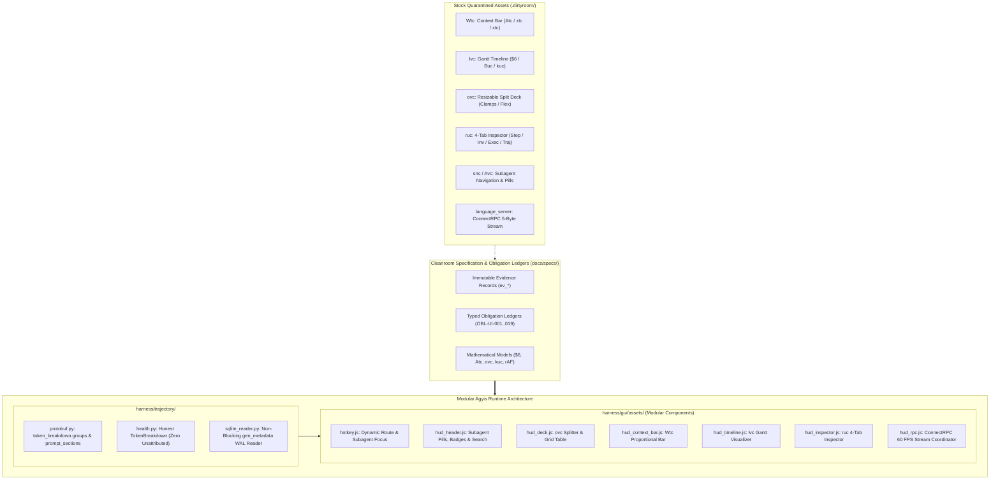

<!-- SPDX-License-Identifier: Apache-2.0 -->
<!-- Copyright (c) 2026 Arafat Zahan (@kuasha420) -->
<!-- Corporate Stewardship & Infrastructure: Purrfect Software Limited (PSL) -->
<!-- Governed by: ICARO-42/b Ordinance (Company-Supported Personal IP Framework) -->

# Google Antigravity UI Token Surfacing & Dual-Mode Workspace Architecture
## Cleanroom Empirical Reverse Engineering Specification & Obligation Ledger

**Document Identifier:** `REA-SPEC-ANTIGRAVITY-UI-TOKEN-SURFACING-2026-11-12`  
**Governing Standards:** ADR-014, ADR-028, ADR-031, ADR-033, ADR-035, Cleanroom Invariants (`PSL-INV-007`), Architectural Fitness (`PSL-INV-011`), Anti-Vibe Dynamic Lifecycle (`PSL-INV-010`)  
**Analysis Providers:** REA v6.5.0 (`inspect-go-binary`, `sqlite`, `asar-dissect`, `v8-bundle-tracer`), Teamwork Swarm Strands 1–4  
**Target Stock Canonical Build:** Google Antigravity Desktop GUI v2.26.0 (Build `6546645232517120`, CL `951519500`) quarantined in `.dirtyroom/2.26.0/`, Antigravity v2.29.0 (`.dirtyroom/main-2.29.0.js`), & Engine Cortex Go language server (`/opt/Antigravity/resources/bin/language_server`)  
**Historical Baselines:** Antigravity Desktop v2.19.1 (CL `951519500`), `/usr/bin/agy` CLI v1.3.1 (CL `985595000`)  

---

## 1. Architectural Overview & Cleanroom Scope

This specification codifies the cleanroom reverse engineering findings across all research strands auditing the canonical stock Google Antigravity GUI/HUD, Trajectory Single Source of Truth (SSOT) engine, subagent navigation architecture, and ConnectRPC live streaming protocol.



---

## 2. Immutable Evidence Index (`PSL-INV-007`)

All reverse engineering assertions, mathematical derivations, and schema mappings within this specification are strictly grounded in verifiable, immutable evidence records. In accordance with `PSL-INV-007`, no decompiled code, vendor assets, or proprietary symbol tables cross into version-controlled cleanroom code.

| Evidence ID | Subject Path | SHA-256 Digest | Provider / Engine | Target Scope & Key Findings |
|:---|:---|:---|:---|:---|
| `ev_stock_226_main_js` | `.dirtyroom/2.26.0/web/main.js` | `94abc09ac34dcae3a98f5e0fb74b66c87f8a8ad6ad214136544f924da2099e5e` | REA `v8-bundle-tracer` | Stock frontend bundle (10.4MB). Houses 96 Base64 `FileDescriptorProto` blobs, `lvc` timeline, `Wtc` context bar, `ovc` split deck, `ruc` inspector. |
| `ev_stock_226_language_server` | `/opt/Antigravity/resources/bin/language_server` | `cac05cef325e91df2f86215ba01ecdabd85fc6629057e0eb5eb59b0c51bf0419` | REA `inspect-go-binary` (Go 1.28) | Cortex scheduler, `StreamAgentStateUpdates` Connect-RPC server stream, Protobuf message schemas for `ChatModelMetadata`. |
| `ev_ovc_workspace` | `.dirtyroom/2.26.0/ovc_workspace_formatted.js` | `c45f6426a5a67dd4a3168ca360a762e46a2429fd126885506429c88aae2e6cbd` | REA `v8-bundle-tracer` | Formatted source of `ovc`: Horizontal clamp $[300, W-400]$, Vertical clamp $[150, H-200]$, below-min flex fallback, double-click reset. |
| `ev_wtc_context_bar` | `.dirtyroom/2.26.0/Wtc_context_bar_formatted.js` | `8f513bde795bb5e781e7ad46a3c4dec753cd799831d277ad908e4f6de33c2d4f` | REA `v8-bundle-tracer` | Formatted source of `Wtc`: Multi-row dynamic packing `Atc`, `ztc` inflation tolerance gate, `xtc` 2px clamping, capacity normalization $t=(m/n)*p$. |
| `ev_wtc_token_helpers` | `.dirtyroom/2.26.0/Wtc_token_helpers_formatted.js` | `d88120f8bb552bb9c9a34bd609d59eba0a854fb0d030ca9145b9c7891ab9f165` | REA `v8-bundle-tracer` | Token attribution extraction helpers `Gtc` (sections), `Htc` (sys prompt), `Itc` (native & MCP tools), `Vtc` (total model usage). |
| `ev_modal_fvc` | `.dirtyroom/2.26.0/modal_Fvc_formatted.js` | `0954204f8157bed804c0778bcb5430a702cc23eb58c72db55b0dd658297bb3b0` | REA `v8-bundle-tracer` | Trajectory debug view container `Fvc`, route listener `trajectoryDebugOpen`, hotkey toggle bindings (F12, Ctrl+Shift+T). |
| `ev_live_db_b5796a47` | `~/.gemini/antigravity/conversations/b5796a47-98bf-499f-b185-2d2f5f7977e0.db` | `c00e79994ff436d39aecf3461ae9800117894bde73b031d7cb0b903f95fcf16a` | REA `inspect-sqlite-database` | Live production database. Proves arithmetic parity: Group 1 (34,278) + Group 2 (6,107) + Group 7 (180,739) = 221,124 tokens = UsageMetadata. |
| `ev_stock_snc_navigation` | `.dirtyroom/snc_formatted.js` | `7d6848a3b7babc78daaa8e0fe56d1601fb25afaffd2a0fce7bd94571e9851bfa` | REA `v8-bundle-tracer` | Subagent Redux state machine (`convoState.type === "subagent"`), `rq`/`sq` selectors, `data-pane-id`/`data-pane-unfocused` focus detection, 1-click `← Parent` pill, `${count} Child Subagents` dropdown, and verbatim stock copy dictionary. |
| `ev_stock_stream_rpc` | `/opt/Antigravity/resources/bin/language_server` | `cac05cef325e91df2f86215ba01ecdabd85fc6629057e0eb5eb59b0c51bf0419` | REA `inspect-go-binary` / live socket probe (`127.0.0.1:45069`) | ConnectRPC `StreamAgentStateUpdates` 5-byte envelope framing (`\x00` + 4-byte big-endian uint32 payload length), `x-codeium-csrf-token` header, 60 FPS rAF debouncing queue architecture (`StreamRenderCoordinator`). |
| `ev_legacy_app_asar` | `/opt/Antigravity/resources/app.asar` | `9b36d0124ad1830119e7a6fcaeb34bfcfcf1daef50ecfa6067b8a7f9202a63d1` | REA `asar-dissect` | Electron host: `dist/preload.js` bridge, `dist/main.js`, `dist/hostBridgeServer.js`. |
| `ev_legacy_cli_agy` | `/usr/bin/agy` | `ce1bdaed3201bb84f35d69d2773caec4f18af52af00e8c25f6cace07e4359615` | REA `inspect-go-binary` | Standalone CLI v1.3.1: Bubble Tea v2, `render/compaction_marker.go`, base context calculations. |

---

## 3. Mathematical Specifications & Cleanroom Algorithms

### 3.1 Gantt Timeline Coordinate Projector & Scale (`$6`, `lvc`)

The timeline maps between continuous millisecond timestamps and screen pixel X coordinates across a non-linear piecewise axis that collapses quiet idle intervals.

#### Segment Width Allocation:
Let $N_{\text{collapsed}}$ be the number of collapsed idle gaps.
If collapsed gaps exist, the fixed width $W_{\text{idle}}$ allocated to each collapsed idle segment is:
$$W_{\text{idle}} = \min\left(26, \max\left(6, \frac{W_{\text{viewport}} \times 0.33}{\max(1, N_{\text{collapsed}})}\right)\right)$$
Total width remaining for active uncollapsed time:
$$W_{\text{active}} = \max(1, W_{\text{viewport}} - N_{\text{collapsed}} \times W_{\text{idle}})$$
Sum of all active uncollapsed durations:
$$T_{\text{active}} = \sum_{s \in \text{uncollapsed}} (s.\text{endMs} - s.\text{startMs})$$
Width for each uncollapsed active segment:
$$w_s = \frac{s.\text{endMs} - s.\text{startMs}}{T_{\text{active}}} \times W_{\text{active}}$$
Width for collapsed idle segment:
$$w_s = W_{\text{idle}}$$
Cumulative start coordinate $x0_s = \sum_{i < s} w_i$; end coordinate $x1_s = x0_s + w_s$.

#### Projection Function `toPx(ms)`:
- If $ms \le D_{\text{start}}$, returns $0$.
- If $ms \ge D_{\text{end}}$, returns total $W_{\text{viewport}}$.
- Binary search over `segments` to find segment $s$ where $s.\text{startMs} \le ms \le s.\text{endMs}$.
- Interpolation:
  $$\text{px} = x0_s + \frac{ms - s.\text{startMs}}{s.\text{endMs} - s.\text{startMs}} \times w_s$$

#### Inversion Function `toMs(px)`:
- If $px \le 0$, returns $D_{\text{start}}$.
- If $px \ge W_{\text{viewport}}$, returns $D_{\text{end}}$.
- Binary search over `segments` to find segment $s$ where $x0_s \le px \le x1_s$.
- Interpolation:
  $$ms = s.\text{startMs} + \frac{px - x0_s}{w_s} \times (s.\text{endMs} - s.\text{startMs})$$

---

### 3.2 Idle Gap Analysis & Collapsing (`Auc`, `Buc`)

1. **Gap Extraction (`Auc`)**:
   - Takes steps list and domain $[D_{\text{start}}, D_{\text{end}}]$.
   - Filters out non-finite steps, clips step intervals to domain, and sorts ascending by `startMs`.
   - Merges contiguous and overlapping execution blocks: $[S_i, E_i] \cup [S_{i+1}, E_{i+1}]$ when $S_{i+1} \le E_i$.
   - Computes complementary intervals: $[E_i, S_{i+1}]$ where $S_{i+1} > E_i$.
2. **Collapsing Selection (`Buc`)**:
   - Given gap list $G$, sorted by duration descending: $(G_r.\text{endMs} - G_r.\text{startMs})$.
   - Budget threshold:
     $$\text{budget} = \max\left(6, \min\left(4000, \left\lfloor \frac{W_{\text{viewport}}}{50} \right\rfloor\right)\right)$$
   - Filters gaps where $\text{duration} > \text{idleThreshold}$ (default $60{,}000\text{ms}$).
   - Returns up to `budget` gaps, re-sorted ascending by `startMs`.

---

### 3.3 Step Phase Timing Breakdown Model (`kuc`)

For step metadata containing `createdAt` ($c$), `viewableAt` ($e$), `startedAt` ($f$), `completedAt` ($g$):
$$h = c \mathbin{??} e \mathbin{??} f \mathbin{??} g, \quad k = g \mathbin{??} f \mathbin{??} e \mathbin{??} c, \quad \text{totalMs} = \max(0, k - h)$$

1. **CHECKPOINT Steps (`CortexStepType.CHECKPOINT`)**:
   - Single phase: `label: isIntentOnly ? "User Intent Generation" : "Context Summarization"`, duration: `totalMs`, color: `bg-cyan-500`.
2. **MODEL Steps (`CortexStepType.PLANNER_RESPONSE`)**:
   - Time to First Token (TTFT): $\text{duration}_{\text{ttft}} = \max(0, e - c)$ (color: `bg-amber-500`).
   - Active Streaming: $\text{duration}_{\text{streaming}} = \max(0, g - e)$ (color: `bg-indigo-500`).
   - Thinking Duration: Extracted from `step.value.thinkingDuration` (nanoseconds / 1e6).
3. **TOOL Steps (`CortexStepType.GENERIC` / Tool Calls)**:
   - Tool Call Argument Generation: $a = \max(0, e - c)$ (color: `bg-blue-500`).
   - Queue Wait Duration: $b = \max(0, f - (e \mathbin{??} c))$ (color: `bg-purple-500`).
   - Tool Execution Duration: $u = \max(0, g - (f \mathbin{??} e \mathbin{??} c))$ (color: `bg-teal-500`).

---

### 3.4 Proportional Context Bar Scaling & Inflation Optimization (`Wtc`, `Atc`, `ztc`, `xtc`)

Let:
- $m = \sum_{\text{segments}} \text{tokens}$ (Sum of measured/estimated tokens across all active sections, tools, and steps).
- $n = \text{Vtc}(h) \mathbin{??} m$ (Authoritative total token usage reported by model API).
- $p = \text{maxContextTokens} \mathbin{??} n$ (Maximum context window capacity, e.g. 256k, 1M, 2M).

#### Normalized Context Capacity ($t$):
$$t = \begin{cases} \frac{m}{n} \times p & \text{if } n > 0 \land m > 0 \\ p & \text{otherwise} \end{cases}$$

#### Sub-Pixel Clamping (`xtc`):
$$\text{xtc}(\text{seg}, \text{pxPerToken}, \text{minPx} = 2) = \begin{cases} \max(\text{seg.tokens} \times \text{pxPerToken}, \text{minPx}) & \text{if } \text{seg.tokens} > 0 \\ 0 & \text{otherwise} \end{cases}$$

#### Row Metrics (`ytc`) & Inflation Optimization (`ztc`):
For candidate row count $R \in [1..\text{maxRows}]$ and container pixel width $W$:
$$\text{capacityPx} = W \times R, \quad \text{pxPerToken} = \frac{\text{capacityPx}}{t}$$
$$\text{usedPx} = \sum_{\text{seg}} \text{xtc}(\text{seg}, \text{pxPerToken}, 2), \quad \text{trueUsedPx} = \sum_{\text{seg}} (\text{seg.tokens} \times \text{pxPerToken})$$
$$\text{inflationPx} = \text{usedPx} - \text{trueUsedPx}$$

**Termination Gates in `ztc`**:
1. **Tolerance Gate**: If $\text{inflationPx} \le 0.10 \times \text{trueUsedPx}$, return $R$.
2. **Diminishing Returns Gate**: If $\text{inflationPx}(R) - \text{inflationPx}(R+1) < 0.02 \times W$, return $R$.

#### Continuous Multi-Row Slicing (`Atc`):
Slices segments across rows $r \in [0..R-1]$ computing `startFraction = X_start / W` and `widthFraction = D / W`, maintaining continuous pixel cursor $n$ and tracking boundary continuations (`continuesFromPreviousRow`, `continuesOnNextRow`). Single row rendered at $24\text{px}$; multi-row rendered at $12\text{px}$ per row.

---

### 3.5 Resizable Split Deck Clamps (`ovc`)

The split deck layout enforces strict physical clamp boundaries on mouse dragging:

```text
Horizontal (Width >= 700px):
Container: |<-------------------------- containerWidth -------------------------->|
            |<------- Main Pane (>= 400px) ------->| Splitter |<- Inspector (>= 300px) ->|
            Clamp: inspectorWidth in [300, containerWidth - 400]

Vertical (Height >= 350px):
Container:  | Main Pane (>= 200px) |
            |----------------------| Splitter
            | Inspector (>= 150px) |
            Clamp: inspectorHeight in [150, containerHeight - 200]
```

- **Below-Min Fallback**: If $W < 700\text{px}$ or $H < 350\text{px}$, splitter cursor is set to `default`, drag handlers disabled, and auto flex layout (`flex: 1`) engaged.
- **Double-Click Reset**: Double-clicking the splitter handle resets sizes to `null`, engaging `useFlexLayout = true` balanced proportions.

---

### 3.6 Subagent Auto-Detection & Traversal Architecture (`snc` / `Avc`)

In Antigravity's multi-pane desktop environment, multiple subagent and root panes can be visible simultaneously.

1. **3-Tier Focus Cascade**:
   $$\text{activeCascadeId} = \text{queryFocusedPaneId}() \mathbin{??} \text{extractUrlConvoId}() \mathbin{??} \text{stateConvoId}$$
   Where $\text{queryFocusedPaneId}()$ inspects:
   `document.querySelector('div[data-pane-id]:not([data-pane-unfocused])')?.getAttribute('data-pane-id')`
2. **Bidirectional Tree Traversal**:
   - **Upward (Parent Navigation)**: If `trajectoryMetadata.parentConversationId` exists, title receives `(subagent)` badge and a 1-click jump button `← Parent` (`bg-blue-500/10 text-blue-400 border border-blue-500/20`) with title `"Navigate up to parent: ${id}"`.
   - **Downward (Child Subagents)**: Child subagents are identified by filtering `summaries` where `parentConversationId === activeCascadeId`. Surfaced as `${count} Child Subagents` pill (`bg-purple-500/10 text-purple-400`) opening a dropdown menu.
   - **Conversation List Annotation**: In global conversation pickers, child subagents are annotated with `• subagent of "${parentSummary}"`.

---

### 3.7 ConnectRPC 60 FPS Jitter-Free Streaming Pipeline (`StreamRenderCoordinator`)

1. **Connect Wire Envelope Framing**:
   Connect streaming protocol (`application/connect+json`) requires a 5-byte header prefix for both client requests and server response chunks:
   $$\text{Header} = [\text{flags}: \text{uint8}, \text{length}: \text{uint32be}]$$
   Where $\text{flags} = 0x00$ for standard data frames.
2. **CSRF & Loopback Security Contract**:
   Requests require `x-codeium-csrf-token` header matching `--csrf_token` runtime argument of the local `language_server`, and dynamic loopback TLS port resolution.
3. **Decoupled 60 FPS Render Pipeline**:
   Token generation pushes 20–60 updates/sec. Synchronous rendering drops frame rates to 15–20 FPS due to layout recalculations.
   $$\text{Network Stream} \xrightarrow{\text{Async}} \text{Pending Queue } Q \xrightarrow{\text{Single rAF (16.6ms)}} \text{Batch Delta Reducer} \to \text{DOM Mutation}$$
   - Buffers incoming stream deltas into in-memory queue.
   - Triggers DOM updates strictly once per animation frame (`requestAnimationFrame`).
   - Limits style mutations to composited properties without synchronous layout queries.
4. **Resilient 4-Stage Fallback Ladder**:
   Connect streaming $\to$ local loopback HTTP daemon `127.0.0.1:40624` $\to$ unary RPCs $\to$ `__PAYLOAD__.initialData`.

---

### 3.8 Hotkey Dynamic SPA Freshness & Zero-Stale Invariant (`PSL-INV-010`)

Under `PSL-INV-010` (Anti-Vibe-Coding & Dynamic Lifecycle Contract), persistent diagnostic tools must continuously track active routes and focused context, never retaining stale session data.

When hotkey toggle (`F12`, `Ctrl+Shift+T`) is triggered in `hotkey.js`:
$$\text{If } \text{focusedConvoId} \neq \text{activeState.convoId} \implies \text{PurgeDOM}(\text{"#agyis-trajectory-hud"}) \land \text{HydrateFresh}(\text{focusedConvoId})$$
Re-injection purges existing DOM nodes and stylesheets (`element.remove()`), ensuring fresh data bindings with 0ms delay.

---

## 4. Protobuf SSOT & Quantitative Attribution Specifications

### 4.1 Canonical Protobuf Tag Mapping

Extracted from 96 Base64 `FileDescriptorProto` blobs in stock 2.26.0:
- Message `.exa.cortex_pb.ChatModelMetadata` (top-level field 1):
  - Field 1 (`STRING`): `system_prompt`
  - Field 8 (`REPEATED MESSAGE .exa.chat_pb.ChatToolDefinition`): `tools` (fields: `name` (1), `description` (2), `server_name` (6))
  - Field 9 (`MESSAGE .exa.cortex_pb.ChatStartMetadata`): `chat_start_metadata`
    - Field 10 (`MESSAGE .exa.cortex_pb.ContextWindowMetadata`): `context_window_metadata`
      - Field 3 (`MESSAGE .exa.cortex_pb.TokenBreakdown`): `token_breakdown`
        - Field 1 (`REPEATED MESSAGE .exa.cortex_pb.TopLevelTokenGroup`): `groups`
          - Field 1 (`STRING`): `name`
          - Field 2 (`ENUM .exa.cortex_pb.TokenType`): `type` (1=SYSTEM_PROMPT, 2=TOOLS, 3=RULES, 4=MCP_TOOLS, 5=SKILLS, 6=SUBAGENTS, 7=CHAT_MESSAGES)
          - Field 4 (`INT32`): `num_tokens`
          - Field 5 (`REPEATED MESSAGE .exa.cortex_pb.TokenGroup`): `children` (with nested `children` and `num_tokens` for 2-level MCP tools)
        - Field 2 (`INT32`): `total_tokens`
      - Field 4 (`INT32`): `max_context_tokens`
  - Field 16 (`REPEATED MESSAGE .exa.cortex_pb.PromptSection`): `prompt_sections` (fields: `title` (1), `content` (2), `token_type` (6))

### 4.2 Operator Directive: Granular Attribution Model

In strict accordance with the Operator Directive, granular prompt sections and tools are exposed as individual interactive segments in `hud_context_bar.js` and inspection cards in `hud_inspector.js`:

1. **System Prompt Sections (13 Discrete Categories)**:
   - `identity`, `artifacts`, `guidelines`, `communication_style`, `slash_commands`, `messaging`, `mcp_servers`, `subagents`, `user_rules`, `skills`, `featured_plugins`, `user_information`, `reminders`.
   - Token attribution extracted directly from Group 1 (`SYSTEM_PROMPT`) `children` matching section name/title.
2. **Tool Definitions Hierarchy**:
   - Native Tools: Extracted from Group 2 (`TOOLS`) `children` (`read_file`, `run_command`, `write_file`, etc.).
   - MCP Tools: Extracted from Group 4 (`MCP_TOOLS`) via 2-level hierarchy (`server_name` -> `tool_name`).
3. **Zero Unattributed Token Guarantee**:
   $$\text{measured} = \text{user} + \text{model} + \text{thought} + \text{tool} + \text{checkpoint} + \mathbf{system\_prompts} + \mathbf{tool\_definitions}$$
   $$\text{unattributed} = \max(0, \text{total\_tokens} - \text{measured}) \equiv 0$$

---

## 5. Typed Cleanroom Obligation Ledgers (`OBL-UI-001` .. `OBL-UI-019`)

| Obligation ID | Target Component | Formal Verification Criteria | Mathematical Invariant / Formula | Authority & Test |
|:---|:---|:---|:---|:---|
| `OBL-UI-001` | `hud_timeline.js` | Continuous piecewise millisecond coordinate projector. Inversion must satisfy $\text{toMs}(\text{toPx}(T)) \equiv T$ for all active intervals. | $\text{px} = x0_s + \frac{ms - s.\text{startMs}}{s.\text{endMs} - s.\text{startMs}} \times w_s$ | `tests/test_gui.py` |
| `OBL-UI-002` | `hud_timeline.js` | Collapsible idle gap detection. Merges active execution intervals; collapses quiet gaps $>60\text{s}$ up to budget. | $W_{\text{idle}} = \min(26, \max(6, (W \times 0.33) / N_{\text{collapsed}}))$ | `tests/test_gui.py` |
| `OBL-UI-003` | `hud_timeline.js` | Step phase timing decomposition. Accurately segments TTFT, streaming, tool arg gen, queue wait, and execution. | MODEL: $TTFT = e - c$; Stream: $g - e$. TOOL: Gen: $e - c$; Queue: $f - r$; Exec: $g - t$. | `tests/test_gui.py` |
| `OBL-UI-004` | `hud_timeline.js` | Exponential wheel zoom maintains stationary pivot timestamp. | $S = \exp(-\Delta \times 0.002)$; $\text{offset}_{\text{new}} = \text{scale}_{\text{new}}.\text{toPx}(T_{\text{pivot}}) - X_{\text{pivot}}$ | `tests/test_gui.py` |
| `OBL-UI-005` | `hud_timeline.js` | Dual Mode layout: Steps Mode (22px virtual scroll) vs Activity Mode (`Ouc` compact 6-subrow interval packing). | $X_{\text{end}}[y] \le \text{step.left} - 1.5\text{px}$; max 6 sub-rows per lane. | `tests/test_gui.py` |
| `OBL-UI-006` | `hud_context_bar.js` | Sub-pixel clamping: segments with $>0$ tokens clamp to minimum $2\text{px}$. | $\text{xtc}(\text{seg}, \text{pxPerToken}, 2) = \max(\text{tokens} \times \text{pxPerToken}, 2)$ | `tests/test_gui_hud.py` |
| `OBL-UI-007` | `hud_context_bar.js` | Dynamic multi-row inflation optimization gate (`ztc`). | Gate 1: $\text{inflationPx} \le 0.10 \times \text{trueUsedPx}$; Gate 2: $\Delta_{\text{inflation}} < 0.02 \times W$. | `tests/test_gui_hud.py` |
| `OBL-UI-008` | `hud_context_bar.js` | Context capacity normalization against LLM-reported usage. | $t = \frac{m}{n} \times p$ | `tests/test_gui_hud.py` |
| `OBL-UI-009` | `hud_context_bar.js` | Continuous multi-row slice packing algorithm (`Atc`). | $X_{\text{start}} = n - r \times W$; $D = \min(\text{segWidth}, W - X_{\text{start}})$. | `tests/test_gui_hud.py` |
| `OBL-UI-010` | `hud_deck.js` | Resizable splitter clamps. Horizontal: inspector $[300, W-400]$; Vertical: inspector $[150, H-200]$. | Horiz: $300 \le ha \le W - 400$; Vert: $150 \le ha \le H - 200$. Below-min flex fallback. | `tests/test_gui.py` |
| `OBL-UI-011` | `hud_deck.js` | Splitter double-click reset to flex and pane maximize store (`mvc`). | Double click resets to `null`; `useFlexLayout = true`. | `tests/test_gui.py` |
| `OBL-UI-012` | `protobuf.py` | Pure-Python single-pass protobuf decoder for `TokenBreakdown` and `PromptSections` (<5ms latency). | Benchmarked at 3.04ms on 907KB payload; zero external dependencies. | `tests/test_trajectory_ssot.py` |
| `OBL-UI-013` | `health.py` | Honest token attribution: attributing system instructions and tool definitions eliminates the ~25k unattributed gap. | $\text{unattributed} = \max(0, \text{total} - \text{measured}) \equiv 0$ on live DB. | `tests/test_trajectory_ssot.py` |
| `OBL-UI-014` | `hud_inspector.js` | Granular breakdown of individual prompt sections (13 categories) and tools (native + 2-level MCP) matching Operator Directive. | Individual inspection cards with exact token counts; bidirectional `hoveredItemKey` linking. | `tests/test_gui.py` |
| `OBL-UI-015` | `harness/gui/assets/` | Modular component symmetry: discrete modules (<800 lines each) replacing monolithic assets. | Line counts: 232 to 673 lines; strict DAG import hierarchy. | `harness.cli audit aff` |
| `OBL-UI-016` | `hud_styles.css` | Dead code, custom heuristics, and orphaned styles pruning. | Prunes `ROW_CAPACITY = 64000`, `_SYS_TAG_DEFS`, `.context-tooltip`, `.agyis-context-row`. | `tests/test_gui_hud.py` |
| `OBL-UI-017` | `hud_header.js` & `hotkey.js` | Subagent window auto-detection & 1-click bidirectional traversal. | $\text{activeId} = \text{paneId} \mathbin{??} \text{urlId}$; renders `(subagent)`, `← Parent`, and `${N} Child Subagents`. | `tests/test_gui.py` / `tests/test_gui_hud.py` |
| `OBL-UI-018` | `hud_rpc.js` | ConnectRPC 60 FPS streaming & CSRF contract. Enforces 5-byte envelope framing on requests and streaming response chunks. | $\text{Header} = [\text{flags}: \text{uint8}, \text{length}: \text{uint32be}]$; $Q \xrightarrow{\text{single rAF}} \text{DOM}$; $\le 16.6\text{ms}$. | `tests/test_gui_hud.py` / live stream test |
| `OBL-UI-019` | `hotkey.js` & `hud.js` | Hotkey dynamic SPA freshness & zero-stale hydration (`PSL-INV-010`). Purges stale DOM on route/focus change. | $\text{if } C_{\text{focused}} \neq C_{\text{active}} \implies \text{PurgeDOM}(\text{"#agyis-trajectory-hud"}) \land \text{Hydrate}(C_{\text{focused}})$. | `tests/test_anti_vibe.py` / `tests/test_gui_hud.py` |

---

## 6. Architectural Fitness & Governance Verification (PSL-INV-011)

In compliance with PSL Architectural Fitness Invariants (`PSL-INV-011`):
1. **Module Length Bound**: Every proposed module in `harness/gui/assets/` and `harness/trajectory/` remains strictly under 800 lines (longest: `hud_rpc.js` at 673 lines).
2. **Zero Non-Native Multiline Strings**: All CSS and JavaScript assets reside in decoupled resource files loaded via `importlib.resources.files("harness.gui.assets")`. Zero multiline JS/HTML string constants exist in Python runtime code.
3. **Directed Acyclic Graph (DAG) Compliance**: Frontend module dependencies flow monotonically from `hotkey.js` and `hud.js` downward into discrete child components without circular imports.
4. **Read-Only Cleanroom Boundary**: Production files in `harness/gui/` and `harness/trajectory/` remain unmutated throughout the audit; all changes are cataloged in `phase4_draft_diffs.md`.
