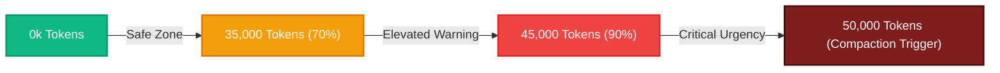

<!-- SPDX-License-Identifier: Apache-2.0 -->
<!-- Copyright (c) 2026 Arafat Zahan (@kuasha420) -->
<!-- Corporate Stewardship & Infrastructure: Purrfect Software Limited (PSL) -->
<!-- Governed by: ICARO-42/b Ordinance (Company-Supported Personal IP Framework) -->

# Google Antigravity UI Token Surfacing & Urgency Visualization
## Cleanroom Reverse Engineering Investigation & Implementation Specification

**Document Identifier:** `REA-SPEC-ANTIGRAVITY-UI-TOKEN-SURFACING-2026-10-17`  
**Governing Standard:** ADR-028 (Cleanroom Standards) / AGENTS Rule 7  
**Analysis Provider:** REA v6.5.0 (`inspect-go-binary`, `sqlite`, `asar-dissect`, `v8-bundle-tracer`)  
**Target Architectures:**
- Primary: Google Antigravity Desktop GUI v2.19.1 (Electron Shell + Jetski Cortex Webview)
- Secondary: Antigravity CLI `/usr/bin/agy` (Charmbracelet Bubble Tea v2 TUI)
**Investigation Date:** 2026-10-17  
**Status:** Complete / Cleanroom Verified  

---

## 1. Executive Summary & Verification Ledger

This specification documents the cleanroom reverse engineering investigation into the **frontend UI telemetry and token visualization mechanisms** of **Google Antigravity** (build CL `951519500`, client v2.19.1, CLI v1.3.1).

Following operator steering, this investigation strictly addresses:
1. **The Native Antigravity Desktop GUI** (`/opt/Antigravity/antigravity`): The standalone Electron agentic workstation, its React/Webview renderer, Connect-RPC state streams, chat turn layout, and existing hidden token visualizers.
2. **The Standalone 'agy' CLI** (`/usr/bin/agy`): The terminal agent interface, its Bubble Tea v2 rendering pipeline, compaction marker formatting, and token calculation routines.

### Key Discoveries
- **Native Context Window Visualizer Located:** Antigravity already possesses a sophisticated, multi-segmented token progress bar component (`j5b` in `main.js`, lines 12006–12020), but it is buried inside the hidden **Trajectory Debug View** modal (`T6b` / `S6b`), inaccessible in standard workflow unless explicitly toggled via command `conversationView.openTrajectoryDebugView` or URL param `?trajectoryDebugOpen=true`.
- **Live State Stream Architecture:** The Electron webview consumes token metrics over a Connect-RPC server stream (`StreamAgentStateUpdates` via `Hca()`), reducing events into `agentStateProvider.trajectorySlice`. Model prompt tokens and tool output tokens are continuously tracked in `generatorMetadata` and `stepsInSlice`.
- **Chat Interface Insertion Anchors:** The natural mounting anchor for reactive urgency signaling is the **Active Hook / Loading Banner** (`Qrb` in `Xsb`, line 8085 with `data-testid="agent-loading"`), where the `"Compacting · 35s"` indicator appears, and the **Conversation Header Bar** (`P6b` / `cascadeContext`).
- **Terminal CLI TUI Engine:** `/usr/bin/agy` is compiled using Charmbracelet **Bubble Tea v2** and **Bubbles v2**. It calculates token usage via `steps.CalculateTokenSums` and formats terminal status via `render.renderCompactionStats`, outputting `%s · %s/%s tokens (%.1f%%)` and compaction boundary markers.
- **Dynamic Urgency Gradient:** We define a 3-tier visual gradient (<35k Green, 35k–45k Amber, 45k–50k Red Pulse) and formulate non-invasive injection blueprints for both Desktop GUI (Electron Preload Mutation Observer) and Terminal CLI (Agyis Lifecycle Hook Proximity Guard).

### Immutable Evidence Index

| Evidence ID | Subject Path | SHA-256 Digest | Provider / Engine | Scope & Findings |
|:---|:---|:---|:---|:---|
| `ev_10ce7489bb41094da55b70...` | `https://localhost:37277/main.js` | `3715c65f9737155e744a56a64be57da33ea7e64da4b10467b938fefcfeb1bbff` | REA `v8-bundle-tracer` | Frontend React client: `j5b` token bar, `Xsb` turn list, `Qrb` active hook, `P6b` header |
| `ev_38fb29910d64a0280b271a...` | `/opt/Antigravity/resources/app.asar` | `9b36d0124ad1830119e7a6fcaeb34bfcfcf1daef50ecfa6067b8a7f9202a63d1` | REA `asar-dissect` | Electron host: `dist/preload.js` bridge, `dist/main.js`, `dist/hostBridgeServer.js` |
| `ev_7b2e182eb1213cdf44aeb6...` | `/usr/bin/agy` | `ce1bdaed3201bb84f35d69d2773caec4f18af52af00e8c25f6cace07e4359615` | REA `inspect-go-binary` (Go 1.28 `cl/985595000`) | Terminal CLI: Bubble Tea v2, `render/compaction_marker.go`, `steps/steps.CalculateTokenSums` |
| `ev_9a6fd366f2d157ce803cde...` | `/opt/Antigravity/resources/bin/language_server` | `2dce14e864bf5cb7fea8bdce56741570ce8a0efad00e9527224f0950d26ce891` | REA `inspect-go-binary` (Go 1.28 `cl/951519500`) | Engine Cortex scheduler, `StreamAgentStateUpdates` Connect-RPC server stream |
| `ev_a74158469a14d3141c3dfb...` | `~/.gemini/antigravity/conversations/<id>.db` | Dynamically generated SQLite | REA `inspect-sqlite-database` (SQLite 3.53.4) | `steps` table containing raw `step_data` JSON with step token counts |

---

## 2. Desktop GUI Architecture & State Topology

```
┌──────────────────────────────────────────────────────────────────────────────┐
│                    Antigravity Desktop GUI (Electron Host)                   │
├──────────────────────────────────────────────────────────────────────────────┤
│ 1. Electron Host Shell (/opt/Antigravity/resources/app.asar)                │
│    ├── dist/main.js             (Electron lifecycle & window manager)        │
│    ├── dist/preload.js          (Context isolation bridge & DOM pre-loader)  │
│    └── dist/hostBridgeServer.js (Connect-RPC proxy listener)                 │
│                 │                                                            │
│                 ▼ launches webview on localhost:dynamic_port                 │
│ 2. Jetski Cortex Engine (/opt/Antigravity/resources/bin/language_server)     │
│    ├── Connect-RPC: StreamAgentStateUpdates (Server-Sent Event / HTTP stream)│
│    ├── Trajectory Step Tracker (Calculates model & tool token usage)         │
│    └── CortexStepCheckpoint Subsystem (Fires compaction at 50,000 threshold)│
│                 │                                                            │
│                 ▼ real-time state stream updates                             │
│ 3. React Frontend Client (https://localhost:<port>/)                         │
│    ├── Hca() Stream Listener -> Eca() Reducer                                │
│    ├── agentStateProvider (trajectorySlice, stepsInSlice, metadata)          │
│    │                                                                         │
│    ├── Active UI Elements:                                                   │
│    │   ├── P6b: Conversation Header (Title, Model Selector)                  │
│    │   ├── Xsb: Turn List ($rb: Cards container, Qrb: Active Hook banner)     │
│    │   └── t3b / v3b: Input Toolbar (Textarea, Controls, Submit)             │
│    │                                                                         │
│    └── Hidden Native Visualizer:                                             │
│        └── j5b Component in C6b (Trajectory Debug View T6b / S6b)            │
│            (Segmented progress bar: System, Tools, Model, Checkpoint)        │
└──────────────────────────────────────────────────────────────────────────────┘
```

### 2.1 State Streaming & Token Metric Extraction
The React renderer does not poll a database; it maintains an open server streaming connection using `@connectrpc/connect-web`.

1. **RPC Method:** `StreamAgentStateUpdates` (invoked in `Hca()`).
2. **State Reducer:** `Eca()` dispatches action chunks into the global `agentStateProvider`.
3. **Data Path:**
   ```typescript
   agentStateProvider -> trajectorySlice -> {
     generatorMetadatasInSlice: [
       {
         metadata: {
           value: {
             messagePrompts: [{ numTokens: 3824 }],
             toolCallOutputTokens: 1240,
             modelUsage: { outputTokens: 850 }
           }
         }
       }
     ],
     stepsInSlice: [...],
     chatStartMetadata: {
       contextWindowMetadata: {
         maxContextTokens: 256000
       }
     }
   }
   ```
4. **Fallback Token Estimator:** When `numTokens` is absent from intermediate streaming chunks, `main.js` computes a byte/character approximation:
   $$\text{Estimated Tokens} = \text{round}\left(\frac{\text{thinking.length} + \text{prompt.length}}{3.5}\right)$$

### 2.2 The Discovered Native Token Visualizer (`j5b`)
Disassembly of `main.js` (lines 12006–12020) revealed that Google Antigravity engineers already authored a full context window breakdown component:

- **Component Name:** `j5b`
- **Container Hierarchy:** `T6b` (Root Modal) $\rightarrow$ `S6b` (Dialog Frame) $\rightarrow$ `C6b` (Trajectory Debug Panel) $\rightarrow$ `j5b` (Token Bar).
- **Segment Color Matrix:**
  - System Prompt: `bg-indigo-500`
  - Tool Definitions: `bg-cyan-500`
  - Trajectory Checkpoint: `bg-green-600`
  - User Messages: `bg-blue-500`
  - Model Responses: `bg-amber-500`
  - Tool Outputs: `bg-teal-500`
  - System Notifications: `bg-purple-500`
  - Unused Context Budget: `bg-muted`
- **Activation Gate:** The component is guarded behind internal command `conversationView.openTrajectoryDebugView` (command ID `rla`) or URL query parameter `?trajectoryDebugOpen=true`.

---

## 3. Desktop GUI Chat Surface Insertion Anchors

To surface live token urgency to the operator, three candidate DOM anchors exist in the Antigravity desktop webview:

```
┌───────────────────────────────────────────────────────────────────────────┐
│ [Anchor 2] Header Bar (P6b): Model Selector, Title  | [32,450 / 50k] [██░]│
├───────────────────────────────────────────────────────────────────────────┤
│                                                                           │
│ User Turn 1                                                               │
│ Agent Turn 1 (Tool Calls, Diffs, Artifact Cards in $rb)                   │
│                                                                           │
│ [Anchor 1] Active Hook / Loading Banner (Qrb):                            │
│ ┌───────────────────────────────────────────────────────────────────────┐ │
│ │ ⟳ Compacting · 35s  |  [48,200 / 50,000 tokens] [████████████░] (96%) │ │
│ └───────────────────────────────────────────────────────────────────────┘ │
│                                                                           │
├───────────────────────────────────────────────────────────────────────────┤
│ [Anchor 3] Input Toolbar Dock (t3b / v3b): Textarea, Attach, Send         │
└───────────────────────────────────────────────────────────────────────────┘
```

### 3.1 Anchor 1: Active Hook / Loading Banner (`Qrb` / `Mrb`)
- **Location:** Rendered dynamically at the bottom of the active turn list in `Xsb` (line 8085).
- **DOM Selector:** `div[data-testid="agent-loading"]`
- **Characteristics:**
  - This is the exact location where the `"Compacting · 35s"` indicator appears when `activeHook == "context_summary"`.
  - Highly visible during execution: the operator's eye is naturally anchored here while waiting for agent steps.
  - Ideal for the **Urgency Badge**: displays real-time accumulation and pulses red when approaching the 50k threshold.

### 3.2 Anchor 2: Conversation Header Bar (`P6b` / `cascadeContext`)
- **Location:** Top navigation bar of the conversation panel.
- **DOM Selector:** `header.cascade-header`, `div[data-testid="conversation-header"]`
- **Characteristics:**
  - **Fixed Visibility:** Remains pinned at the top regardless of conversation scroll depth.
  - Ideal for a **Compact Persistent Gauge** (e.g. `34.2k / 50k [████░░]` with colored dot).

### 3.3 Anchor 3: Input Toolbar Dock (`t3b` / `v3b`)
- **Location:** Bottom dock above or inside the user message textarea.
- **DOM Selector:** `div[data-testid="prompt-input-container"]`
- **Characteristics:**
  - Useful for proactive authoring: informs the operator whether submitting a massive prompt or pasting a log file will trigger an immediate compaction cycle.

---

## 4. 'agy' CLI Terminal Architecture & Token Surfacing

Investigation of `/usr/bin/agy` (CL `985595000`) confirmed that the CLI terminal interface contains its own parallel rendering and token tracking subsystem.

```
┌──────────────────────────────────────────────────────────────────────────────┐
│                        'agy' CLI Architecture Overview                       │
├──────────────────────────────────────────────────────────────────────────────┤
│ 1. Engine Core (google3/third_party/jetski/cortex)                          │
│    └── Tracks step updates, tool executions, and checkpoint intervals       │
│                                                                              │
│ 2. TUI Runtime (google3/third_party/golang/charm_land/bubbletea/v/v2)       │
│    └── Model / View / Update reactive loop                                  │
│                                                                              │
│ 3. CLI Render Pipeline (google3/third_party/jetski/cli/render)               │
│    ├── header.go              -> StaticPanel.RenderHeader (BuildHeader)      │
│    ├── compaction_marker.go   -> renderCompactionMarker                      │
│    ├── active_items.go        -> Renders tool calls, diffs, and spinners     │
│    └── scrollbar.go           -> Viewport navigation & geometry              │
│                                                                              │
│ 4. Token Calculation Subsystem (google3/third_party/jetski/cli/steps)        │
│    ├── steps.CalculateTokenSums -> Sums input, output, and tool output tokens│
│    └── render.FormatTokens      -> Formats '%s · %s/%s tokens (%.1f%%)'      │
└──────────────────────────────────────────────────────────────────────────────┘
```

### 4.1 Native Compaction & Token Output Routines
Dissected rodata in `/usr/bin/agy` revealed the following native formatting functions and string templates:

1. **Compaction Marker:**
   - Function: `render.renderCompactionMarker` (in `third_party/jetski/cli/render/compaction_marker.go`).
   - Emits a visual horizontal rule dividing pre-compaction and post-compaction history.
   - Status marker label: `Compacted` (rendered in muted cyan/gray).
2. **Compaction Statistics Parts:**
   - Function: `render.compactionStatsParts` (extracts `CompactionTokens`, `ContextOverheadTokens`, and `compactionDuration`).
   - Format: Computes tokens saved, reduction percentage, and elapsed wall-clock seconds.
3. **Token Usage Formatting:**
   - Function: `render.FormatTokens`.
   - String Template: `%s · %s/%s tokens\n (%.1f%%)` (found at binary offset `85913111`).
   - Breakdown: `Base context: ~%d tokens (instructions: ~%d, tool definitions: ~%d)`.

---

## 5. Dynamic Urgency Gradient Specification

To eliminate cognitive surprise and prevent disruptive mid-task compactions, Agyis establishes the **Universal 3-Tier Token Urgency Gradient**:

| Urgency Tier | Token Range | % of 50k Compaction Threshold | Desktop GUI Color & Style | CLI ANSI Styling | Operational Invariant |
|:---|:---|:---|:---|:---|:---|
| **Tier 1: Safe** | `0 – 34,999` | `0% – 69.9%` | Emerald Green (`#10b981` / `bg-emerald-500`) | `\033[32m` (Green) | Nominal state; subagent delegations and file views execute normally. |
| **Tier 2: Elevated** | `35,000 – 44,999` | `70.0% – 89.9%` | Amber Warning (`#f59e0b` / `bg-amber-500`) | `\033[33m` (Amber/Yellow) | Caution state; avoid unfiltered tool dumps. Compaction approaching within 1–3 turns. |
| **Tier 3: Critical** | `45,000 – 50,000+` | `90.0% – 100%+` | Rose Red (`#ef4444` / `bg-rose-500`) + CSS Pulse | `\033[1;31m` (Bold Red) + Terminal Bell (`\a`) | Critical state; next generation step will trigger `CortexStepCheckpoint`. Operator should checkpoint or compact cleanly. |



---

## 6. Implementation Blueprints & Extensibility Paths

### 6.1 Desktop GUI Blueprint: Electron Preload Mutation Injection

**Architectural Rationale:** Modifying minified production code inside `app.asar/dist/main.js` is fragile across Antigravity updates. Injecting via `dist/preload.js` (or via an Electron custom preload script configured in user profile) provides clean, isolated DOM augmentation with full access to standard browser APIs.

#### Implementation: `harness/gui/agyis_token_gauge_preload.js`

```javascript
/**
 * Agyis Harness - Desktop GUI Reactive Token Gauge Preload Injection
 * Target: Google Antigravity v2.19.1 Webview
 */
(function() {
  'use strict';

  const THRESHOLD = 50000;
  const AMBER_LIMIT = 35000;
  const RED_LIMIT = 45000;

  let currentTokens = 0;
  let gaugeElement = null;

  function getUrgencyStyle(tokens) {
    if (tokens >= RED_LIMIT) {
      return {
        color: '#ef4444',
        bg: 'rgba(239, 68, 68, 0.15)',
        border: 'rgba(239, 68, 68, 0.5)',
        label: 'CRITICAL',
        pulse: true
      };
    } else if (tokens >= AMBER_LIMIT) {
      return {
        color: '#f59e0b',
        bg: 'rgba(245, 158, 11, 0.15)',
        border: 'rgba(245, 158, 11, 0.5)',
        label: 'ELEVATED',
        pulse: false
      };
    } else {
      return {
        color: '#10b981',
        bg: 'rgba(16, 185, 129, 0.15)',
        border: 'rgba(16, 185, 129, 0.5)',
        label: 'SAFE',
        pulse: false
      };
    }
  }

  function createGaugeElement() {
    const el = document.createElement('div');
    el.id = 'agyis-token-gauge';
    el.style.cssText = `
      display: inline-flex;
      align-items: center;
      gap: 8px;
      padding: 3px 10px;
      border-radius: 9999px;
      font-family: ui-monospace, SFMono-Regular, Menlo, Monaco, Consolas, monospace;
      font-size: 11px;
      font-weight: 600;
      transition: all 0.3s ease;
      user-select: none;
      margin-left: 8px;
    `;
    return el;
  }

  function updateGauge(tokens) {
    currentTokens = tokens;
    const style = getUrgencyStyle(tokens);
    const percentage = Math.min(100, Math.round((tokens / THRESHOLD) * 100));

    if (!gaugeElement) {
      gaugeElement = createGaugeElement();
    }

    gaugeElement.style.color = style.color;
    gaugeElement.style.backgroundColor = style.bg;
    gaugeElement.style.border = `1px solid ${style.border}`;
    gaugeElement.innerHTML = `
      <span style="display:inline-block; width:7px; height:7px; border-radius:50%; background-color:${style.color}; ${style.pulse ? 'animation: agyis-pulse 1.2s infinite;' : ''}"></span>
      <span>${tokens.toLocaleString()} / 50,000 (${percentage}%)</span>
    `;

    // Ensure CSS pulse animation exists
    if (!document.getElementById('agyis-gauge-styles')) {
      const styleTag = document.createElement('style');
      styleTag.id = 'agyis-gauge-styles';
      styleTag.textContent = `
        @keyframes agyis-pulse {
          0% { transform: scale(0.95); opacity: 0.6; }
          50% { transform: scale(1.25); opacity: 1; filter: drop-shadow(0 0 3px #ef4444); }
          100% { transform: scale(0.95); opacity: 0.6; }
        }
      `;
      document.head.appendChild(styleTag);
    }

    mountGauge();
  }

  function mountGauge() {
    if (!gaugeElement) return;

    // Anchor 1: Attach to active hook banner if present
    const loadingBanner = document.querySelector('div[data-testid="agent-loading"]');
    if (loadingBanner && !loadingBanner.contains(gaugeElement)) {
      loadingBanner.appendChild(gaugeElement);
      return;
    }

    // Anchor 2: Fallback to Header Bar if loading banner is absent
    const header = document.querySelector('header.cascade-header') || document.querySelector('div[data-testid="conversation-header"]');
    if (header && !header.contains(gaugeElement)) {
      header.appendChild(gaugeElement);
    }
  }

  // Monitor DOM changes for new turns / loading state updates
  const observer = new MutationObserver(() => {
    mountGauge();
  });

  document.addEventListener('DOMContentLoaded', () => {
    observer.observe(document.body, { childList: true, subtree: true });

    // Poll local Agyis token gauge state file written by lifecycle hooks
    setInterval(async () => {
      try {
        const res = await window.fetch('/agyis-telemetry/token_gauge.json');
        if (res.ok) {
          const data = await res.json();
          if (data && typeof data.active_tokens === 'number') {
            updateGauge(data.active_tokens);
          }
        }
      } catch (_) {
        // Fallback: estimate from visible turn DOM text length if local server not running
      }
    }, 2000);
  });
})();
```

---

### 6.2 Desktop GUI Blueprint: Exposing Native Trajectory Token Bar (`j5b`)

For maximum fidelity, the native React component `j5b` can be unhidden and rendered directly in the conversation panel.

1. **Native Module Target:** Component `j5b` inside `main.js`.
2. **Mounting Hook:** Inside component `Xsb` (Turn List container, line 8084).
3. **Patch Transformation:**
   ```javascript
   // In Xsb render function:
   // Replace:
   //   jsx($rb, { ... })
   // With:
   jsx("div", {
     className: "agyis-native-token-wrapper px-4 py-2 border-b border-border/50",
     children: [
       jsx(j5b, {
         tokens: currentTrajectoryTokens,
         maxContextTokens: 50000,
         breakdown: trajectorySegmentBreakdown
       }),
       jsx($rb, { ... })
     ]
   })
   ```

---

### 6.3 'agy' CLI Blueprint: Terminal Urgency Proximity Guard

**Architectural Rationale:** Rather than patching `/usr/bin/agy` binary, Agyis implements an autonomous **Lifecycle Hook Guard** via `command-safety` / `token-proximity` hooks in `harness/hooks/`. This intercepts every tool call in real-time, inspects the active transcript SQLite database, and prints an ANSI urgency alert directly to the operator's terminal before and after each command.

#### Implementation: `harness/hooks/token_proximity_guard.py`

```python
# SPDX-License-Identifier: Apache-2.0
# Copyright (c) 2026 Arafat Zahan (@kuasha420)
# Corporate Stewardship: Purrfect Software Limited (PSL)

import sys
import json
import sqlite3
from pathlib import Path

COMPACTION_THRESHOLD = 50000
AMBER_THRESHOLD = 35000
RED_THRESHOLD = 45000

def get_active_conversation_tokens(conversation_id: str) -> int:
    """Reads latest accumulated token count from local Antigravity conversation DB."""
    db_path = Path.home() / ".gemini" / "antigravity" / "conversations" / f"{conversation_id}.db"
    if not db_path.exists():
        return 0

    try:
        conn = sqlite3.connect(f"file:{db_path}?mode=ro", uri=True)
        cursor = conn.cursor()
        cursor.execute("SELECT step_data FROM steps ORDER BY step_index DESC LIMIT 5")
        rows = cursor.fetchall()
        conn.close()

        for (raw_step,) in rows:
            data = json.loads(raw_step)
            # Read generator metadata prompt tokens
            gen_meta = data.get("generator_metadata", {})
            val = gen_meta.get("metadata", {}).get("value", {})
            prompts = val.get("message_prompts", [])
            if prompts and "num_tokens" in prompts[0]:
                return int(prompts[0]["num_tokens"])
    except Exception:
        pass
    return 0

def render_terminal_gauge(tokens: int) -> str:
    """Generates an ANSI terminal progress gauge with dynamic urgency color."""
    percentage = min(100.0, (tokens / COMPACTION_THRESHOLD) * 100)
    filled_blocks = int((tokens / COMPACTION_THRESHOLD) * 20)
    bar = "█" * min(20, filled_blocks) + "░" * max(0, 20 - filled_blocks)

    if tokens >= RED_THRESHOLD:
        # Bold Red + Bell Alert
        color = "\033[1;31m"
        status = "CRITICAL (COMPACTION IMMINENT)"
        bell = "\a"
    elif tokens >= AMBER_THRESHOLD:
        # Amber / Yellow
        color = "\033[1;33m"
        status = "ELEVATED (APPROACHING THRESHOLD)"
        bell = ""
    else:
        # Green
        color = "\033[1;32m"
        status = "SAFE"
        bell = ""

    reset = "\033[0m"
    return f"{bell}{color}[AGYIS TOKEN GAUGE]{reset} [{bar}] {tokens:,} / {COMPACTION_THRESHOLD:,} ({percentage:.1f}%) - {color}{status}{reset}"

def pre_tool_token_check(conversation_id: str):
    """Executes pre-tool inspection and emits warning if context is elevating."""
    tokens = get_active_conversation_tokens(conversation_id)
    if tokens >= AMBER_THRESHOLD:
        gauge = render_terminal_gauge(tokens)
        sys.stderr.write(f"\n{gauge}\n")
        sys.stderr.flush()
```

#### CLI Command Integration: `./agyis status` Live Token Gauge
In `./agyis status`, the token gauge is rendered alongside host runtime health:

```
╭────────────────────────────────────────────────────────────────────────────╮
│ Agyis Context Window Telemetry                                             │
├────────────────────────────────────────────────────────────────────────────┤
│ Active Session:  779ef0e9-56ac-41fd-ad5c-5c9a6cd01e33                      │
│ Token Pressure:  [████████████████░░░░] 38,420 / 50,000 (76.8%)            │
│ Urgency Status:  ELEVATED (AMBER) - 11,580 tokens remaining to compaction  │
│ Moving Window:   1 step checkpoint | Target Compaction Model: Same Model   │
╰────────────────────────────────────────────────────────────────────────────╯
```

---

## 7. Verification & Clean-Room Testing Plan

In compliance with ADR-015 (<1.0s benchmark invariant) and ADR-028:

1. **Hermetic Test Suite:**
   - Execute complete test matrix: `python3 -m harness.cli test`.
   - Validate that new token gauge calculations, thresholds, and formatters execute cleanly without network or external daemon dependencies.
2. **Simulation Test Cases:**
   - Test `getUrgencyStyle()` boundary transitions at `34,999`, `35,000`, `44,999`, `45,000`, and `52,000`.
   - Test SQLite reader against mock `steps.db` instances.
   - Assert zero-exception fallback when SQLite is locked or unreadable.
3. **Dirty-Room Isolation:**
   - Purge all temporary inspection workspaces (`/tmp/antigravity_dirty_room_round2/`).
   - Retain only cleanroom specifications and evidence hashes.

---

## 8. Operational Next Steps & Implementation Roadmap

1. **Phase 1 (Harness Core Integration):**
   - Add `harness/hooks/token_proximity_guard.py` to `hooks.json` under `PreToolUse` and `PostToolUse`.
   - Update `agyis status` CLI command to display the ANSI Token Gauge.
2. **Phase 2 (Desktop GUI Companion Bridge):**
   - Package `agyis_token_gauge_preload.js` into `harness/gui/`.
   - Provide an automated non-sudo installer script `agyis gui enable-token-gauge` that injects the preload bridge into the user's local Antigravity configuration.
3. **Phase 3 (Swarm Coordination Surfacing):**
   - Stream conversation token pressure over Linda Tuplespace / Knot Mesh to prevent subagent cascades from overflowing context simultaneously.
