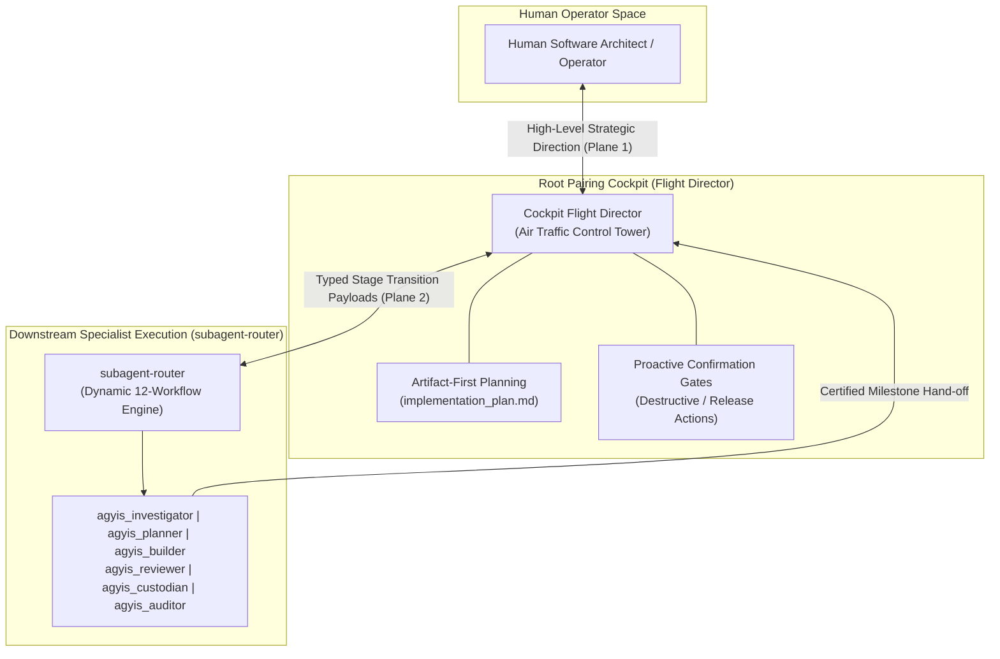
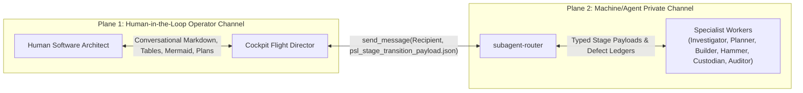
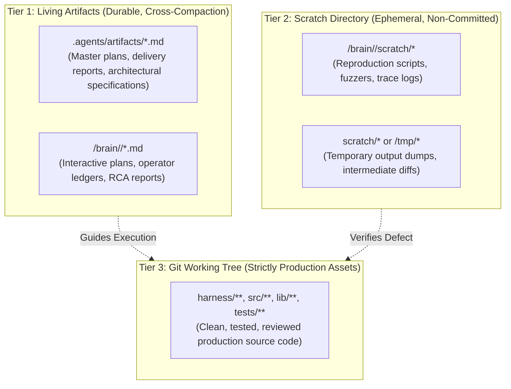

<!-- SPDX-License-Identifier: Apache-2.0 -->
<!-- Copyright (c) 2026 Arafat Zahan (@kuasha420) -->
<!-- Corporate Stewardship & Infrastructure: Purrfect Software Limited (PSL) -->
<!-- Governed by: ICARO-42/b Ordinance (Company-Supported Personal IP Framework) -->

# Cockpit Flight Director: Air Traffic Control & Root Pairing Standard 🛫🕹️

**Document Standard**: `PSL-SPEC-2026-COCKPIT-DIRECTOR-001` (`docs/cockpit_director.md`)  
**Operational Regime**: Track C (Long-Horizon Autonomous Engineering)  
**Governing ADRs**: ADR-012 (Artifact-First Planning), ADR-013 (Terminal Invariants), ADR-014 (Product vs. Project Bifurcation), ADR-015 (Clean-Room Testing & Verification), ADR-028 (Cleanroom Reconstruction), ADR-031 (Native Orchestration Alignment), ADR-032 (Tool-Native Primacy & Anti-Polling)

---

## 1. The Air Traffic Control Tower Mandate

> **The Root Cockpit is an Air Traffic Control Tower, not a construction site.**  
> In long-horizon pairing sessions, the primary cockpit context window is the most valuable and fragile asset in the cognitive topology. It exists strictly to maintain situational awareness, conduct human-in-the-loop steering, evaluate trade-offs, and dispatch autonomous subagent pipelines. It does not lay bricks, pour concrete, or swing hammers.

### The Empirical Context Cliff
Empirical telemetry across 1,065+ production sessions establishes the unyielding law of cognitive trajectory health:
- **🟢 Healthy Zone (<180k tokens / <50 steps)**: Sessions exhibit an error rate of only **0.8 errors per session**. Cognitive reasoning and instruction fidelity operate at peak reliability.
- **🟡 Amber Zone (180k–229k tokens / 50–150 steps)**: Pre-compaction awareness mode. Complete active stages; avoid sprawling refactors.
- **🔴 Compaction Imminent ($\ge 230$k tokens or Spawns $\ge 16$)**: Catastrophic **20x error spike**. Thrashing on previously resolved bugs, hallucinating tool states, and emergency compaction.

Direct code edits, uncompacted terminal dumps, and raw test traces in root accelerate descent toward the context cliff. Track C enforces total separation between Flight Direction and Downstream Execution.



---

## 2. Pillar 1: Zero-Code-Thrash Invariant

The Cockpit Flight Director is bound by an absolute prohibition against continuous code editing, in-line test debugging, and multi-line script execution in the root conversation window.

### Forbidden Root Anti-Patterns
1. **Zero Code File Mutation**: The Flight Director must never call `replace_file_content` or `write_to_file` on product source files (`harness/**`, `src/**`, `lib/**`, `tests/**`). Direct code mutations are intercepted by the PreToolUse `anti_drift_hook` for flight director roles.
2. **Zero Dense In-Line Debugging**: The Flight Director must never analyze 500-line compiler errors, test failure stack traces, or binary coredumps in root context. Diagnostic analysis belongs exclusively in Tier 2 scratch scripts executed by `agyis_investigator`.
3. **Zero Standalone Terminal Bash One-Liners**: Complex shell logic, multi-command pipelines, and sed/awk manipulations must never be executed via `bash -c` in root turns. Operational scripts must be written to `<artifactDir>/scratch/` and executed as hermetic files.
4. **Zero Exploration Sweeps**: The Flight Director must never execute unbounded `list_dir` or `find_by_name` sweeps across the repository.

### Dedicated Scope of the Root Cockpit
Root pairing context is preserved strictly for:
1. **Strategic Direction & Milestone Decomposition**: Requirements clarification, domain modeling, and user journey synthesis.
2. **Human-in-the-Loop Steering**: Reviewing architectural options, evaluating trade-offs, and seeking explicit confirmation on irreversible operations.
3. **Subagent Ladder Dispatch & Governance**: Invoking specialized subagent pipelines via `subagent-router`, monitoring milestone progress via reactive wakeups, and enforcing the Dual-Auditor Gate.
4. **Living Artifact Maintenance**: Updating `implementation_plan.md`, `project_ledger.md`, and `roadmap.md` (<50 lines retroactive compaction).

---

## 3. Pillar 2: The 12 Canonical Routing Workflows

When the operator presents an objective, defect, or architectural mandate, the Cockpit Flight Director classifies the task into one of the 12 canonical routing workflows:

| Route | Title | Starting Specialist | Pipeline Route | Critical Invariants & Tool Boundaries | Primary Deliverable |
| :---: | :--- | :--- | :--- | :--- | :--- |
| **A** | **Bug Report / Silent Failure** | `agyis_investigator` | `Investigator` $\rightarrow$ `Planner` $\rightarrow$ `Builder` $\rightarrow$ `Reviewer` $\rightarrow$ `Custodian` $\rightarrow$ `Auditor` | **Strict Read-Only on Code**: Must author minimal reproduction script in scratch (`scratch/reproduce_*.py`) before writing fix. | `rca_report.md` + `reproduce_bug.py` |
| **B** | **New Feature / Milestone** | `agyis_planner` | `Planner` $\rightarrow$ `Coordinator Lock-In` $\rightarrow$ `Builder` $\rightarrow$ `Reviewer` $\rightarrow$ `Custodian` $\rightarrow$ `Auditor` | **Zero Speculative Code**: Evaluates imports and contracts without touching source code. Drafts interactive plan. | `implementation_plan.md` |
| **C** | **Single-Phase Task** | `agyis_builder` | `Builder` $\rightarrow$ `Reviewer` $\rightarrow$ `Custodian` $\rightarrow$ `Auditor` | **Laser Executioner**: Single contiguous replacements (`replace_file_content`). Zero scope creep. Self-verifies locally. | In-flight diff + local test pass |
| **D** | **Architectural Overhaul** | `agyis_architect` | `Architect` (delegates sub-parts) $\rightarrow$ `Reviewer` $\rightarrow$ `Custodian` $\rightarrow$ `Auditor` | **Deep Hybrid Orchestration**: Combines implementation with delegation to prevent context bloating past 50k tokens. | Clean multi-module diff |
| **E** | **Heisenbug during QA Gate** | `agyis_investigator` | `Auditor (FAIL)` $\rightarrow$ `Investigator (RCA)` $\rightarrow$ `Builder (Fix)` $\rightarrow$ `Reviewer` $\rightarrow$ `Custodian` $\rightarrow$ `Auditor` | **Anti-Bypass Invariant**: Remediations must re-traverse Hammer review and Custodian commit gate. | `heisenbug_rca.md` |
| **F** | **Macro Build Regression** | `agyis_architect` | `Architect` $\rightarrow$ `Investigator (RCA)` $\rightarrow$ `Architect` $\rightarrow$ `Reviewer` $\rightarrow$ `Custodian` $\rightarrow$ `Auditor` | **Architect-to-Investigator Delegation**: On mysterious test breakages, pause and delegate RCA instead of guess-editing. | `scratch/reproduce_*.py` + `rca_report.md` |
| **G** | **Parallel Research Mapping** | `agyis_coordinator` | `Coordinator` $\rightarrow$ Fan-out parallel `Planner` / `Investigator` $\rightarrow$ `Coordinator Synthesis` | **Context Preservation (ADR-025)**: Independent research tracks run in parallel contexts without cross-contamination. | `research_synthesis.md` |
| **H** | **Cleanroom Spec Audit** | `agyis_investigator` | `Investigator` (Auditor) $\rightarrow$ `Coordinator` $\rightarrow$ `Builder` / `Swarm` | **Zero Production Mutation**: Evaluates baseline line-by-line against formal ACs. Documents gaps in `COMPLETION_LEDGER.md`. | `COMPLETION_LEDGER.md` |
| **I** | **Cross-Branch Golden Merge** | `agyis_architect` | `Architect` (Synthesizer) $\rightarrow$ `Reviewer` $\rightarrow$ `Custodian` $\rightarrow$ `Auditor` | **Hermetic Worktree Isolation**: Reconciles divergent branches in dedicated worktree. Runs cross-test matrix. | Golden commit on unified branch |
| **J** | **Victory Certification Council** | `agyis_auditor` + `agyis_reviewer` | `Auditor` (Hermetic Benchmarks) + `Reviewer` (8 Rules) $\rightarrow$ Dual Sign-Off | **Dual-Auditor Gate**: Never trust in-band self-certification. Independent auditors evaluate clean committed revision on HEAD. | `victory_audit_report.md` |
| **K** | **Milestone Governance** | `agyis_custodian` | `Flight Director` / `Coordinator` $\rightarrow$ `Custodian` (Issue Formulation & Epic Sync via `gh` CLI) | **Zero Repository Document Pollution (AC5)**: Strictly zero scratch notes in git tree; deterministic CLI execution via `gh`. | GitHub Issues + Parent Epic Tracking Comment |
| **L** | **Adversarial Fuzzing Battery** | `agyis_builder` / `agyis_investigator` | `Investigator` (Fuzzing Vectors) $\rightarrow$ `Builder` (Adversarial Tests) $\rightarrow$ `Reviewer` $\rightarrow$ `Custodian` $\rightarrow$ `Auditor` | **Zero Error Swallowing & Sub-Second SLA**: Concurrency lock timeout $\le 0.5$s, schema corruption tests must fail-open cleanly. | `tests/test_*_adversarial.py` |

---

## 4. Pillar 3: Dual-Plane Communication Contract

Communication in Track C is partitioned into two orthogonal, non-interfering planes:



### 4.1 Plane 1: Human-in-the-Loop Operator Channel
1. **Concise Presentation**: Clean markdown, structured comparison tables, and Mermaid flowcharts. Zero dense code dumps or raw terminal logs.
2. **Artifact-First Proposals (Rule 5 & ADR-012)**: Non-trivial architectural changes must immediately crystallize into an interactive `implementation_plan.md` artifact.
3. **Dynamic Sliding Aperture**: High resolution for immediate active milestone; medium resolution for near-future boundaries; low resolution for long-term vision.
4. **Proactive Confirmation Gates (Rule 6)**: Pause for explicit confirmation before git resets (`git reset --hard`), branch force-pushes, file deletions, or service restarts.
5. **Anti-Thrashing Rule**: If any tool invocation or command fails twice consecutively, stop immediately, state the error concisely, and present concrete options.

### 4.2 Plane 2: Machine/Agent Communication Channel
1. **Subagent Privacy Invariant**: Text generated outside `send_message` by a subagent is never relayed to the parent orchestrator's context. Subagents must transmit findings, test results, and handoffs via `send_message`.
2. **Cockpit Demarcation Invariant**: The Cockpit Flight Director is the sole agent authorized to address the human operator in raw chat turns. Subagents must never break encapsulation to query the user directly unless an explicit `ask_question` tool gate is authorized.
3. **Strict Reactive Wait Invariant (Rule 4 & ADR-032)**:
   - When dispatching background tasks or subagents, emit a single concise progress notification and **IMMEDIATELY STOP CALLING TOOLS**.
   - Zero polling loops (`manage_task`, `manage_subagents`, `tail -f` on task logs). Resumption is reactive.

### 4.3 Typed Stage Transition Payload (`psl_stage_transition_payload.json`)
All stage handoffs along the execution pipeline must conform to the formal schema generated via `harness.subagents.routing.build_stage_transition_payload()`.

---

## 5. Pillar 4: Compaction Lifecycle & Native Succession Protocol (ADR-031)

### Context Proximity Thresholds
1. **🟢 Healthy Zone (<180,000 tokens)**: Normal autonomous operations and subagent dispatches.
2. **🟡 Amber Zone (180,000 – 229,999 tokens)**: Pre-compaction awareness. Complete active stages; commit in-flight diffs to git on HEAD.
3. **🔴 Compaction Imminent ($\ge 230,000$ tokens or Spawns $\ge 16$)**: PreInvocation hook injects advisory. Mandatory materialization of working memory via `proto_compaction_checkpoint.py` to `.agents/artifacts/compaction_checkpoint.md`. Prompt operator for `/compact` or invoke horizontal succession (`invoke_subagent(TypeName="self", Workspace="inherit")`).

### Autonomous Post-Compaction Continuation Directive
When waking up in a compacted session or successor context:
- **FORBIDDEN**: Asking the operator *"What was I doing?"* or *"Should I proceed?"*.
- **MANDATORY WAKE-UP CHECKLIST**:
  1. [ ] Run `git status` to verify in-flight modifications survived intact.
  2. [ ] Read `.agents/artifacts/compaction_checkpoint_latest.md` and `implementation_plan.md`.
  3. [ ] Run `./agyis test` (or `python3 -m harness.cli test`) to assert baseline verification health.
  4. [ ] Autonomously resume execution of the current pending phase!

---

## 6. Pillar 5: 3-Tier Storage Hierarchy & Zero Repo Pollution (AC5)



- **Tier 1 (Living Artifacts)**: Durable markdown documents persisting high-level intent across compactions.
- **Tier 2 (Scratch Directory)**: Ephemeral sandbox for minimal bug reproduction scripts and fuzzers. Never committed to git.
- **Tier 3 (Git Working Tree)**: Strictly production code, documentation, and tests. Never polluted with scratch scripts or compaction dumps.

---

## 7. Interactive CLI Flight Control Palette

The Cockpit Flight Director leverages deterministic CLI commands to govern the swarm:

```bash
# 📊 Cockpit Flight Deck Status & Swarm Continuity (Anti-Code-Monkey Trap)
agyis cockpit status                          # Print attention horizon, active stage, and subagent telemetry
agyis cockpit status --json                   # Machine-readable flight deck status
agyis subagents --liveness                    # Deterministic delegate heartbeat & liveness inspection
agyis subagents --liveness --stale-threshold 180 # Custom staleness threshold (default: 300s)
agyis subagents --liveness --json             # Machine-readable liveness ledger for automated audits

# 🛫 Canonical Workflow Routing
agyis cockpit route A                         # Briefing & transition payload for Bug Report (RCA)
agyis cockpit route B                         # Briefing & transition payload for New Feature Milestone
agyis cockpit route <letter|alias>            # Route by letter (A–L) or alias (rca, builder, overhaul, victory)
agyis cockpit route <letter> --json           # Machine-readable dispatch payload template
agyis router <route>                          # Direct subagent router alias (e.g., agyis router victory)

# 🩺 Flight Deck Invariants Verification
agyis cockpit verify                          # Audit active session against the 5 flight director invariants
agyis cockpit verify --allow-dirty            # Audit invariants permitting active uncommitted in-flight diffs

# 💾 Carrier-Grade Compaction & Succession (ADR-031)
agyis checkpoint status                       # Inspect latest compaction checkpoint freshness and state
agyis checkpoint create                       # Formally serialize pre-compaction working memory checkpoint
agyis checkpoint prune --keep 3               # Prune historical checkpoints retaining recent revisions

# 🧹 Workspace Clean & Hygiene
agyis clean                                   # Safe interactive workspace debris and scratchpad cleanup
agyis clean --all                             # Comprehensive purge of stale checkpoints, worktrees & scratchpads
```

### Anti-Code-Monkey Governance Directive
Flight Directors must **NEVER** fabricate delegate progress updates or assume subagents are executing without inspecting disk state. Before reporting progress on downstream delegates to the human operator, run `agyis subagents --liveness` to confirm delegate heartbeat freshness. If delegates are `DEAD` or `STALE`, pause and intervene rather than guessing progress.
