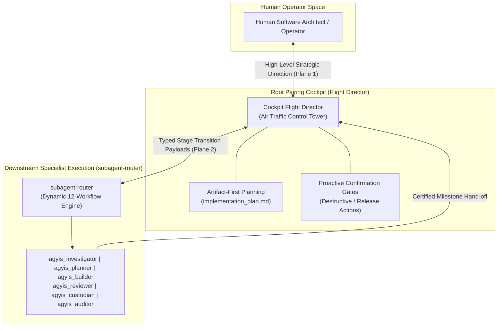
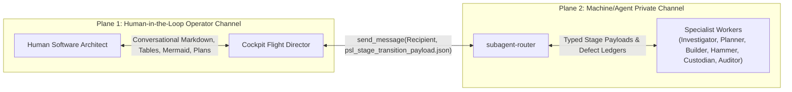
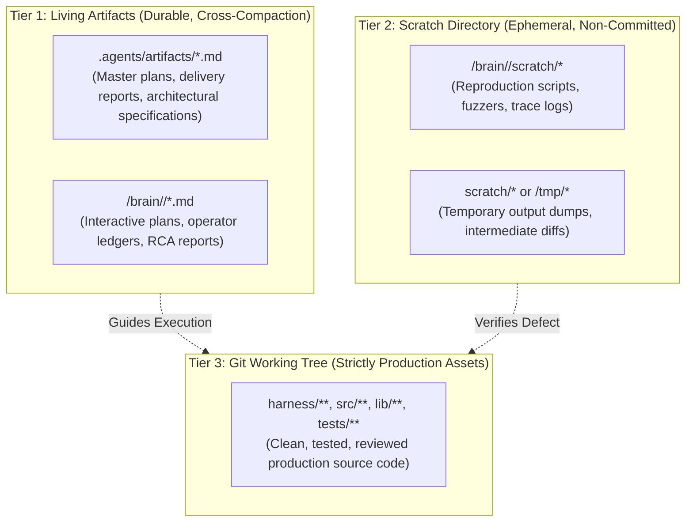

<!-- SPDX-License-Identifier: Apache-2.0 -->
<!-- Copyright (c) 2026 Arafat Zahan (@kuasha420) -->
<!-- Corporate Stewardship & Infrastructure: Purrfect Software Limited (PSL) -->
<!-- Governed by: ICARO-42/b Ordinance (Company-Supported Personal IP Framework) -->

# Cockpit Flight Director: Architecture Diagrams & Detailed 12-Workflow Reference

Supplementary diagrams and workflow matrix for [SKILL.md](../SKILL.md).

## 1. Flight Deck & Downstream Execution Topology

## 2. Dual-Plane Communication Topology

## 3. 3-Tier Storage Hierarchy Diagram

## 4. Detailed 12-Workflow Invariants & Tool Boundaries

| Route | Title | Starting Specialist | Pipeline Route | Critical Invariants & Tool Boundaries | Primary Deliverable |
| :---: | :--- | :--- | :--- | :--- | :--- |
| **A** | **Bug Report / Silent Failure** | `agyis_investigator` | `Investigator` -> `Planner` -> `Builder` -> `Reviewer` -> `Custodian` -> `Auditor` | **Strict Read-Only on Code**: Must author minimal reproduction script in scratch (`scratch/reproduce_*.py`) before writing fix. | `rca_report.md` + `reproduce_bug.py` |
| **B** | **New Feature / Milestone** | `agyis_planner` | `Planner` -> `Coordinator Lock-In` -> `Builder` -> `Reviewer` -> `Custodian` -> `Auditor` | **Zero Speculative Code**: Evaluates imports and contracts without touching source code. Drafts interactive plan. | `implementation_plan.md` |
| **C** | **Single-Phase Task** | `agyis_builder` | `Builder` -> `Reviewer` -> `Custodian` -> `Auditor` | **Laser Executioner**: Single contiguous replacements (`replace_file_content`). Zero scope creep. Self-verifies locally. | In-flight diff + local test pass |
| **D** | **Architectural Overhaul** | `agyis_architect` | `Architect` (delegates sub-parts) -> `Reviewer` -> `Custodian` -> `Auditor` | **Deep Hybrid Orchestration**: Combines implementation with delegation to prevent context bloating above the 180k/230k compaction runway. | Clean multi-module diff |
| **E** | **Heisenbug during QA Gate** | `agyis_investigator` | `Auditor (FAIL)` -> `Investigator (RCA)` -> `Builder (Fix)` -> `Reviewer` -> `Custodian` -> `Auditor` | **Anti-Bypass Invariant**: Remediations must re-traverse Hammer review and Custodian commit gate. | `heisenbug_rca.md` |
| **F** | **Macro Build Regression** | `agyis_architect` | `Architect` -> `Investigator (RCA)` -> `Architect` -> `Reviewer` -> `Custodian` -> `Auditor` | **Architect-to-Investigator Delegation**: On mysterious test breakages, pause and delegate RCA instead of guess-editing. | `scratch/reproduce_*.py` + `rca_report.md` |
| **G** | **Parallel Research Mapping** | `agyis_coordinator` | `Coordinator` -> Fan-out parallel `Planner` / `Investigator` -> `Coordinator Synthesis` | **Context Preservation (ADR-025)**: Independent research tracks run in parallel contexts without cross-contamination. | `research_synthesis.md` |
| **H** | **Cleanroom Spec Audit** | `agyis_investigator` | `Investigator` (Auditor) -> `Coordinator` -> `Builder` / `Swarm` | **Zero Production Mutation**: Evaluates baseline line-by-line against formal ACs. Documents gaps in `COMPLETION_LEDGER.md`. | `COMPLETION_LEDGER.md` |
| **I** | **Cross-Branch Golden Merge** | `agyis_architect` | `Architect` (Synthesizer) -> `Reviewer` -> `Custodian` -> `Auditor` | **Hermetic Worktree Isolation**: Reconciles divergent branches in dedicated worktree. Runs cross-test matrix. | Golden commit on unified branch |
| **J** | **Victory Certification Council** | `agyis_auditor` + `agyis_reviewer` | `Auditor` (Hermetic Benchmarks) + `Reviewer` (11 Invariants) -> Dual Sign-Off | **Dual-Auditor Gate**: Never trust in-band self-certification. Independent auditors evaluate clean committed revision on HEAD. | `victory_audit_report.md` |
| **K** | **Milestone Governance** | `agyis_custodian` | `Flight Director` / `Coordinator` -> `Custodian` (Issue Formulation & Epic Sync via `gh` CLI) | **Zero Repository Document Pollution (AC5)**: Strictly zero scratch notes in git tree; deterministic CLI execution via `gh`. | GitHub Issues + Parent Epic Tracking Comment |
| **L** | **Adversarial Fuzzing Battery** | `agyis_builder` / `agyis_investigator` | `Investigator` (Fuzzing Vectors) -> `Builder` (Adversarial Tests) -> `Reviewer` -> `Custodian` -> `Auditor` | **Zero Error Swallowing & Sub-Second SLA**: Concurrency lock timeout <= 0.5s, schema corruption tests must fail-open cleanly. | `tests/test_*_adversarial.py` |
