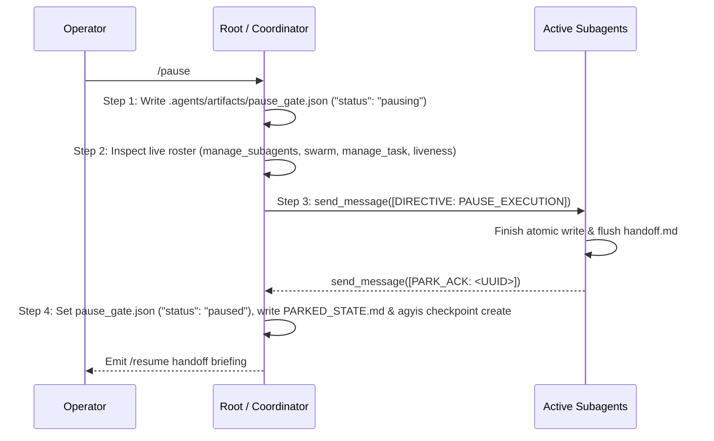

<!-- SPDX-License-Identifier: Apache-2.0 -->
<!-- Copyright (c) 2026 Arafat Zahan (@kuasha420) -->
<!-- Corporate Stewardship & Infrastructure: Purrfect Software Limited (PSL) -->
<!-- Governed by: ICARO-42/b Ordinance (Company-Supported Personal IP Framework) -->

# Graceful Execution Suspension Runbook (`/pause`)

This operational runbook governs non-destructive suspension of active sessions, multi-agent trees, and background tasks when the operator invokes `/pause`, approaches context/quota fences, or pauses work for later `/resume`.

## Table of Contents
1. [Zero-Kill Invariant and Scope](#1-zero-kill-invariant-and-scope)
2. [Pause Gate and Living Artifacts](#2-pause-gate-and-living-artifacts)
3. [4-Step Pause Execution Sequence](#3-4-step-pause-execution-sequence)
4. [Quiescence Verification and Resume Handoff](#4-quiescence-verification-and-resume-handoff)

---

## 1. Zero-Kill Invariant and Scope

### Prohibited Destructive Actions
Pausing an execution tree is a **non-destructive quiescence handshake**, never a process kill. Coordinators and root flight directors must **NEVER** invoke destructive termination or workspace wipe primitives when pausing:
- `swarm(action='kill')` (permanently destroys worker sessions and `share`/`branch` workspaces)
- `manage_task(Action='kill')` (abruptly terminates in-flight background processes)
- Shell force-kill signals (`kill -9`, `pkill -9`, `killall -9`)
- Destructive git resets (`git checkout -- .`, `git reset --hard`, `git clean -fd`)

### Zero-Phantom-Pause Guarantee
Never declare the workspace paused while leaf subagents continue mutating files or spending quota in the background. An execution tree is **NOT** paused until every active subagent has flushed its local handoff state and returned an explicit `[PARK_ACK: <UUID>]` token.

For deep background on failure modes (Panic-Kill and Phantom Pause), see the companion `graceful-parking` skill.

---

## 2. Pause Gate and Living Artifacts

`/pause` writes deterministic Tier 1 Living Artifacts recognized natively by `command_safety_hook.PAUSE_GATE_FILES` and `liveness.py`:

1. **Machine-Readable Pause Gate (`.agents/artifacts/pause_gate.json`)**:
   Evaluated in `<1ms` by lifecycle safety hooks to block destructive kill commands while suspended:
   ```json
   {
     "status": "pausing",
     "reason": "operator_pause",
     "mode": "teamwork",
     "timestamp": "2026-11-27T00:00:00Z",
     "initiator": "root_orchestrator"
   }
   ```
   Transition `"status"` from `"pausing"` -> `"paused"` only after all active worker acknowledgments are recorded.

2. **Human and Agent State Ledger (`.agents/artifacts/PARKED_STATE.md` or `.agents/teamwork/PARKED_STATE.md`)**:
   Records active branch, dirty file summary, every discovered subagent UUID, background task ID, `[PARK_ACK: <UUID>]` receipt status, checkpoint reference, and next `/resume` entry point.

---

## 3. 4-Step Pause Execution Sequence



### Step 1: Declare the Pausing Gate
1. Create `.agents/artifacts/pause_gate.json` with `"status": "pausing"`, `reason`, `mode`, UTC `timestamp`, and `initiator`.
2. Initialize `PARKED_STATE.md` (`.agents/artifacts/PARKED_STATE.md` or `.agents/teamwork/PARKED_STATE.md`) to track quiescence acknowledgments as they arrive.

### Step 2: Inspect the Full Live Roster
Before broadcasting directives, enumerate every active agent and background process so no leaf worker is missed:
1. `manage_subagents(Action='list')` — list native child subagents and their live states (`running`, `idle`, `errored`).
2. `swarm(action='status')` — inspect active teamwork/swarm workers if a swarm is active.
3. `manage_task(Action='list')` — list active background shell tasks and daemons.
4. `agyis subagents --liveness` — audit heartbeat freshness (`ACTIVE`, `STALE`, `PARKED`, `DEAD`).

Record every discovered worker ID, role, branch/worktree, and task ID in `PARKED_STATE.md`.

### Step 3: Broadcast `[DIRECTIVE: PAUSE_EXECUTION]` and Await Reactive `[PARK_ACK: <UUID>]`
1. For every active worker or child subagent, dispatch the standardized pause directive via `send_message`:
   ```markdown
   [DIRECTIVE: PAUSE_EXECUTION]
   Reason: Operator /pause request (Zero-Kill suspension).
   Instructions:
   1. Finish your current atomic file edit (do not start new subtasks).
   2. Flush pending progress and exact next step to your handoff.md / progress.md.
   3. Stop invoking mutating tools and settle into an idle holding pattern.
   4. Reply via send_message with [PARK_ACK: <YOUR_UUID>] once quiesced.
   ```
2. Await reactive receipt (`swarm_wait` or turn wakeup) of `[PARK_ACK: <UUID>]` from every active worker. Do **not** busy-poll `manage_task(Action='status')` and do **not** kill slow workers.
3. If an intermediate coordinator replies with `[PARK_ACK]` without accounting for its leaf workers, send `[DIRECTIVE: PAUSE_EXECUTION]` directly to each unacknowledged leaf worker.
4. If a worker is already `idle` or `errored` (e.g., HTTP `429`), record its exact status in `PARKED_STATE.md` without killing or respawning it so `/resume` can revive it in-place.

### Step 4: Finalize Gate, Ledger, and Carrier-Grade Checkpoint
1. Update `.agents/artifacts/pause_gate.json` to `"status": "paused"` with an updated UTC timestamp.
2. Finalize `PARKED_STATE.md` with:
   - Active branch, HEAD SHA, and non-destructive `git status -s` summary.
   - Roster table showing each worker UUID, status (`PARKED` / `idle` / `errored`), `[PARK_ACK: <UUID>]` token, and handoff ledger path.
   - Active background tasks (left running or cleanly quiesced) and exact resume instructions.
3. Capture a carrier-grade working memory snapshot:
   ```bash
   agyis checkpoint create
   ```
   Verify the checkpoint was recorded cleanly via `agyis checkpoint status`.

---

## 4. Quiescence Verification and Resume Handoff

1. Run `agyis subagents --liveness` to confirm every tracked worker reports `PARKED` (or documented `idle`/`errored` state) with zero runaway mutators.
2. Emit a concise operator handoff summary containing:
   - Confirmation that `.agents/artifacts/pause_gate.json` is `"status": "paused"` and `PARKED_STATE.md` is finalized.
   - Collected `[PARK_ACK: <UUID>]` roster and latest checkpoint identifier.
   - Clear instruction to invoke `/resume` when ready to continue work safely.
