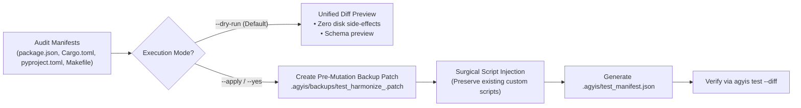

<!-- SPDX-License-Identifier: Apache-2.0 -->
<!-- Copyright (c) 2026 Arafat Zahan (@kuasha420) -->
<!-- Corporate Stewardship & Infrastructure: Purrfect Software Limited (PSL) -->
<!-- Governed by: ICARO-42/b Ordinance (Company-Supported Personal IP Framework) -->

# Dedicated Project Test Harmonization Protocol (`psl-test-harmonize`)

This skill codifies the operational protocol for inspecting, auditing, and harmonizing test runners and project manifests into the **Diff-Aware Affected Testing Architecture** (`agyis test --harmonize`). It eliminates synthetic tautological verification (e.g. 1,150 tests passing with 0% UI mounting) and equips workspaces with tiered test dispatch capabilities.

## Table of Contents
1. [When to Use](#1-when-to-use)
2. [Safe Dual-Mode Harmonization Lifecycle](#2-safe-dual-mode-harmonization-lifecycle)
3. [Standardized Test Script Conventions](#3-standardized-test-script-conventions)
4. [Polyglot Manifest Ingestion and Injection](#4-polyglot-manifest-ingestion-and-injection)
5. [Anti-Synthetic Runner Upgrades](#5-anti-synthetic-runner-upgrades)
6. [The Harmonization Manifest](#6-the-harmonization-manifest)
7. [Operational Verification](#7-operational-verification)

---

## 1. When to Use

Trigger this skill whenever:
- A workspace lacks diff-targeted test execution (`test:diff`, `test:affected`).
- An agent suffers consecutive test failure loops or token burn due to running full macro suites (>90s) on single-line edits.
- Frontend components are imported as raw JavaScript/TypeScript functions in Node without an authentic DOM mounting lifecycle (`happy-dom`, `jsdom`, or `@testing-library/react`).
- Visual Regression Testing (VRT) uses synthetic file existence checks (`fs.existsSync(file) == true`) rather than authentic pixel diffing (`toHaveScreenshot()`).
- Monorepos lack package-scoped test commands (`test:pkg`).
- Preparing a repository for multi-agent delegation pipelines (`/subagent-router`, `/teamwork-preview`) or milestone handoff gates.

---

## 2. Safe Dual-Mode Harmonization Lifecycle

To prevent unintended configuration drift, `psl-test-harmonize` mandates a safe dual-mode mutation protocol:



### Phase 1: Inspection & Diff Preview (Default)
Run a non-destructive audit of the workspace test configuration:

```bash
# Non-destructive dry-run preview (default behavior)
agyis harmonize test

# Explicit dry-run with structured JSON output
agyis harmonize test --dry-run --json
```

Guarantees:
1. **Zero Filesystem Mutation**: Target manifests remain byte-for-byte identical.
2. **Unified Diff Inspection**: Emits standard unified diff previews showing exactly which scripts or config blocks would be inserted.
3. **Gap Enumeration**: Explicitly catalogs missing tiers, fake mocks, and missing DOM environments.

### Phase 2: Safe Application & Pre-Mutation Patching
When ready to apply changes, execute with `--apply` or `--yes` (`-y`):

```bash
# Apply harmonization with automated backup patch creation
agyis harmonize test --apply

# Non-interactive application for agent subshells
agyis harmonize test --yes
```

**Automated Safety Guarantees**:
1. **Pre-Mutation Backup Patch**: Before any file is modified, a unified diff patch is written to `.agyis/backups/test_harmonize_<timestamp>.patch`.
2. **Custom Script Preservation Invariant**: Pre-existing custom scripts (e.g. specialized `test`, `test:e2e`, or custom `test:diff`) are NEVER overwritten. Only missing standardized scripts are appended.
3. **Format Integrity**: Preserves exact indentation, line endings, and file formatting of `package.json`, `Cargo.toml`, `pyproject.toml`, and `Makefile`.
4. **Manifest Synchronization**: Generates `.agyis/test_manifest.json` documenting supported test tiers.

---

## 3. Standardized Test Script Conventions

The protocol standardizes five canonical script tiers across all language stacks:

| Tier | Script Name | Target Scope | Execution Contract | Primary Consumer |
|---|---|---|---|---|
| **Tier 1A** | `test:diff` | Uncommitted working tree diffs (`git diff HEAD`) | Sub-second (<1.0s) related test run | Autonomous Agent turns & CI pre-commit hooks |
| **Human** | `test:watch` | Interactive file-watching loop | Long-running interactive process | Human engineers (Agents guarded via `--no-watch`) |
| **Tier 1B** | `test:affected` | Complete feature/bugfix blast radius | Runs unit, integration, DOM mounting, and affected VRTs | Subagent delegation handoffs & milestone completion |
| **Tier 2A** | `test:pkg` | Package boundary in monorepos | Scoped package suite (`--filter <pkg>`) | Monorepo feature engineers |
| **Tier 2B** | `test:full` | Complete repository / workspace | Unfiltered macro sweep (clean cache, all suites) | Final atomic git commit & PR publication gates |

---

## 4. Polyglot Manifest Ingestion and Injection

Harmonization inspects stack manifests and injects standardized `test:diff`, `test:watch`, `test:affected`, `test:pkg`, and `test:full` targets without overwriting pre-existing custom scripts:
- **Node / TypeScript (`package.json`, `pnpm-workspace.yaml`)**: Configures `vitest` (`vitest related --run` / `vitest run`), `jest` (`jest --findRelatedTests --passWithNoTests` / `jest --runInBand`), or monorepo `pnpm` / `turbo` workspace filters.
- **Rust (`Cargo.toml`, `.cargo/config.toml`)**: Adds `test-diff`, `test-watch`, `test-pkg`, and `test-full` cargo aliases.
- **Python (`pyproject.toml`, `pytest.ini`, `Makefile`)**: Configures `[tool.pytest.ini_options]` and `Makefile` targets (`pytest --picked -q`, `ptw`, `pytest -v`).

For exact polyglot JSON/TOML/Makefile templates, see [Templates, Runner Upgrades, and Manifest Schema](references/templates-and-manifest.md).

---

## 5. Anti-Synthetic Runner Upgrades

1. **Eliminating 0% UI Mounting**: When React, Vue, or Svelte is detected, upgrade `vitest.config.ts` `test.environment` to `'happy-dom'` or `'jsdom'` and require `@testing-library/react` (`render(<Component />)`).
2. **Pixel-Based Visual Regression Testing (VRT)**: Ban synthetic `expect(fs.existsSync('screenshot.png')).toBe(true)`; require `await expect(page).toHaveScreenshot(...)` with `maxDiffPixelRatio`.
3. **Computed Style & Contrast Auditing**: Enforce `@axe-core/playwright` (`injectAxe`, `checkA11y`) in real browser viewports.

Full configuration and test snippets are documented in [Templates, Runner Upgrades, and Manifest Schema](references/templates-and-manifest.md#2-anti-synthetic-runner-snippets).

---

## 6. The Harmonization Manifest

Applying harmonization generates `.agyis/test_manifest.json` capturing `stack`, `role`, `framework`, `package_manager`, `backup_patch`, tier metadata (`tier_1a_diff`, `tier_1b_affected`, `tier_2b_full`), `human_loop` guards (`--no-watch CI=true`), and `ui_mounting` (`happy-dom`) for `agyis test` and `completion_fence_hook` (full JSON schema in [Templates, Runner Upgrades, and Manifest Schema](references/templates-and-manifest.md#3-agyistest_manifestjson-example-schema)).

---

## 7. Operational Verification

```bash
# 1. Preview harmonization
agyis harmonize test --dry-run

# 2. Apply harmonization and generate manifest
agyis harmonize test --apply

# 3. Verify backup patch creation
ls -la .agyis/backups/test_harmonize_*.patch

# 4. Execute Tier 1A diff test
agyis test --diff

# 5. Check completion fence status
agyis status
```
