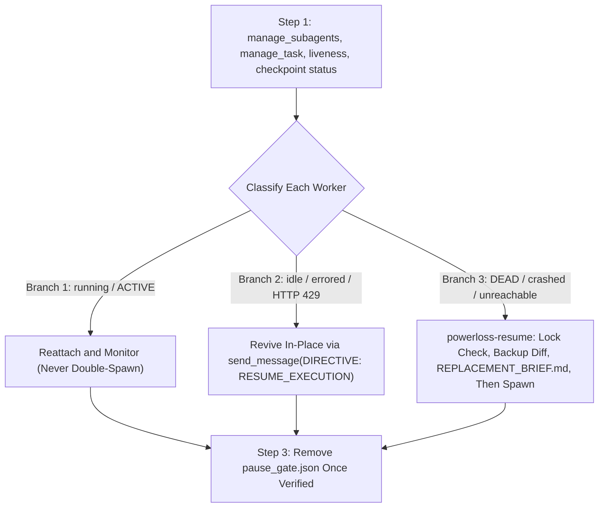

<!-- SPDX-License-Identifier: Apache-2.0 -->
<!-- Copyright (c) 2026 Arafat Zahan (@kuasha420) -->
<!-- Corporate Stewardship & Infrastructure: Purrfect Software Limited (PSL) -->
<!-- Governed by: ICARO-42/b Ordinance (Company-Supported Personal IP Framework) -->

# Live-First Resumption Runbook (`/resume`)

This operational runbook governs safe continuation of paused, rate-limited, compacted, or crash-interrupted sessions when the operator invokes `/resume`. Its core discipline is **inspect live reality first, preserve warm context whenever possible, and never double-spawn or wipe uncommitted work**.

## Table of Contents
1. [Core Resumption Invariants](#1-core-resumption-invariants)
2. [Step 1 Mandatory Live Roster and Checkpoint Audit](#2-step-1-mandatory-live-roster-and-checkpoint-audit)
3. [Step 2 3-Branch Live Subagent Triage](#3-step-2-3-branch-live-subagent-triage)
4. [Step 3 Pause Gate Removal and Execution Continuation](#4-step-3-pause-gate-removal-and-execution-continuation)

---

## 1. Core Resumption Invariants

1. **Mandatory Inspect-Before-Spawn Ordering**: NEVER spawn new subagents, create replacement workers, or delete `.agents/artifacts/pause_gate.json` before executing the Step 1 live roster audit.
2. **Zero Double-Spawn Invariant**: If a worker is already `running` or `ACTIVE`, reattach and monitor it. Spawning a duplicate worker against the same branch or file scope causes merge collisions and wasted quota.
3. **Warm Context Preservation**: An `idle` or `errored` subagent (such as one interrupted by HTTP `429` quota exhaustion or transient API rate limits) retains its warm conversation history. Always revive it in-place via `send_message` before considering a cold replacement.
4. **Zero Destructive Recovery**: NEVER run `git checkout -- .`, `git reset --hard`, `git clean -fd`, `kill -9`, `pkill -9`, or `swarm(action='kill')` during resumption or crash recovery.

---

## 2. Step 1 Mandatory Live Roster and Checkpoint Audit

**MANDATORY FIRST CALL**: Execute all four discovery commands **before** spawning any worker or removing any pause gate:

1. `manage_subagents(Action='list')` — enumerate live child subagent UUIDs and current platform state (`running`, `idle`, `errored`).
2. `manage_task(Action='list')` — inspect surviving background shell tasks and daemons.
3. `agyis subagents --liveness` — classify heartbeat freshness (`ACTIVE`, `STALE`, `PARKED`, `DEAD`).
4. `agyis checkpoint status` — verify the latest carrier-grade checkpoint and compaction state.

Immediately read supporting workspace state (read-only):
- `.agents/artifacts/pause_gate.json` (confirm whether `"status"` is `"paused"` or `"pausing"`).
- `PARKED_STATE.md` (`.agents/artifacts/PARKED_STATE.md` or `.agents/teamwork/PARKED_STATE.md`).
- `git status -s` and active `handoff.md` / `progress.md` ledgers.

---

## 3. Step 2 3-Branch Live Subagent Triage



Classify every discovered subagent into exactly one branch:

### Branch 1: `running` / `ACTIVE` — Reattach and Monitor
- **Do NOT spawn a replacement** and do **NOT** kill the worker.
- Reattach to the live worker: send a lightweight non-disruptive status probe via `send_message` if clarification is needed, or simply await reactive wakeup (`swarm_wait` or turn completion).
- Confirm its active file scope matches the plan and let it finish its in-flight turn.

### Branch 2: `idle` / `errored` (e.g., HTTP `429` Quota Exhaustion) — Revive In-Place
- **Preserve warm context**: do not discard an `idle` or `errored` subagent that failed due to transient rate limiting (`429`), network hiccups, or `/pause` quiescence.
- Revive the existing subagent in-place via `send_message`:
  ```markdown
  [DIRECTIVE: RESUME_EXECUTION]
  Reason: Operator invoked /resume (in-place warm revival).
  Context Anchors:
  - Parked Ledger: PARKED_STATE.md
  - Checkpoint: <checkpoint-id from agyis checkpoint status>
  - Worker Handoff: <path to handoff.md / progress.md>
  Instructions:
  1. Re-verify your working tree with `git status -s` and read your latest handoff.md.
  2. Resume from the exact next unfinished atomic step without redoing completed work.
  3. Reply via send_message confirming resumption.
  ```
- Await reactive confirmation from each revived subagent. Escalate to Branch 3 only if the subagent is confirmed unreachable or unrecoverable.

### Branch 3: `DEAD` / Crashed / Unreachable — Non-Destructive `powerloss-resume` Recovery
When a subagent is confirmed `DEAD`, crashed after power loss, or permanently unreachable, execute the non-destructive recovery sequence from `powerloss-resume`:
1. **Stale Git Lock Check**: If `.git/index.lock` exists, verify that no live `git` PID holds the lock (confirm the git process is dead) **before** unlinking `.git/index.lock`.
2. **Non-Destructive Backup Snapshot**: Before touching code or spawning a replacement, snapshot the workspace into `.agents/teamwork/backups/`:
   ```bash
   BACKUP_DIR=".agents/teamwork/backups/resume_$(date +%Y%m%d_%H%M%S)"
   mkdir -p "$BACKUP_DIR"
   git status -s > "$BACKUP_DIR/git_status.txt"
   git diff > "$BACKUP_DIR/git_diff_backup.patch"
   ```
   Copy any dead worker `handoff.md`, `progress.md`, or scratch notes into `$BACKUP_DIR`.
3. **Author `REPLACEMENT_BRIEF.md`**: Write `REPLACEMENT_BRIEF.md` inside `$BACKUP_DIR` (and/or the worker's teamwork folder) documenting the interrupted milestone, backup snapshot path, observed test state, and exact remaining tasks.
4. **Spawn Replacement Only After Snapshot**: Launch a replacement worker **only after** `git_diff_backup.patch`, `git_status.txt`, and `REPLACEMENT_BRIEF.md` exist on disk, passing `REPLACEMENT_BRIEF.md` as its context anchor.
5. **Safe Hygiene**: Run `agyis clean` to prune expired scratch debris without deleting working assets or backups.

---

## 4. Step 3 Pause Gate Removal and Execution Continuation

1. **Verified Readiness Gate**: Remove `.agents/artifacts/pause_gate.json` (and `.pause_gate` if present) **only after**:
   - All `running` / `ACTIVE` workers are accounted for,
   - All `idle` / `errored` workers targeted for in-place revival have acknowledged `[DIRECTIVE: RESUME_EXECUTION]`, and
   - Any `DEAD` workers have been backed up to `.agents/teamwork/backups/` with `REPLACEMENT_BRIEF.md`.
2. **Update State Ledger**: Mark `PARKED_STATE.md` as resumed (recording timestamp and triage outcome for every worker) or archive it alongside the resume briefing.
3. **Resume Active Milestone**: Report the concise 3-branch triage summary to the operator (`reattached`, `revived in-place`, `replaced after backup`) and continue the active milestone plan.

### Cross-Session Baton Recovery (`/crosstalk`)
- When resuming from a cross-thread or cross-project baton rather than an in-place checkpoint, run `agyis crosstalk status --json` and `agyis crosstalk inspect <cid> --steps 20` to recover origin context cleanly before spawning workers.
