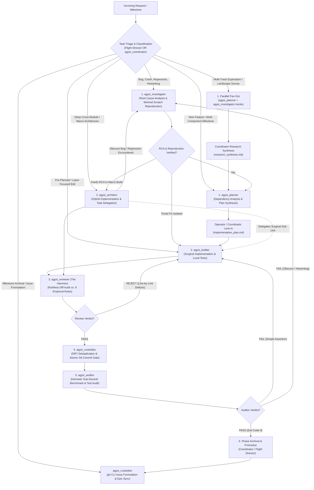

<!-- SPDX-License-Identifier: Apache-2.0 -->
<!-- Copyright (c) 2026 Arafat Zahan (@kuasha420) -->
<!-- Corporate Stewardship & Infrastructure: Purrfect Software Limited (PSL) -->
<!-- Governed by: ICARO-42/b Ordinance (Company-Supported Personal IP Framework) -->

# Subagent Router: Dynamic Multi-Agent SWE Execution Protocol 🤖🧭

The **Subagent Router** (formerly known as `subagent-ladder`) formalizes the dynamic multi-agent execution engine for complex software engineering milestones, architectural refactorings, and multi-node delivery campaigns in Agyis Harness.

Rather than enforcing a rigid 1-dimensional waterfall, the Subagent Router dynamically routes engineering tasks through specialized `agyis_*` agents across **12 canonical workflows** and **4 distinct execution modes** (Sequential Quality Gates, Parallel Fan-Out, Native Teamwork Task DAGs, and Tournament Boosts).

> [!NOTE]
> **Invocation Contracts**:
> - **Upstream Cockpit Dispatch**: Naturally dispatched downstream by the **Cockpit Flight Director** (`cockpit-director`) via typed stage transition payloads (`psl_stage_transition_payload.json`).
> - **Operator / Manual Engagement**: Can also be engaged directly by human operators using `/subagent-router` (or legacy `/subagent-ladder`), or via `agyis cockpit route <letter>`.
> - **Specialist Orchestration**: Coordinated by `agyis_coordinator` (for assembly lines and research fan-outs) or `agyis_architect` (for cross-module overhauls).

---

## 1. Architectural Rationale & Dual-Sovereignty Model

Complex engineering initiatives easily cause **conversational context collapse** when executed in a single monolithic context window. Accumulated tool outputs, compile logs, and search results bloat context, degrade instruction following, and incur exponential token costs.

The Subagent Router enforces the **Dual-Sovereignty Principle** (Cognition vs. Harness):
- **Cognition governs reasoning, intent, and architectural synthesis**: Role-pinning mental models, falsifiable root-cause hypotheses, surgical laser implementation, and dual-auditor certification.
- **The Harness governs boundaries, state verification, and physical execution guarantees**: Deterministic pre-tool-use write blocks for read-only agents, terminal command safety, output compaction (<2KB), and completion fence verification gates.

Key cognitive benefits include:
1. **Zero Context Carryover**: Subagents operate in lean, task-focused contexts (<50k tokens), preserving high reasoning capability and deterministic instruction following.
2. **Cognitive Role Isolation**: Separates the builder from the reviewer. An agent that writes code never reviews or audits its own diffs.
3. **Hermetic State Preservation**: High-level milestone state, plan artifacts, and empirical test logs are preserved in persistent markdown documents, resilient to conversational compaction or session resets.
4. **Anti-Anchoring Invariant**: Reviewers and auditors approach incoming diffs skeptically to break them with real repository tests rather than passively confirming prior attempts.

---

## 2. Autonomous Routing Architecture & 12-Workflow Decision Table

The Subagent Router provides dynamic, autonomous routing across specialized `agyis_*` agents based on the operational profile of the incoming task.

### 2.1 Autonomous Routing Flowchart



### 2.2 The 12-Workflow Decision Table

Calibrated across empirical telemetry, the 12 canonical workflows define the optimal agent sequence, invariants, and primary deliverables for any engineering objective:

| Workflow Profile & Signature | Starting Specialist | Pipeline Route | Critical Invariants & Tool Boundaries | Primary Deliverable Artifact | Empirical Precedent |
| :--- | :--- | :--- | :--- | :--- | :--- |
| **A. Bug Report / Test Regression / Silent Failure** | `agyis_investigator` | `Investigator` $\rightarrow$ `Planner` $\rightarrow$ `Builder` $\rightarrow$ `Reviewer` $\rightarrow$ `Custodian` $\rightarrow$ `Auditor` | **Strict Read-Only on Code**: Must author a deterministic reproduction script in scratch (`scratch/reproduce_*.py`) before writing any fix. | `rca_report.md` + `reproduce_bug.py` | Live debugging of `/compact` interceptor bug (Steps 3580–3634) |
| **B. New Feature / Multi-File Milestone** | `agyis_planner` | `Planner` $\rightarrow$ `Coordinator Lock-In` $\rightarrow$ `Builder` $\rightarrow$ `Reviewer` $\rightarrow$ `Custodian` $\rightarrow$ `Auditor` | **Zero Speculative Code**: Evaluates imports, architecture, and contracts without touching source code. Drafts interactive implementation plan. | `implementation_plan.md` | Epic #51 Phase 3.1 & Phase 3.3 planning |
| **C. Well-Defined Single-Phase Task** | `agyis_builder` | `Builder` $\rightarrow$ `Reviewer` $\rightarrow$ `Custodian` $\rightarrow$ `Auditor` | **Laser Executioner**: Single contiguous replacements (`replace_file_content`). Zero scope creep. Self-verifies locally. | In-flight diff + local test pass | Native slash command bypass patch (`f13e63f`) |
| **D. Cross-Module Architectural Overhaul** | `agyis_architect` | `Architect` (delegates sub-parts) $\rightarrow$ `Reviewer` $\rightarrow$ `Custodian` $\rightarrow$ `Auditor` | **Deep Hybrid Orchestration**: Combines implementation with delegation to `agyis_planner` and `agyis_builder` to prevent context bloating past 50k tokens. | Clean multi-module pull request / diff | Issue #87 Subagent Ladder domain decoupling (`a71c104`) |
| **E. Heisenbug during Auditor QA Gate** | `agyis_investigator` | `Auditor (FAIL)` $\rightarrow$ `Investigator (RCA)` $\rightarrow$ `Builder (Fix)` $\rightarrow$ `Reviewer` $\rightarrow$ `Custodian` $\rightarrow$ `Auditor` | **Anti-Bypass Invariant**: Under no circumstances may an Auditor failure bypass Hammer re-review or Custodian commit gate after being remediated. | `heisenbug_rca.md` | SQLite WAL concurrency contention debugging |
| **F. Obscure Regression during Macro Build** | `agyis_architect` | `Architect` $\rightarrow$ `Investigator (RCA)` $\rightarrow$ `Architect` $\rightarrow$ `Reviewer` $\rightarrow$ `Custodian` $\rightarrow$ `Auditor` | **Architect-to-Investigator Delegation**: When encountering unexpected side-effects or mysterious test breaks during macro refactoring, `agyis_architect` pauses and delegates RCA to `agyis_investigator` instead of guess-editing. | `scratch/reproduce_*.py` + `rca_report.md` | PreInvocation locked DB handling |
| **G. Multi-Track Parallel Research / Landscape Mapping** | `agyis_coordinator` | `Coordinator` $\rightarrow$ Fan-out parallel `agyis_planner` / `agyis_investigator` $\rightarrow$ `Coordinator Synthesis` | **Context Preservation (ADR-025)**: Independent research tracks run in parallel contexts without cross-contamination. Results chiseled into persistent markdown. | `research_synthesis.md` / `track_*.md` | Epic Research Kickoff (Steps 5–17: 4 parallel research tracks) |
| **H. Cleanroom Specification Audit & Gap Ledger** | `agyis_investigator` | `Investigator` (Cleanroom Auditor) $\rightarrow$ `Coordinator` $\rightarrow$ `Builder` / `Swarm` | **Zero Production Mutation**: Evaluates baseline revision line-by-line against formal ACs. Documents gaps in `COMPLETION_LEDGER.md`. | `COMPLETION_LEDGER.md` | Issue #83 Route C Baseline Audit (Step 2488) |
| **I. Cross-Branch Golden Merge & Reconciliation** | `agyis_architect` | `Architect` (Synthesizer) $\rightarrow$ `Reviewer` $\rightarrow$ `Custodian` $\rightarrow$ `Auditor` | **Hermetic Worktree Isolation**: Reconciles divergent branches in dedicated worktree (`agyis-golden-merge`). Runs cross-test matrix. | Golden commit on unified feature branch | Epic #51 Phase 3.1 Route A vs Route B Golden Merge (Steps 1505 & 1603) |
| **J. Out-of-Band Victory Certification Council** | `agyis_auditor` + `agyis_reviewer` | `Auditor` (Hermetic Benchmarks) + `Reviewer` (8 Rules) $\rightarrow$ Dual Sign-Off | **Dual-Auditor Gate**: Never trust in-band self-certification. Independent auditors evaluate clean committed revision on HEAD. | `victory_audit_report.md` | Route A, B, and C Victory Audits (Steps 993, 2106, 3634, 3781) |
| **K. Milestone Governance & GitHub Issue Curation** | `agyis_custodian` | `Flight Director` / `Coordinator` $\rightarrow$ `Custodian` (Issue Formulation & Epic Sync via `gh` CLI) | **Zero Repository Document Pollution (AC5)**: Strictly zero scratch or progress notes in git tree; deterministic CLI execution; formal parent Epic checklist and comment updates verified via `gh issue view`. | GitHub Issues + Parent Epic Tracking Comment | Phase 3.3 GitHub Issue Harmonizer (Step 2095: Created #83, #84, #85 and synced Epic #51) |
| **L. Adversarial Fuzzing & Stress Hardening Battery** | `agyis_builder` / `agyis_investigator` | `Investigator` (Fuzzing Vectors) $\rightarrow$ `Builder` (Adversarial Tests) $\rightarrow$ `Reviewer` $\rightarrow$ `Custodian` $\rightarrow$ `Auditor` | **Zero Error Swallowing & Sub-Second SLA**: Stress tests (concurrency lock timeout $\le 0.5$s, schema corruption, rapid token bursts, stdin binary stream noise) must execute cleanly in sub-second latency and fail-open. | `tests/test_*_adversarial.py` | Route C Carrier-Grade Hardening (Step 2990: 4 adversarial hardening vectors) |

---

## 3. The 6-Stage Pipeline Lifecycle

Every engineering milestone progressing through the sequential execution path advances through the **6-Stage Pipeline**:

```
┌─────────────────────────────────────────────────────────────────────────┐
│ STAGE 1: PLANNING & OPERATOR LOCK-IN (`agyis_coordinator` / `agyis_planner`) │
│ - `agyis_planner` synthesizes architecture into `implementation_plan.md`.│
│ - Operator reviews, grills, refines, and formally locks in the plan.    │
└────────────────────────────────────┬────────────────────────────────────┘
                                     │ (Approved)
                                     ▼
┌─────────────────────────────────────────────────────────────────────────┐
│ STAGE 2: SURGICAL EXECUTION (`agyis_builder` / `agyis_architect`)       │◄────────────────────────┐
│ - `agyis_builder` applies surgical contiguous edits (`replace_file_content`). │                     │
│ - Local self-verification via native tests (<1.0s benchmark invariant).  │                         │
│ - Produces diff summary and local test pass.                            │                         │
└────────────────────────────────────┬────────────────────────────────────┘                         │
                                     │ (Execution Complete OR Remedy Complete)                      │
                                     ▼                                                              │
┌─────────────────────────────────────────────────────────────────────────┐                         │
│ STAGE 3: CODE REVIEW & QUALITY AUDIT (`agyis_reviewer` - The Hammer)    │                         │
│ - Independent agent audits diff against 8 Canonical Empirical Rules.    │                         │
│ - Zero Error Swallowing Invariant & Zero Self-Certification.            │                         │
│ - Emits PASS verdict OR Defect Ledger with file/line/rule citations.   │                         │
└────────────────────────────────────┬────────────────────────────────────┘                         │
                                     │                                                              │
         ┌───────────────────────────┴───────────────────────────┐                                  │
         │ (Passed Code Review)                                  │ (Rejected: Defect Ledger)        │
         ▼                                                       └──────────────────────────────────┤
┌─────────────────────────────────────────────────────────────────────────┐                         │
│ STAGE 4: GIT COMMIT GATE & REPOSITORY HYGIENE (`agyis_custodian`)       │                         │
│ - DRY Deduplication Audit: sweeps repo to ensure no duplicated helpers. │                         │
│ - Stages ONLY target files declared in approved plan (no blind `git add`).│                         │
│ - Asserts working tree is 100% clean of scratch debris (AC5).           │                         │
│ - Executes atomic commit on HEAD.                                       │                         │
└────────────────────────────────────┬────────────────────────────────────┘                         │
                                     │ (Committed Cleanly)                                          │
                                     ▼                                                              │
┌─────────────────────────────────────────────────────────────────────────┐                         │
│ STAGE 5: HERMETIC QA & VERIFICATION AUDIT (`agyis_auditor`)             │                         │
│ - Strictly evaluates the COMMITTED git revision on HEAD (never dirty).  │                         │
│ - Runs project native test suite (`agyis test`, `pnpm test`, etc.).     │                         │
│ - Asserts exit code 0 and sub-second benchmark latency (<1.0s SLA).     │                         │
└──────────────────┬───────────────────────────────┘                                                │
                   │                                                                                │
         ┌─────────┴─────────┐                                                                      │
         │ (Passed QA Audit) │ (QA/Audit Failed)       ─────────────────────────────────────────────┘
         │                   │                                 (MANDATORY: Return to Builder/Investigator,
         ▼                   │                                 THEN through Hammer!)
┌────────────────────────────┴────────────────────────────────────────────┐
│ STAGE 6: PHASE ARCHIVAL & PROMOTION (`cockpit_director` / `agyis_coordinator`) │
│ - Archives milestone plan into `.agents/artifacts/phase_X_delivery.md`. │
│ - Records milestone completion in `docs/taxonomy/project-ledger.md`.     │
│ - Subagents for completed phase are formally retired.                   │
│ - Presents Phase X+1 Implementation Plan to user.                       │
└─────────────────────────────────────────────────────────────────────────┘
```

---

## 4. Multi-Node Swarm PR Ingestion Protocol

When coordinating distributed campaigns across parallel feature worktrees, multi-agent branches, or remote contributor PRs:

### 4.1 Distributed PR & Branch Discovery
Subagents or external contributors push branches or open Pull Requests asynchronously. The Router coordinator discovers and ingests remote PRs using GitHub CLI (`gh`):
```bash
# Ingest open PRs across fleet
gh pr list --state open --json number,title,headRefName,author,updatedAt

# Inspect specific PR diff
gh pr diff <pr_number>
```

### 4.2 Swarm Ingestion Lifecycle
1. **Branch Fetch & Isolation**: Coordinator fetches feature / subagent worktrees into dedicated tracking branches (`git fetch origin pull/<id>/head:pr-<id>`).
2. **Phase Partitioning**: Coordinator maps ingested PR branches to Router milestones in `implementation_plan.md`.
3. **Router Verification Sweep**:
   - `agyis_builder`: Integrates or rebases branch changes cleanly against upstream HEAD.
   - `agyis_reviewer`: Audits multi-agent diffs against PSL invariants (The Hammer).
   - `agyis_custodian`: Re-verifies clean staging, enforces AC5, and executes DRY deduplication check across merged modules.
   - `agyis_auditor`: Executes local hermetic tests (`agyis test`).
4. **Automated Review Approval**: On Auditor PASS, Coordinator approves or merges the PR via `gh pr merge --squash` or `gh pr review --approve`.

---

## 5. Strict State Machine Invariants

### 5.1 Anti-Bypass Invariant (Zero Shortcuts)
> [!CAUTION]
> If `agyis_auditor` detects a failure and `agyis_builder` produces a remedy patch:
> $$\text{Auditor FAIL} \longrightarrow \text{Builder (Remedy)} \longrightarrow \mathbf{Reviewer\ (The\ Hammer\ Re\text{-}Review)} \longrightarrow \mathbf{Custodian\ (Commit\ Gate)} \longrightarrow \text{Auditor (QA)}$$
> **Under NO circumstances may an Executioner remedy bypass Hammer review or Custodian commit gate.** An implementer fixing an edge case under test failure pressure is prone to introducing error-swallowing constructs or artificial mocks. Auditor must audit strictly the clean, committed revision.

### 5.2 Zero Coordinator Remediation Invariant
> [!CRITICAL]
> The Coordinator (`agyis_coordinator`) is **strictly forbidden from modifying product code, patching files directly, or self-resolving review defects**.
> - The Coordinator orchestrates the ladder, manages persistent artifacts, and routes diagnostics.
> - Defect reports must be routed back to the designated `agyis_builder`.

### 5.3 Git Commit Gate & Custodian Mandate
> [!IMPORTANT]
> The Custodian (`agyis_custodian`) is the sole entity authorized to stage and commit milestone deliverables.
> - **DRY & Code Deduplication Audit**: Custodian sweeps repo to verify new helpers do NOT duplicate existing logic.
> - **Clean Revision Invariant**: The Auditor must certify a **committed git revision**, never a volatile, dirty working tree.
> - **Atomic Staging**: Deliberately stage only files specified in the approved implementation plan. Blind `git add .` is prohibited.
> - **Zero Scratch Debris (AC5)**: Telemetry databases, temporary logs, and scratch artifacts must never be staged into version control.
> - **Zero Direct Code Mutation**: The Custodian cannot modify product or test code (`write: false`).

---

## 6. The 4 Multi-Agent Execution Modes

The Subagent Router supports 4 distinct execution topologies:

1. **`LADDER` (Sequential Specialist Quality Gates)**:
   - The default sequential path: `Builder -> Reviewer -> Custodian -> Auditor`.
   - Used for production code modifications where independent quality gates prevent regression.
2. **`PARALLEL_FANOUT` (Coordinator Diagnostic Exploration)**:
   - Used for Workflow G (Multi-Track Parallel Research).
   - `agyis_coordinator` dispatches parallel read-only planners and investigators in isolated contexts.
   - Findings are chiseled into persistent reports and synthesized by the Coordinator.
3. **`TEAMWORK_DAG` (Native `/teamwork-preview` Task Graphs)**:
   - Native Antigravity multi-agent directed acyclic graph (DAG).
   - Spawns parallel worker worktrees under `.agents/teamwork/<agent_name>/`.
   - Liveness is tracked via `progress.md` heartbeats.
4. **`BOOST_TOURNAMENT` (Native `/boost` Multi-Perspective Synthesis)**:
   - Native Antigravity tournament mode pairing DeepCoder (`owl`) and DeepInvestigator.
   - Evaluates alternative architectural solutions through competitive reasoning before synthesis.

---

## 7. Interactive CLI Routing Integration & Swarm Monitoring

```bash
# 🛫 Canonical Workflow Routing
agyis router <route>                          # Dynamic subagent router CLI alias (e.g., agyis router victory)
agyis ladder <route>                          # Backwards-compatible router CLI alias (e.g., agyis ladder builder)
agyis cockpit route A                         # Route Workflow A (Bugfix / RCA)
agyis cockpit route B                         # Route Workflow B (New Feature Milestone)
agyis cockpit route <letter|alias>            # Route by letter (A–L) or alias (rca, builder, victory)
agyis cockpit route <letter> --json           # Machine-readable dispatch payload template

# 📋 View Registered Workflows & Execution Modes
agyis cockpit status                          # Flight deck overview & active subagents

# 🩺 Swarm Liveness & Delegate Monitoring Loops
agyis subagents --liveness                    # Deterministic delegate heartbeat inspection & liveness audit
agyis subagents --liveness --stale-threshold 300 # Detect stalled or dead workers in multi-agent swarms
agyis subagents --liveness --json             # Machine-readable liveness ledger for automated orchestration guards
```

### Swarm Monitoring Invariant
Orchestrators and coordinators must run `agyis subagents --liveness` in monitoring loops when awaiting delegate progress. If a delegate subagent stalls into `STALE` (>300s) or `DEAD` (>1800s) state without an active pause gate, the orchestrator must halt and intervene rather than hallucinating progress updates.
