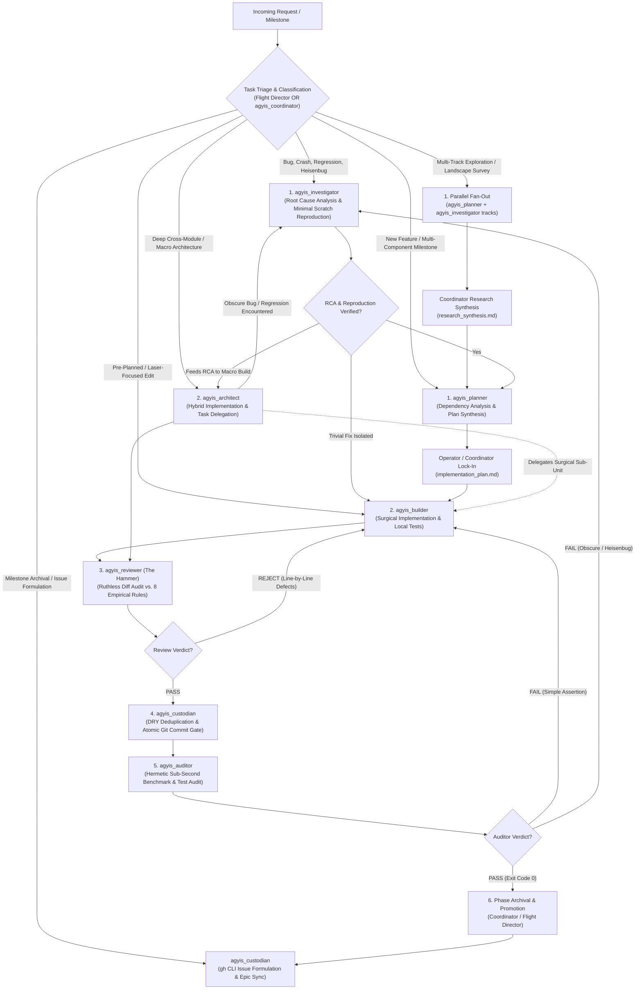

<!-- SPDX-License-Identifier: Apache-2.0 -->
<!-- Copyright (c) 2026 Arafat Zahan (@kuasha420) -->
<!-- Corporate Stewardship & Infrastructure: Purrfect Software Limited (PSL) -->
<!-- Governed by: ICARO-42/b Ordinance (Company-Supported Personal IP Framework) -->

# Workflow Routing Table & Decision Matrix

## 1. Visual Specialist Routing Topology

---

## 2. The 12 Canonical Workflow Decision Table

Calibrated across empirical telemetry, the 12 canonical workflows define the optimal agent sequence, invariants, and primary deliverables for any engineering objective:

| Workflow Profile & Signature | Starting Specialist | Pipeline Route | Critical Invariants & Tool Boundaries | Primary Deliverable Artifact | Empirical Precedent |
| :--- | :--- | :--- | :--- | :--- | :--- |
| **A. Bug Report / Test Regression / Silent Failure** | `agyis_investigator` | `Investigator` $\rightarrow$ `Planner` $\rightarrow$ `Builder` $\rightarrow$ `Reviewer` $\rightarrow$ `Custodian` $\rightarrow$ `Auditor` | **Strict Read-Only on Code**: Must author a deterministic reproduction script in scratch (`scratch/reproduce_*.py`) before writing any fix. | `rca_report.md` + `reproduce_bug.py` | Live debugging of `/compact` interceptor bug (Steps 3580–3634) |
| **B. New Feature / Multi-File Milestone** | `agyis_planner` | `Planner` $\rightarrow$ `Coordinator Lock-In` $\rightarrow$ `Builder` $\rightarrow$ `Reviewer` $\rightarrow$ `Custodian` $\rightarrow$ `Auditor` | **Zero Speculative Code**: Evaluates imports, architecture, and contracts without touching source code. Drafts interactive implementation plan. | `implementation_plan.md` | Epic #51 Phase 3.1 & Phase 3.3 planning |
| **C. Well-Defined Single-Phase Task** | `agyis_builder` | `Builder` $\rightarrow$ `Reviewer` $\rightarrow$ `Custodian` $\rightarrow$ `Auditor` | **Laser Executioner**: Single contiguous replacements (`replace_file_content`). Zero scope creep. Self-verifies locally. | In-flight diff + local test pass | Native slash command bypass patch (`f13e63f`) |
| **D. Cross-Module Architectural Overhaul** | `agyis_architect` | `Architect` (delegates sub-parts) $\rightarrow$ `Reviewer` $\rightarrow$ `Custodian` $\rightarrow$ `Auditor` | **Deep Hybrid Orchestration**: Combines implementation with delegation to `agyis_planner` and `agyis_builder` to prevent context bloating past 50k tokens. | Clean multi-module pull request / diff | Issue #87 Subagent Ladder domain decoupling (`a71c104`) |
| **E. Heisenbug during Auditor QA Gate** | `agyis_investigator` | `Auditor (FAIL)` $\rightarrow$ `Investigator (RCA)` $\rightarrow$ `Builder (Fix)` $\rightarrow$ `Reviewer` $\rightarrow$ `Custodian` $\rightarrow$ `Auditor` | **Anti-Bypass Invariant**: Under no circumstances may an Auditor failure bypass Hammer re-review or Custodian commit gate after being remediated. | `heisenbug_rca.md` | SQLite WAL concurrency contention debugging |
| **F. Obscure Regression during Macro Build** | `agyis_architect` | `Architect` $\rightarrow$ `Investigator (RCA)` $\rightarrow$ `Architect` $\rightarrow$ `Reviewer` $\rightarrow$ `Custodian` $\rightarrow$ `Auditor` | **Architect-to-Investigator Delegation**: When encountering unexpected side-effects or mysterious test breaks during macro refactoring, `agyis_architect` pauses and delegates RCA to `agyis_investigator` instead of guess-editing. | `scratch/reproduce_*.py` + `rca_report.md` | PreInvocation locked DB handling |
| **G. Multi-Track Parallel Research / Landscape Mapping** | `agyis_coordinator` | `Coordinator` $\rightarrow$ Fan-out parallel `agyis_planner` / `agyis_investigator` $\rightarrow$ `Coordinator Synthesis` | **Context Preservation (ADR-025)**: Independent research tracks run in parallel contexts without cross-contamination. Results chiseled into persistent markdown. | `research_synthesis.md` / `track_*.md` | Epic Research Kickoff (Steps 5–17: 4 parallel research tracks) |
| **H. Cleanroom Specification Audit & Gap Ledger** | `agyis_investigator` | `Investigator` (Cleanroom Auditor) $\rightarrow$ `Coordinator` $\rightarrow$ `Builder` / `Swarm` | **Zero Production Mutation**: Evaluates baseline revision line-by-line against formal ACs. Documents gaps in `COMPLETION_LEDGER.md`. | `COMPLETION_LEDGER.md` | Issue #83 Route C Baseline Audit (Step 2488) |
| **I. Cross-Branch Golden Merge & Reconciliation** | `agyis_architect` | `Architect` (Synthesizer) $\rightarrow$ `Reviewer` $\rightarrow$ `Custodian` $\rightarrow$ `Auditor` | **Hermetic Worktree Isolation**: Reconciles divergent branches in dedicated worktree (`agyis-golden-merge`). Runs cross-test matrix. | Golden commit on unified feature branch | Epic #51 Phase 3.1 Route A vs Route B Golden Merge (Steps 1505 & 1603) |
| **J. Out-of-Band Victory Certification Council** | `agyis_auditor` + `agyis_reviewer` | `Auditor` (Hermetic Benchmarks) + `Reviewer` (8 Rules) $\rightarrow$ Dual Sign-Off | **Dual-Auditor Gate**: Never trust in-band self-certification. Independent auditors evaluate clean committed revision on HEAD. | `victory_audit_report.md` | Route A, B, and C Victory Audits (Steps 993, 2106, 3634, 3781) |
| **K. Milestone Governance & GitHub Issue Curation** | `agyis_custodian` | `Flight Director` / `Coordinator` $\rightarrow$ `Custodian` (Issue Formulation & Epic Sync via `gh` CLI) | **Zero Repository Document Pollution (AC5)**: Strictly zero scratch or progress notes in git tree; deterministic CLI execution; formal parent Epic checklist and comment updates verified via `gh issue view`. | GitHub Issues + Parent Epic Tracking Comment | Phase 3.3 GitHub Issue Harmonizer (Step 2095: Created #83, #84, #85 and synced Epic #51) |
| **L. Adversarial Fuzzing & Stress Hardening Battery** | `agyis_builder` / `agyis_investigator` | `Investigator` (Fuzzing Vectors) $\rightarrow$ `Builder` (Adversarial Tests) $\rightarrow$ `Reviewer` $\rightarrow$ `Custodian` $\rightarrow$ `Auditor` | **Zero Error Swallowing & Sub-Second SLA**: Stress tests (concurrency lock timeout $\le 0.5$s, schema corruption, rapid token bursts, stdin binary stream noise) must execute cleanly in sub-second latency and fail-open. | `tests/test_*_adversarial.py` | Route C Carrier-Grade Hardening (Step 2990: 4 adversarial hardening vectors) |
